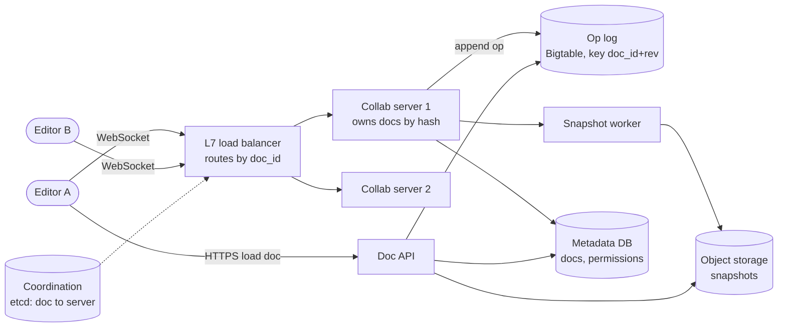
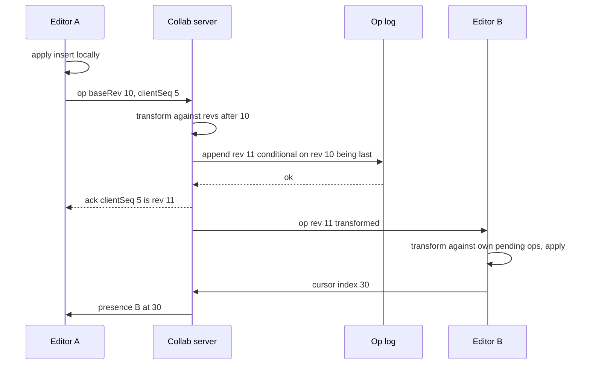

# Design Google Docs (Collaborative Editor)

## Requirements

**Functional**
1. Create, open and edit rich-text documents.
2. Multiple users edit the same document at the same time and see each other's changes in real time.
3. See other editors' cursors and selections, with their names.
4. View revision history (nice to have).

**Non-functional**
- **Convergence:** after everyone stops typing, every replica of the document is identical (eventual consistency), and each user's intent is preserved where possible.
- **Low latency:** your own keystrokes appear instantly (local apply); others' edits appear within ~100 ms in the same region.
- **Durability:** an edit acknowledged by the server is never lost.
- **Scale:** ~100M DAU, ~10M documents open at peak, usually 1–10 editors per document, with a cap (~100 concurrent editors) per document.

**Out of scope:** comments, suggestions mode, offline-first sync beyond short disconnects, spreadsheets.

### Back-of-envelope estimates

| Quantity | Estimate | Implication |
|---|---|---|
| Concurrent connections | ~10M open sessions | At ~100k WebSockets per server, ~100 collaboration servers |
| Edit rate | ~1M actively typing users × ~1 batched op/s (keystrokes grouped every ~200–500 ms) ≈ 1M ops/s | Op log must take ~1M small appends/s, sharded by `doc_id` |
| Op size | ~100 bytes | 1M × 100 B = 100 MB/s ≈ 8.6 TB/day of raw ops before compaction |
| Snapshot cadence | every ~1,000 ops | Loading a doc reads one snapshot plus ≤ 1,000 ops, not the full history |
| Document size | typical doc ~100 KB as snapshot | 1B docs × 100 KB = 100 TB of snapshots in object storage |

## Core entities

| Entity | Key fields | Store/Notes |
|---|---|---|
| Document | `doc_id`, `title`, `owner_id`, `current_rev`, `snapshot_rev` | Metadata DB (Postgres / Spanner) |
| Operation | (`doc_id`, `rev`) → `op` (insert/delete/format), `user_id`, `client_id`, `client_seq`, `ts` | Op log: Bigtable / Cassandra, partition key `doc_id`, clustering key `rev`; append-only |
| Snapshot | (`doc_id`, `rev`) → serialized document | Object storage (S3 / GCS), pointer in metadata |
| Permission | (`doc_id`, `user_id`) → `role` (owner / editor / commenter / viewer) | Metadata DB; cached at the collaboration server |
| Presence | `doc_id` → {`user_id`, `cursor`, `selection`, `color`} | In memory on the collaboration server only; never persisted |

## API

```
POST /v1/docs                  { title }        → 201 { docId }
GET  /v1/docs/{docId}                           → 200 { snapshot, rev, ops: [ops after snapshot] }
GET  /v1/docs/{docId}/revisions?cursor=         → 200 { revisions: [...], nextCursor }

WebSocket wss://collab.example.com/docs/{docId}?rev=1042   (auth via token)

client → server
  { type: "op", clientSeq: 17, baseRev: 1042, op: [{ retain: 5 }, { insert: "hi" }] }
  { type: "cursor", index: 7, selectionEnd: 7 }
server → client
  { type: "ack", clientSeq: 17, rev: 1043 }
  { type: "op", rev: 1044, userId: "u2", op: [...] }
  { type: "presence", userId: "u2", index: 30 }
  { type: "error", code: 403 }      (no edit permission)
```

- **`baseRev`** says which server revision the op was written against; the server transforms it against anything newer.
- **`clientSeq`** makes resends idempotent: after a reconnect the client resends unacknowledged ops, and the server skips any `(client_id, clientSeq)` it already applied.
- Ops use a retain/insert/delete format (as in OT libraries like ot.js and Quill's Delta), which is compact and transformable.
- Identity and permissions come from the token checked at WebSocket upgrade; viewers can receive ops but their op messages are rejected.

## High-level design



**Open flow**
1. The client calls `GET /docs/{id}`; the doc API returns the latest snapshot and the ops after it. The client builds the document locally at revision R.
2. It opens a WebSocket with `?rev=R`. The load balancer routes it to the collaboration server that owns this doc (see routing below); the server sends any ops after R.

**Edit flow**
3. The user types; the client applies the change locally at once, then sends the op with `baseRev`.
4. The server transforms the op against ops committed since `baseRev`, assigns the next revision, appends it to the op log, then acks the sender and broadcasts the transformed op to other editors.
5. Other clients transform the incoming op against their own unacknowledged ops and apply it.

**Background flow**
6. Every ~1,000 ops, a snapshot worker applies ops to the previous snapshot and writes a new one. Cursor updates go only through server memory.



## Deep dives

### OT versus CRDTs, explained

**The problem:** the document is "abc". Alice inserts "X" at index 1 (→ "aXbc"). At the same time Bob deletes index 2, the "c" (→ "ab"). If each simply applies the other's op as sent, Alice deletes index 2 of "aXbc", which removes "b", giving "aXc", while Bob inserts at 1 of "ab", giving "aXb". The replicas diverge.

#### How operational transformation (OT) works

OT adjusts an incoming op to account for concurrent ops already applied. For two ops created against the same state, `transform(a, b)` returns `a'` such that applying `b` then `a'` gives the same result as `a` then `b'`. Core rules for plain-text insert and delete:

```
transform(ins(p1, s), ins(p2, _)):   p1 < p2 or (p1 == p2 and tiebreak) → ins(p1, s) else ins(p1 + len, s)
transform(del(p1), ins(p2, s)):      p1 < p2 → del(p1) else del(p1 + len(s))
transform(ins(p1, s), del(p2)):      p1 <= p2 → ins(p1, s) else ins(p1 - 1, s)
transform(del(p1), del(p2)):         p1 < p2 → del(p1); p1 > p2 → del(p1 - 1); equal → no-op
```

Worked example with a central server (the Jupiter/Google Wave style that Google Docs uses: the server picks one order, so transforms only need to work pairwise):

| Step | Server log | Alice's doc | Bob's doc |
|---|---|---|---|
| Start, rev 0 | | abc | abc |
| Alice types ins(1,"X"), Bob types del(2), both locally | | aXbc | ab |
| Server receives Alice's op first (base 0): becomes rev 1 | rev1 = ins(1,"X") | aXbc | ab |
| Server receives Bob's del(2) with base 0; transform against rev 1: 2 ≥ 1, so del(3); becomes rev 2 | rev2 = del(3) | aXbc | ab |
| Alice receives rev 2 del(3) | | aXb | ab |
| Bob receives rev 1 ins(1,"X"); transform against his pending del(2): 1 ≤ 2, unchanged | | aXb | aXb |

Both converge to "aXb", and both intents survive: X is inserted after "a", and "c" is deleted. Each client keeps a queue of sent-but-unacked ops and transforms incoming server ops through that queue. Clients send one op at a time and wait for the ack before sending the next (buffering local edits meanwhile), which keeps the server's transform simple.

#### How CRDTs work

A sequence CRDT (RGA, YATA as used by Yjs, Automerge) avoids positions altogether. Every character gets a globally unique ID `(clientId, counter)`, and an insert says "put this character immediately after the character with ID L". Deletes mark the character as a tombstone instead of removing it, so later ops can still refer to it.

Same example: "a" = (s,1), "b" = (s,2), "c" = (s,3). Alice's op is `insert X id (A,1) after (s,1)`. Bob's op is `delete (s,3)`. These commute: whichever order a replica applies them, X ends up after "a" and "c" is tombstoned, giving "aXb". If two users insert after the same character concurrently, a deterministic rule (for example, order by ID) decides which comes first, so every replica agrees without a server.

| | OT | CRDT |
|---|---|---|
| Needs a central server | Practically yes (it orders ops) | No: merge works peer-to-peer and offline |
| Metadata overhead | Small: ops reference positions | IDs per character plus tombstones; modern libraries compress this well |
| Complexity | Transform functions for every op pair, notoriously hard for rich text | Data structure is complex but merges are mechanical |
| Used by | Google Docs, Etherpad | Figma (CRDT-inspired, server-ordered), Yjs and Automerge users |

**Choice:** we have a server in the loop anyway for durability and permissions, so **server-ordered OT** is a sound, proven answer. Choose a CRDT if offline editing or peer-to-peer sync is a requirement.

### Routing WebSocket connections by document

OT with a central order requires that one process sequence all ops for a document.

- **Weak:** any server accepts any connection and they coordinate through a shared database lock per op. Every keystroke pays a distributed lock round trip.
- **Better:** any server accepts connections and publishes ops to a pub/sub channel per doc (Redis). Broadcast works, but ordering and transforming still need a single sequencer.
- **Best:** **assign each document to one collaboration server** and route all its connections there.

#### How doc-to-server routing works

1. Hash `doc_id` onto a consistent-hash ring of collaboration servers (with virtual nodes), so each server owns a slice of documents and adding a server moves only ~1/N of them.
2. The L7 load balancer (Envoy or a thin routing tier) reads `doc_id` from the WebSocket URL and forwards the upgrade to the owner.
3. Ring membership lives in etcd or ZooKeeper; servers hold a lease. If a server dies, its lease expires (~10 s), its docs map to the next servers on the ring, and clients reconnect with their last `rev`.
4. **Fencing:** the new owner must not accept ops while the old one might still be writing. The op log append is conditional (`insert rev N only if rev N does not exist`), so a stale owner's write fails and it stops serving the doc.

A single document's load is small (at most ~100 editors), so one server per doc is never a bottleneck; the hash spreads millions of docs evenly.

### Operation log and snapshots

The document is **event-sourced**: the op log is the source of truth, and the document at any revision is the result of replaying ops.

#### How durable writes and loading work

- **Write:** the server appends `(doc_id, rev, op)` to the op log and waits for the replicated write before acking the client or broadcasting. If the server crashes after the append but before the ack, the client resends the op on reconnect and the server recognizes `(client_id, clientSeq)` as already applied, returning the existing revision.
- **Conditional append** keeps revisions gapless and unique:

```sql
-- Spanner / Postgres style; Bigtable uses CheckAndMutateRow
INSERT INTO ops (doc_id, rev, op, client_id, client_seq)
VALUES ('d1', 1043, '[{"retain":5},{"insert":"hi"}]', 'cA', 17);
-- primary key (doc_id, rev) rejects a duplicate rev 1043
```

- **Snapshot:** every 1,000 ops (or after 10 minutes idle), a worker loads snapshot at rev S, applies ops S+1..S+1000, and writes a new snapshot to object storage, then updates `snapshot_rev`. Loading a doc at rev 10,500 reads the snapshot at 10,000 plus 500 ops.
- **History:** keep snapshots at coarser intervals (hourly, daily) for the revision-history UI; ops older than the retained snapshots can be compacted or moved to cold storage.

| Doc rev | Stored | Load cost |
|---|---|---|
| 0–999 | ops only | up to 1,000 ops |
| 1,000 | snapshot S1 | 1 snapshot |
| 1,742 | S1 + 742 ops | 1 snapshot + 742 ops |
| 2,000 | snapshot S2 | 1 snapshot |

### Cursors and presence

Cursors change on every keystroke but have no long-term value, so they skip the op log entirely. The client sends cursor positions throttled to ~10–20 per second; the server keeps them in memory per doc and broadcasts them. A cursor index must also be transformed: when an op inserts 3 characters before your cursor at 30, every client shifts your displayed cursor to 33 using the same transform rules as a delete or insert position. If a user disconnects, the server removes their cursor after a short timeout.

## Follow-up questions

### What happens when a user goes offline for a few minutes and keeps typing?
The client keeps applying edits locally and queues them. On reconnect it sends its base revision; the server sends all ops since then, the client transforms its queued ops against them, and resends. For long offline periods with many changes, a CRDT handles merging more gracefully than OT.

### How do you handle rich text formatting, not just plain characters?
Use an op format with attributes, such as Quill Delta's `retain(n, {bold: true})`. Transforms must handle overlapping formatting ranges, for example by letting the later op win on conflicting attributes. Block structures like tables need their own op types, which is where OT gets complex.

### How do you enforce permissions?
Check the role at WebSocket upgrade and cache it on the collaboration server. Viewers receive ops but any op they send is rejected with 403. When permissions change, the metadata service notifies the owning server, which downgrades or disconnects the session immediately.

### How would you support undo?
Undo is per user, not global: undoing your last op means generating its inverse (an insert becomes a delete of the same text) and transforming it against everything that happened since. The result is sent as a normal new op, so it goes through the same ordering and history.

### What if a document has 1,000 simultaneous viewers?
Editors stay on the owning server, but read-only viewers can be fanned out through a pub/sub tier or additional relay servers that subscribe to the doc's op stream. Cursor broadcasts are sampled or hidden above a threshold. Google Docs itself limits simultaneous editors and shows viewers differently at high counts.

### Why not store the document as a single row and update it on each keystroke?
Every keystroke would rewrite the whole document and concurrent writers would overwrite each other. The op log turns edits into small appends, gives a total order, and provides revision history for free.

### How do you keep latency under 100 ms for users in different regions?
Place the document's owning server in the region of most of its editors, chosen at open time. Local edits always apply instantly, so only the remote-echo latency depends on distance. Cross-continent collaborators will see 100–200 ms for each other's edits, which is acceptable.

### How do you detect and fix divergence caused by a bug?
Clients periodically send a checksum of their document at a given revision; the server compares it with its own. On mismatch the client discards local state and reloads the snapshot plus ops. Log the case, since it signals a bug in the transform functions.
