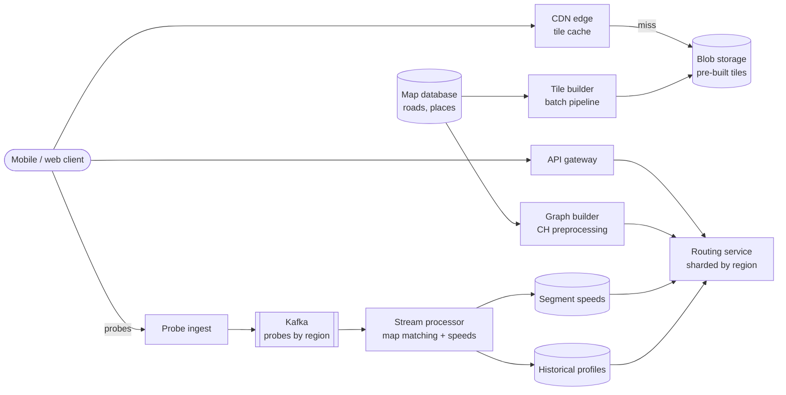
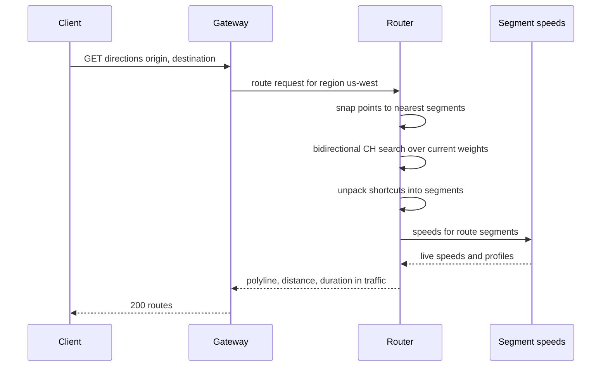

# Design Google Maps

## Requirements

**Functional**
1. Render a pannable, zoomable map of the world.
2. Return driving directions between two points.
3. Show an ETA that reflects live traffic.

**Non-functional**
- **Low latency:** map tiles load in under ~200 ms; a route returns in under ~1 s, even across a continent.
- **Global scale:** ~100M daily users, worldwide.
- **Fresh traffic:** a new jam shows up in ETAs within ~1–2 minutes.
- **Availability:** maps must keep rendering even if routing degrades.

**Out of scope:** place search, Street View, transit and walking directions, offline maps.

### Back-of-envelope estimates

| Quantity | Estimate | Implication |
|---|---|---|
| Tile requests | 100M DAU × 100 tiles/day = 10B/day ≈ 116k/s, peaks ~3× ≈ 350k/s | Must be served from CDN edges, not origin |
| Vector tiles, zoom 0–14 | 4⁰ + 4¹ + … + 4¹⁴ ≈ 358M tiles × ~20 KB ≈ 7 TB | Pre-generated in blob storage; ocean tiles deduplicate |
| Route requests | 100M × 2/day = 200M/day ≈ 2.3k/s, peak ~10k/s | Each query must be milliseconds of CPU, so plain Dijkstra won't do |
| Road graph | ~500M nodes, ~1B edges (assumption) × ~16 B per edge ≈ 16 GB of edges | Fits in RAM per region; partition by region for cross-region scale |
| Location probes | 5M navigating users × 1 ping / 5 s = 1M events/s | Kafka plus a stream processor for traffic |

## Core entities

| Entity | Key fields | Store/Notes |
|---|---|---|
| Tile | key `(z, x, y)`, version, vector data (roads, labels, areas) | Blob storage (S3/GCS) behind a CDN |
| Road node | `node_id`, lat, lng, CH rank | In-memory graph on routing servers |
| Road segment (edge) | `edge_id`, from, to, length, speed limit, road class, restrictions | In-memory; source of truth in a map database |
| Segment speed | `edge_id` → live speed, sample count, updated_at | Redis / in-memory, keyed by edge; overwritten each minute |
| Historical profile | `edge_id`, time-of-week bucket → typical speed | Columnar store; loaded into routers |
| Probe | `device_session`, lat, lng, speed, heading, ts | Kafka only; anonymized, short retention |

## API

```
GET  https://tiles.example.com/v3/{z}/{x}/{y}.pbf        → 200 vector tile (Cache-Control: max-age=86400)
GET  /v1/directions?origin=lat,lng&destination=lat,lng&departAt=now&alternatives=true
     → 200 { routes: [{ polyline, distanceMeters, durationSeconds, durationInTrafficSeconds,
                        legs: [{ instruction, distanceMeters }] }] }
       404 no route | 400 invalid point
POST /v1/probes   { sessionId, points: [{lat, lng, speed, heading, ts}] }   → 202 (batched every ~30 s)
```

- Tile URLs include a version (`v3`) so a map data release changes the URL and the CDN never serves a mix of old and new tiles.
- Probes are batched on the device to save battery and requests; `202` means accepted for async processing.
- The route response carries both free-flow and in-traffic durations so the client can explain delays.

## High-level design



**Map rendering**
1. The client computes which tiles cover the viewport at the current zoom and requests `/{z}/{x}/{y}`.
2. The CDN serves most tiles from the edge; misses go to blob storage, where an offline pipeline has written every tile.
3. The client renders vector tiles itself (styling, rotation, labels), so one tile set serves every theme and language.

**Directions**
1. The gateway routes the request to the routing shard that holds both endpoints' region (or a cross-region tier).
2. The router snaps each point to the nearest road segment, runs a contraction-hierarchy query, and unpacks shortcuts into a polyline.
3. It sums segment travel times using live and historical speeds to produce the ETA.

**Traffic**
1. Navigating devices send probes; a stream processor snaps them to segments and computes per-segment speeds each minute.
2. Routers pull the new speeds and refresh edge weights.



## Deep dives

### Map tiles and zoom levels

#### How tiling works

The world is projected onto a square with **Web Mercator**, then cut into a quadtree of square tiles, each rendered at 256×256 (or 512×512) pixels.

- At zoom `z` there are 2^z × 2^z tiles. Zoom 0 is one tile showing the whole world; each zoom level splits every tile into 4.
- Tile `(z, x, y)` has children `(z+1, 2x, 2y)`, `(z+1, 2x+1, 2y)`, `(z+1, 2x, 2y+1)`, `(z+1, 2x+1, 2y+1)`.

| Zoom | Tiles | Roughly shows |
|---|---|---|
| 0 | 1 | Whole world |
| 5 | 1,024 | Large country region |
| 10 | ~1M | City |
| 15 | ~1.07B | Streets |
| 21 | ~4.4 trillion | Buildings |

Converting a coordinate to a tile:

```
n = 2^z
x = floor((lng + 180) / 360 * n)
y = floor((1 - ln(tan(lat_rad) + 1/cos(lat_rad)) / π) / 2 * n)
```

**Worked example:** San Francisco (37.7749, −122.4194) at zoom 10: x = floor(57.58 / 360 × 1024) = floor(163.78) = **163**, y = floor(395.80) = **395**. The client requests `/10/163/395` plus its neighbors to fill the screen.

#### Raster vs vector tiles

- **Weak:** render raster images for every zoom on demand. CPU-heavy at origin and impossible to restyle.
- **Better:** pre-render raster PNGs for all zooms. Simple clients, but zoom 21 alone has trillions of tiles, and every language or dark mode needs another set.
- **Best:** pre-build **vector tiles** (geometry plus attributes, commonly in the Mapbox Vector Tile protobuf format) up to about zoom 14, and let the client **overzoom**: it draws zoom 15–20 from the zoom-14 data at higher detail. Tiles stay small, the set is ~358M tiles, and styling happens on the device.

Most tiles are ocean or empty land, which deduplicate to a handful of objects. Tiles are immutable per version, so they get long `Cache-Control` lifetimes, and the CDN hit rate is very high because everyone requests the same popular city tiles.

### Shortest path: Dijkstra, A*, contraction hierarchies

Take this small road graph (weights in minutes, roads two-way):

```
A–B 4   A–C 2   C–B 1   B–D 5   C–D 8
C–E 10  D–E 2   D–F 6   E–F 3
```

#### How Dijkstra works

Keep a priority queue of tentative distances. Repeatedly settle the closest unsettled node and relax its edges (if `dist[u] + w < dist[v]`, lower `dist[v]`).

| Step | Settled | Tentative distances after relaxing |
|---|---|---|
| 1 | A (0) | C 2, B 4 |
| 2 | C (2) | B 3 (via C), D 10, E 12 |
| 3 | B (3) | D 8 (via B) |
| 4 | D (8) | E 10 (via D), F 14 |
| 5 | E (10) | F 13 (via E) |
| 6 | F (13) | done: A→C→B→D→E→F, 13 min |

Dijkstra is correct but explores in all directions like a growing circle. On a continental graph a long route settles millions of nodes and takes seconds, far too slow for 10k queries/s.

#### How A* works

A* orders the queue by `f(v) = g(v) + h(v)`: distance so far plus an estimate of the remaining distance. With `h` = straight-line distance ÷ maximum road speed, `h` never overestimates (it is admissible), so the result is still optimal. The search leans toward the destination and skips nodes behind the origin, often settling several times fewer nodes. It still scales with route length, so cross-country routes remain slow.

#### How contraction hierarchies work

CH moves the work offline.

1. **Order nodes by importance** (cul-de-sacs low, highway interchanges high).
2. **Contract nodes from least to most important.** Remove node v; for each pair of neighbors (u, w), if u→v→w is the only shortest path between them, add a **shortcut edge** u→w with the combined weight. A small local "witness search" checks whether another path exists.
3. **Query** with a bidirectional Dijkstra in which both searches only move to *higher-ranked* nodes. They meet near the top of the hierarchy, at the important roads, and the best meeting point gives the answer.

**Worked example:** contract B first. Pair (C, D): C→B→D costs 1 + 5 = 6, the direct C–D edge costs 8, so add shortcut **C–D = 6**. Pair (A, D): A→B→D costs 9, but the witness A→C→D now costs 2 + 6 = 8, so no shortcut. Pair (A, C): A→B→C costs 5 > A–C 2, so no shortcut. Later queries use C–D = 6 without ever visiting B, then expand the shortcut back to C→B→D for the polyline.

On real road networks, queries settle only hundreds of nodes and take around a millisecond or less instead of seconds. The cost is preprocessing (minutes to hours per continent) and extra memory for shortcuts.

| Algorithm | Preprocessing | Query work | Live weight changes |
|---|---|---|---|
| Dijkstra | None | Millions of nodes on long routes | Trivial |
| A* | None | Fewer, still route-length dependent | Trivial |
| Contraction hierarchies | Minutes to hours | Hundreds of nodes | Shortcuts depend on weights, so needs re-customization |
| CRP (partition-based) | Partition once, customize metric in seconds | Small | Designed for frequent updates |

#### Live traffic with precomputed shortcuts

CH shortcuts bake in edge weights, so a jam invalidates some of them. Options: run CH on free-flow weights and re-rank the top few candidate routes with live weights (simple, approximate); use **customizable contraction hierarchies**, which keep the node order fixed and recompute only shortcut weights; or use **Customizable Route Planning** (Microsoft Research, built for Bing Maps), which partitions the graph into cells, precomputes cell-boundary distances, and can re-apply new weights in seconds. Partitioning also lets each region's graph live on its own routing shard.

### ETA from live traffic

#### How probes become speeds

1. **Ingest:** probe batches go to Kafka, partitioned by region so a region's points stay together.
2. **Map matching:** raw GPS is noisy (±10 m or more), so a point near a highway overpass could be on either road. A hidden Markov model matcher picks the most likely sequence of segments, using distance to each road and whether consecutive points are reachable at plausible speeds.
3. **Aggregate:** a stream processor (Flink) computes each segment's speed over a sliding window, e.g. the median of the last 3–5 minutes of traversals, dropping outliers such as a delivery van that stopped.
4. **Publish:** new speeds are written every minute; routers refresh weights.

#### How the ETA is computed

Segments with enough fresh samples use live speed; others fall back to the **historical profile** for that segment and time of week (e.g. 672 buckets of 15 minutes). For parts of the route reached 40 minutes from now, the profile for that future time beats today's live speed, which will have changed.

**Worked example:**

| Segment | Length | Speed used | Time |
|---|---|---|---|
| City street | 1.2 km | 30 km/h (live) | 2.4 min |
| Highway | 18 km | 54 km/h (live, jammed) | 20 min |
| Exit ramp | 0.8 km | 24 km/h (historical, no samples) | 2 min |
| **Total** | 20 km | | **24.4 min** |

Free-flow on the highway (100 km/h) would give 10.8 min there and 15.2 min overall, so the client shows "+9 min due to traffic". A learned model then corrects systematic errors such as turn delays and traffic lights.

### Serving routing at scale

- Shard routers by region; each holds its region's graph and CH data in memory, with replicas behind a load balancer.
- Long cross-region trips use a coarse top-level graph of highways and region boundaries, then local graphs at each end.
- Cache popular origin–destination pairs at coarse precision for a minute, which helps commute peaks.

## Follow-up questions

### How do you update the map when a new road opens?
Map edits land in the map database; a pipeline rebuilds the affected tiles at all zooms and publishes them under a new version, and the graph builder re-runs preprocessing for that region. The new graph is loaded on spare router replicas and traffic switches over, so there's no downtime.

### How does the client decide which tiles to request?
It computes the tile range covering the viewport at the current zoom (rounded), requests those plus a ring of neighbors to prefetch, and keeps a local cache. While zooming it scales already-loaded parent tiles until children arrive, so the screen never goes blank.

### How do you protect user privacy with location probes?
Probes carry a rotating session ID rather than a user ID, are aggregated per segment with minimum sample counts, and are deleted after aggregation. The start and end of trips can be trimmed so homes aren't revealed.

### How would you detect a road closure without official data?
If a segment that normally sees steady traffic suddenly gets zero traversals while neighbors stay busy, and drivers consistently reroute around it, flag it as likely closed. Confirm with user reports and set a very low weight until traffic resumes.

### How do you handle turn restrictions and one-way streets?
One-way streets are directed edges. Turn restrictions are modeled by routing on an edge-based graph, where nodes represent road segments and edges represent allowed turns, or with turn-cost tables at intersections. CH works on either form.

### Why not compute routes on the client?
The full graph and live traffic are far too large to ship, and traffic changes every minute. Clients can do offline routing over a downloaded region with historical speeds as a fallback, but the server gives fresher and better routes.

### How would you offer alternative routes?
Run the query, then find routes that share little with the best one but are not much longer, for example via-node alternatives through different meeting nodes in the CH search. Filter for routes within ~20–30% of the best time and without silly detours.

### What happens during a traffic data outage?
Routers keep the last speeds and fall back to historical profiles as they age out, so ETAs become less accurate but routing continues. Tiles are unaffected because they come from the CDN.
