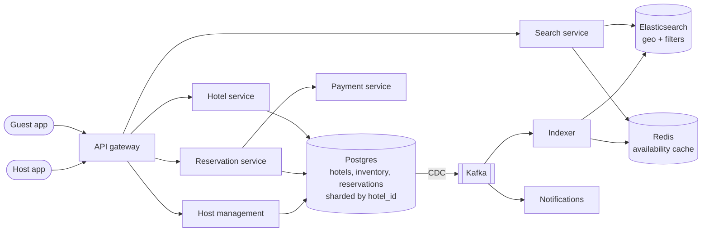
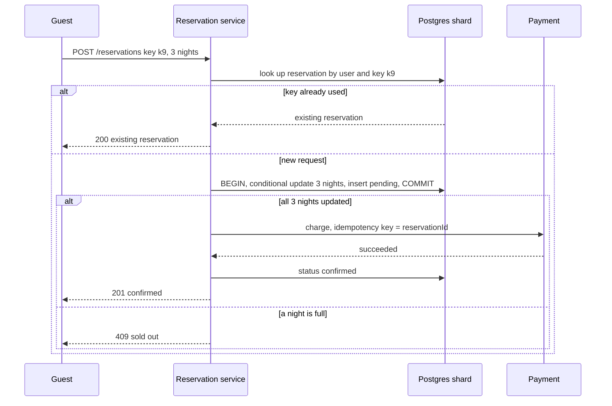
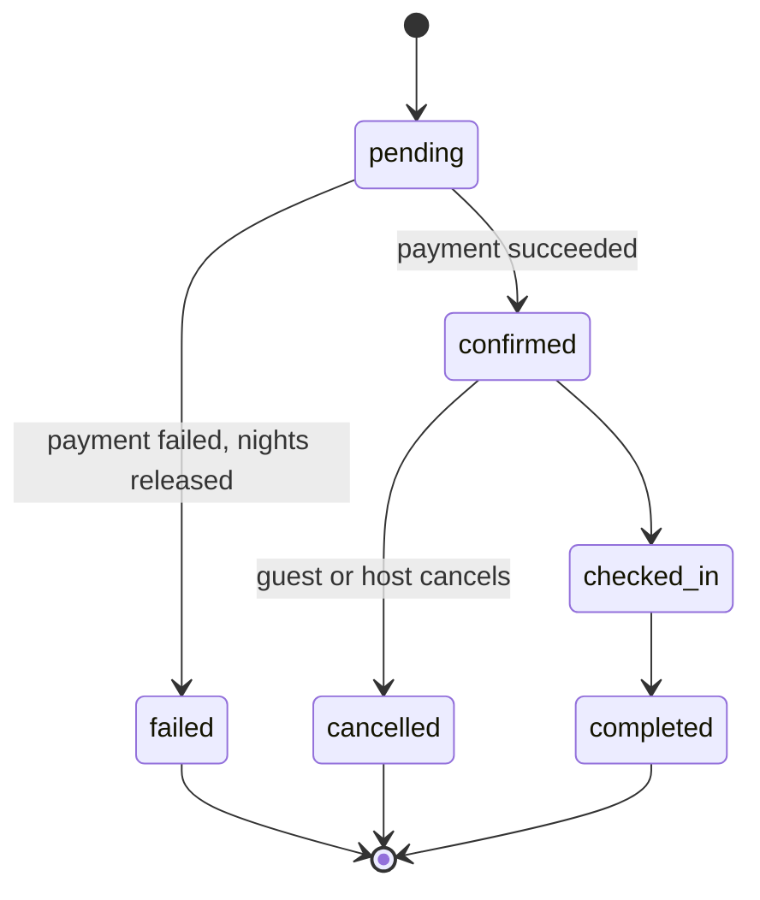

# Design a Hotel Reservation System (Airbnb / Booking.com)

## Requirements

**Functional**
1. Search properties by location, check-in and check-out dates, number of guests, and filters (price, amenities).
2. View a property with room types, prices and availability for the chosen dates.
3. Reserve a room type (hotel) or a whole listing (Airbnb) for a date range and pay.
4. Cancel a reservation according to the property's cancellation policy.
5. Hosts create and edit listings, set prices and inventory per date, and block dates.

**Non-functional**
- **No double booking:** a room type is never booked beyond its configured capacity for any night, and a single-unit listing is never booked twice.
- **Controlled overbooking:** hotels may opt in to selling up to a configured percentage above physical rooms (e.g. 5–10%) to offset no-shows.
- **Fast search:** under ~500 ms p99; availability shown in search may be a few seconds stale.
- **Consistency at reservation time:** the reserve step checks live inventory.
- **Scale:** ~1M properties, ~5M room types, ~1M reservations/day, ~100 searches per reservation.

**Out of scope:** reviews, messaging between guests and hosts, dynamic pricing models, loyalty programs.

### Back-of-envelope estimates

| Quantity | Estimate | Implication |
|---|---|---|
| Reservations | 1M/day ≈ 12/s average, ~10× at peak ≈ 120/s | Write volume is small; correctness under contention matters more than throughput |
| Searches | 100M/day ≈ 1,160/s average, ~5k/s peak | Search runs on a separate read-optimized index and cache |
| Inventory rows | 5M room types × 365 days ≈ 1.8B rows | ~50 bytes each ≈ 90 GB; shard Postgres by `hotel_id` |
| Rows touched per booking | one per night, average stay ~3 nights | A reservation updates ~3 rows in one transaction on one shard |
| Reservation storage | 1M/day × ~1 KB = 1 GB/day ≈ 365 GB/year | Fits a sharded relational DB easily |

## Core entities

| Entity | Key fields | Store/Notes |
|---|---|---|
| Property | `hotel_id`, `host_id`, `name`, `lat`, `lng`, `geohash`, `amenities`, `policies` | Postgres; indexed into Elasticsearch |
| Room type | `room_type_id`, `hotel_id`, `name`, `max_guests`, `total_rooms` | Postgres, same shard as property. Airbnb listing = room type with `total_rooms = 1` |
| Room inventory | (`hotel_id`, `room_type_id`, `date`) → `total`, `reserved`, `overbook_pct`, `price`, `version` | Postgres, PK as shown, sharded by `hotel_id`; the contended table |
| Reservation | `reservation_id`, `user_id`, `hotel_id`, `room_type_id`, `check_in`, `check_out`, `qty`, `status`, `amount`, `idempotency_key` | Postgres, same shard as the hotel; unique on (`user_id`, `idempotency_key`) |
| Payment | `payment_id`, `reservation_id`, `provider_ref`, `status` | Payment service |

## API

```
GET  /v1/search?lat=48.85&lng=2.35&radiusKm=5&checkIn=2026-12-10&checkOut=2026-12-13&guests=2&cursor=
     → 200 { results: [{ hotelId, name, fromPrice, available: true }], nextCursor }

GET  /v1/hotels/{hotelId}?checkIn=...&checkOut=...
     → 200 { hotel, roomTypes: [{ roomTypeId, nightlyPrices: [...], roomsLeft }] }

POST /v1/reservations          Idempotency-Key: 6f1c...
     { hotelId, roomTypeId, checkIn, checkOut, qty, paymentMethodToken }
     → 201 { reservationId, status: "confirmed", total }
     → 200 same body when the key was already used (replay)
     → 409 { error: "sold_out", nights: ["2026-12-11"] }
     → 402 payment declined

DELETE /v1/reservations/{id}    → 200 { status: "cancelled", refund }

PUT  /v1/hosts/hotels/{hotelId}/inventory
     { roomTypeId, from, to, totalRooms?, price?, blocked? }   → 200
```

- **Idempotency key** on reservation creation: the client generates a UUID when the user opens checkout and reuses it on retries, so a timeout plus retry never books or charges twice.
- `check_out` is exclusive: a stay from 10 to 13 December books the nights of the 10th, 11th and 12th.
- Search uses cursor pagination; the user ID and host ID come from the auth token; prices are recomputed on the server.

## High-level design



**Search flow**
1. Elasticsearch filters properties by geo distance (or geohash cell), guests and amenities, and returns candidate hotels.
2. The search service checks each candidate's availability for the date range against a Redis cache of per-hotel, per-night availability, drops sold-out ones, and ranks the rest.

**Reserve flow**
3. The reservation service checks the idempotency key, then in one Postgres transaction on the hotel's shard increments `reserved` for each night conditionally and inserts the reservation as `pending`.
4. It charges the payment method; on success it marks the reservation `confirmed`, on failure it releases the nights and marks it `failed`.
5. CDC publishes inventory changes to update the availability cache and search index.

**Cancel and host flows**
6. Cancellation decrements `reserved` for each night in one transaction, sets `cancelled`, and refunds per policy. Host changes to `total` are validated so `total` can't drop below already reserved rooms.





## Deep dives

### Modeling inventory per date

- **Weak:** store reservations only, and compute availability with "count overlapping reservations for this room type". Every reservation runs a range query, and two concurrent transactions can both count 9 of 10 and both insert, because nothing locks a row that represents the night.
- **Weak:** one row per physical room (room 101, 102...). Guests book a room type, not a room number, and room assignment happens at check-in. Per-room rows force the booking flow to search for a free room.
- **Best:** one row per **(room type, night)** holding a counter. Each night of a stay is an explicit row that can be locked and conditionally updated.

#### How the per-night counter works

```sql
CREATE TABLE room_inventory (
  hotel_id      bigint,
  room_type_id  bigint,
  date          date,
  total         int NOT NULL,
  reserved      int NOT NULL DEFAULT 0,
  overbook_pct  int NOT NULL DEFAULT 0,
  price_cents   int NOT NULL,
  version       int NOT NULL DEFAULT 0,
  PRIMARY KEY (hotel_id, room_type_id, date),
  CHECK (reserved <= total * (100 + overbook_pct) / 100)
);
```

A nightly job (or the host tool) creates rows a year or two ahead. Worked example: a hotel's "Double" room type has `total = 10` and `overbook_pct = 10`, so up to 11 can be sold per night.

| Night | total | reserved before | Request (qty 2, nights 10–12 Dec) | reserved after |
|---|---|---|---|---|
| 10 Dec | 10 | 7 | 7 + 2 = 9 ≤ 11 | 9 |
| 11 Dec | 10 | 10 | 10 + 2 = 12 > 11, fails | 10 (rolled back) |
| 12 Dec | 10 | 4 | not reached | 4 |

Because 11 December fails, the whole transaction rolls back, including the 10th. The guest gets 409 with `nights: ["2026-12-11"]`, and the UI can suggest other room types. An Airbnb listing is the same table with `total = 1` and `overbook_pct = 0`, so it is either booked or not.

### Concurrency control: optimistic versus pessimistic

Two guests try to book the last Double for 11 December at the same moment. Each reads `reserved = 10`, sees space under 11, and writes `reserved = 11`: two bookings, one slot. Every option below makes check-and-write atomic.

#### How pessimistic locking works

```sql
BEGIN;
SELECT date, total, reserved, overbook_pct FROM room_inventory
 WHERE hotel_id = 5 AND room_type_id = 2 AND date >= '2026-12-10' AND date < '2026-12-13'
 ORDER BY date
   FOR UPDATE;                     -- row locks; a concurrent booker waits here
-- application checks reserved + qty <= limit for every night
UPDATE room_inventory SET reserved = reserved + 2
 WHERE hotel_id = 5 AND room_type_id = 2 AND date >= '2026-12-10' AND date < '2026-12-13';
INSERT INTO reservations (...) VALUES (...);
COMMIT;                            -- locks released
```

The second transaction blocks at `FOR UPDATE` until the first commits, then reads the new `reserved`. Locking rows in date order prevents deadlocks between overlapping stays (a stay of 10–12 and one of 11–13 both lock the 11th before the 12th). Locks are held only for milliseconds, never during payment.

#### How optimistic locking works

Read rows with their `version`, then update only if no one changed them:

```sql
UPDATE room_inventory SET reserved = reserved + 2, version = version + 1
 WHERE hotel_id = 5 AND room_type_id = 2 AND date = '2026-12-11' AND version = 41;
-- 1 row: success; 0 rows: someone else changed it, re-read and retry (or fail)
```

| Time | Guest A | Guest B | Row (reserved, version) |
|---|---|---|---|
| t1 | reads (10, 41) | | (10, 41) |
| t2 | | reads (10, 41) | (10, 41) |
| t3 | update WHERE version = 41 → 1 row | | (11, 42) |
| t4 | | update WHERE version = 41 → 0 rows | (11, 42) |
| t5 | | re-reads (11, 42): full, return 409 | (11, 42) |

#### Choosing

| Approach | Behavior under contention | Fits |
|---|---|---|
| Pessimistic (`FOR UPDATE`) | Waiters queue; no wasted work | Hot inventory: a popular hotel on New Year's Eve |
| Optimistic (version column) | Losers retry; no locks held | Typical hotel inventory, where two guests rarely collide on the same night |
| **Conditional update** | Check folded into the write: `SET reserved = reserved + 2 WHERE ... AND reserved + 2 <= total * (100 + overbook_pct) / 100`, then verify the row count equals the number of nights | Best default here: one statement per stay, no retry loop, no explicit lock |

Hotel booking contention is low (about 12 reservations per second spread over millions of rows), so the conditional update or optimistic locking works well. The `CHECK` constraint is the safety net if application code has a bug.

### Idempotent reservation API

A guest clicks "Book", the request times out on a flaky connection, and the app retries. Without protection, the hotel gets two bookings and the card is charged twice.

#### How the idempotency key works

1. The client creates a UUID per checkout attempt and sends it as `Idempotency-Key` on every retry.
2. The server inserts the reservation with a unique constraint on `(user_id, idempotency_key)` inside the same transaction as the inventory update. A retry that arrives after the commit hits the constraint; the server then loads the existing reservation and returns it with 200.
3. If the retry arrives while the first request is still running, the unique insert blocks until the first transaction commits or aborts, then either fails (return the existing result) or succeeds (the first one aborted, so this one proceeds).
4. The payment call uses the `reservation_id` as the payment provider's idempotency key, so a retried charge returns the first charge's result.
5. Keys are kept for at least 24 hours; reusing a key with a different body returns 422 to catch client bugs.

### Fast search with availability

- **Weak:** for each search, query Postgres for hotels in a bounding box and check every night's inventory row. With 5k searches/s each touching hundreds of hotels and several nights, the inventory shards drown.
- **Better:** Elasticsearch for location and filters, then a batched Postgres availability check. Still heavy for popular cities.
- **Best:** Elasticsearch for geo and filters, plus a **Redis availability cache** maintained from CDC events: for each room type, a per-night "rooms left" value. Search reads it with one pipelined `MGET` per page. It can lag by a second or two; the reservation step re-checks live inventory, so staleness only risks a rare 409.

**How the geo part works:** each property stores a geohash (e.g. a 6-character cell ≈ 1.2 km × 0.6 km). Elasticsearch's `geo_point` type with a `geo_distance` filter does the cell lookup and exact distance check internally; for map views, a `geo_bounding_box` filter on the visible map area. Popular queries (Paris, next weekend, 2 guests) can be cached for ~30 s.

## Production readiness

### Database choice and consistency

- **Inventory and reservations: Postgres sharded by `hotel_id` (ACID).** A booking is a multi-row conditional update (one row per night) plus a reservation insert with a unique idempotency key, all-or-nothing. That is exactly what a relational transaction gives on one shard. A key-value store like DynamoDB can do this only with its transaction API and its size limits, and Cassandra's lightweight transactions are single-partition and slow; both were rejected because the whole product promise is "never double-book". At ~120 bookings/s peak over 1.8B rows, throughput is not a reason to leave Postgres.
- **Search: Elasticsearch, availability: Redis, both BASE.** Both are fed by CDC and lag by seconds, which the requirements explicitly allow. Staleness costs a rare 409 at reservation time, never a double booking.
- **"My trips" store keyed by `user_id`:** an eventually consistent projection (see follow-ups); the confirmation itself comes from the reservation service, so a few seconds' lag is harmless.
- **CAP stance:** the reserve path is **CP**: if a hotel's shard primary is unreachable, return 503 for that hotel's bookings rather than accept them on a replica that might diverge. Search and hotel pages are **AP**: show possibly stale availability rather than nothing, because a search outage loses far more revenue than an occasional 409.

### Service boundaries and communication

- **Search** (read-heavy, ~5k/s peak, scales with replicas), **Hotel service** (property pages), **Reservation service** (the only writer of `reserved`), **Host management**, **Payment service**, **Indexer** and **Notifications**. The key boundary is that only the reservation service and host management write inventory, and both use conditional updates; search never touches Postgres.
- **Synchronous:** search and hotel reads; reservation → Postgres; reservation → payment (the guest is waiting for "confirmed" or "declined", and the room is held as `pending` meanwhile).
- **Asynchronous:** CDC → Kafka → indexer (search index, availability cache), notifications, "my trips" projection, channel-manager pushes to Expedia and others. These lag tolerably and must not block a booking.
- **Not split further:** inventory and reservations stay in one service and one shard because separating them would turn every booking into a distributed transaction.

### Failure modes and reliability

| Failure | Effect | Mitigation |
|---|---|---|
| Payment provider times out | Reservation stuck `pending` with nights held | 5–10 s timeout, idempotent retry with `reservation_id` as provider key and backoff + jitter; circuit breaker returns "try again shortly"; the sweeper releases holds after `held_until` |
| Shard primary fails during a booking | Transaction aborts; client sees an error | Failover to a synchronous standby; client retries with the same `Idempotency-Key`, so it either gets the committed reservation or books afresh |
| CDC/indexer lag | Search shows rooms that are sold out | Bounded staleness alert on CDC lag; reservation re-checks live inventory; during long lag show "availability may have changed" |
| Elasticsearch overloaded during a city event | Slow or failed searches | Cache popular query results ~30 s, shed expensive filters first, separate thread pools (bulkheads) for search and property pages so one can't starve the other |
| Channel-manager push fails | External site sells a night we just sold | Retries with backoff, then a dead-letter queue with alerting; per-channel inventory allocation or buffers to absorb sync delay |

### High availability and disaster recovery

- **SPOFs:** each shard primary (synchronous standby in another zone, automatic failover), the CDC pipeline (Kafka replicated across zones, connector restarts from its stored log position), the sweeper (leader election).
- **Zone vs region:** multi-zone in a primary region plus an async-replicated warm standby region. Active-active booking writes were rejected: they would need cross-region locking or risk double-booking.
- **RPO/RTO:** reservations **RPO 0** within a region (a lost confirmed booking means a guest arrives with no room) and **≤ 1 minute** across regions, with a reconciliation against payment provider records to recover anything lost in that window. **RTO ≤ 5 minutes** for a zone, **≤ 30 minutes** for a region; search can stay up throughout.
- **Backups:** snapshots plus WAL archiving for point-in-time recovery, with restore tests; Elasticsearch and Redis are rebuilt from Postgres.

### Security

- **Authn:** guest and host accounts with separate scopes; host staff can have sub-roles (front desk vs revenue manager).
- **Authz and tenant isolation:** a host may only edit inventory for hotels they own; every host API checks `hotel_id` ownership server-side. Guests can only read and cancel their own reservations.
- **PII:** names, emails, phone numbers and payment tokens. Card data stays with the payment provider (we store `provider_ref`); encrypt guest contact fields at rest, and share them with the hotel only for confirmed stays.
- **Encryption and secrets:** TLS everywhere, KMS-managed at-rest keys with rotation; payment and channel-manager credentials in a secret manager.
- **Audit log:** price and inventory changes by hosts, cancellations, refunds and support-agent overrides, with actor and time, for disputes.
- **Abuse:** rate limits per user and IP on reservations, and holds per user capped (a bot creating thousands of `pending` holds could block a hotel's inventory). Scraping of prices is limited with per-client search quotas.

### Observability

- **SLIs/SLOs (30 days):**
  - 99.9% of reservation requests get a final answer (confirmed, 409 or 402) within 3 s.
  - Zero nights booked beyond the configured limit, checked by a nightly audit query against the `CHECK` invariant.
  - 99.9% of searches return within 500 ms (the p99 requirement).
  - 99% of inventory changes reflected in the availability cache within 5 s.
- **Dashboards:** bookings/s and 409 rate by city, payment success and latency, pending hold count and age, CDC lag, search latency.
- **Traces:** the reserve path (reservation → Postgres → payment → confirm) on every error and a sample of successes; search fan-out.
- **Paging:** burn rate on the reservation and search SLOs, and any oversell found by the audit. A 409 spike alone is not a page (it may be a sell-out).

### Performance and cost

- **Bottleneck:** search, not booking. 5k searches/s each check hundreds of hotels across several nights. Store availability in Redis as one compact value per room type with a byte or small integer per night (5M room types × 365 nights ≈ 1.8 GB), so a page of results is one pipelined read. Keep Elasticsearch shards sized to fit in memory and filter before scoring.
- **Search cluster cost:** the largest line item, because replicas scale with query rate, not data size (1M properties is a small index). Caching popular queries for ~30 s cuts replicas needed at peak, at the cost of slightly staler results.
- **Database cost is modest:** ~90 GB of inventory plus ~365 GB/year of reservations. Archive completed reservations older than a year or two to cheap storage, and drop inventory rows for past dates.
- **Cross-region replication** is small (~1 GB/day of reservations plus inventory churn), so a standby region is cheap insurance. The bigger hidden cost is operating shards; at this data size a few large shards beat many small ones.

## Follow-up questions

### How does overbooking work operationally, and what happens if everyone shows up?
The hotel sets `overbook_pct` based on historical no-show rates, and the inventory limit becomes `total × (100 + pct) / 100`. If more guests arrive than rooms, the hotel "walks" a guest to a comparable nearby hotel at its own cost. Airbnb-style single listings never overbook, so `overbook_pct` is forced to 0.

### How do you hold a room while the guest enters payment details?
Create the reservation as `pending` with `held_until = now() + 10 minutes` and increment `reserved` immediately. A sweeper releases expired pending holds by decrementing the nights in a transaction. This keeps rooms from being sold under someone mid-checkout while ensuring abandoned holds return to inventory.

### How do you sync with external channels (Expedia, the hotel's own system)?
Hotels connect through channel managers that push inventory and rate updates. Treat each external booking as a reservation through the same conditional update, and push our bookings outward with retries. Because of delays between systems, hotels often allocate separate inventory per channel or keep a small buffer.

### What if a host reduces total rooms below what is already booked?
Validate in the update: `UPDATE room_inventory SET total = :new WHERE ... AND reserved <= :new` and reject with a list of conflicting nights. The host must cancel or relocate those bookings first, which triggers guest notifications and refunds.

### Why shard by hotel_id instead of by date or user?
Every booking touches several nights of one room type of one hotel, so sharding by hotel keeps the transaction on a single shard with no distributed commit. Per-user lookups ("my trips") go to a secondary store keyed by `user_id`, populated from reservation events.

### How do you handle price changes between search and booking?
Prices are stored per night in the inventory rows and read inside the reservation transaction. If the total differs from the quoted one, return a price-changed response and let the guest confirm. Quotes can carry a short-lived signed token if you want to honor the shown price for a few minutes.

### How would you handle a big event when everyone books the same city?
Contention is still spread across many hotels and room types, so the database is fine. Search load spikes, so scale the Elasticsearch replicas and cache popular query results. Availability in the cache may go stale faster, so shorten TTLs and surface "only 1 left" warnings.

### How do you implement cancellation policies and refunds?
Store the policy on the reservation at booking time (for example, free cancellation until 48 hours before check-in, then one night's charge). On cancel, compute the refund from the stored policy, release the nights in one transaction, and issue the refund idempotently using the reservation ID.
