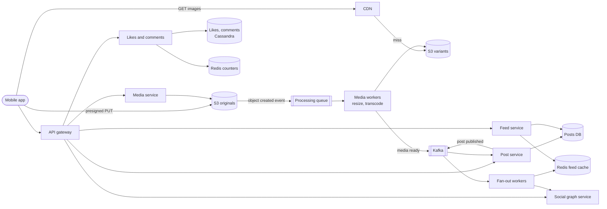
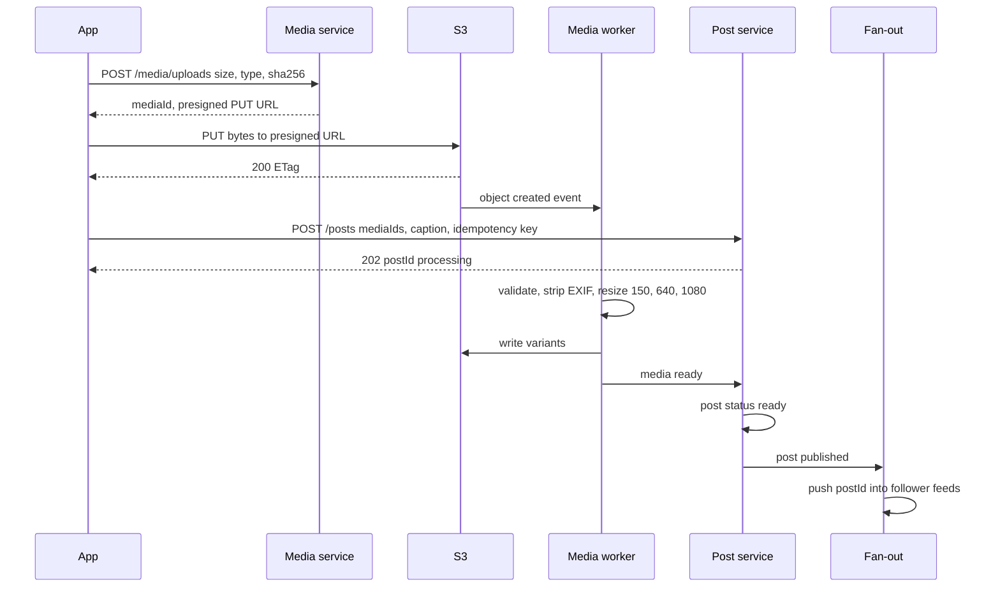

# Design Instagram

## Requirements

**Functional**
1. Upload a photo or short video with a caption.
2. Follow and unfollow other users.
3. View a home feed of recent posts from people you follow.
4. Like and comment on posts, and see like and comment counts.

**Non-functional**
- **Upload reliability:** an upload that the app reports as posted is never lost; large uploads survive flaky mobile networks by resuming.
- **Fast feed and media globally:** feed API under ~200 ms p99; images start rendering within ~1 s on mobile anywhere in the world.
- **Eventual consistency for social signals:** like counts and new posts may take a few seconds to appear for others.
- **High availability** for reads; reads outnumber writes by roughly 100:1.
- **Scale:** ~500M DAU, ~50M new posts/day.

**Out of scope:** stories, direct messages, search and explore ranking, ads.

### Back-of-envelope estimates

| Quantity | Estimate | Implication |
|---|---|---|
| Posts | 50M/day ≈ 580/s average, ~3k/s peak | Upload API is modest; media processing is the heavy part |
| Media storage | ~2 MB original + ~1 MB of resized variants = 3 MB × 50M ≈ 150 TB/day ≈ 55 PB/year | Object storage (S3) with tiering of old originals to cheaper classes |
| Feed opens | 500M × 10/day = 5B/day ≈ 58k/s | Feeds must be precomputed and cached, not assembled from scratch |
| Image downloads | 58k feed pages/s × ~10 images ≈ 580k images/s | Only a CDN serves this; origin sees cache misses only |
| Likes | ~5B/day ≈ 58k/s, with spikes on celebrity posts | Counters need batching or sharding to avoid hot rows |

## Core entities

| Entity | Key fields | Store/Notes |
|---|---|---|
| User | `user_id`, `username`, `avatar_key`, `follower_count` | Postgres (sharded by `user_id`) |
| Post | `post_id` (Snowflake-style, time-ordered), `author_id`, `caption`, `media: [{media_id, type}]`, `status` (pending / ready), `created_at` | Cassandra or sharded Postgres, partitioned by `author_id`, clustered by `post_id` desc |
| Media | `media_id`, `post_id`, `original_key`, `variants: {150, 640, 1080}`, `content_hash` | Metadata in DB; bytes in S3 |
| Follow | (`follower_id`, `followee_id`), `created_at` | Two tables: `following` keyed by follower, `followers` keyed by followee |
| Like | (`post_id`, `user_id`), `created_at` | Cassandra, partition `post_id`; primary key prevents double likes |
| Comment | `comment_id`, `post_id`, `author_id`, `text`, `created_at` | Partition `post_id`, clustered by `comment_id` |
| Feed | `user_id` → list of recent `post_id`s (~500) | Redis sorted set or list per user |
| Like counter | `post_id` → `count` | Redis plus periodic flush to the post row |

## API

```
POST /v1/media/uploads          { contentType: "image/jpeg", sizeBytes: 2400000, sha256 }
     → 201 { mediaId, uploadUrl (presigned PUT, expires 15 min) }
     → 201 { mediaId, multipart: { uploadId, partUrls: [...] } }   (videos > 10 MB)
PUT  {uploadUrl}                 (client → S3 directly, bytes)          → 200 ETag
POST /v1/posts                   Idempotency-Key: <uuid>
     { mediaIds: [...], caption }                                      → 202 { postId, status: "processing" }
GET  /v1/feed?cursor=<opaque>&limit=20
     → 200 { posts: [{ postId, author, caption, media: [{ urls: { "640": ..., "1080": ... } }], likeCount, likedByMe }], nextCursor }
POST   /v1/users/{userId}/follow                                       → 204
DELETE /v1/users/{userId}/follow                                       → 204
PUT    /v1/posts/{postId}/like                                         → 204 (idempotent)
DELETE /v1/posts/{postId}/like                                         → 204
POST   /v1/posts/{postId}/comments   { text }                          → 201 { commentId }
GET    /v1/posts/{postId}/comments?cursor=                             → 200 { comments, nextCursor }
```

- **Media bytes never pass through our API servers.** The client uploads straight to S3 with a presigned URL, which keeps multi-megabyte bodies off the app tier.
- **Likes use PUT/DELETE**, so a retried like is a no-op rather than a second like.
- **Idempotency key on post creation** prevents duplicate posts when the app retries after a timeout.
- **Cursor pagination** on the feed (the cursor encodes the last `post_id` seen), because new posts keep arriving at the top and offsets would skip or repeat items.

## High-level design



**Upload flow**
1. The app asks the media service for an upload slot; the service creates a `media` record and returns a presigned S3 URL.
2. The app uploads bytes directly to S3. S3 emits an object-created event to the processing queue.
3. Media workers validate the file, strip EXIF location data, generate variants, and write them to the variants bucket, then publish "media ready".

**Post flow**
4. The app calls `POST /posts` with the media IDs. The post is stored as `processing`; when all media are ready it becomes `ready` and a "post published" event goes to Kafka.
5. Fan-out workers fetch the author's followers and push the `post_id` into each follower's feed cache (except for celebrities, below).

**Feed flow**
6. The feed service reads the user's cached list of post IDs, merges in recent posts from followed celebrities, hydrates post data and counts from caches, and returns CDN URLs for the right image size.

**Engagement flow**
7. Likes write a row keyed by (`post_id`, `user_id`) and increment a Redis counter; counts are flushed to durable storage periodically.



## Deep dives

### Reliable uploads with presigned URLs

- **Weak:** the app POSTs the file to our API servers, which forward it to storage. App servers tie up threads and bandwidth on slow mobile uploads, and a dropped connection at 90% restarts the whole upload.
- **Better:** a single presigned PUT straight to S3. Offloads bandwidth, but a large video still restarts from zero on failure.
- **Best:** presigned PUT for photos and **multipart presigned uploads** for videos, so failed parts are retried individually.

#### How a presigned URL works

The media service holds AWS credentials; the client does not. The service builds a URL for one specific action (PUT to one specific key), with an expiry, and signs it with its secret key (AWS Signature Version 4, an HMAC over the method, bucket, key, expiry and selected headers). S3 recomputes the signature when the request arrives and rejects it if anything was changed or the URL has expired.

```python
url = s3.generate_presigned_url(
    "put_object",
    Params={"Bucket": "ig-originals", "Key": f"u/{user_id}/{media_id}",
            "ContentType": "image/jpeg"},
    ExpiresIn=900)          # 15 minutes
```

Because the key is chosen by the server (`u/{user_id}/{media_id}`), a client can't overwrite someone else's file. Size limits are enforced with a presigned POST policy (`content-length-range`) or by checking object size in the processing step and deleting oversized objects.

#### How multipart upload makes videos resumable

1. The server calls `CreateMultipartUpload` and gets an `uploadId`.
2. It returns presigned URLs for each part (e.g. 8 MB parts; S3 requires parts of at least 5 MB except the last, and allows up to 10,000 parts).
3. The client uploads parts in parallel and records each part's ETag. If part 7 fails, it retries only part 7.
4. The client asks the server to call `CompleteMultipartUpload` with the list of part numbers and ETags; S3 assembles the object.

For a 60 MB video in 8 MB parts: 8 parts (7 full and one of 4 MB). On a connection drop after 5 parts, the app resumes by uploading parts 6–8 instead of re-sending 60 MB. A lifecycle rule aborts multipart uploads that are not completed within a day, so abandoned parts don't accumulate storage cost.

**Upload reliability end to end:** the app keeps the file and the pending post locally until it receives the 202, retries with the same idempotency key, and the post service only shows the post once media are processed. If processing fails, the post moves to `failed` and the app offers a retry.

### Media processing, multiple resolutions and the CDN

#### How the processing pipeline works

- Workers consume object-created events from a queue (SQS or Kafka), so bursts are buffered and a crashed worker's message is redelivered after its visibility timeout. Processing is idempotent: variant keys are derived from `media_id`, so redoing a job overwrites the same objects.
- **Photos:** decode, apply orientation, strip EXIF (removes GPS location), and produce widths such as 150 px (thumbnail grid), 640 px and 1080 px (Instagram's standard maximum width for feed photos), encoded as JPEG and WebP (or AVIF where clients support it).
- **Videos:** transcode into an adaptive bitrate ladder (for example 360p, 480p, 720p, 1080p) as HLS segments of a few seconds plus a playlist, and extract a poster frame. Transcoding is the most expensive step and runs on a separate worker pool.
- **Dedup and safety:** a content hash catches exact duplicates; perceptual hashing and moderation classifiers run in the same pipeline before the post is published.

#### How serving the right size works

The feed API returns several URLs per image, and the client picks based on screen width and network: a phone 1,170 px wide on a fast connection loads the 1080 variant, on a slow connection the 640 one. Worked example of savings: a 1080 px WebP photo might be ~200 KB versus ~40 KB at 640 px, so a 10-image feed page on a slow network drops from ~2 MB to ~400 KB.

Variants are immutable (a new edit gets a new `media_id`), so the CDN can cache them with `Cache-Control: public, max-age=31536000, immutable`. URLs are unguessable IDs, optionally signed with an expiry for private accounts. With ~580k image requests per second, a 95% CDN hit rate still leaves ~29k/s origin fetches, so an origin shield (a regional mid-tier cache in front of S3) collapses repeated misses for the same object into one fetch.

### Feed generation with hybrid fan-out

| Approach | How it works | Read cost | Write cost | Problem |
|---|---|---|---|---|
| Fan-out on read (pull) | At feed time, query recent posts of every followee and merge | High: hundreds of queries per open | Low | 58k feed opens/s × hundreds of followees is too many queries |
| Fan-out on write (push) | On post, insert `post_id` into every follower's feed list | Low: one cache read | One write per follower | A user with 100M followers creates 100M writes per post |
| **Hybrid** | Push for normal users; pull for accounts above a threshold (e.g. 100k followers) and merge at read time | Low | Bounded | Slightly more complex read path |

#### How the hybrid feed works

- **Write side:** a fan-out worker pages through the author's followers (`followers` table keyed by `followee_id`) and for each runs `ZADD feed:{follower} {post_id} {post_id}` then trims to the newest 500 entries (`ZREMRANGEBYRANK feed:{follower} 0 -501`). It skips followers who haven't opened the app in, say, 30 days; their feeds are rebuilt on their next visit.
- **Read side:** take the user's cached feed, add the latest posts of the few celebrities they follow (each celebrity's recent posts are one cached list), merge by `post_id` (time-ordered), rank, and hydrate.

Worked example: Ana follows 300 regular users and 3 celebrities. A regular friend posting costs one `ZADD` to Ana's feed among ~300 other followers. A celebrity with 50M followers posting costs zero fan-out writes. When Ana opens the app: one `ZREVRANGE` on her feed (up to 500 IDs) plus 3 reads of celebrity post lists, merged into one page of 20. Posts are hydrated with a multi-get from a post cache. The full feed mechanics are covered in the News Feed solution.

### Likes and counts with eventual consistency

- **Weak:** `UPDATE posts SET like_count = like_count + 1` per like. A viral post receiving 10k likes per second turns one row into a lock hotspot.
- **Better:** store each like as a row (for "did I like this" and dedup) and count with `COUNT(*)` at read time. Correct, but far too slow for every feed render.
- **Best:** a like row keyed by (`post_id`, `user_id`) for truth plus an **asynchronously aggregated counter**.

#### How the counter pipeline works

1. `PUT /like` inserts (`post_id`, `user_id`). Using the composite primary key means a second like is an overwrite, not a duplicate. The service emits a `like_added` event only if the row was new (Cassandra lightweight transaction `IF NOT EXISTS`, or a check in Postgres via `ON CONFLICT DO NOTHING` and the affected row count).
2. A consumer increments `INCRBY likes:{post_id} 1` in Redis and buffers deltas in memory, flushing a combined `+N` to the durable counter every few seconds.
3. Feed hydration reads counts from Redis. For extremely hot posts, the counter is split into shards (`likes:{post_id}:0..15`, incremented at random, summed on read) so no single key takes all writes.

| Time | Likes arriving | Redis count | Durable count |
|---|---|---|---|
| 12:00:00 | 4,000 | 4,000 | 0 |
| 12:00:05 | 6,000 | 10,000 | 10,000 (flush) |
| 12:00:07 | 2,500 | 12,500 | 10,000 |

Other users may briefly see 10,000 instead of 12,500, which is acceptable. The liker sees their own like immediately because the app updates its local state optimistically and `likedByMe` comes from the like row.

## Production readiness

### Database choice and consistency

- **Users and the follow graph: sharded Postgres.** Usernames must be unique, account changes need transactions, and the `following`/`followers` pair should be written together. Volume is moderate and relational constraints catch bugs that would otherwise corrupt the graph. (Keeping both directions in step across shards needs an outbox or retried async write; a brief mismatch is tolerable.)
- **Posts, likes, comments: Cassandra-style wide-column (or sharded Postgres).** Access is always "by partition key, newest first", writes are heavy (58k likes/s), and we need multi-region writes with tunable consistency. We give up joins and cross-row transactions, which these access patterns don't need; the `(post_id, user_id)` primary key handles dedupe.
- **Feed lists and counters: Redis.** Pure derived data, rebuildable from posts and the graph, so BASE is fine.
- **Media: object storage.** 150 TB/day of immutable bytes.
- **ACID vs BASE:** ACID where uniqueness or money-like correctness matters (username, account state, post creation with its idempotency key). BASE for feeds, like counts and comment counts, as the requirements say.
- **CAP stance:** the read paths (feed, media, counts) are **AP**: a slightly stale feed beats an error for 500M daily users. Post creation is **CP within the user's home region**: if the post write can't be durably stored, return an error so the app keeps the post locally and retries, rather than claim "posted" and lose it.

### Service boundaries and communication

- **Media**, **Post**, **Feed**, **Social graph**, **Likes and comments**, plus **media workers** and **fan-out workers**. Splits follow load shape: media processing is CPU/GPU heavy and bursty; the feed service is read-heavy and latency-critical; fan-out is write amplification that must never slow the feed read.
- **Synchronous:** upload slot, `POST /posts` (returns 202), feed read and hydration, like/comment writes, follow/unfollow.
- **Asynchronous:** object-created → processing queue → variants → "media ready" → post published → fan-out; like events → counter aggregation; unfollow cleanup; deletes and CDN purges. Each step can lag or retry without the user waiting, and the 202 + `processing` status makes that explicit.
- **Hydration fan-in** is where sync calls multiply (posts, users, counts, `likedByMe`); use cache multi-gets under one deadline, not serial calls per post.

### Failure modes and reliability

| Failure | Effect | Mitigation |
|---|---|---|
| Media workers fall behind (viral event, transcoding spike) | Posts stay `processing` longer | Queue buffers the burst; autoscale photo and video pools separately (bulkheads) so videos can't starve photos; prioritize photos |
| A file crashes the decoder repeatedly | Message redelivered forever, wasting workers | Max delivery attempts, then dead-letter queue; post marked `failed` and app offers retry |
| Redis feed shard lost | Users on it get empty feeds | Graceful degradation: rebuild that user's feed by fan-out-on-read on demand; replicas for fast failover |
| Counter or comments service slow during feed hydration | Feed p99 blows past 200 ms | Per-dependency timeouts within a feed deadline; on timeout return the page without counts (or cached counts); circuit breaker on the slow dependency |
| Celebrity post triggers a burst of likes and comments | Hot partition and hot counter key | Sharded counters (already covered), rate limits per user, comment writes queued and shed when the partition is overloaded |

### High availability and disaster recovery

- **SPOFs:** none should be a single box. Postgres shards have synchronous standbys across zones; Cassandra runs replication factor 3 per region; Kafka is replicated across zones; Redis has replicas, and is rebuildable anyway.
- **Zone vs region:** multi-region active-active for reads (users are global and reads are 100:1), with writes going to a user's home region and replicating asynchronously (see follow-ups). Cassandra's multi-datacenter replication fits this; Postgres user data uses a primary region plus cross-region replicas.
- **RPO/RTO:** acknowledged posts and media **RPO 0 within a region** (the requirement "an upload reported as posted is never lost"), **≤ 1 minute** across regions. Likes and counters can tolerate **minutes** of loss because they can be recounted from like rows. **RTO:** feed reads **≤ 1 minute** (DNS/anycast to another region), posting **≤ 15 minutes** for a home-region loss.
- **Backups:** delete protection or versioning on originals (a buggy deletion job is a bigger risk than hardware), plus Postgres and Cassandra snapshots. Feeds and counters are rebuilt, not backed up.

### Security

- **Authn:** OAuth tokens per device; session revocation on password change. **Authz:** private accounts enforced server-side on every post, feed and media URL (signed, short-lived URLs for private media, as in follow-ups).
- **PII:** EXIF GPS is stripped in processing; emails and phone numbers encrypted at rest and visible only to the account owner and support with audit.
- **Encryption and secrets:** TLS everywhere; storage and databases encrypted at rest with rotated KMS keys; the media service's signing credentials in a secret manager, rotated with overlap so in-flight presigned URLs stay valid.
- **Audit log:** privacy setting changes, moderator and admin actions, and GDPR export and deletion requests.
- **Abuse:** per-user and per-device rate limits on follows, likes, comments and posts; size and type limits on uploads; moderation before publish; phone verification for suspicious signups.

### Observability

- **SLIs/SLOs (30 days):**
  - 99.9% of feed requests return in under 200 ms.
  - 99.9% of posts become `ready` within 30 s for photos (longer target for video).
  - Zero acknowledged posts lost, verified by reconciling post records against stored originals.
  - CDN image availability 99.95%, with time-to-first-image under 1 s at p95 on mobile.
- **Dashboards:** feed latency by region, CDN hit ratio, processing queue age, fan-out lag, counter flush lag.
- **Traces:** feed reads with hydration fan-in (to find the slow dependency); upload → processing → publish → fan-out as one trace keyed by `post_id`.
- **Paging:** burn rate on feed latency, post-ready latency and upload success. Queue depth alone is a dashboard signal unless it drives the post-ready SLO.

### Performance and cost

- **Bottleneck:** feed hydration at ~58k opens/s; batch multi-gets and cache hot posts.
- **Media storage (largest growing cost):** ~55 PB/year, of which originals are ~2 MB of every 3 MB (~36.5 PB/year). Tier originals older than a few months to cold storage, since variants serve almost all reads; the trade-off is slow re-processing if a new format is needed. Cross-region copies of originals double that line, so keep a second copy only of originals in a cold class.
- **CDN egress:** 580k images/s at an average of, say, 100 KB is ~58 GB/s, about 5 PB/day. WebP/AVIF and serving 640 px on slow networks are the biggest levers; better compression costs CPU at encode time.
- **Fan-out writes:** with ~200 active followers per post on average, 50M posts/day is ~10B feed inserts/day (~116k/s). The celebrity threshold and skipping inactive users cap this; raising the threshold makes reads cheaper but writes costlier.
- **Feed cache memory:** 500M users × 500 IDs × 8 bytes is ~2 TB of raw IDs, and several times that with Redis sorted-set overhead. Shorter lists for light users or not caching inactive users saves most of it, at the cost of on-demand rebuilds.

## Follow-up questions

### How do you generate post IDs?
Use a Snowflake-style 64-bit ID: a millisecond timestamp, a worker ID, and a per-millisecond sequence. IDs are unique without coordination and sort by creation time, so feeds and cursors can order by ID alone. Instagram described a similar scheme using Postgres shards to generate IDs.

### What happens when a user unfollows someone?
Delete the follow edges, then remove that author's posts from the user's cached feed asynchronously, or filter them at read time against the current following set. Filtering at read time is cheap because the feed is hydrated anyway, and it handles the window before the cleanup finishes.

### How would you handle a private account?
Fan-out only goes to approved followers, and the feed and post APIs check the follow relationship before returning a post. Media URLs for private posts are signed with a short expiry so a leaked URL stops working quickly. Revoking a follower also removes their cached feed entries.

### How do you keep the feed fast for a user who hasn't opened the app in months?
Their feed cache was skipped or evicted. On login, build it on demand by pulling recent posts from the people they follow (a fan-out-on-read for this one user), store it, and show a loading state for the first fetch. Subsequent posts are pushed as normal.

### How do you delete a post and its media?
Mark the post deleted so reads filter it out immediately, then asynchronously remove it from feed caches, delete the S3 objects, and purge CDN caches by URL. Regulations such as GDPR require actual deletion within a bounded time, so a deletion job tracks completion.

### How would you rank the feed instead of showing it chronologically?
Fetch a candidate set of a few hundred recent posts from the hybrid feed, then score each with a model using signals such as relationship strength, post type, engagement velocity and recency. Return the top items with a cursor that remembers what was already shown. Ranking happens at read time, so the candidate generation design doesn't change.

### How do you store comments on a post with millions of comments?
Partition comments by `post_id` and cluster by `comment_id` descending, so the newest page is one contiguous read. For very large posts, bucket the partition by time as well (`post_id`, `month`) so one partition doesn't grow without bound. Show top comments from a separately ranked list.

### How do you serve users in regions far from your data centers?
Media is served from CDN edge locations near the user, so image latency is local. API requests go to the nearest region, with read replicas of posts and feed caches there; writes go to the user's home region and replicate asynchronously. Upload to the nearest region's bucket and replicate originals in the background.
