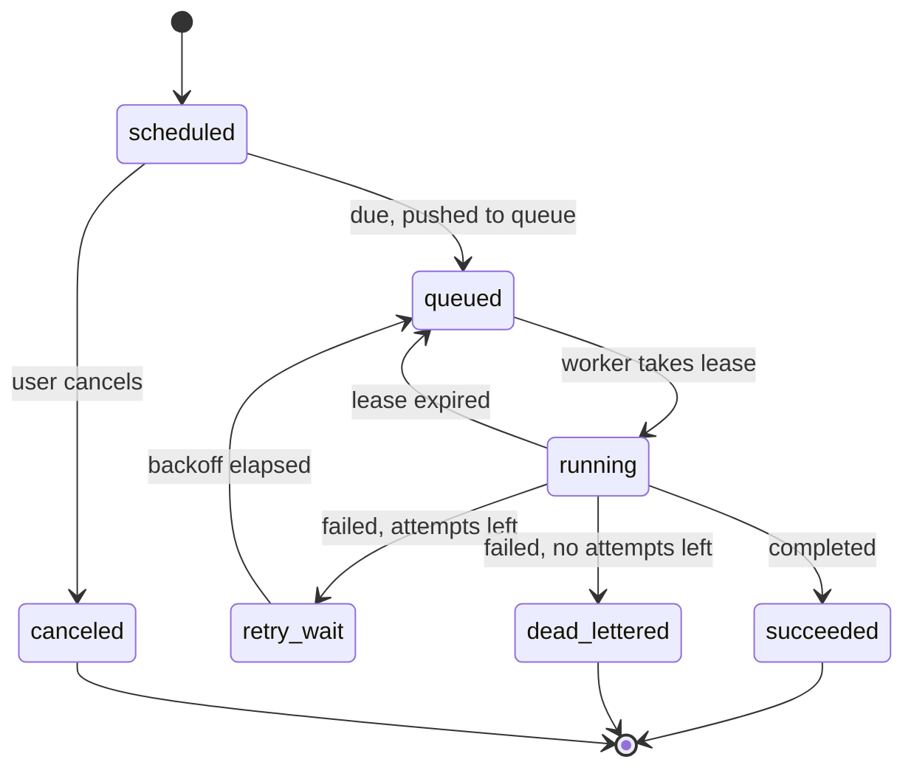
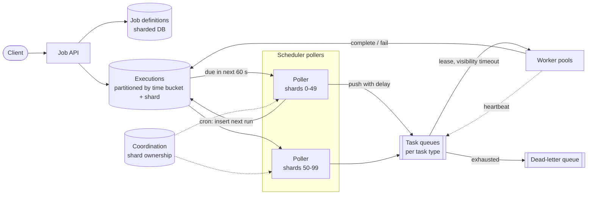
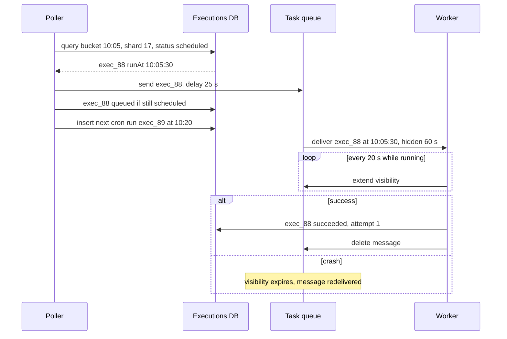

# Design a Distributed Job Scheduler

## Requirements

**Functional**
1. Schedule a job to run immediately, after a delay or at a specific time, or on a recurring cron schedule (with a time zone).
2. A job is a task type plus a payload (e.g. "send report email to user 42") run by registered worker pools.
3. Users can view a job's status and its execution history, and pause, resume or cancel it.
4. Failed executions are retried with a configurable policy; exhausted ones go to a dead-letter state.

**Non-functional**
- **Timeliness:** an execution starts within ~2 s of its scheduled time at p99.
- **At-least-once execution:** a scheduled run is never silently lost, even if workers or schedulers crash.
- **Throughput:** 10k executions/s sustained, bursts to ~30k/s at the top of the hour (cron jobs cluster at `:00`).
- **Highly available** with no single scheduler node whose failure stops jobs.
- **Scale:** ~100M job definitions, execution history kept for 30 days.

**Out of scope**
- DAG workflows with dependencies between jobs (Airflow-style); mention as a follow-up.

### Back-of-envelope estimates

| Quantity | Estimate | Implication |
|---|---|---|
| Executions/day | 10k/s × 86,400 s = 864M | The executions table is the hot, write-heavy store |
| Execution history | 864M × ~500 bytes ≈ 432 GB/day; × 30 days ≈ 13 TB | Partition by time and drop old partitions instead of deleting rows |
| Job definitions | 100M × ~1 KB = 100 GB | Fits comfortably in a sharded DB |
| Due items per 1-minute bucket | 10k/s × 60 = 600k (1.8M at a 30k/s peak) | One bucket per minute must be split into shards to avoid a hot partition |
| Per-shard load with 100 shards | 600k / 100 = 6k items/minute = 100/s | Easy for one poller per shard |

## Core entities

| Entity | Key fields | Store/Notes |
|---|---|---|
| Job | `job_id` (PK), `owner_id`, `task_type`, `payload`, `schedule` (`once` at time / `cron` expr + `tz`), `retry_policy`, `status` (active / paused / canceled) | Definitions DB (Postgres or DynamoDB), sharded by `job_id` |
| Execution | PK (`time_bucket`, `shard`), sort key (`scheduled_at`, `execution_id`); `job_id`, `attempt`, `status`, `lease_owner`, `lease_expires_at`, `result` | Wide-column store (DynamoDB/Cassandra); `time_bucket` = scheduled minute |
| Execution by job | PK `job_id`, sort `scheduled_at` → `execution_id`, `status` | Secondary index for "history of this job" |
| Worker | `worker_id`, `task_types`, `last_heartbeat` | Ephemeral, in the coordination store |



## API

```
POST /v1/jobs
  headers: Idempotency-Key: 5b2...
  { taskType: "send_report", payload: {...},
    schedule: { type: "cron", expr: "0 9 * * 1-5", timezone: "America/New_York" }
              | { type: "once", runAt: "2026-11-02T10:00:00Z" } | { type: "now" },
    retry: { maxAttempts: 5, backoff: "exponential", initialSeconds: 10 } }
  → 201 { jobId, nextRunAt }
  → 400 invalid cron expression

GET    /v1/jobs/{jobId}                               → { job, status, nextRunAt }
GET    /v1/jobs/{jobId}/executions?cursor=&limit=50   → { executions: [...], nextCursor }
POST   /v1/jobs/{jobId}/pause | /resume               → 200
DELETE /v1/jobs/{jobId}                               → 204

Worker protocol (internal):
  lease(taskTypes, max=10)            → [{ executionId, attempt, payload, leaseExpiresAt }]
  heartbeat(executionId, attempt)     → { leaseExpiresAt }  or 409 lease lost
  complete(executionId, attempt, result | error)
```

- `Idempotency-Key` on create stops a client retry from creating two cron jobs that both fire.
- History uses **cursor pagination** on `scheduled_at` since it grows without bound.
- Every worker call carries `attempt`, which acts as a **fencing token**: a stale worker's late `complete` is rejected.
- The owner comes from the auth token, not the body.

## High-level design



**Create flow**
1. The API validates the request, parses the cron expression, and writes the job definition.
2. It computes the first fire time and inserts an `Execution` row into bucket `floor(run_at to minute)` and shard `hash(execution_id) % 100`. A "run now" job goes straight to the queue as well.

**Dispatch flow**
1. Each poller owns a set of shards (assigned through a coordination service with leases, so a dead poller's shards are taken over).
2. Every few seconds it queries its shards for the current and next minute's buckets, for rows still `scheduled`.
3. It pushes each to the task queue with a delay of `run_at − now`, and conditionally marks the row `queued`.
4. For cron jobs it computes the next fire time and inserts that execution row, so there is always exactly one future row per active cron job.

**Execution flow**
1. A worker leases a message; the queue hides it for the visibility timeout.
2. The worker runs the task, heartbeating to extend the lease for long jobs.
3. On success it records the result and deletes the message. On failure it schedules a retry row at `now + backoff`, or dead-letters the execution.



## Deep dives

### Finding due jobs quickly: the two-layer design

- **Weak:** one table with `SELECT * FROM jobs WHERE next_run_at <= now()` polled by every scheduler node. At 10k/s the index becomes a hot spot, nodes fight over the same rows, and adding nodes doesn't add throughput.
- **Better:** a single Redis sorted set scored by run time, popped with a Lua script. Very fast, but one key is one shard, memory holds every future job, and losing Redis loses schedules.
- **Best:** two layers. A durable **executions table partitioned by time bucket** holds everything far in the future; pollers move only items due in the next minute into a **queue** that handles precise delivery, leasing and redelivery.

#### How time-bucketed scheduling works

1. The partition key is `(time_bucket, shard)`, where `time_bucket` is the scheduled minute (e.g. `2026-11-01T10:05`) and `shard = hash(execution_id) % 100`. The sort key is `scheduled_at`.
2. All rows due in one minute live in 100 small partitions instead of one huge one, so writes and reads spread across the cluster.
3. A poller responsible for shard 17 runs `Query PK=("2026-11-01T10:05", 17) AND status = scheduled`. That's a direct partition read, not a scan.
4. It hands each row to the queue with a delay. SQS supports per-message delays up to 15 minutes; with a 1-minute look-ahead that's plenty.

Worked example at 10k executions/s:

| Item | Value |
|---|---|
| Rows in bucket 10:05 | 600k |
| Per shard (100 shards) | 6k rows, about 100/s |
| Pollers | 10, each owning 10 shards, so ~1k rows/s each |
| Top-of-hour spike (3×) | 1.8M rows in bucket 11:00; add shards for known-hot minutes or start dispatching that bucket earlier |

Late jobs (a poller was down) are still found, because pollers also scan the previous few buckets for rows left `scheduled`. Marking the row `queued` with a conditional update (`IF status = 'scheduled'`) means two pollers that briefly overlap during a shard handover don't both enqueue the same run.

### Worker leasing and visibility timeouts

A worker can crash halfway through a job. Something must notice and give the job to someone else, without two workers running it at once in the normal case.

- **Weak:** the worker deletes the message when it receives it. A crash loses the job: at-most-once.
- **Better:** a distributed lock per job with no expiry. A crashed worker holds the lock forever.
- **Best:** a **lease** with an expiry (a visibility timeout), extended by heartbeats, plus a fencing token.

#### How a lease works

1. The worker receives the message; the queue makes it invisible for the visibility timeout (say 60 s). With a database instead of a queue, the same thing is a conditional update:
   ```sql
   UPDATE executions SET status='running', lease_owner='w7',
          lease_expires_at = now() + interval '60 seconds', attempt = attempt + 1
   WHERE execution_id = 'exec_88' AND status = 'queued'
   RETURNING attempt;
   ```
   Postgres-based queues pick work with `SELECT ... FOR UPDATE SKIP LOCKED` so workers don't block on each other's rows.
2. While running, the worker heartbeats every ~20 s (a third of the timeout) to push the expiry forward.
3. On success it deletes the message (or sets `succeeded`). If it crashes, heartbeats stop, the lease expires, and the message becomes visible to another worker.

Worked example (timeout 60 s, heartbeat 20 s):

| Time | Event | Lease expires | Owner |
|---|---|---|---|
| 0 s | w7 leases exec_88, attempt 1 | 60 s | w7 |
| 20 s | heartbeat | 80 s | w7 |
| 40 s | heartbeat | 100 s | w7 |
| 45 s | w7 crashes | 100 s | w7 (stale) |
| 100 s | lease expires, message visible | | none |
| 101 s | w3 leases exec_88, attempt 2 | 161 s | w3 |
| 130 s | w7 was only paused (GC), wakes and calls complete(attempt 1) | | rejected: current attempt is 2 |

The last row is why the **attempt number is a fencing token**: the store accepts `complete` only `WHERE attempt = :attempt`. Picking the timeout is a trade-off: too short and slow jobs are duplicated; too long and crash recovery is slow. Heartbeats let you use a short timeout for long jobs.

### At-least-once and idempotent jobs

Exactly-once execution isn't achievable in general: a worker can finish the side effect (send an email) and crash before recording success, and the scheduler can't tell that apart from crashing before the side effect. So the scheduler guarantees **at least once**, and jobs are made idempotent.

- Each execution gets a stable `execution_id`; retries of the same run reuse it.
- Jobs pass it as the idempotency key to downstream systems (`Idempotency-Key: exec_88` to a payment API), or record it in their own DB in the same transaction as the effect: `INSERT INTO processed(execution_id) ... ON CONFLICT DO NOTHING`, and skip if it already exists.
- Naturally idempotent operations (set a value, upsert a report for a date) need nothing extra.

**Retries** use exponential backoff with jitter: with initial 10 s, attempts wait up to 10, 20, 40, 80 s. After `maxAttempts` the execution moves to `dead_lettered`, an alert fires, and an operator can replay it after fixing the cause. Retries are new rows in a future bucket, so they flow through the same dispatch path.

### Cron parsing and recurring jobs

#### How cron expressions work

Five fields: `minute hour day-of-month month day-of-week`. Each field allows `*` (any), lists `1,15`, ranges `9-17`, and steps `*/15` (every 15).

Example: `*/15 9-17 * * 1-5` means every 15 minutes from 09:00 to 17:45, Monday to Friday. The next runs after Friday 17:40 are 17:45 Friday, then 09:00 Monday, 09:15 Monday.

Computing the next fire time:

```
def next_fire(expr, after, tz):
    t = (after in tz) rounded up to next minute
    loop:
        if t.month not in expr.months: t = first minute of next month; continue
        if not day_matches(expr, t):  t = next day 00:00; continue
        if t.hour not in expr.hours:  t = next hour :00; continue
        if t.minute not in expr.minutes: t = next minute; continue
        return t converted to UTC
```

Classic cron quirk: if both day-of-month and day-of-week are restricted, a day matches if **either** matches (`0 0 1 * 1` fires on the 1st and on every Monday).

**Time zones and DST:** store the zone, evaluate in local time and convert to UTC. In zones with DST, a 02:30 job doesn't exist on the spring-forward day and occurs twice on the fall-back day, so define a policy (run once, at the first occurrence; skip or shift nonexistent times) and document it.

**Materialize one run at a time:** when run N is dispatched, insert run N+1. This keeps storage bounded, makes pause and edit trivial (cancel the single future row and recompute), and avoids generating years of rows.

### Scheduler high availability

- Shard ownership is assigned through a coordination service (ZooKeeper, etcd) with leases: if poller P1 stops renewing, its shards go to P2 within seconds.
- Dispatch is idempotent (conditional `scheduled → queued` and stable execution IDs), so a brief double-ownership during handover only risks a duplicate enqueue, which workers already tolerate.
- The queue (SQS, Kafka with a delay layer, or a Redis-backed queue) is replicated; pollers are stateless and the executions table is the source of truth, so recovery means re-scanning recent buckets.

## Production readiness

### Database choice and consistency

- **Job definitions in Postgres** (sharded by `job_id`). 100 GB of human-edited rows with ownership, status and idempotency keys benefit from constraints and transactions: "create job unless this idempotency key exists" is one transaction.
- **Executions in a wide-column store** (DynamoDB/Cassandra). 864M rows/day, 13 TB of history and a `(time_bucket, shard)` access pattern suit them; Postgres would need heavy partitioning and vacuuming at ~10k inserts/s plus updates.
- **Cross-store atomicity:** creating a job writes Postgres, then the first execution row in the other store. Rather than a distributed transaction, a **reconciler** periodically finds active jobs with no future execution row and creates one. Losing a write only delays a job briefly.
- **Consistency per path:** state transitions (`scheduled → queued`, lease, `complete`) need **per-row compare-and-set**, done with conditional writes. In Cassandra that means lightweight transactions, which run Paxos and are expensive at this rate, so a store with cheap conditional writes is preferable. History views can be **eventually consistent** (a secondary index lagging by a second is fine). Shard ownership in ZooKeeper/etcd is **CP**: during a partition, pollers stop dispatching rather than risk two owners. That trades a few seconds of lag for fewer duplicates.

### Service boundaries and communication

- **Job API** (CRUD, validation, cron parsing), **pollers** (dispatch), the **queue**, and the **coordination service** are platform components. **Workers** belong to the teams that own each task type. That ownership line is the most important boundary: task code crashes, hangs and deploys on its own schedule, and must not be able to stall dispatch.
- **Sync vs async:** client → API is synchronous (the client needs `jobId` and `nextRunAt`). Dispatch is async through the queue, which provides delay, leasing and redelivery for free. The worker protocol (`lease`, `heartbeat`, `complete`) is synchronous and small.

### Failure modes and reliability

| Failure | Effect | Mitigation |
|---|---|---|
| Hot buckets at `:00` (1.8M rows) | DB throttling, schedule lag beyond 2 s | Pre-dispatch a minute early with delays, more shards for hot minutes, encourage jittered crons (follow-up) |
| Queue unavailable | Pollers can't enqueue; rows stay `scheduled` | Pollers retry with backoff and a circuit breaker; the catch-up scan of earlier buckets dispatches them later, rate-limited so recovery isn't a thundering herd |
| Downstream of one task type slow (e.g. email API) | Workers hang, leases pile up | Per-task-type queues and pools (bulkhead); per-job execution timeout; retries with backoff and jitter |
| Poison job crashes its worker | Crash loop, repeated redelivery | `maxAttempts` then `dead_lettered`; run each job in an isolated process so one bad payload doesn't kill a worker host |
| Poller paused (GC) during shard handover | Two pollers dispatch the same shard | Conditional `scheduled → queued` update; duplicates are absorbed by idempotent jobs |
| Coordination quorum lost | Shard leases can't renew; dispatch pauses | 5-node quorum across 3 zones; alert immediately, since this stops all jobs |

### High availability and disaster recovery

- **SPOFs:** API and pollers are stateless across zones; the executions store and Postgres replicate across 3 zones; the queue is a replicated service; the coordination service is a quorum.
- **Region strategy:** active-passive. Executions and definitions replicate asynchronously to a standby region. Active-active dispatch would need cross-region shard ownership, which isn't worth its complexity for a 2 s timeliness target.
- **Targets:** zone loss: **RPO 0, RTO under 1 minute** (shard reassignment). Region loss: **RPO under 1 minute** of execution state, **RTO about 15 minutes**. Recent runs whose `succeeded` status didn't replicate will run again, which at-least-once already allows.
- **Missed runs:** each job declares a misfire policy (run once to catch up, or skip) so a 15-minute outage doesn't fire fifteen copies of an every-minute cron.
- **Backups:** Postgres PITR is the critical one: definitions are the source of truth, and future execution rows can be regenerated from them by the reconciler.

### Security

- **AuthN/AuthZ:** users and services authenticate with tokens or mTLS; the owner comes from the token. Authorization covers both job ownership and **task-type registration**: a tenant may only schedule task types its own workers serve.
- **Worker isolation:** workers authenticate with mTLS and may only lease their registered task types. Otherwise a compromised worker could lease another tenant's payloads.
- **Payload secrets:** payloads should reference secrets by name (resolved by the worker from a secrets manager), never embed them. Encrypt the `payload` column with envelope encryption and KMS keys rotated on schedule; use TLS on every hop.
- **Audit:** create, edit, pause, cancel and manual DLQ replays, recording who and when.
- **Abuse:** per-tenant quotas on active jobs and executions/s, a minimum cron interval, and a cap on `maxAttempts`, so one tenant can't consume the 10k/s budget.

### Observability

**SLIs and SLOs (30 days):**
- 99% of executions start within 2 s of `scheduled_at` (schedule lag), matching the requirement.
- 100% of due executions are dispatched within 5 minutes, verified by a sweeper counting `scheduled` rows in buckets older than 5 minutes (should be zero).
- 99.95% of API requests succeed.

**Dashboards:** schedule lag per shard, rows per upcoming bucket (forecasting the `:00` spike), queue depth and age per task type, lease expiries (crashes or timeouts set too short), DLQ rate per task type.

**Tracing:** `execution_id` is the trace root across dispatch, queue, worker and downstream calls.

**Paging:** schedule-lag burn rate, stuck `scheduled` rows, and coordination quorum loss page the platform team. A single task type's failure rate alerts **its owning team**, since it's almost always their code.

### Performance and cost

**Bottleneck:** write amplification on the executions store. Each run writes roughly insert, `queued`, `running` and the final status, so ~4 writes: about 40k writes/s sustained and 120k/s at the `:00` peak. Levers:
- **Skip the `running` write** and rely on the queue lease. This cuts write volume by about a quarter, but the UI can no longer show "running" precisely.
- **Batch queue calls.** At 3 calls per execution (send, receive, delete), 864M runs mean ~2.6B queue requests/day; batches of 10 cut that to ~260M. Batching adds a little latency per message.

**Cost drivers:**
- **History, ~13 TB** for 30 days (more with replicas). Drop time partitions or use row TTL. Moving executions older than 7 days to compressed object storage cuts hot storage by about three quarters, at the cost of slower history queries.
- **Cross-region replication** of ~432 GB/day of execution writes. Replicating only definitions and future execution rows, not history, cuts most of it; history from the lost region is then gone after failover.
- **Operational complexity:** a DB, a queue and a coordination service are three systems to run. At much smaller scale, a single Postgres with `SKIP LOCKED` (deep dive) is the cheaper, simpler choice.

## Follow-up questions

### Why not just push every job into a delay queue when it's created?
Most queues cap delays (SQS at 15 minutes) and keeping months of future messages in a queue is costly and hard to edit or cancel. The database holds the long tail cheaply and supports cancel, pause and queries; the queue only holds the next minute, where it's good at precise delivery and leasing.

### How do you handle the top-of-the-hour spike?
Pre-dispatch: pollers start loading the `:00` bucket a minute or two early and queue messages with delays, so the work is spread before the spike. Use more shards for known-hot minutes, autoscale workers on queue depth, and let users add jitter to their cron schedule when exact timing doesn't matter.

### How do you prevent a long-running job from being run twice?
Heartbeats extend the lease while the worker is healthy, so the message doesn't reappear. If the worker is partitioned and the lease expires, a second run can happen; the fencing token rejects the stale worker's writes, and idempotent side effects make the overlap harmless. For truly exclusive jobs, take a distributed lock keyed by job ID and check the fencing token in the downstream system.

### What if a cron job's previous run is still going when the next one is due?
Make it a per-job policy: allow concurrent runs, skip the new run, or stop the old run and start the new one (Kubernetes CronJob calls these Allow, Forbid and Replace). A fourth option is to queue the new run until the previous finishes. Enforce it with a per-job running counter or lock checked when leasing.

### How would workers for different task types be isolated?
One queue per task type (or per tenant) with its own worker pool and autoscaling, so a flood of slow report jobs doesn't starve urgent email jobs. Per-tenant rate limits at enqueue time stop one customer from monopolizing a shared pool.

### How do users monitor jobs?
Execution rows store status, timestamps, attempt counts and errors, queryable by job. Emit metrics for schedule lag (start time minus scheduled time), queue depth, failure rate and DLQ size, and alert on lag above the 2 s target.

### How would you support job dependencies (run B after A succeeds)?
Model a workflow as a DAG; when an execution of A succeeds, the completion handler checks B's dependencies and enqueues B when all are satisfied. That's a workflow engine on top of the scheduler, like Airflow or Temporal, with state per DAG run.

### Can you avoid the database scan entirely with a timing wheel?
Kafka uses hierarchical timing wheels for in-memory delayed operations: slots per tick, with coarser wheels for longer delays, giving O(1) insert. They're great inside a single process for the near term but aren't durable, so they complement the bucketed table rather than replace it.
