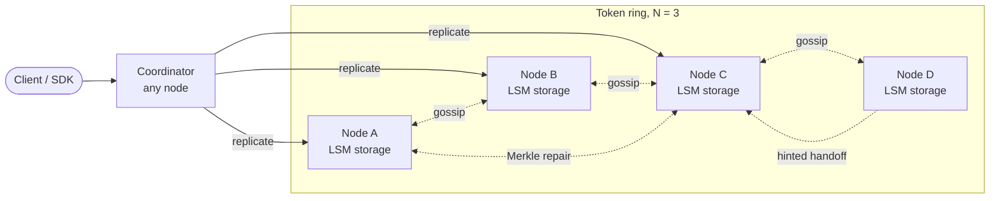
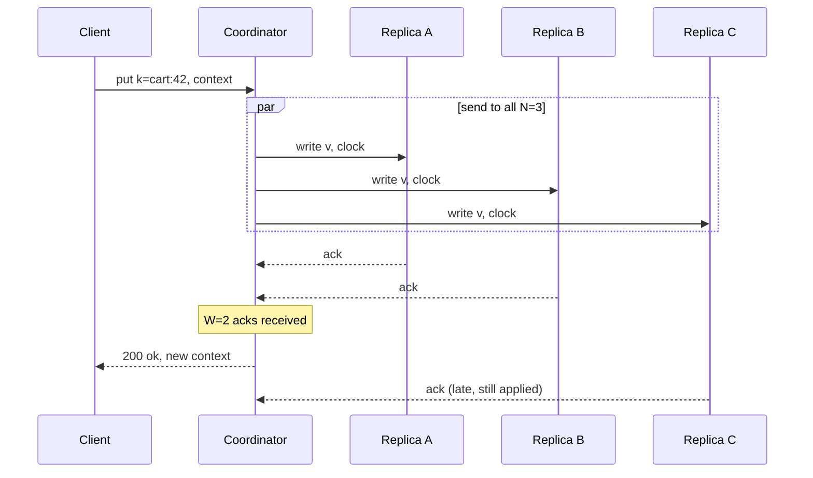

# Design a Distributed Key-Value Store (DynamoDB / Cassandra)

## Requirements

**Functional**
1. `put(key, value)` stores a value (up to ~1 MB) under a key.
2. `get(key)` returns the latest value, or all conflicting versions if replicas diverged.
3. Consistency is configurable per request (e.g. ONE, QUORUM, ALL).
4. Optional delete (implemented as a tombstone) and TTL.

**Non-functional**
- **Highly available:** writes succeed even when nodes or a whole availability zone are down ("always writable", as in Amazon's Dynamo paper).
- **Horizontally scalable:** add nodes to add capacity, with only a small fraction of data moving.
- **Tunable consistency:** callers trade latency and availability against staleness.
- **Low latency:** p99 under ~10 ms for single-key operations inside a region.
- **Scale:** ~100 TB of data, 1M reads/s and 200k writes/s at peak.

**Out of scope**
- Multi-key transactions, secondary indexes and range scans across partitions.

### Back-of-envelope estimates

| Quantity | Estimate | Implication |
|---|---|---|
| Keys | 100 TB / 1 KB average value = 100B keys | Metadata per key must be tiny; no central index of keys |
| Raw storage with N = 3 | 100 TB × 3 = 300 TB | At ~2 TB usable per node, ~150 nodes |
| Replica reads (R = 2) | 1M/s × 2 = 2M replica reads/s | Reads dominate; caching and bloom filters matter |
| Replica writes (N = 3) | 200k/s × 3 = 600k replica writes/s | Every replica gets the write, even if the coordinator waits for only W |
| Load per node | (2M + 600k) / 150 ≈ 17k ops/s | Comfortable for an SSD-backed LSM node |

## Core entities

| Entity | Key fields | Store/Notes |
|---|---|---|
| Item | `key`, `value`, version (vector clock or timestamp), `tombstone`, `ttl` | Partition key = hash(key); stored in each replica's LSM tree |
| Token ring | list of (token, node) for every virtual node | Small; every node has a copy, spread by gossip |
| Node state | `node_id`, address, status (up / suspect / down), heartbeat counter, load | Gossiped |
| Hint | target node, key, value, version | Stored locally on the node that accepted a write for a down replica |

## API

```
PUT /v1/kv/{key}?consistency=QUORUM
    headers: X-Context: <opaque version context from a previous GET>
    body: <bytes>
    → 200 { context }            write reached W replicas
    → 503                        fewer than W replicas reachable

GET /v1/kv/{key}?consistency=QUORUM
    → 200 { values: [<bytes>], context }   one value, or several siblings on conflict
    → 404                        no live value (missing or tombstoned)

DELETE /v1/kv/{key}  headers: X-Context  → 200   (writes a tombstone)
```

- The **context** is the version (vector clock) the client last read. Sending it back on `put` tells the store which versions this write supersedes, which is how conflicts get resolved rather than piling up.
- Returning multiple **siblings** is a deliberate choice (Dynamo, Riak); Cassandra-style stores instead return one value chosen by last-write-wins.
- Any node can serve any request: it becomes the **coordinator** and forwards to the key's replicas. Smart clients can hash the key themselves and go straight to a replica.

## High-level design



**Write path**
1. The client sends `put(k, v, context)` to any node. That node hashes `k` onto the ring and finds the **preference list**: the first N distinct physical nodes clockwise from the hash.
2. The coordinator increments the vector clock, sends the write to all N replicas, and replies once W of them acknowledge.
3. Each replica appends the write to its commit log (for durability), inserts it into an in-memory memtable, and later flushes it to immutable sorted files (SSTables).

**Read path**
1. The coordinator sends the read to the replicas and waits for R responses.
2. If the versions differ, it returns the newest (or all concurrent siblings) and sends the newest version back to stale replicas: **read repair**.

**Background**
1. Gossip spreads membership and failure information.
2. Hinted handoff replays writes to nodes that were briefly down.
3. Merkle-tree anti-entropy repairs replicas that drifted for longer.



## Deep dives

### Partitioning with consistent hashing

- **Weak:** `node = hash(key) mod S`. Going from 10 to 11 servers changes the result for about 10/11 of keys, so nearly all data moves.
- **Better:** consistent hashing with one position per node. Adding a node moves only ~1/S of the keys, but load is uneven.
- **Best:** consistent hashing with **virtual nodes**.

#### How consistent hashing works

1. Hash every key into a large fixed space (e.g. 0 to 2^64 − 1, treated as a circle).
2. Hash each node to one or more positions (**tokens**) on the same circle.
3. A key belongs to the first node clockwise from its hash. Its N − 1 replicas are the next distinct physical nodes clockwise.

Worked example with a ring of 0–99 and N = 3:

| Node | Token | Owns hashes |
|---|---|---|
| A | 10 | 76–99, 0–10 |
| B | 40 | 11–40 |
| C | 75 | 41–75 |

Key `user:7` hashes to 52, so its primary is C, and its preference list is C, A, B. Now add node D at token 60. Only hashes 41–60 change owner (C → D); everything else stays put. That's the whole point: membership changes move about 1/S of the data.

#### How virtual nodes fix the imbalance

With one token per node, random positions give uneven arcs (above, C owns 35% of the ring and A owns 35% while B owns 30%, and it gets worse with random tokens). When a node dies, its entire range falls onto **one** neighbor. Virtual nodes give each physical node many tokens (Cassandra used 256 per node by default for years; 4.0 lowered the default to 16 with a smarter token allocator). Each physical node then owns many small arcs scattered around the ring, so:

- Load evens out statistically.
- When a node fails or joins, its data streams to or from **many** peers in parallel, so rebuilds are faster.
- A bigger machine gets more tokens, which gives heterogeneous hardware proportional load.

When building the preference list, skip tokens belonging to a physical node already chosen, and ideally pick replicas in different availability zones.

### Replication and quorums (N, R, W)

#### How quorums work

- **N** = number of replicas per key. **W** = acks the coordinator waits for on a write. **R** = replies it waits for on a read.
- If **R + W > N**, every read set overlaps every write set in at least one replica, so a read sees the latest acknowledged write (assuming no sloppy-quorum substitutions, below).

Worked example, N = 3, W = 2, R = 2, replicas A, B, C all start with `v1`:

| Step | A | B | C | What happens |
|---|---|---|---|---|
| 1. put v2 | v2 | v2 | v1 (message delayed) | A and B ack, W = 2 met, client gets success |
| 2. get, R = 2, asks B and C | v2 | v2 | v1 | Responses v2 and v1; coordinator returns v2 (newer clock) |
| 3. read repair | v2 | v2 | v2 | Coordinator writes v2 back to C |

Any two of three replicas overlap with any other two, so the read in step 2 can't miss v2. With R = 1, W = 1 the coordinator might ask only C and return v1: fast but stale.

| Setting (N = 3) | Read cost | Write cost | Behavior |
|---|---|---|---|
| W = 1, R = 1 | lowest | lowest | Eventual consistency, highest availability |
| W = 2, R = 2 | medium | medium | Read-your-writes in the normal case; tolerates 1 replica down |
| W = 3, R = 1 | fast reads | writes fail if any replica is down | Read-heavy data that rarely changes |
| W = 1, R = 3 | slow reads | fast writes | Write-heavy, rarely read |

Quorums are not linearizability: concurrent writes and sloppy quorums can still produce conflicts, which is why versions are needed. This is the CAP trade-off made per request: during a partition, a side with fewer than W replicas either rejects writes (consistency) or accepts them via sloppy quorum (availability).

### Conflict resolution: vector clocks vs last-write-wins

Two clients can write the same key on different sides of a partition. Something must decide what `get` returns afterwards.

- **Weak: last-write-wins by wall-clock timestamp.** Simple and used by Cassandra (per column) and DynamoDB global tables. But clocks skew, and a concurrent update is silently discarded: two people adding items to the same cart lose one item.
- **Better: LWW with hybrid logical clocks** reduces skew problems but still drops concurrent writes.
- **Best for merge-able data: vector clocks** to detect concurrency, plus application-level or CRDT merges.

#### How vector clocks work

A vector clock is a map `{node: counter}`. The coordinator handling a write increments its own counter on top of the context the client sent. Compare two clocks:
- If every counter in X is ≤ the matching counter in Y, X is an ancestor of Y and can be discarded.
- Otherwise they are **concurrent** and both are kept as siblings.

Worked example (the shopping-cart case from the Dynamo paper):

| Step | Write handled by | Resulting clock | Notes |
|---|---|---|---|
| 1 | Sx | D1 `{Sx:1}` | New cart |
| 2 | Sx | D2 `{Sx:2}` | Supersedes D1 |
| 3 | Sy (client 1 read D2) | D3 `{Sx:2, Sy:1}` | Descends from D2 |
| 4 | Sz (client 2 read D2) | D4 `{Sx:2, Sz:1}` | Also descends from D2 |
| 5 | read | returns D3 and D4 | Neither dominates: Sy:1 vs Sz:1 |
| 6 | Sx, context = both | D5 `{Sx:3, Sy:1, Sz:1}` | Client merged (union of carts); dominates both |

```
def compare(a, b):
    a_le_b = all(a.get(n,0) <= b.get(n,0) for n in a|b)
    b_le_a = all(b.get(n,0) <= a.get(n,0) for n in a|b)
    if a_le_b and b_le_a: return EQUAL
    if a_le_b: return BEFORE
    if b_le_a: return AFTER
    return CONCURRENT
```

Clocks grow with the number of coordinators, so entries carry a timestamp and the oldest are truncated past a size limit (Dynamo used about 10), accepting rare false conflicts. **What to say:** "Use LWW for data where losing a concurrent update is fine (profile fields, caches); use vector clocks with siblings, or CRDTs like an OR-set, where it isn't (carts, counters)."

### Handling failures: gossip, hinted handoff, anti-entropy

#### How gossip works

There's no master tracking membership. Every second, each node picks a few random peers and exchanges its table of `(node, heartbeat counter, status, tokens)`, keeping the higher counter for each entry. A change reaches all S nodes in about O(log S) rounds: for 150 nodes, roughly 7–8 rounds. Failure detection uses heartbeat freshness; Cassandra uses a **phi accrual detector**, which turns the gap since the last heartbeat into a suspicion level relative to that node's normal inter-arrival times, instead of a fixed timeout.

#### How hinted handoff works

Suppose C is down when `put(k)` arrives and k's preference list is C, A, B. With a **sloppy quorum**, the coordinator writes to the next healthy node on the ring, D, with a hint "this belongs to C". D stores it in a separate hints area. When gossip shows C is back, D replays the hints to C and deletes them. Writes stay available during short outages. Hints expire after a window (Cassandra's default `max_hint_window` is 3 hours); longer outages need anti-entropy.

#### How Merkle-tree anti-entropy works

Comparing replicas key by key would mean shipping billions of keys. Instead, each replica builds a **Merkle tree** per token range: leaves hash buckets of keys, and each parent hashes its children.

1. Two replicas exchange root hashes. Equal roots mean the range is identical: done, one hash compared.
2. If they differ, compare the children and descend only into differing subtrees.
3. At the leaves, exchange only the keys in mismatched buckets.

Example: a range split into 1,024 leaf buckets of ~100k keys each. If one key differs, the replicas compare about 10 levels × 2 hashes and then sync one bucket of ~100k keys instead of ~100M. This is Cassandra's `nodetool repair`; run it more often than the tombstone grace period (`gc_grace_seconds`, 10 days by default) so deleted data doesn't come back.

### Storage engine on each node

- **Weak:** a B-tree updated in place. Random writes on every put.
- **Best:** an **LSM tree**. Writes append to a commit log and go into a sorted memtable; full memtables flush to immutable SSTables; background compaction merges SSTables and drops overwritten values and expired tombstones. Reads check the memtable, then SSTables newest first, using a **bloom filter** per SSTable to skip files that definitely don't contain the key. Writes become sequential I/O, which suits a write-heavy, always-writable store.

## Production readiness

### Database choice and consistency

- **Leaderless, AP data path.** Rejected: a leader-per-range design (Raft groups). It gives linearizable reads and multi-key transactions, but a range is unwritable for an election timeout whenever its leader dies, breaking "always writable". For carts, a rejected write costs revenue; a sibling the client merges costs a few lines of code. So the default is BASE: single-key atomic writes, eventual convergence via read repair, hints and Merkle repair.
- **ACID is per key only.** A put is atomic and durable on W replicas (commit log first), but there are no multi-key transactions. Compare-and-set callers pay for a consensus round (lightweight transactions) and accept failure during partitions: CP for that call only.
- **Control-plane metadata needs strong consistency.** Keyspace definitions, per-tenant quotas, ACLs and N/W/R defaults live in a small Raft-backed config store (three or five members). Two nodes disagreeing on a keyspace's replication factor would build different preference lists, so this must be CP. It's cached on every node, so an outage blocks admin changes, not traffic.

### Service boundaries and communication

- **One storage-node binary** runs coordinator, replica and gossip together. A separate coordinator tier would add a network hop to a 10 ms p99 budget for little gain.
- **A separate control plane** (provisioning, repair scheduler, backup orchestrator, quota service) is split off because it needs different permissions and must never sit on the request path.
- **Synchronous:** coordinator to replicas, waiting for exactly W (or R) acks. **Asynchronous:** the remaining replica acks, read repair (done after replying), hint replay, Merkle repair, compaction, backups and cross-region replication.

### Failure modes and reliability

| Failure | Effect | Mitigation |
|---|---|---|
| One node dies | Its keys have 2 of 3 replicas; QUORUM still succeeds | Sloppy quorum + hinted handoff; replace the node within the 3-hour hint window or run repair |
| Slow replica (GC pause, compaction storm) | p99 jumps because the coordinator waits on it | Per-replica timeout of a few ms, then **speculative retry** to the third replica; the phi-accrual detector marks it suspect so coordinators route around it |
| Hot key | N nodes saturate while the rest idle | Detect with per-key counters; read cache, sub-key splitting, per-tenant load shedding with 429s |
| Client retries a timed-out put | Same value written twice, possibly as two siblings | Puts are idempotent overwrites under the same context; reads collapse identical siblings. Clients use capped exponential backoff with jitter to avoid retry storms |
| Repair falls behind `gc_grace_seconds` | Deleted data resurrects | Repair scheduler finishes a full cycle well inside the 10-day grace; flag any range whose last repair is older than ~7 days |
| Disk fills (compaction can't keep up) | Writes fail on that node and neighbours absorb hints | Reject writes at a high-water mark (fail fast rather than corrupt), give compaction and foreground I/O separate bulkheads (thread pools, I/O budgets), add nodes |

### High availability and disaster recovery

- **No SPOF on the data path:** every node can coordinate, membership is gossiped, and the preference list puts the three replicas in three different availability zones. Losing an AZ removes one replica per key, so QUORUM reads and writes continue with **RTO ≈ 0** and no failover step.
- **RPO in-region:** a W = 2 write sits in two AZs' commit logs before the ack, so RPO is 0 for acknowledged QUORUM writes. W = 1 callers explicitly accept losing a write if that one disk dies before replication.
- **Region loss:** each region runs its own ring with LOCAL_QUORUM, replicating asynchronously. RPO is the replication lag (target under ~5 s); RTO is the time to point clients at the other region, a few minutes via DNS or SDK config.
- **Backups protect against bugs and bad deletes, which replication copies faithfully.** Immutable SSTables make snapshots cheap (hard links, upload only new files); archived commit logs give point-in-time restore. Restore is parallel: each of 150 nodes pulls its ~2 TB, about 70 minutes at ~500 MB/s. Test the restore quarterly.

### Security

- **mTLS everywhere:** client to node, and node to node for gossip, replication, hints and streaming, so a rogue host can't join the ring. Certificates are short-lived and auto-rotated.
- **Authn/authz per keyspace:** callers authenticate with a service identity; ACLs grant read/write/admin per keyspace. Each tenant gets its own keyspace plus ops/s and storage quotas, so one tenant's hot key can't starve others.
- **Encryption at rest:** commit logs, SSTables, hint files and backups are encrypted with per-keyspace data keys wrapped by a KMS master key. Rotating the master key re-wraps data keys only; a new data key applies to new SSTables, and compaction rewrites old ones.
- **PII and deletion:** values are opaque, so the store can't classify PII, but a GDPR delete isn't physically complete until compaction purges the tombstone after `gc_grace_seconds` and backups containing the key expire.
- **Audit:** log every admin action (keyspace change, grant, decommission, restore). Per-request audit is opt-in per keyspace; at 1.2M ops/s it would cost more than the data.
- **Abuse:** enforce the 1 MB value cap and a key-length limit at the coordinator; return 429 for quota breaches so clients back off instead of retrying blindly.

### Observability

**SLIs and SLOs (30-day windows):**
- 99.99% of QUORUM writes succeed.
- 99% of single-key reads and writes complete within 10 ms in-region.
- 99.9% of cross-region replication completes within 5 s.

**Dashboards:** per-node p99 latency, pending compactions and SSTables touched per read (read amplification), bloom filter false-positive rate, hints outstanding, oldest repair per range, disk usage and per-tenant throttles. **Tracing:** sample coordinator requests with a span per replica so one slow replica stands out. **Paging:** multi-window burn-rate alerts on the availability and latency SLOs (e.g. 2% of the monthly budget gone in an hour). Repair age and disk at 80% are tickets, not pages.

### Performance and cost

**Bottleneck: read amplification.** Reads are 2M of the 2.6M replica ops/s. Leveled compaction keeps SSTables per read low (at the cost of more write I/O than size-tiered); bloom filters at ~1% false positives and a block cache keep most lookups off disk; LZ4 block compression trades a little CPU for less I/O. Commit-log group commit batches fsyncs; token-aware clients with pooled connections skip the coordinator hop.

**Cost drivers:**
- **Storage, 300 TB raw over ~150 nodes**, plus compaction headroom. If values compress 2×, the fleet could shrink toward ~75 nodes, but per-node load doubles to ~35k ops/s (2.6M / 75), so check CPU and IOPS first.
- **Replication factor.** N = 3 is the price of surviving an AZ loss with QUORUM. Dropping cache-like keyspaces to N = 2 saves a third of their storage, but then any single failure blocks QUORUM.
- **Cross-region egress.** 200k writes/s × ~1 KB ≈ 200 MB/s, about 17 TB/day per remote region; at a couple of cents per GB that's several hundred dollars a day. Compress the replication stream and replicate only keyspaces that need multi-region.
- **Operational complexity.** Repair, compaction tuning and node replacement need a dedicated team; a managed service trades that for higher unit cost and less control.

## Follow-up questions

### Why does R + W > N give strong reads, and when does it not?
Any R replicas and any W replicas must share at least one member, so the read contacts someone who has the latest acknowledged write. It breaks down with sloppy quorums (the write may have landed on substitute nodes outside the read set), with concurrent writes (two different latest values), and with failed writes that partially applied. For linearizable operations you need consensus such as Paxos or Raft, which Cassandra offers as lightweight transactions.

### How does a new node join?
It picks tokens (randomly or via an allocator), announces itself through gossip, and streams the data for its new ranges from the current owners. During streaming, writes for those ranges go to both old and new owners so nothing is missed. Once it catches up, it starts serving reads.

### How are deletes handled if replicas can be down?
A delete writes a tombstone with a version rather than removing data, so a replica that missed the delete can't resurrect the value during repair. Tombstones are purged in compaction only after a grace period long enough for repair to have run everywhere.

### What is read repair and is it enough?
When a read sees differing versions, the coordinator pushes the newest version to stale replicas. It only fixes keys that get read, so cold keys can stay inconsistent forever. That's why periodic Merkle-tree anti-entropy is also required.

### How do you handle a hot key?
Consistent hashing spreads keys, not traffic, so one key still lands on N nodes. Add a cache in front for hot reads, let reads go to any replica at R = 1 for tolerant callers, and for hot writes split the key into sub-keys (`counter#0..#9`) and sum on read.

### Where does this design sit in CAP?
It's AP by default: during a partition both sides keep accepting writes, and conflicts are resolved later. Callers can choose CP-like behavior per request with W = ALL or quorum without sloppy substitution, at the cost of failing requests when replicas are unreachable.

### How would you replicate across regions?
Run a full ring per region and replicate asynchronously between regions, with local quorums (Cassandra's LOCAL_QUORUM) so requests don't wait on cross-region latency. Cross-region conflicts then need LWW, vector clocks or CRDTs; DynamoDB global tables use last-writer-wins.

### Why use virtual nodes instead of manually assigning balanced tokens?
Manual balance breaks every time a node is added or removed and requires moving data to rebalance. Many small virtual-node ranges keep load statistically even automatically, spread recovery traffic over many peers, and let you weight bigger machines with more tokens.
