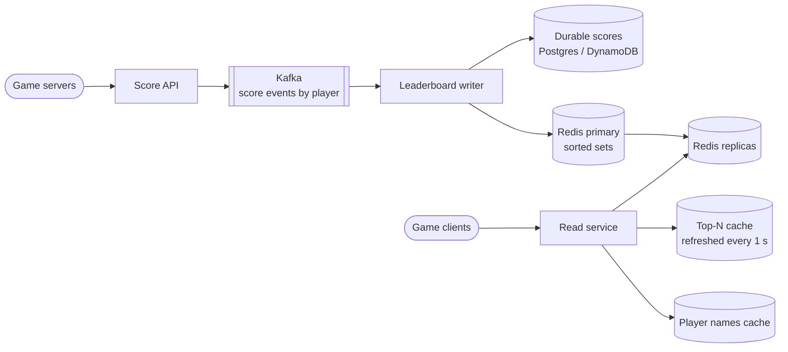
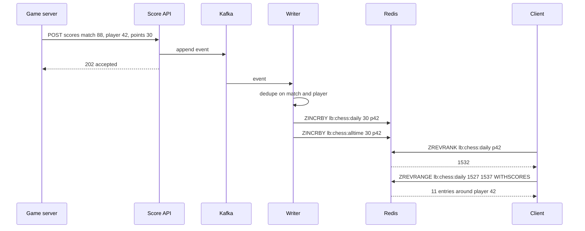

# Design a Real-time Gaming Leaderboard

## Requirements

**Functional**
1. Update a player's score when a match ends.
2. Get the top N players (e.g. top 100) for a leaderboard.
3. Get a player's rank, score, and the players just above and below them.
4. Support time-windowed boards (daily, weekly, season) alongside all-time.

**Non-functional**
- **Real-time:** a new score is reflected in ranks within ~1 s.
- **Low-latency reads:** top N and "my rank" under ~50 ms at p99.
- **Correct ordering:** deterministic tie-breaking, so two clients never see different orders for the same data.
- **Durable:** scores are never lost, even if the ranking store fails.
- **Scale:** 100M players, 10M daily active, ~10 matches each per day.

**Out of scope:** matchmaking, anti-cheat detection itself, friend graphs (mentioned as a follow-up).

### Back-of-envelope estimates

| Quantity | Estimate | Implication |
|---|---|---|
| Score updates | 10M DAU × 10 matches = 100M/day ≈ 1.2k/s, peak ~10× ≈ 12k/s | A single Redis node handles this; writes are not the bottleneck |
| Leaderboard reads | 10M × 20 views/day = 200M/day ≈ 2.3k/s, peak ≈ 25k/s | Top N is the same for everyone, so cache it; rank reads hit replicas |
| Sorted set memory | 100M members × ~100 B (skip list node + hash entry + ID) ≈ 10 GB | Fits in one large Redis instance per board, but tight with many boards |
| Daily boards | ~10M active members × 100 B ≈ 1 GB each | Cheap; expire after a few days |

## Core entities

| Entity | Key fields | Store/Notes |
|---|---|---|
| Player | `player_id`, display name, region | Postgres; names cached for rendering top N |
| Score event | `event_id`, `player_id`, `match_id`, `points`, ts | Kafka, then a durable store (Cassandra/Postgres) partitioned by `player_id`; source of truth |
| Player score | `(board_id, player_id)` → `score`, `achieved_at` | Postgres or DynamoDB; durable copy of each board's current score |
| Leaderboard | key `lb:{game}:{window}` → sorted set of `player_id` by composite score | Redis; rebuildable from the durable store |

## API

```
POST /v1/scores    Idempotency-Key: <matchId>:<playerId>
     { matchId, playerId, points }                 (called by the game server, not the client)
     → 202 { accepted: true }        403 unsigned or unknown game server

GET  /v1/leaderboards/{boardId}/top?limit=100       → { entries: [{rank, playerId, name, score}], asOf }
GET  /v1/leaderboards/{boardId}/players/{playerId}?around=5
     → { rank, score, neighbors: [{rank, playerId, name, score}] }   404 player has no score
GET  /v1/leaderboards/{boardId}/top?limit=100&cursor=100            (next page)
```

- Scores are submitted by authenticated game servers, never by game clients, which would make cheating trivial.
- The idempotency key is the match plus player, so a retried submission doesn't add points twice.
- `boardId` encodes game and window, e.g. `chess:weekly:2026-W44`.
- Ranks are 1-based in the API; Redis ranks are 0-based, so add 1.

## High-level design



**Write flow**
1. A match ends; the game server posts each player's points with an idempotency key.
2. The API validates the server's signature and appends a score event to Kafka (partitioned by `player_id`, so one player's events stay in order).
3. The writer consumes events, dedupes on the key, updates the durable score row, and runs `ZINCRBY` (or `ZADD GT` for best-score games) on every board key the event belongs to: daily, weekly, season, all-time.

**Read flow**
1. Top N: the read service serves a snapshot of the top 100, refreshed every second from Redis, so millions of identical requests cost one `ZREVRANGE` per second.
2. My rank: `ZREVRANK` plus a small `ZREVRANGE` around that rank, against a replica, with names joined from a cache.



## Deep dives

### Ranking with Redis sorted sets

**The problem:** "what is my rank?" in a SQL table means `SELECT COUNT(*) FROM scores WHERE score > :mine`. Even with an index on `score`, counting 50M rows above a mid-ranked player scans much of the index, and doing it 25k times a second while scores change is hopeless.

- **Weak:** SQL with `ORDER BY score DESC LIMIT 100` for top N and `COUNT(*)` for rank. Top N is fine; rank is O(N) per query.
- **Better:** precompute ranks with a batch job every few minutes. Cheap reads, but not real-time.
- **Best:** a **Redis sorted set**, which keeps members ordered by score and answers rank queries in O(log N).

#### How a sorted set works

Each sorted set uses two structures together:
- A **hash table** from member to score, so `ZSCORE` is O(1).
- A **skip list** ordered by (score, member). A skip list is a linked list with extra "express lanes": each node is randomly promoted to higher levels, so a search skips large stretches and takes O(log N) on average. Redis stores the span (number of nodes skipped) on every forward link, so while descending toward a member it can add up spans and get the member's **rank** in O(log N) too.

#### The commands, with a worked example

```
ZADD lb:weekly 1200 alice 950 bob 1430 carol 950 dave 700 erin
ZINCRBY lb:weekly 300 bob                    # bob: 950 → 1250
ZREVRANGE lb:weekly 0 2 WITHSCORES           # top 3, highest first
ZREVRANK lb:weekly alice                     # 0-based rank from the top
ZREVRANGE lb:weekly 1 3 WITHSCORES           # alice's neighbors (rank 2 ± 1)
ZCOUNT lb:weekly 1000 +inf                   # how many players scored at least 1000
```

| After | Order (rank: member score) |
|---|---|
| `ZADD` | 0: carol 1430, 1: alice 1200, 2: dave 950, 3: bob 950, 4: erin 700 |
| `ZINCRBY bob 300` | 0: carol 1430, 1: bob 1250, 2: alice 1200, 3: dave 950, 4: erin 700 |

Now `ZREVRANK lb:weekly alice` returns 2 (rank 3 for display), and `ZREVRANGE lb:weekly 1 3` returns bob, alice, dave. Before the increment, dave ranked above bob at 950 because equal scores sort by member name and `ZREVRANGE` reverses that order (dave > bob). That accidental tie-break is why the next section matters.

`ZINCRBY` suits games where points accumulate. For "best single run" games use `ZADD lb:weekly GT 1800 alice`, which only updates if the new score is higher (Redis 6.2+). `ZRANGE ... REV` is the newer form of `ZREVRANGE`.

| Operation | Command | Cost |
|---|---|---|
| Update score | `ZINCRBY` / `ZADD GT` | O(log N) |
| Top N | `ZREVRANGE 0 N-1` | O(log N + N) |
| Rank | `ZREVRANK` | O(log N) |
| Neighbors | `ZREVRANGE r-k r+k` | O(log N + k) |

### Ties and time windows

#### How a composite score breaks ties

Most games rank whoever reached the score **first** higher. A Redis score is a 64-bit double, which represents integers exactly up to 2^53, so you can pack two numbers into one score:

```
composite = points × 2^32 + (2^32 − 1 − seconds_since_season_start)
```

Higher points always win; for equal points, a smaller timestamp gives a larger remainder, so the earlier player ranks higher. Points can go up to 2^21 (about 2M) before exceeding 2^53.

**Worked example** (2^32 = 4,294,967,296):

| Player | Points | Reached at (s since start) | Composite |
|---|---|---|---|
| dave | 950 | 1,000 | 950 × 2^32 + 4,294,966,295 |
| bob | 950 | 5,000 | 950 × 2^32 + 4,294,962,295 |

dave's composite is larger, so he ranks above bob. To display, `points = floor(composite / 2^32)`. With `ZINCRBY` you can't simply add to a composite, so the writer reads the durable score, computes the new composite, and writes it with `ZADD` in a Lua script so the read-modify-write is atomic.

If you prefer ties to share a rank (both "#3"), compute rank as `ZCOUNT key (points+1)×2^32 +inf` plus 1, i.e. the number of players with strictly more points.

#### How time windows work

Keep one sorted set per window and write to all of them on each event:

```
ZINCRBY lb:chess:daily:2026-11-01 30 p42      EXPIRE ... 3 days
ZINCRBY lb:chess:weekly:2026-W44  30 p42      EXPIRE ... 3 weeks
ZINCRBY lb:chess:alltime          30 p42
```

A new window starts empty because the key name changes at the boundary, so there's no reset job. Expired keys clean themselves up after the results are archived. Rolling windows such as "last 7 days" can be built with `ZUNIONSTORE lb:last7 7 lb:daily:d1 ... lb:daily:d7` every few minutes. Window boundaries must use one agreed timezone (usually UTC) recorded in the board definition.

### Sharding a global leaderboard

A single sorted set holds 100M members comfortably, and Redis handles roughly 100k simple ops/s per node, so many games never need to shard. You shard when one board outgrows a node's memory or write throughput, or to keep many boards on one cluster.

| Strategy | Top N | Player rank | Problem |
|---|---|---|---|
| **Weak:** shard by `player_id` hash | Ask every shard for its top N, merge K lists | Sum over shards of `ZCOUNT(score, +inf)`: K calls per query | Scatter-gather on every rank read |
| **Better:** shard by score range | Read the top shard only | Local rank + total counts of higher shards (cached) | Ranges go hot and need rebalancing as scores inflate |
| **Best for huge boards:** exact top tier + approximate long tail | Exact set of the top ~100k players | Exact if in the top set; else percentile from a histogram | Ranks below the top are approximate |

#### How score-range sharding works

Split by score: shard 1 holds 2000+, shard 2 holds 1000–1999, shard 3 holds 0–999. Each shard also maintains its member count (`ZCARD`), cached by the read service.

**Worked example:** shard 1 has 40k players, shard 2 has 2M, shard 3 has 30M. A player with 1500 points has local rank 812,000 on shard 2. Global rank = 40,000 + 812,000 + 1 = **852,001**. When a player crosses 2000, the writer removes them from shard 2 and adds them to shard 1 in the same script or a short transaction.

#### How the approximate long tail works

Players ranked 5,000,000th vs 5,000,412th don't care about the exact number. Keep an exact sorted set only for the top tier, and for everyone else a histogram of player counts per score bucket (e.g. per 10 points). Rank = players in all higher buckets + an interpolated position in the player's own bucket, displayed as "top 12%". This uses a few KB instead of 10 GB and never scatter-gathers.

### Durability and rebuilding

- Redis is a fast index, not the record. Every event is in Kafka and every score row is in the durable store.
- Enable AOF with `appendfsync everysec` and replicas for fast failover; lost increments in the last second are replayed from Kafka by resetting the consumer offset a little and relying on idempotent dedupe.
- Full rebuild: scan the durable scores table and `ZADD` in pipelined batches of ~1,000. 100M members load in minutes.

### Hot reads

- The top 100 is identical for everyone, so serve a snapshot refreshed every second from memory or a CDN with `max-age=1`. That turns 25k/s into one Redis call per second per region.
- "My rank" is per player, so it goes to read replicas. Replica lag of milliseconds is acceptable.
- Push updates to players watching a live board by publishing the refreshed snapshot over WebSockets or SSE.

## Follow-up questions

### How would you show a leaderboard of just my friends?
Fetch the friend list (usually under a few hundred), get their scores with one `ZMSCORE` (Redis 6.2+) or pipelined `ZSCORE` calls on the global board, and sort in the service. For very active users cache the result for a few seconds. A separate sorted set per user doesn't scale because each score update would fan out to every friend's set.

### How do you prevent cheating through the score API?
Only game servers can submit, with mutual TLS or signed requests, and the server computes the score from authoritative match state. Add plausibility checks (maximum points per match, minimum match duration) and quarantine suspicious scores before they reach the public board.

### How do you handle a player who gets banned?
`ZREM` them from every board key and mark them banned in the durable store so rebuilds skip them. Everyone below moves up by one automatically, because ranks are computed rather than stored.

### What happens at the end of a season?
Snapshot the final board (`ZREVRANGE 0 -1 WITHSCORES` in pages, or dump the durable table) into permanent storage for rewards and history. The next season writes to a new key, so the old one can expire after rewards are issued.

### Why put Kafka between the API and Redis?
It absorbs bursts (a tournament round ending at once), gives a replayable log for rebuilding Redis, and lets other consumers such as analytics and achievements read the same events. Partitioning by player keeps each player's updates ordered.

### How do you return a stable rank while pages of the top list are being fetched?
Ranks change between page requests. For a consistent view, serve pages from the 1-second snapshot identified by its `asOf` timestamp, and have the client pass it back. For a live board, accept small shifts and paginate by rank offset.

### Can you use a relational database instead of Redis?
For small boards, yes: an index on `(board_id, score DESC)` makes top N fast. Rank queries still count rows, so they get slow beyond a few million players. Some teams precompute ranks periodically in SQL and use Redis only for the live top tier.

### How would you support multiple regions?
Either run regional boards (each region's Redis is independent and fast) or a global board fed by events from all regions into one writer cluster, with read replicas in each region. Cross-region replication lag of a second or two is acceptable for a leaderboard.
