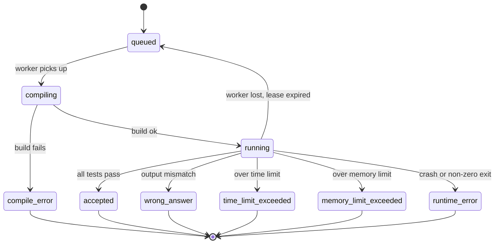
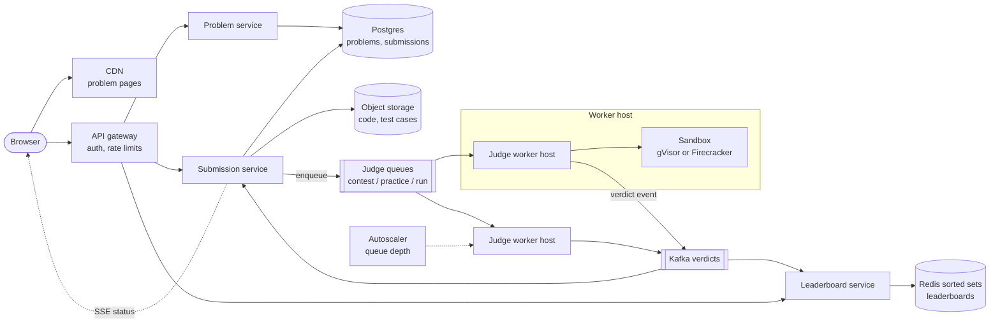
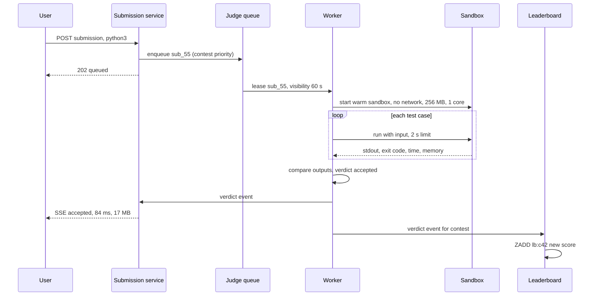

# Design LeetCode / Online Judge

## Requirements

**Functional**
1. Users browse and view problems: statement, examples, constraints, starter code per language.
2. Users submit code in one of several languages (Python, Java, C++, Go, ...) and get a verdict: accepted, wrong answer, time limit exceeded, memory limit exceeded, runtime error or compile error, with runtime and memory used.
3. Users can "run" code against custom input without a full submission.
4. Timed contests with a live leaderboard ranked by score and penalty time.

**Non-functional**
- **Secure isolation:** submitted code is hostile by default. It must not read other users' code or test data, reach the network, or affect the host or other submissions.
- **Fast results:** verdicts within ~5 s at p95 in normal load, ~10 s during contest peaks.
- **Contest spikes:** traffic jumps 50–100× when a contest starts and in its last minutes.
- **Fairness:** the same code gets consistent timing regardless of which machine runs it.
- **Scale:** ~1M submissions/day normally; contests with ~50k concurrent participants.

**Out of scope**
- Discussion forums, editorials, plagiarism detection beyond a note in the follow-ups.

### Back-of-envelope estimates

| Quantity | Estimate | Implication |
|---|---|---|
| Normal submissions | 1M/day ÷ 86,400 s ≈ 12/s | A small worker fleet handles normal traffic |
| Contest peak | 50k participants, ~1,000 submissions/s at the start and end | Queue the work; autoscale and pre-warm before the start |
| Work per submission | ~2 s of sandbox time (compile + ~100 test cases) | 1,000/s × 2 s = 2,000 sandboxes busy at once |
| Worker hosts | 2,000 sandboxes ÷ 8 per host (1 core each) = 250 hosts | Scale from ~10 hosts to ~250 for a contest |
| Code storage | 1M × ~5 KB = 5 GB/day, ~1.8 TB/year | Code in object storage or a DB column; cheap |
| Leaderboard reads | 50k users refreshing every ~10 s = 5k reads/s | Serve from Redis, cache the top pages |

## Core entities

| Entity | Key fields | Store/Notes |
|---|---|---|
| Problem | `problem_id` (PK), title, statement, difficulty, `time_limit_ms`, `memory_limit_mb`, starter code per language | Postgres; statements cached at the CDN |
| Test case | `problem_id`, `case_id`, input file, expected output file, checker type | Object storage (S3), versioned; cached on worker hosts |
| Submission | `submission_id` (PK), `user_id`, `problem_id`, `contest_id?`, `language`, `code_ref`, `status`, `verdict`, `runtime_ms`, `memory_kb`, `created_at` | Postgres, indexed by (`user_id`, `problem_id`, `created_at`) |
| Contest | `contest_id`, `start_at`, `end_at`, `problem_ids`, points per problem, penalty rule | Postgres |
| Contest result | (`contest_id`, `user_id`) → points, penalty, per-problem attempts and solve times | Postgres (truth) plus a Redis sorted set `lb:{contest_id}` for ranking |



## API

```
GET  /v1/problems?cursor=&difficulty=&tag=      → { problems: [...], nextCursor }
GET  /v1/problems/{problemId}                   → { statement, examples, constraints, starterCode }

POST /v1/submissions
  headers: Idempotency-Key: 3f9a...
  { problemId, language: "python3", code, contestId? }
  → 202 { submissionId, status: "queued" }
  → 429 too many submissions (Retry-After)
  → 403 contest not running

GET  /v1/submissions/{id}       → { status, verdict, runtimeMs, memoryKb, failedCase? }
GET  /v1/submissions/{id}/events   (SSE stream: queued → running 37/100 → accepted)

POST /v1/runs   { problemId, language, code, input } → 202 { runId }   (custom input, never ranked)

GET  /v1/contests/{id}/leaderboard?offset=0&limit=50 → { rows: [{rank, user, points, penalty}], asOf }
GET  /v1/contests/{id}/leaderboard/me               → { rank, points, penalty }
```

- Submissions are **asynchronous** (202 plus status), since execution takes seconds and contest queues can be long.
- **SSE** pushes progress to the browser; clients fall back to polling the status endpoint every ~1 s.
- The user comes from the auth token, never the body. Hidden test cases are never returned; for wrong answers outside contests we may show the first failing case.
- Per-user submission rate limits (e.g. one every 5 s) protect the queue during contests.

## High-level design



**Submit flow**
1. The submission service checks the rate limit and contest window, stores the code in object storage and a `queued` row in Postgres, and pushes `{submissionId}` onto the right queue (contest, practice or custom run).
2. A judge worker leases the message, fetches the code and the problem's test cases (cached locally by problem version), and takes a pre-warmed sandbox for the language.
3. In the sandbox it compiles, then runs each test with CPU, memory, process and output limits, comparing output with the expected file. It stops at the first failure.
4. It publishes a verdict event, destroys or resets the sandbox, and acknowledges the message.
5. The submission service updates the row and pushes the result over SSE. For contest submissions, the leaderboard service updates standings.

**Leaderboard flow:** each verdict updates the user's contest result in Postgres (the truth), recomputes their score and writes it into the Redis sorted set; pages are read with `ZREVRANGE`.



## Deep dives

### Sandboxing untrusted code

Assume every submission tries `rm -rf /`, a fork bomb, reading `/etc/passwd`, opening sockets, or a kernel exploit.

- **Weak:** run the program as a child process on the worker with a timeout. It can read the filesystem, use the network, fork-bomb the host and see other submissions.
- **Better:** a Docker-style container with tight limits. Good isolation for most attacks, but the container shares the host kernel, so a single kernel vulnerability can escape.
- **Best:** a container wrapped in a stronger boundary, either **gVisor** or a **Firecracker microVM**, plus all the container limits below.

#### How container isolation works

A container is an ordinary Linux process restricted by kernel features:

| Mechanism | What it restricts | Setting for a judge |
|---|---|---|
| Namespaces (pid, mount, net, user, ipc, uts) | What the process can see | Own PID tree, private filesystem, **network namespace with no interfaces**, root inside maps to an unprivileged user outside |
| cgroups v2 | What it can use | `memory.max` = problem limit, `cpu.max` = 1 core, `pids.max` = e.g. 64 (stops fork bombs) |
| seccomp-bpf | Which syscalls it can make | Allowlist of what compilers and runtimes need; no `mount`, `ptrace`, `reboot`, raw sockets |
| Read-only root filesystem | Persistent changes | Only a small tmpfs for `/tmp` and the working directory |
| rlimits | File size, open files, core dumps | Cap output files (e.g. 64 MB) so a program can't fill the disk |

Example invocation:

```
docker run --rm --network=none --read-only --tmpfs /tmp:size=64m \
  --memory=256m --memory-swap=256m --cpus=1 --pids-limit=64 \
  --user 65534:65534 --cap-drop=ALL --security-opt no-new-privileges \
  --security-opt seccomp=judge-seccomp.json judge-python:3.12 /run/judge.sh
```

#### How gVisor and Firecracker strengthen the boundary

- **gVisor** puts a user-space kernel (the Sentry, written in Go) between the program and the host. The program's syscalls are handled by gVisor, which itself uses only a small set of host syscalls. A kernel bug the program targets is in gVisor's implementation, not the host's. It runs as a drop-in container runtime (`runsc`); the cost is slower syscall-heavy workloads, mostly I/O, which matters little for CPU-bound solutions. Google uses it for services such as Cloud Run.
- **Firecracker** runs each sandbox as a lightweight virtual machine on KVM with a minimal device model. The isolation boundary is hardware virtualization, the same class of boundary between cloud tenants. AWS built it for Lambda and Fargate and states microVMs start in as little as ~125 ms with under 5 MiB of memory overhead each.

| Option | Boundary | Startup | Overhead | Fit |
|---|---|---|---|---|
| Plain process + timeout | none | ~ms | none | never for untrusted code |
| Container (namespaces, cgroups, seccomp) | shared kernel | ~100s of ms | low | acceptable with strict seccomp; risk of kernel escapes |
| gVisor | user-space kernel | similar to containers | syscall overhead | good default, easy to adopt with containers |
| Firecracker microVM | hardware virtualization | ~125 ms+ | ~5 MiB per VM | strongest; best for multi-tenant at scale |

**Hygiene:** never reuse a sandbox across users without resetting it (or simply destroy it); workers hold no secrets or credentials the sandbox could steal; test cases are mounted read-only and only for the problem being judged.

### Queue-based execution and fair timing

- **Weak:** the API server executes code inline. A contest start ties up every API thread and one slow submission blocks others.
- **Better:** one shared queue with a worker pool. Decoupled and durable, but custom runs and practice traffic compete with contest submissions.
- **Best:** **separate queues by class** (contest > practice > custom runs), workers that drain higher priority first, leases with visibility timeouts, and autoscaling on queue depth.

#### How a worker processes a submission

```
loop:
    msg = queue.lease(["contest", "practice", "run"], visibility=60s)   # first non-empty
    sub = msg.submission                     # id, code, language, problem; workers have no DB access
    if results_api.is_final(sub.id): queue.ack(msg); continue          # duplicate delivery
    tests = cache.get_or_fetch(sub.problem_id, problem_version)
    box = pool.take(sub.language)                                        # pre-warmed
    verdict = box.compile(sub.code)
    for t in tests while verdict is None:
        r = box.run(t.input, cpu_limit=tl * lang_multiplier, mem=ml, wall=3*tl)
        verdict = classify(r, t.expected)                                # TLE, MLE, RE, WA or None
    publish(sub.id, verdict or ACCEPTED, max_time, max_mem)
    pool.destroy(box); queue.ack(msg)
```

If a worker dies mid-judging, the lease expires and another worker re-judges. Judging is deterministic and the final status write is conditional (`WHERE status NOT IN final states`), so a duplicate run is harmless.

**Fair timing:** measure **CPU time**, not wall time, from cgroup accounting, so a busy neighbor doesn't cause a false TLE; enforce a wall-clock limit too (e.g. 3× CPU limit) to kill programs blocked on `sleep`. Pin each sandbox to a dedicated core, use one hardware type for contest workers, and apply per-language multipliers (Python commonly gets a larger time limit than C++).

**Output comparison:** exact match after trimming trailing whitespace by default; floating-point problems compare within a tolerance (e.g. 1e-6); problems with many valid answers use a custom checker program, run in a sandbox too.

### Live contest leaderboard with Redis sorted sets

- **Weak:** `SELECT ... ORDER BY points DESC, penalty ASC` over the contest results table on every refresh. 5k reads/s, each sorting 50k rows, is wasteful and grows with participants.
- **Better:** recompute the full ranking every 30 s in a batch job and cache it. Cheap, but ranks lag and "my rank" for a user deep in the list needs the full list.
- **Best:** a **Redis sorted set** per contest, updated on every verdict, with a score that encodes both sort keys.

#### How the sorted set and score encoding work

A sorted set keeps members ordered by a numeric score in a skip list, so updates and rank lookups are O(log n). Ranking is by points (higher is better), then penalty time (lower is better). LeetCode-style penalty is the time of the last accepted solution plus 5 minutes per wrong attempt on solved problems. Fold both into one number:

```
score = points * 1_000_000 - penalty_seconds        # penalty is always < 1,000,000 s
ZADD lb:c42 <score> user_7                          # overwrite on every new verdict
ZREVRANGE lb:c42 0 49 WITHSCORES                    # top 50
ZREVRANK lb:c42 user_7                              # 0-based rank for "me"
```

Worked example (90-minute contest):

| User | Points | Last AC at | Wrong attempts | Penalty (s) | Score | Rank |
|---|---|---|---|---|---|---|
| bo | 18 | 44:10 | 0 | 2,650 | 17,997,350 | 1 |
| ana | 18 | 40:00 | 1 | 2,400 + 300 = 2,700 | 17,997,300 | 2 |
| cy | 12 | 20:00 | 2 | 1,200 + 600 = 1,800 | 11,998,200 | 3 |

ana finished earlier, but her wrong attempt adds 5 minutes, so bo's penalty is lower, his score is higher, and he ranks first. At 50:00, cy solves a 6-point problem with no further wrong attempts: points 18, penalty 3,000 + 600 = 3,600, score 17,996,400, which puts cy third, behind both.

Every verdict for a contest submission updates the user's row in Postgres in a transaction and then recomputes and `ZADD`s the score, so Redis can always be rebuilt from Postgres. Ties in score are ordered by member name in Redis; display them as equal ranks. Top pages are cached for ~2–5 s, while "my rank" is read live. A 50k-member sorted set is a few MB; even millions of participants fit one Redis node.

### Surviving contest spikes

1. **Pre-warm:** the autoscaler scales judge hosts up 10–15 minutes before a scheduled start, and each host fills its pool of warm sandboxes per language.
2. **Absorb with queues:** submissions are durable messages; a 30 s backlog shows as "queued" instead of errors.
3. **Scale on queue depth and age:** target the oldest contest message waiting under ~5 s.
4. **Shed less important work:** pause or throttle custom runs and practice judging during the first minutes of a contest.
5. **Rate-limit per user:** one submission per few seconds, which also blunts brute-force guessing.
6. **Static content at the CDN:** problem statements are published to the CDN at the start time, so 50k simultaneous page loads don't hit the origin.

## Production readiness

### Database choice and consistency

- **Postgres for problems, submissions, contests and contest results.** This data is relational (submission → problem → contest), small (12 submission rows/s normally, ~1,000/s at peak), and needs transactions: a verdict must update the submission row and the user's contest result together, and the conditional final-status write (`WHERE status NOT IN final states`) relies on row-level atomicity. A NoSQL store would handle the write rate easily but would push the "exactly one final verdict" guarantee and the per-user penalty math into application code. Rejected.
- **Object storage for code and test cases.** 5 GB/day of code blobs don't belong in the hot database; versioned test data is immutable and cached on workers, so eventual consistency on reads is fine as long as a worker always fetches a specific version, never "latest".
- **Redis sorted sets for leaderboards: BASE, derived, rebuildable.** A rank that lags by a second is harmless; a lost point is not, which is why points live in Postgres and Redis is only a projection.
- **CAP stance:** the submission path chooses **consistency**. If Postgres's primary is unreachable we reject new submissions with a retryable error rather than accept work we can't record. The leaderboard chooses **availability**: serve the last cached page with its `asOf` timestamp rather than an error.

### Service boundaries and communication

- **Problem service** (read-mostly, CDN-fronted), **submission service** (writes, rate limits, SSE), **leaderboard service** (Redis), and the **judge fleet**. The judge is split out because it has a completely different trust level (it runs hostile code), scaling curve (10 → 250 hosts) and hardware profile. Problem and submission services could share one deployable early on; the split that really matters is the judge.
- **Synchronous:** reading problems, creating the submission row, reading leaderboard pages, all of which must answer the user now.
- **Asynchronous:** submit → judge queue → Kafka verdict events → submission and leaderboard services. Judging takes seconds and peaks at 1,000/s, so a durable queue absorbs the spike and keeps API threads free. Workers report results only as verdict events, never by writing to the database, which narrows what a compromised worker can touch.

### Failure modes and reliability

| Failure | Effect | Mitigation |
|---|---|---|
| Worker host dies mid-judge | Submission stuck in `running` | 60 s lease expires, message redelivered; deterministic judging plus conditional status write makes the re-run idempotent |
| A submission crashes the judge every time (poison message) | Endless redelivery wastes sandboxes | Count deliveries; after 3, move to a **DLQ** and mark the submission `system_error` so the user can resubmit; alert if DLQ rate rises |
| Contest start exceeds capacity | Queue age grows past the 10 s target | Pre-warm, scale on queue age, **shed** custom runs and practice first; separate queues act as **bulkheads** so contest traffic is never starved |
| Redis leaderboard node lost | Rankings unavailable | Serve cached top pages; rebuild the sorted set from Postgres contest results (50k rows takes seconds) |
| Kafka verdict consumer lags | Verdicts delayed, SSE shows "running" | Clients fall back to polling the status endpoint; alert on consumer lag; consumers are idempotent on `submission_id` |
| Object storage slow or erroring | Workers can't fetch code or tests | **Timeouts** with **retries using exponential backoff and jitter**; test cases already cached per host; a **circuit breaker** stops workers leasing new messages so they aren't burned on failures |

### High availability and disaster recovery

- **SPOFs:** Postgres primary (removed with a synchronous standby in another zone and automatic failover), the queue and Kafka (replicated across three zones), Redis (replica plus rebuild from Postgres). The judge fleet has no SPOF; it's stateless and spread across zones.
- **Zone vs region:** multi-zone in one region. A contest is a fixed 90-minute window; cross-region active-active adds consistency problems for contest results without much benefit. Keep a warm standby region with replicated backups.
- **Targets:** submissions and contest results **RPO ≈ 0** within the region (synchronous replica) and **RTO under 5 minutes**, because losing an accepted solve during a contest changes rankings. For a full region loss, RPO of minutes from async replication and RTO of an hour are acceptable: we'd extend or reschedule the contest. Code blobs and test cases rely on versioned, cross-region-replicated object storage.

### Security

The deep dive covers sandbox isolation; the rest of the system needs its own controls.

- **Authn/authz:** OAuth or session tokens at the gateway; user ID always from the token. Admin roles (problem setters) are separate and required to read hidden test cases or trigger rejudges.
- **Hidden test cases are the crown jewels:** encrypted at rest, readable only by the judge's service identity and problem setters, and every admin read is written to an **audit log**.
- **Workers hold no long-lived secrets:** short-lived credentials scoped to "lease from queue, read this problem's tests, publish verdicts", rotated automatically.
- **Encryption:** TLS everywhere including the internal queue; at-rest encryption for Postgres and object storage. User code may contain personal info, so it's private by default.
- **Abuse:** per-user submission limits (one per 5 s), per-IP account creation limits to stop sock-puppet accounts, and CAPTCHA on suspicious bursts.

### Observability

**SLIs and SLOs (30-day window):**
- 95% of practice submissions reach a final verdict within 5 s; during contests, 95% within 10 s.
- 99.9% of submissions reach a final verdict at all (not `system_error`).
- 99.9% of leaderboard requests succeed with data less than 10 s old.

**Dashboards:** queue depth and oldest-message age per class, warm sandbox pool size per language, verdict mix per problem (a sudden spike in WA on one problem usually means bad test data), host count vs autoscaler target, Kafka consumer lag.

**Tracing:** one trace per submission across API → queue → worker → verdict event → SSE, with spans for compile and test runs, so a slow verdict can be pinned to queue wait vs execution.

**Paging:** alert on SLO burn rate (verdict latency and system-error rate) and on contest queue age over 10 s. Don't page on a single host failure; leases handle that.

### Performance and cost

- **Main bottleneck:** sandbox capacity at contest peaks, 2,000 concurrent sandboxes. Levers: warm pools to cut startup, stop at the first failing test, cache test cases per host, and pin one core per sandbox so timing stays fair.
- **Biggest cost: the judge fleet.** Running 250 hosts all day for a peak that lasts minutes would be wasteful; normal load needs ~10 hosts. Scaling up 15 minutes before a 90-minute contest means ~250 hosts for ~2 hours, roughly 500 host-hours per contest. Spot or preemptible instances are tempting for practice and custom runs (leases make interruptions safe), but contest workers should stay on-demand, single hardware type, for consistent timing.
- **Storage** is minor: ~1.8 TB/year of code. Move submissions older than a year to cheaper storage tiers; the trade-off is slower "view old submission".
- **Leaderboard reads** (5k/s) cost almost nothing from Redis with 2–5 s page caching; the trade-off is slightly stale top pages.
- **Operational complexity:** gVisor or Firecracker adds operational work beyond plain containers; worth it here because the threat model is literally hostile code.

## Follow-up questions

### How do you stop users from reading the hidden test cases?
Only the current test's input reaches the sandbox, through stdin or a read-only file, and expected outputs never enter it; comparison happens outside in the worker. The sandbox has no network, so data can't be exfiltrated directly; limit how much stderr and output is shown back to users so inputs can't be printed piece by piece.

### Why measure CPU time instead of wall-clock time?
Wall time depends on host load and scheduling noise, so the same code could pass on one machine and TLE on another. CPU time from cgroup accounting reflects the work the program did. A separate wall-clock cap still kills programs that sleep or block.

### How would you add a new language?
Build a sandbox image with the compiler or runtime, a seccomp profile it needs, a compile and run command, and a time multiplier calibrated by running reference solutions. Roll it out to the worker pool configuration; nothing else in the pipeline changes.

### What if a worker host is compromised anyway?
Defense in depth limits damage: workers have no database credentials (they only consume a queue and publish results through a narrow API), run in an isolated network segment, and are replaced frequently. Verdict events are checked against the submission's expected state so a rogue worker can't rewrite arbitrary results.

### How do you implement "Run" against custom input cheaply?
Same pipeline on a lower-priority queue with tighter limits (one input, short time limit) and output returned to the user. Run requests are rate-limited and never touch the leaderboard. During contests they can be throttled first.

### How would you detect cheating in contests?
Compare submissions pairwise after normalizing (strip comments, rename identifiers) using token-based similarity such as MOSS-style fingerprinting, focusing on users with similar solve times. Flag for human review rather than auto-banning.

### How do you handle a rejudge after a test case was wrong?
Fix the test data as a new version, then enqueue every affected submission on a low-priority rejudge queue. Verdicts and leaderboard scores are recomputed from Postgres, and Redis is rebuilt from the updated contest results.

### How do you show progress like "running test 37/100"?
The worker publishes progress events every few tests to a pub/sub channel keyed by submission ID; the SSE server subscribed for that user forwards them. Progress is best-effort; the final verdict is always read from the database.
