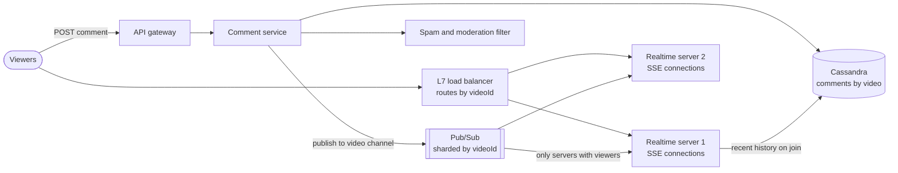
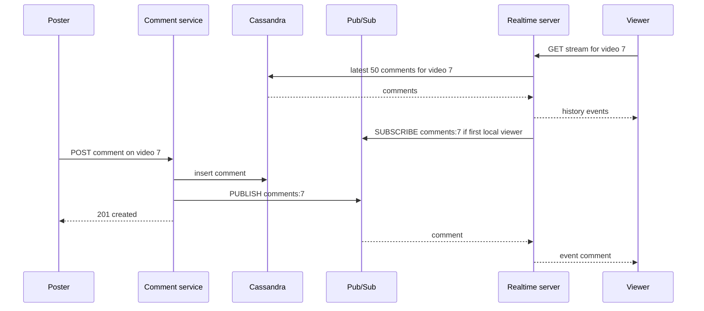

# Design Live Comments (Facebook Live / Twitch chat)

## Requirements

**Functional**
1. A viewer posts a comment on a live video.
2. All viewers of that video see new comments in real time.
3. A viewer who joins mid-stream sees the most recent comments.

**Non-functional**
- **Real-time:** a comment reaches other viewers in under ~200 ms at p99 within a region.
- **Massive fan-out:** a single video can have millions of concurrent viewers.
- **Availability over consistency:** a viewer missing or seeing a comment slightly out of order is acceptable; the stream must never stall.
- **Scale:** ~10M concurrent viewers in total across ~1M live videos, the largest with ~1M viewers.

**Out of scope:** the video stream itself, moderation models (mentioned briefly), reactions.

### Back-of-envelope estimates

| Quantity | Estimate | Implication |
|---|---|---|
| Concurrent connections | 10M viewers / ~100k connections per server = ~100 realtime servers | Long-lived connections dominate the capacity plan |
| Comment writes | 10M viewers × 1 comment per 10 min ≈ 17k/s | Writes are small; a partitioned store handles them easily |
| Hottest video writes | 1M viewers × 1 per 10 min ≈ 1.7k comments/s | Nobody can read 1.7k/s, so sample down to ~20/s for display |
| Hottest video fan-out | 20 displayed/s × 1M viewers = 20M messages/s | Spread over ~10+ servers; each server receives a comment once and writes it to each local viewer |
| Comment storage | 17k/s × 86,400 × ~200 B ≈ 290 GB/day | Wide-column store partitioned by video, with TTL or archiving |

## Core entities

| Entity | Key fields | Store/Notes |
|---|---|---|
| Live video | `video_id`, `owner_id`, `status` (live / ended), started_at | Postgres; cached |
| Comment | `video_id` (partition key), `comment_id` (time-ordered, e.g. TIMEUUID/Snowflake, clustering key desc), `user_id`, text, created_at | Cassandra: one partition per video gives cheap "latest 50" reads |
| Subscription (in memory) | on each realtime server: `video_id` → set of local connections | Local map; plus one pub/sub subscription per video per server |
| Viewer connection | `connection_id`, `user_id`, `video_id`, last event ID | In memory on the realtime server |

## API

```
POST /v1/videos/{videoId}/comments   { text }
     → 201 { commentId, createdAt }     429 posting too fast | 403 banned | 404 video not live

GET  /v1/videos/{videoId}/comments?before=<commentId>&limit=50
     → { comments: [{commentId, userId, name, text, createdAt}], nextBefore }

GET  /v1/videos/{videoId}/comments/stream          (Accept: text/event-stream)
     Last-Event-ID: <commentId>                     (sent automatically on reconnect)
     → 200 stream of events:
       id: 01HF3K...
       event: comment
       data: {"commentId":"01HF3K...","name":"ana","text":"what a goal"}
```

- Posting is a normal HTTP request; receiving is a separate server-push stream. The two paths scale independently.
- The user ID comes from the auth token. Per-user posting limits (e.g. 1 comment per 2 s) protect the stream from spam.
- History uses a cursor (`before`) on the time-ordered comment ID, never an offset, because new comments arrive constantly.

## High-level design



**Post flow**
1. The viewer posts a comment; the comment service checks rate limits and runs a quick spam filter.
2. It writes the comment to Cassandra under the video's partition, then publishes it to the channel `comments:{videoId}`.
3. It returns 201; the poster's own client shows the comment optimistically.

**Watch flow**
1. When a viewer opens a video, the client opens an SSE stream. The L7 load balancer routes it to a realtime server, preferring servers already serving that video.
2. The server loads the latest 50 comments from Cassandra (or a per-video cache) and sends them first.
3. If this is the server's first viewer of the video, it subscribes to `comments:{videoId}`. From then on, each published comment arrives once at this server, which writes it to every local connection for that video.



## Deep dives

### SSE vs WebSockets vs polling

#### How each option works

- **Short polling:** the client calls `GET /comments?after=X` every 2 s. Simple, but each poll is a full request even when nothing changed, and latency averages half the interval. A million viewers polling every 2 s is 500k req/s of mostly empty responses.
- **Long polling:** the server holds the request open until a comment arrives or ~30 s passes, then the client immediately re-requests. Lower latency, but every batch costs a new request and connection setup.
- **Server-Sent Events (SSE):** the client makes one ordinary HTTP GET with `Accept: text/event-stream`, and the server keeps the response open, writing events as text lines (`id:`, `event:`, `data:`, blank line). The browser's `EventSource` API parses them and **reconnects automatically**, sending the last `id` it saw in the `Last-Event-ID` header so the server can resume. One direction only: server to client.
- **WebSockets:** the client sends an HTTP request with `Upgrade: websocket`; the server replies `101 Switching Protocols`, and the TCP connection becomes a full-duplex channel of framed messages in both directions. Reconnection, resume and heartbeats are up to you.

| | Short polling | Long polling | SSE | WebSockets |
|---|---|---|---|---|
| Direction | Client pull | Client pull | Server push | Both ways |
| Latency | Up to the interval | Low | Low | Low |
| Per-message overhead | Full HTTP request | Full HTTP request | A few bytes of framing | A few bytes of framing |
| Reconnect and resume | N/A | Manual | Built in (`Last-Event-ID`) | Manual |
| Works with HTTP proxies and HTTP/2 | Yes | Yes | Yes, multiplexed on HTTP/2 | Needs upgrade support |

**Choice:** SSE for receiving, plain POST for sending. Comment traffic is extremely asymmetric (thousands of readers per writer), so a one-way push channel fits, and SSE gives reconnection and resume for free over standard HTTP infrastructure. One caveat: over HTTP/1.1 browsers allow only about 6 connections per domain, so serve the stream over HTTP/2. WebSockets would be the better choice if the client sent frequent messages (typing indicators, game inputs), which is why Twitch chat, built on IRC semantics, uses a WebSocket.

### Pub/sub partitioned by video

The comment service knows which video a comment belongs to, but not which of the ~100 realtime servers hold its viewers.

- **Weak:** broadcast every comment to every realtime server, and let each drop comments for videos it doesn't serve. 17k comments/s × 100 servers = 1.7M deliveries/s, nearly all wasted, and it grows with fleet size.
- **Better:** a **channel per video**. Each server subscribes only to channels of videos it currently has viewers for. A comment reaches only the servers that need it.
- **Best:** channels per video **plus** L7 routing that concentrates a video's viewers on a few servers, so each channel has few subscribers (next section).

#### How a viewer's server subscribes

Each realtime server keeps a local map from video to its open connections and subscribes or unsubscribes on the first join and last leave:

```
local = {}   # video_id -> set of connections

def on_connect(conn, video_id):
    if video_id not in local:
        local[video_id] = set()
        pubsub.subscribe(f"comments:{video_id}", on_message)
    local[video_id].add(conn)
    conn.send_all(recent_comments(video_id, 50))

def on_disconnect(conn, video_id):
    local[video_id].discard(conn)
    if not local[video_id]:
        del local[video_id]
        pubsub.unsubscribe(f"comments:{video_id}")

def on_message(channel, comment):
    for conn in local[video_of(channel)]:
        conn.send(comment)        # non-blocking; drop if the client's buffer is full
```

**Worked example** (server RT1):

| Time | Event | `local[7]` | Subscribed to `comments:7`? |
|---|---|---|---|
| t1 | Ana opens video 7 | {ana} | Subscribes now |
| t2 | Ben opens video 7 | {ana, ben} | Already subscribed |
| t3 | Comment on video 7 published | {ana, ben} | RT1 receives 1 copy, writes 2 |
| t4 | Ana leaves | {ben} | Still subscribed |
| t5 | Ben leaves | {} | Unsubscribes |

#### Choosing the pub/sub system

Redis Pub/Sub is a good fit: it's in memory, fire-and-forget, and fast. Fire-and-forget is fine here because comments are durable in Cassandra and clients can resume from history. In a Redis Cluster, classic `PUBLISH` is broadcast to every node, which limits scale; **sharded pub/sub** (`SPUBLISH` / `SSUBSCRIBE`, Redis 7.0+) maps each channel to a hash slot like a key, so a video's channel lives on one shard and the cluster scales by adding shards. Kafka is a poorer fit for per-video channels because a million topics or consumer filters on shared partitions are expensive.

### Routing viewers to servers (L7 load balancing)

With random (round-robin) routing, a video's 1M viewers land on all 100 servers, so every server subscribes to every popular video: the fan-in problem comes back.

- **Weak:** round-robin L4 balancing. Every server ends up subscribed to every big channel.
- **Better:** L7 routing by `videoId` in the URL using **consistent hashing**, so all viewers of a video go to the same server. Each channel has one subscriber. But one server can't hold 1M connections.
- **Best:** consistent hashing that maps each video to a **group of servers** sized by its viewer count: small videos get 1 server, a 1M-viewer video gets ~10–20. The balancer picks a server within the group by least connections.

#### How consistent hashing with groups works

Servers are placed at many points on a hash ring. A video hashes to a point; its group is the next k distinct servers clockwise, where k = ceil(viewers / per-server target), updated from viewer counts every few seconds. Adding a server only remaps the videos whose ring segment it takes over, so existing viewers rarely move.

**Worked example:** with a target of 50k viewers per server for any one video, video 7 with 400k viewers gets k = 8 servers. Each comment is delivered to 8 subscribers instead of 100, and each server writes it to ~50k sockets. If video 7 grows to 1M viewers, k becomes 20 and new viewers spread onto the 12 added servers; existing connections stay put.

### Delivering at a million viewers

- **Sample for display:** past ~20 comments/s nobody can read the stream. The comment service publishes everything, but the realtime server (or a per-video aggregator) forwards a ranked sample: comments from the creator, moderators, friends and verified accounts first, then random.
- **Batch writes to sockets:** send comments in 100–200 ms batches, which cuts syscalls and framing overhead with no visible latency change.
- **Slow clients:** each connection has a bounded buffer; if it fills, drop older comments for that client rather than blocking the fan-out loop.
- **Multi-region:** viewers connect to their nearest region; the comment service publishes to a cross-region relay so each region's pub/sub gets each comment once.

### Showing past comments on join

- Cassandra partitions by `video_id` with comments clustered by time-ordered ID descending, so "latest 50" is one partition read: `SELECT * FROM comments WHERE video_id = ? LIMIT 50`.
- For hot videos, keep the last 100 comments in a Redis list (`LPUSH` + `LTRIM 0 99`) to avoid hammering one Cassandra partition during a join storm.
- On reconnect, the server reads `Last-Event-ID` and sends comments newer than it from the cache, closing the gap.
- Very hot partitions can be split by time bucket (`(video_id, minute)`) so one partition doesn't grow without bound.

## Production readiness

### Database choice and consistency

- **Cassandra for comments.** The workload is append-only, ~17k writes/s, ~290 GB/day, always read as "latest N for one video". That maps directly onto a partition key (`video_id`) plus a time-ordered clustering key, and Cassandra's leaderless writes keep accepting comments when a node is down. Postgres was rejected: comments need no joins or multi-row transactions, and sharding a relational store to this write rate and storage growth costs more operational effort than it returns. DynamoDB or Bigtable would work for the same reasons.
- **Postgres for live video metadata.** Small, relational, rarely written, and the `status` flag (live / ended) gates posting, so it should be strongly consistent. Cached heavily on the read path.
- **ACID vs BASE:** almost nothing here needs ACID. Comments are BASE: write at `LOCAL_QUORUM` or even `LOCAL_ONE`, and accept that a reader may briefly miss the newest comment. The places that do want strong consistency are bans and moderation deletes (a banned user must stop posting everywhere quickly), which live with user data and are cached with short TTLs.
- **CAP stance:** the comment path is firmly **AP**, matching the stated requirement that the stream must never stall. During a partition each side keeps posting and delivering; ordering is fixed up by time-ordered IDs on the client.

### Service boundaries and communication

- **Comment service** (write path: rate limits, spam filter, persist, publish) and **realtime servers** (hold connections, fan out) are separate because they scale on different axes: 17k writes/s vs 10M open connections. A deploy of the comment service must not drop millions of SSE connections.
- **Moderation** is split into an inline cheap check (synchronous, a few ms) and an ML classifier (asynchronous, publishes delete events). Putting the ML model on the synchronous path would blow the 200 ms budget.
- **Synchronous:** POST comment → Cassandra write → 201. The write is synchronous so the poster knows it was saved.
- **Asynchronous:** publish to pub/sub, fan-out to sockets, cross-region relay, archiving. Fire-and-forget is acceptable because Cassandra is the record and clients resume via `Last-Event-ID`.
- **Not split further:** sampling for hot videos lives in the realtime server or a per-video aggregator, not a separate service per step; another network hop adds latency for no isolation benefit.

### Failure modes and reliability

| Failure | Effect | Mitigation |
|---|---|---|
| Realtime server crashes | Up to ~100k viewers disconnect at once | `EventSource` reconnects with `Last-Event-ID`; clients add **jittered backoff** so the reconnect storm doesn't hit the group's other servers all at once |
| Redis pub/sub shard down | Comments for videos on that shard stop arriving live | Replica promotion; meanwhile realtime servers detect silence on an active channel and poll the recent-comments cache, a **graceful degradation** to near-live |
| Cassandra slow or a partition hot | POSTs time out | Tight **timeouts** (~100 ms) on the write; on timeout, still publish and retry the write asynchronously with backoff, with a **DLQ** for writes that keep failing. A comment visible live but missing from history is acceptable |
| 1M-viewer join storm | Recent-history reads overload one partition | Serve history from the Redis list or a CDN snapshot; admission throttling at the load balancer (**load shedding**) |
| Slow client socket | Fan-out loop blocks | Bounded per-connection buffer; drop oldest comments for that client only, a per-connection **bulkhead** |
| Spam wave on one video | Readable stream ruined | Per-user and per-video rate limits, slow mode, sampling that favors trusted accounts |

### High availability and disaster recovery

- **SPOFs:** the L7 load balancer (run several behind anycast or DNS), the hashing-ring config (stored replicated, cached on each balancer; if it can't be refreshed, keep the last good copy), Redis shards (replica each), Cassandra (RF 3 across three zones).
- **Regions:** viewers are global and latency target is 200 ms within a region, so run active-active in several regions, each with its own realtime fleet and pub/sub, joined by the cross-region relay. Cassandra replicates asynchronously across regions; a comment written in one region appears in another's history shortly after.
- **Targets:** live delivery **RTO under ~30 s** (time for clients to reconnect elsewhere). Comment history **RPO of seconds**: a few comments lost in a region failure is acceptable for chat, and the product says so. Snapshots of Cassandra feed replay and VOD; daily backups are enough because history is not critical data.

### Security

- **Authn:** posting requires a logged-in user; watching may allow anonymous viewers with a signed, short-lived stream token so connections can't be opened in bulk without limits.
- **Authz:** the comment service checks bans, the video's mode (followers-only, slow mode) and whether the video is live. Creators and moderators can delete; each delete is written to an **audit log** with actor and reason, since moderation decisions get disputed.
- **Encryption:** TLS on all client and internal traffic, including the Redis and Cassandra links; at-rest encryption on Cassandra. Secrets (DB and Redis credentials) come from a secrets manager and rotate without restarting realtime servers, since a restart drops ~100k connections.
- **PII:** comments carry user IDs and free text that may contain personal data. Honor deletion requests by tombstoning in Cassandra and expiring cached copies.
- **Abuse:** per-user posting limits (1 per 2 s), per-IP connection limits on the stream endpoint, link and duplicate-text filters for bot floods.

### Observability

**SLIs and SLOs (30-day window):**
- 99% of comments are delivered to connected viewers within 200 ms of the POST returning, within a region (measured by synthetic viewers on every server group).
- 99.9% of comment POSTs succeed.
- 99.9% of stream connection attempts succeed.

**Metrics:** open connections per server, publish-to-socket latency, per-connection buffer drops, subscribed channels per server, Cassandra write latency per partition, sampled-vs-received ratio on hot videos.

**Tracing:** sample traces across POST → Cassandra → publish → realtime server → socket write. Tracing every fan-out write is too expensive at 20M messages/s; tag by `video_id` and trace only a sample.

**Paging:** on burn rate of the delivery-latency and POST-success SLOs, and a sudden drop in total open connections (a symptom of a mass disconnect), not on a single server's CPU.

### Performance and cost

- **Main bottleneck:** fan-out to sockets for hot videos, 20M messages/s for a 1M-viewer video. Sampling (1.7k → 20 comments/s) is the big lever; batching writes every 100–200 ms cuts syscalls, and compressing the SSE response (flushed per batch) shrinks repetitive JSON further, at some CPU cost per connection.
- **Egress** is the biggest cost: 20M messages/s × ~200 B ≈ 4 GB/s (~32 Gbps) for the hottest video alone. Levers: sampling harder, shorter payloads (send user IDs and let the client cache names), compression. Trade-off: fewer comments shown and more client logic.
- **Storage:** ~290 GB/day × RF 3 ≈ 870 GB/day, ~26 TB per month. Lever: TTL comments after ~30 days or move them to object storage for replay. Trade-off: old replays fetch history more slowly.
- **Connections:** ~100 servers for 10M viewers. Lever: tune memory per connection (TLS buffers) to fit more per server. Trade-off: a crash disconnects more viewers at once.
- **Cross-region relay** is cheap: each region receives each comment once, 17k/s × 200 B ≈ 3.4 MB/s.

## Follow-up questions

### What happens when a realtime server crashes?
Its viewers' SSE connections drop; `EventSource` reconnects automatically through the load balancer to another server in the video's group, sending `Last-Event-ID`. The new server subscribes if needed and replays the gap from the recent-comments cache. Viewers see a short pause, not lost comments.

### How do you order comments?
Use time-ordered IDs generated by the comment service (Snowflake-style or TIMEUUID), which are roughly ordered across servers. Clients insert by ID, so small reordering from pub/sub is corrected. Strict global ordering isn't worth its cost for a chat stream.

### How do you moderate comments without adding latency?
Run cheap checks inline (blocked words, rate limits, banned users) in a few milliseconds before publishing. Run heavier ML classifiers asynchronously, and if one flags a comment, publish a delete event that clients apply. Creators can enable slow mode or followers-only mode, enforced in the comment service.

### Why not store comments in Redis only?
Redis Pub/Sub has no persistence, and keeping every comment in memory is costly. Cassandra provides durable, cheap, append-heavy storage partitioned by video, and the replay or VOD view needs the full history. Redis holds only the recent window.

### How does the poster see their own comment instantly?
The client inserts it locally as pending as soon as the POST is sent, then reconciles when its own comment arrives on the stream (matched by a client-generated ID). If the POST fails, the client marks it as failed.

### How would you show comments synced to the replay after the stream ends?
Store each comment's offset from the stream start. During replay, the client fetches comments in time windows (e.g. 30 s at a time) by offset and displays them as playback reaches each one, with no realtime path involved.

### How many connections can one server hold, and what limits it?
With an event-driven server (epoll, Netty, Go), around 100k or more idle connections per server is common. Limits are memory per connection (TLS and socket buffers), file descriptors, and the CPU to write fan-out messages, which is why sampling and batching matter more than raw connection counts.

### How do you handle a sudden join storm when a celebrity goes live?
Pre-assign a large server group for known big streams, serve the initial history from the Redis cache or even a CDN-cached snapshot that refreshes every second, and let clients add jitter to reconnects. Admission throttling at the load balancer smooths the spike.
