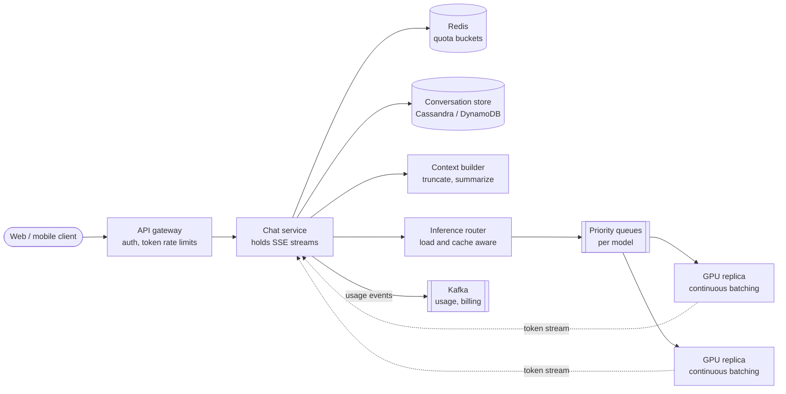
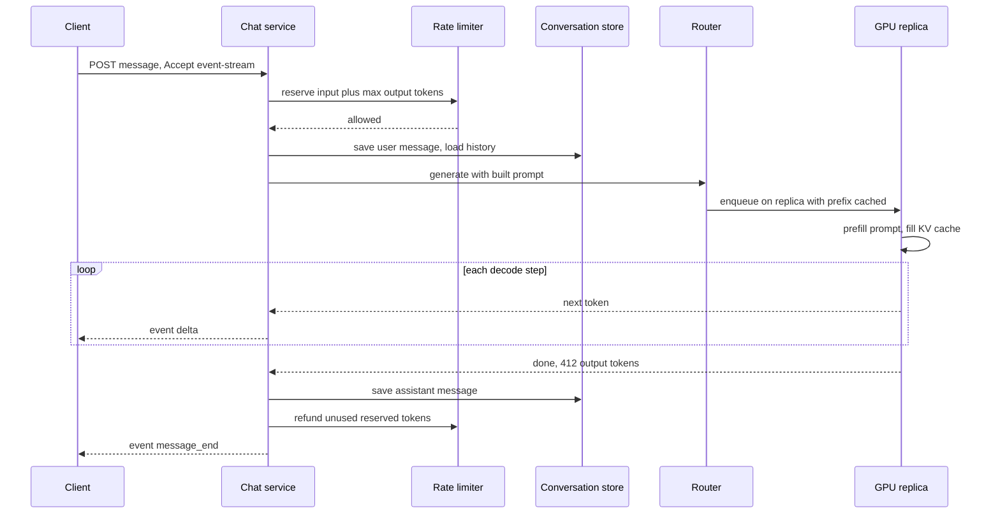

# Design ChatGPT / an LLM Chat Service

## Requirements

**Functional**
1. A user sends a prompt in a conversation and receives the model's response streamed token by token.
2. Users see a list of past conversations and can reopen and continue any of them.
3. Usage is limited per tier (e.g. free vs paid) by requests and tokens.
4. A user can stop a response mid-generation.

**Non-functional**
- **Low time to first token (TTFT):** under ~1 s at p50 for typical prompts; steady streaming afterwards (~30+ tokens/s per stream).
- **Efficient GPU use:** GPUs are the dominant cost, so keep them busy with large batches without hurting latency.
- **High availability:** chat keeps working through GPU node failures and partial region outages.
- **Scale:** 50M daily users, ~10 messages each per day.

**Out of scope:** model training, tool use and browsing, image generation, file uploads.

### Back-of-envelope estimates

| Quantity | Estimate | Implication |
|---|---|---|
| Messages | 50M × 10 = 500M/day ≈ 5.8k/s average, ~12k/s at peak | The API tier is ordinary; the GPU tier is not |
| Output tokens | 5.8k/s × ~500 tokens ≈ 2.9M tokens/s average | Drives GPU count |
| Concurrent streams | 500 tokens at ~33 tokens/s ≈ 15 s each; 5.8k/s × 15 s ≈ 87k open streams | 87k long-lived SSE connections at average, ~2× at peak |
| GPU replicas | Assume ~2,000 output tokens/s per 8-GPU replica with batching: 2.9M / 2,000 ≈ 1,450 replicas, ~3,000 at peak | Tens of thousands of GPUs, so a few percent utilization is real money |
| KV cache per token | 70B-class model with grouped-query attention: 2 × 80 layers × 8 KV heads × 128 dims × 2 bytes = 320 KB | A 4k-token conversation needs 1.25 GB of GPU memory, which caps batch size |
| Conversation storage | 500M messages × ~2 KB ≈ 1 TB/day | Wide-column store partitioned by conversation |

## Core entities

| Entity | Key fields | Store/Notes |
|---|---|---|
| User | `user_id`, tier, org | Postgres |
| Conversation | `conversation_id`, `user_id`, title, model, created_at, updated_at | DynamoDB/Cassandra; partition key `user_id`, sort key `updated_at` for the sidebar list |
| Message | `conversation_id` (partition key), `message_id` (time-ordered sort key), `parent_id`, role, content, token counts, status (streaming / complete / stopped) | Same store; `parent_id` makes edits create branches |
| Usage counter | key `quota:{user}:{window}` → tokens, requests | Redis token buckets; durable usage in a billing pipeline |
| Model replica | `replica_id`, model, KV cache free, queue depth, health | Router's in-memory registry, updated by heartbeats |

## API

```
POST /v1/conversations                     → 201 { conversationId }
GET  /v1/conversations?cursor=             → { conversations: [{id, title, updatedAt}], nextCursor }
GET  /v1/conversations/{id}/messages       → { messages: [{id, parentId, role, content}] }

POST /v1/conversations/{id}/messages
     Accept: text/event-stream   Idempotency-Key: <uuid>
     { content, parentId, model }
     → 200 text/event-stream
       event: message_start   data: {"messageId":"m_91"}
       event: delta           data: {"text":"Sure"}
       event: delta           data: {"text":", here"}
       event: message_end     data: {"stopReason":"end_turn","outputTokens":412}
     429 rate limited (Retry-After) | 413 prompt too long | 503 overloaded

POST /v1/conversations/{id}/messages/{messageId}/stop   → 200
GET  /v1/conversations/{id}/messages/{messageId}/stream?after=<offset>   (resume after disconnect)
```

- The response is the stream itself, so a single POST creates the user message and streams the assistant reply. OpenAI's and Anthropic's public APIs both stream over SSE in this style.
- The idempotency key stops a retried POST from generating and billing twice.
- `parentId` lets the user edit an earlier message and branch the conversation.
- The user and tier come from the auth token; the server, not the client, builds the prompt from stored history.

## High-level design



**Send and stream flow**
1. The gateway authenticates the user and checks the request and token buckets for their tier.
2. The chat service saves the user message, loads the conversation, and the context builder assembles the prompt (system prompt, summary of older turns, recent turns) within the model's context window.
3. The router picks a replica based on queue depth, free KV cache, and whether the replica already holds this conversation's prefix in cache.
4. The replica runs prefill on the prompt, then decodes tokens; each token goes back to the chat service, which writes an SSE `delta` event to the client.
5. At the end, the chat service saves the full assistant message, reconciles the token bucket with actual tokens used, and emits a usage event.

**History flow:** the sidebar reads conversations by `user_id` sorted by `updated_at`; opening one reads messages by `conversation_id`.



## Deep dives

### Token streaming over SSE

Generating 500 tokens takes ~15 s; making the user wait for the whole response would feel broken. Streaming shows the first words in under a second.

#### How SSE streaming works

1. The client sends the POST with `Accept: text/event-stream`. (Browsers' `EventSource` only does GET, so web clients read the POST response body with `fetch` and a stream reader.)
2. The server responds `200` with `Content-Type: text/event-stream` and keeps the connection open, writing events as they occur: each is `event:` and `data:` lines followed by a blank line, flushed immediately.
3. Proxies must not buffer the response: disable response buffering at the load balancer and send periodic comment lines (`: ping`) so idle timeouts don't cut long generations.
4. The stream ends with `message_end`, and the server closes the response.

**Why SSE rather than WebSockets:** the exchange is one request followed by a one-way stream of output, which is exactly what SSE models. It's plain HTTP, so it passes through existing gateways, auth and HTTP/2 without an upgrade.

#### Disconnects and stop

Generation is decoupled from the client connection. The chat service writes each chunk to a short-lived buffer (a Redis stream keyed by message ID). If the client drops, generation continues and the client resumes with `GET .../stream?after=<offset>`; if it never returns, the finished message is saved anyway. **Stop** is an explicit call that tells the replica to evict the sequence, freeing its batch slot and KV cache immediately, and the message is saved as `stopped`.

### GPU batching and the KV cache

#### How generation uses the GPU

Generation has two phases:
- **Prefill:** process all prompt tokens in one parallel pass, computing each token's attention keys and values. This is compute-bound and determines TTFT.
- **Decode:** produce one token per forward pass, each attending to all previous tokens. Every step reads all the model weights from GPU memory to produce one token per sequence, so it is **memory-bandwidth-bound**. Batching many sequences into one step reuses each weight read across all of them, which is why batching multiplies throughput.

The **KV cache** stores the keys and values of all previous tokens so each decode step doesn't recompute them. It grows with every token. Using the estimate above (320 KB per token), a 4k-token sequence holds 1.25 GB. On 8 × 80 GB GPUs with ~140 GB of fp16 weights for a 70B model, roughly 500 GB remains for KV cache: about 1.5M tokens, or ~390 sequences of 4k tokens. Memory, not compute, usually limits batch size.

#### How continuous batching works

- **Weak: one request at a time.** The GPU spends most of each step waiting on memory reads for a single sequence.
- **Better: static batching.** Gather N requests, run them together until all finish. Short responses finish early and their slots sit idle until the longest one ends, and new requests wait for the whole batch.
- **Best: continuous (iteration-level) batching**, introduced by the Orca paper (OSDI 2022) and used by vLLM, TGI and TensorRT-LLM. The scheduler re-forms the batch at **every decode step**: finished sequences leave immediately and waiting ones join.

**Worked example** (batch capacity 3; A needs 2 tokens, B needs 6, C needs 3, D arrives at step 1 needing 2):

| Step | Static batch | Continuous batch |
|---|---|---|
| 1 | A B C | A B C |
| 2 | A B C (A finishes) | A B C (A finishes) |
| 3 | _ B C (C finishes) | D B C (C finishes) |
| 4 | _ B _ | D B _ (D finishes) |
| 5 | _ B _ | _ B _ |
| 6 | _ B _ (B finishes) | _ B _ (B finishes) |
| 7–8 | D (waits for the batch) | done |

Static batching takes 8 steps and leaves 7 of the 18 slot-steps in steps 1–6 idle; continuous batching finishes D 4 steps sooner and everything in 6 steps instead of 8. With real traffic constantly arriving, the freed slots are always refilled.

#### Supporting techniques

- **PagedAttention (vLLM):** stores the KV cache in fixed-size blocks (like OS memory pages) instead of one contiguous region per sequence, so memory isn't reserved for the maximum length up front and fragmentation stays low. More sequences fit, so batches get bigger.
- **Chunked prefill:** a long prompt's prefill is split into chunks mixed with other sequences' decode steps, so one 30k-token prompt doesn't freeze every other stream's output.
- **Prefix caching:** the KV cache for a shared prefix (system prompt, earlier turns of this conversation) is kept and reused. The router sends a conversation's next turn to the replica that likely holds its prefix (hashing on conversation ID, with load as a tiebreaker), which cuts prefill work and TTFT.

### Scheduling and routing across replicas

- Requests enter per-model priority queues: paid tiers ahead of free, interactive ahead of batch API jobs.
- The router tracks each replica's queue depth and free KV cache blocks and sends work to the replica that can start it soonest, preferring a prefix-cache hit when load is similar.
- **Admission control:** if the estimated wait for a free tier exceeds a threshold, return 503 with `Retry-After` or fall back to a smaller model, rather than letting TTFT grow unbounded.
- Replicas send heartbeats; a failed replica's in-flight requests are retried on another replica. The chat service streams the restarted output, or marks the message failed if partial text was already shown.
- Capacity is spread across regions and GPU pools so a regional outage reduces capacity rather than taking chat down.

### Conversation storage and context management

#### Storage layout

Conversations are partitioned by `user_id` (sidebar list, sorted by `updated_at`) and messages by `conversation_id` (sorted by time-ordered `message_id`). Both reads are single-partition queries. Messages carry `parent_id`, so editing message 3 creates a sibling branch, and the conversation view follows the chosen leaf back to the root.

#### How the context builder fits history into the window

The model accepts a fixed context window (input plus output tokens). For each request:

1. Reserve space for the system prompt and for the maximum output.
2. Add messages from newest to oldest until the budget runs out.
3. If older turns don't fit, replace them with a stored running **summary** (generated asynchronously by a cheaper model when the conversation passes a threshold), or retrieve the most relevant older turns with embeddings.

**Worked example** (8k window, 1k max output, 500-token system prompt): the budget for history is 8,192 − 1,024 − 500 = 6,668 tokens. A conversation with 20 turns of ~450 tokens (9,000 tokens) doesn't fit; the last 13 turns use 5,850 tokens, and a 600-token summary of the first 7 turns brings the total to 6,450, which fits.

Token counts are stored per message at write time, so the builder never re-tokenizes the whole history.

### Rate limits by tokens

Requests per minute alone are unfair: one 100k-token request costs the GPU far more than ten short ones. Limit both requests and **tokens** per minute, per tier, using token buckets (as in a standard rate limiter, with a Lua script in Redis for atomicity).

#### How reserve-and-refund works

The output length is unknown when the request starts, so:

1. **Reserve** `input_tokens + max_output_tokens` from the bucket before generation. If the bucket lacks that, return 429 with `Retry-After`.
2. **Refund** `max_output_tokens − actual_output_tokens` when generation ends.

**Worked example** (tier limit 40,000 tokens/min, refill ≈ 667 tokens/s):

| Time | Event | Bucket |
|---|---|---|
| 0 s | Start | 40,000 |
| 0 s | Request 1: 3,000 input + 4,000 max reserved | 33,000 |
| 2 s | Refill 2 × 667 | 34,334 |
| 12 s | Request 1 ends with 800 output: refund 3,200; refill 10 s | 44,204 → capped at 40,000 |
| 13 s | Request 2: 30,000 input + 4,000 max reserved (bucket was full) | 6,000 |
| 14 s | Request 3 needs 8,000; refill brings the bucket to 6,667 | 429, Retry-After ~2 s (1,333 short ÷ 667/s) |

A separate **concurrency limit** (e.g. 3 simultaneous generations per free user) protects GPU slots from one user opening many streams.

## Production readiness

### Database choice and consistency

- **Cassandra or DynamoDB for conversations and messages.** ~1 TB/day of new messages, ~5.8k writes/s plus a write for each finished assistant reply, and every read is a single partition (`user_id` for the sidebar, `conversation_id` for a thread). No cross-conversation joins or transactions are needed. Postgres was rejected because at ~365 TB/year it would need manual sharding, and we'd use none of its relational features. The trade-off: no ad hoc queries, so search runs on a separate index fed asynchronously.
- **Postgres for users, tiers and orgs.** Small, relational, and changes to tier affect billing, so it needs ACID.
- **Redis for quota buckets: BASE with a durable backstop.** If a Redis node loses a few seconds of counters, a user gets slightly more tokens than their limit for a minute. That's acceptable; invoices come from the Kafka usage pipeline, which dedupes on request ID. Billing is the one place that needs exactly-once *effect*.
- **CAP stance:** the conversation store is **AP** with read-your-writes per session (write the user message at quorum, read at quorum in the same region). A user briefly not seeing a conversation on a second device is a minor annoyance; refusing to chat is not. The billing ledger is **CP**: delaying an invoice is better than miscounting it.

### Service boundaries and communication

- **Chat service** (SSE, prompt assembly, persistence), **inference router**, **GPU replicas**, and the **billing consumer**. The GPU tier is split out because it scales, deploys and fails on its own timeline (loading weights takes minutes) and is ~all of the cost. The context builder can live inside the chat service; making it a separate network hop adds latency to TTFT for no isolation gain.
- **Synchronous:** quota check, saving the user message, loading history, and the router call. All are on the TTFT path, so each has a tight timeout.
- **Streaming:** replica → chat service → client, buffered in a Redis stream so the client connection is decoupled from generation.
- **Asynchronous:** usage events to Kafka, summary generation for long conversations, search indexing. None of them should add milliseconds to TTFT, and all can retry later.

### Failure modes and reliability

| Failure | Effect | Mitigation |
|---|---|---|
| GPU replica dies mid-generation | Stream stops for up to ~390 in-flight sequences | Heartbeat **timeout**; retry on another replica if no tokens were shown, else mark failed with a regenerate button; charge only delivered tokens |
| GPU pool saturated after a launch | Queue wait grows, TTFT blows past 1 s | **Admission control** and **load shedding** by tier: free tier gets 503 with `Retry-After` or a smaller model first, paid tier last |
| Conversation store slow | Can't load history, TTFT stalls | **Timeout** of ~200 ms on history reads; **circuit breaker** opens and the chat service degrades to "can't load history" errors rather than tying up GPU slots with requests that will fail |
| Redis quota store down | Can't enforce limits | **Fail open** for paid tiers with a conservative per-server local limit; **fail closed** for free tier and anonymous traffic, where abuse risk is highest |
| Kafka billing consumer falls behind | Invoices delayed | Events are durable; consumer is idempotent on request ID; malformed events go to a **DLQ** for review |
| One user floods long prompts | Their requests eat batch slots | Token-based buckets plus a per-user concurrency limit act as a **bulkhead** between users |

### High availability and disaster recovery

- **SPOFs:** the router (run several stateless instances; the replica registry is rebuilt from heartbeats), Redis (replicated, with the fail-open/closed rule above), and per-model GPU pools in a single region. Spread each model's replicas across zones and several regions.
- **Regions:** active-active. The chat service and conversation store run in each region; GPU capacity is a global pool and the router can send overflow to another region's GPUs. Cross-region inference adds a little TTFT but beats a 503.
- **Targets:** conversation history **RPO under a minute** (async cross-region replication; losing the last turn in a region failure is tolerable, the user can re-ask), **RTO of a few minutes** via DNS failover. Billing events have **RPO ≈ 0** from replicated Kafka because they are money. Point-in-time backups of the conversation store protect against bad deploys and accidental deletes.

### Security

- **Authn/authz:** session tokens for the consumer app, API keys for the developer API, both resolved at the gateway to a user, org and tier. Every conversation read checks `user_id` ownership; org admins see only their org's data.
- **Tenant isolation on GPUs:** prefix caching must be keyed per user or org (or limited to shared system prompts) so one user's cached context can't leak into another's response or reveal itself through timing.
- **Encryption:** TLS end to end; conversations encrypted at rest. Conversations are the most sensitive data here (health, legal, code), so enterprise orgs may get per-tenant keys in a KMS with rotation, and staff access to message content goes through a logged break-glass path written to an **audit log**.
- **Secrets:** API keys are stored hashed; users can rotate and revoke them. Internal service credentials rotate automatically.
- **PII and retention:** honor user deletion across the store, search index, Redis stream buffers and backups (deleted from backups when they age out). Don't log prompt text by default.
- **Abuse:** token and concurrency limits per tier, signup throttling, and a safety classifier on inputs and outputs to catch misuse; API keys leaked in public code should be detectable and revoked.

### Observability

**SLIs and SLOs (30-day window):**
- 99% of interactive requests get their first token within 2 s; p50 under 1 s.
- 99% of streams sustain at least 20 tokens/s after the first token.
- 99.9% of accepted requests finish with `end_turn`, `max_tokens` or a user stop, not an error.

**Metrics:** TTFT split into queue wait vs prefill, tokens/s per replica, batch size and KV cache utilization, prefix cache hit rate, 429 and 503 rates per tier, GPU utilization per pool.

**Tracing:** one trace per message across gateway → quota → store → router → replica → stream end, with queue wait as its own span. This is how you tell "GPUs are full" from "history load was slow".

**Paging:** fast and slow SLO burn-rate alerts on TTFT and error rate, per model and region. GPU utilization dropping is a cost signal, not a page.

### Performance and cost

- **Main bottleneck:** KV cache memory per replica (~1.5M tokens) caps batch size. Levers: continuous batching, PagedAttention, prefix caching and lower default max output length, all covered above. Quantizing the KV cache or weights to 8-bit fits more sequences per GPU, at some quality risk that needs evaluation.
- **GPUs are the cost.** ~1,450 replicas × 8 = ~11,600 GPUs on average, ~24,000 at peak. At an assumed $2 per GPU-hour, average load alone is ~$23k/hour, ~$560k/day. Levers: route simple prompts to a smaller model (cheaper, sometimes worse answers); run batch API jobs off-peak on idle capacity (slower for those users); keep a smaller warm spare pool (slower recovery from spikes). A 5% gain in tokens/s per replica saves ~70 replicas.
- **Storage:** 1 TB/day × replication factor 3 ≈ 3 TB/day raw, ~1.1 PB/year. Compress message bodies (text compresses well) and tier conversations untouched for months to object storage; the trade-off is slower reopening of old chats.

## Follow-up questions

### How do you reduce time to first token?
Keep prefill short: prefix caching for system prompts and earlier turns, chunked prefill so long prompts don't block others, and routing to replicas with free capacity. Admit requests with priority so interactive traffic isn't stuck behind batch jobs. Stream the first token as soon as it's sampled, with no buffering in proxies.

### What happens if a GPU replica dies mid-response?
The chat service sees the token stream stop (or the router reports the failure). It can retry on another replica from the original prompt and continue the stream if no tokens were shown, or show an error with a regenerate button if partial text was already delivered. Usage is charged only for tokens actually delivered.

### How would you serve multiple models with different sizes?
Separate GPU pools per model, sized by demand, with the router mapping model names to pools. Small models can share GPUs; large ones span several GPUs with tensor parallelism. Autoscaling shifts replicas between pools as demand changes, which takes minutes because loading weights is slow, so keep warm spares.

### How do you cache responses?
Exact response caching rarely hits for chat, because prompts include conversation history and sampling is random. The valuable cache is the KV prefix cache on GPUs. For repeated identical API requests with temperature 0, a response cache keyed by a hash of model and prompt can help.

### How do you store and search very long conversations?
Messages stay in the partitioned store, with large ones split into chunks if a row size limit applies. Search across a user's conversations uses a separate index (full text plus embeddings) fed asynchronously from message writes.

### How would you handle a sudden traffic spike after a launch?
Queue with priorities and shed load early: free-tier requests get 503 or a smaller model before paid ones degrade. Lower the default maximum output length and tighten free-tier token limits temporarily. Since GPU capacity can't scale in seconds, admission control is the main lever.

### Why decouple generation from the client's HTTP connection?
Mobile networks drop connections often, and generation costs real GPU time. Buffering output by message ID lets the client resume without regenerating, and the conversation shows the complete answer even if the client vanished. Explicit stop is the only way generation ends early.

### How do you make usage billing accurate?
The replica reports exact input and output token counts per request; the chat service emits a usage event to Kafka keyed by request ID. A billing consumer dedupes on the request ID and aggregates per user and org. Redis buckets enforce limits in real time, while the Kafka pipeline is the record for invoices.
