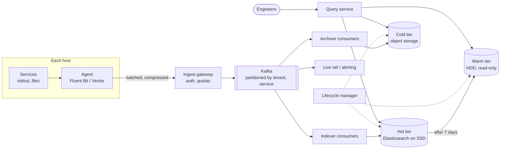
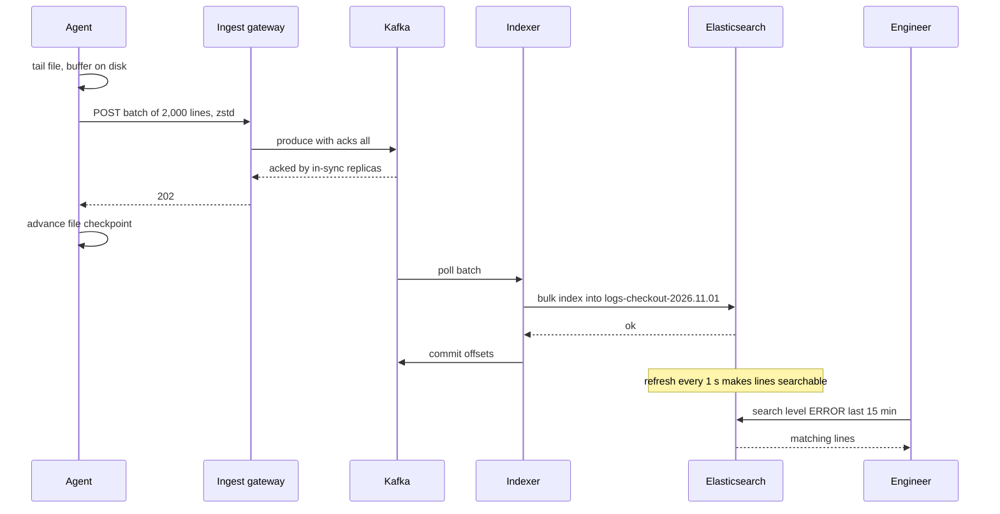

# Design a Distributed Logging System

## Requirements

**Functional**
1. Ingest logs from thousands of services running on tens of thousands of hosts.
2. Search and filter logs by time range, service, host, level, and free text, and tail logs live.
3. Apply retention policies per tenant or service (e.g. 7 days searchable, 1 year archived), then delete.

**Non-functional**
- **High ingest throughput:** ~1M log lines/s on average, with bursts of 3–5× during incidents.
- **Durable:** once acknowledged by the pipeline, a log line is not lost.
- **Fresh:** a line is searchable within ~5 s of being written.
- **Fast search:** queries over the last few hours return in ~1–2 s; older data can be slower.
- **Cost-efficient:** storage and indexing are the main costs, so tier data by age.

**Out of scope:** metrics and traces, alerting rules (a consumer of the same stream), log-based analytics dashboards.

### Back-of-envelope estimates

| Quantity | Estimate | Implication |
|---|---|---|
| Ingest volume | 1M lines/s × 500 B = 500 MB/s ≈ 43.2 TB/day raw | Needs a horizontally partitioned pipeline, not a single database |
| Kafka storage | Compressed ~5× in batches → 100 MB/s × 86,400 ≈ 8.6 TB/day, × 3 replicas ≈ 26 TB for 24 h | A modest Kafka cluster buffers a full day of indexer outages |
| Hot tier (7 days) | Index + compressed data ≈ raw size: 43 TB × 7 ≈ 300 TB, × 2 replicas ≈ 600 TB SSD | The largest cost; keep the window short |
| Cold tier (1 year) | Compressed ~10×: 4.3 TB/day × 365 ≈ 1.6 PB in object storage | Cheap per GB; scans are slow but rare |
| Agents | 50k hosts × ~20 lines/s ≈ 1M lines/s | Agents must batch and compress; one TCP request per line would be 1M req/s |

## Core entities

| Entity | Key fields | Store/Notes |
|---|---|---|
| Log event | `ts`, `tenant`, `service`, `host`, `level`, `trace_id?`, `message`, extra fields | Kafka topic partitioned by `(tenant, service)`; then indexed store |
| Index (time shard) | `logs-{tenant}-{yyyy.mm.dd}` with primary shards | Elasticsearch/OpenSearch, one index per day per tenant group, so retention = drop index |
| Chunk / archive file | `tenant`, `service`, time range, object key, per-chunk bloom filter | Object storage (S3/GCS), compressed Parquet or JSON lines |
| Retention policy | `tenant`, `service` pattern, hot days, warm days, cold days, legal hold flag | Postgres; read by the lifecycle manager |

## API

```
Ingest (agents, batched):
POST /v1/logs        Content-Encoding: zstd   Authorization: Bearer <tenant ingest token>
     [{ts, service, host, level, message, fields}, ...]          (up to ~1 MB per batch)
     → 202 accepted       429 tenant over quota (Retry-After)    413 batch too large

Search:
POST /v1/search
     { query: "level:ERROR AND service:checkout AND \"payment timeout\"",
       from: "2026-11-01T10:00:00Z", to: "2026-11-01T11:00:00Z", limit: 100, cursor }
     → 200 { hits: [{ts, service, host, message}], nextCursor, scannedTiers: ["hot"] }

GET  /v1/tail?query=service:checkout         (SSE stream of matching new lines)

Retention:
PUT  /v1/retention/{tenant}  { rules: [{service: "*", hotDays: 7, warmDays: 30, coldDays: 365}] }
```

- `202` means the line is durably in Kafka, not yet searchable; durability and searchability are separate guarantees.
- The tenant comes from the ingest token, never the payload, so one team can't write into another's logs.
- Search requires a time range; unbounded queries across a year of data are rejected or sent to an async job.
- Results use a cursor (sort values of the last hit) rather than offsets, which get expensive deep into large result sets.

## High-level design



**Ingest flow**
1. Applications write to stdout or files; the agent on each host tails them, parses lines into structured fields, and buffers them on local disk.
2. Every ~1 s or 1 MB, the agent sends a compressed batch to the ingest gateway, which checks the tenant's quota and produces to Kafka with `acks=all`, then returns 202.
3. Indexer consumers read Kafka in batches, bulk-write into the current day's index, and commit offsets only after the bulk write succeeds.
4. Archiver consumers independently write compressed hourly files to object storage.

**Search flow**
1. The query service parses the query, works out which tiers cover the time range, and fans out to the matching daily indices.
2. Each shard searches its inverted index, returns top hits sorted by time, and the query service merges them.



## Deep dives

### The agent → Kafka → indexer pipeline

- **Weak:** services write directly to Elasticsearch. Every service needs cluster credentials and retry logic, and when the cluster is slow or down during an incident (exactly when logs matter most), logs are dropped or apps block.
- **Better:** agents send straight to indexers. Agents absorb small blips, but a long indexer outage overflows their disks.
- **Best:** agents → **Kafka** → indexers. Kafka is a durable buffer that decouples producers from the indexing tier and lets several consumers (indexer, archiver, alerting) read the same stream.

#### How each stage keeps data safe

1. **Agent:** tails files and records its position (inode + byte offset) in a checkpoint file. It only advances the checkpoint after the gateway returns 202, so a crash resends rather than loses. It buffers to disk when the gateway is unreachable and caps memory so it never starves the application.
2. **Kafka:** the producer uses `acks=all` with `min.insync.replicas=2` on a replication factor of 3, so an acknowledged batch survives one broker failure. Partitioning by `(tenant, service)` spreads load and keeps one service's lines in order within a partition.
3. **Indexer:** consumes a batch, sends one `_bulk` request (e.g. 5–15 MB), and commits Kafka offsets only after success. On crash, the next consumer re-reads from the last committed offset.

This is **at-least-once** delivery: retries can duplicate lines. To dedupe, the agent assigns each line an ID (hash of host, file, offset), and the indexer uses it as the document `_id`, so a retried write overwrites instead of duplicating.

**Worked example of backpressure:** an Elasticsearch upgrade slows indexing from 1M to 400k lines/s for 30 minutes. Kafka lag grows by 600k lines/s × 1,800 s = 1.08 billion lines (~108 GB compressed), well within 24 h of retention. Afterwards, indexers scaled out to 1.5M lines/s drain the backlog at 500k lines/s net in about 36 minutes. No agent ever noticed.

### Inverted index and indexing cost

#### How an inverted index works

Instead of scanning every line for "timeout", build a map from each **term** to the sorted list of documents containing it (the posting list).

| Doc | Message |
|---|---|
| 1 | `payment timeout for order 77` |
| 2 | `user login ok` |
| 3 | `db timeout on payment write` |

After tokenizing and lowercasing:

| Term | Posting list |
|---|---|
| payment | 1, 3 |
| timeout | 1, 3 |
| login | 2 |
| db | 3 |
| order | 1 |

`timeout AND db` intersects [1, 3] with [3] → doc 3, by walking two sorted lists, without reading any message. Structured fields such as `service` and `level` are indexed as exact keywords, so `level:ERROR` is also a posting list lookup. Lucene (under Elasticsearch) writes these as **immutable segments**: new documents go to an in-memory buffer, a **refresh** (default every 1 s) turns the buffer into a searchable segment, and background merges combine small segments. That refresh interval is where "searchable within seconds" comes from.

#### What indexing costs

Full-text indexing every field makes the index roughly as large as the compressed data, and building it uses most of the cluster's CPU. Most logs are never searched.

| Approach | How | Cost | Search |
|---|---|---|---|
| **Weak:** index every field, full text, forever | Elasticsearch defaults with dynamic mappings | Highest; mapping explosions from arbitrary JSON keys | Fast for everything |
| **Better:** label-only index + brute-force scan | Index a few labels (service, host, level); store compressed chunks in object storage and grep the chunks matching the labels and time range (Grafana Loki's design) | Very low | Fast when labels narrow it; slow for needle-in-haystack text |
| **Best:** hybrid | Full-text index for the hot 7 days with explicit mappings (`message` as text, a whitelist of keyword fields, others stored but not indexed); label index + per-chunk bloom filters for older data | Moderate | Fast for recent; acceptable for old |

#### How a bloom filter helps old data

For each archived chunk, store a bloom filter of its terms: a bit array where each term sets k hashed bits. To check "does this chunk contain `trace_id=abc123`?", test those k bits: if any is 0, the term is definitely absent and the chunk is skipped; if all are 1, it's probably present and the chunk is scanned. A search for one trace ID over a day of 100k chunks might scan only a few hundred, at a filter cost of about 10 bits per term for a ~1% false-positive rate.

#### Cutting volume before it's stored

Drop or sample debug logs at the agent, enforce per-tenant quotas at the gateway, and truncate huge lines (e.g. over 32 KB). Ingest volume is the multiplier on every other cost.

### Hot, warm and cold tiers

Query patterns are steeply skewed toward recent data: most searches during incidents cover the last hour. Paying SSD prices for year-old logs wastes money.

| Tier | Age | Storage | Layout | Query latency |
|---|---|---|---|---|
| Hot | 0–7 days | SSD, 1 replica | Writable daily indices, full index | Sub-second to ~2 s |
| Warm | 7–30 days | HDD nodes | Read-only, force-merged to 1 segment per shard, replicas reduced | Seconds |
| Cold | 30–365 days | Object storage | Compressed Parquet or searchable snapshots, label index + bloom filters | Tens of seconds to minutes, often an async job |
| Delete | > retention | — | Index or objects removed | — |

#### How data moves between tiers

Elasticsearch's index lifecycle management (ILM) expresses this as a policy applied to each daily index:

```json
{ "policy": { "phases": {
    "hot":    { "actions": { "rollover": { "max_age": "1d", "max_primary_shard_size": "50gb" } } },
    "warm":   { "min_age": "7d",  "actions": { "forcemerge": { "max_num_segments": 1 },
                                              "allocate": { "require": { "data": "warm" } } } },
    "cold":   { "min_age": "30d", "actions": { "searchable_snapshot": { "snapshot_repository": "s3-logs" } } },
    "delete": { "min_age": "365d", "actions": { "delete": {} } } } } }
```

Rollover starts a new index each day (or at 50 GB per shard), so every index covers a bounded time range. Force-merging read-only indices shrinks them and speeds up search. Searchable snapshots keep only the data in object storage and fetch the parts a query needs into a local cache.

The query service checks the time range and only fans out to tiers that overlap it, so a 15-minute query never touches cold storage.

### Retention policies

- **Time-partitioned indices make deletion cheap.** Dropping the index `logs-checkout-2026.10.01` is a metadata operation. Deleting individual documents from a shared index (`delete_by_query`) marks each one deleted and rewrites segments, which is slow and expensive.
- **Per-tenant policies:** group tenants with the same retention into the same index pattern, since retention can only be as fine-grained as the index.
- **Cold tier:** S3 lifecycle rules expire objects by prefix (`tenant=payments/date=...`) after the policy's days.
- **Legal hold:** a flag on the policy that the lifecycle manager checks before any delete, overriding expiry.
- **Privacy:** personal data shouldn't be in logs; scrub known patterns (emails, card numbers) at the agent, because deleting one user's lines later means rewriting data.

### Fast search and live tail

- Every query is bounded by time, so it hits only the daily indices in range. Shards are sized at tens of GB so each searches in parallel quickly.
- Results are sorted by timestamp descending and use `search_after` for pagination.
- Live tail is a separate Kafka consumer that filters the stream and pushes matches over SSE, so tailing doesn't load the index.

## Production readiness

### Database choice and consistency

- **Kafka** is the durable buffer and the point of acknowledgment: the write path needs replayable, high-throughput appends, not queries.
- **Elasticsearch/OpenSearch for the hot tier**, because the core query is free text plus filters over recent data, which needs an inverted index. A relational DB rejects 1M rows/s with B-tree maintenance and has weak full-text support. A wide-column store (Cassandra) handles the writes but can't do ad-hoc text search.
- **Object storage for the cold tier:** 1.6 PB of rarely read data doesn't belong on block storage.
- **Postgres for retention policies and legal holds.** This is the only data that needs ACID: the lifecycle manager must read a committed legal-hold flag before deleting anything, and a half-applied policy update could delete a year of data.
- **CAP per path:** ingest is **AP**: always accept and buffer, because a log you refuse during an incident is gone forever. Search is **BASE**: lines show up after the refresh, a replica may lag slightly, and a query with a timed-out shard returns partial results marked as such. Deletion is **CP**: if the policy store is unreachable, the lifecycle manager skips deletes rather than guess.

### Service boundaries and communication

- **Ingest gateway** is stateless and split from Kafka so that auth, quotas and tenant stamping happen in one place, and agents never hold Kafka credentials.
- **Indexer, archiver and tail** are separate consumer groups on the same topics. They fail and scale independently, so an Elasticsearch outage never stops archiving, and the archive (not the index) is the long-term source of truth.
- **Sync vs async:** agent → gateway → Kafka is synchronous up to the `acks=all` ack, since that ack is the durability promise. Everything after Kafka is async. Search is synchronous with per-shard timeouts; cold-tier searches become async jobs, because minutes-long scans don't belong on an HTTP request.

### Failure modes and reliability

| Failure | Effect | Mitigation |
|---|---|---|
| Hot cluster slow or rejecting bulks (429) | Kafka lag grows, freshness misses 5 s | Indexers back off with jitter and a circuit breaker on bulk errors; Kafka's 24 h buffer absorbs it (deep dive example); UI shows "indexed up to T" |
| Incident burst at 5× (2.5 GB/s raw) | Gateway and indexers saturate | Autoscale stateless gateways; per-tenant quotas return 429; shed by priority (DEBUG first) at agents; agents buffer to disk |
| Malformed line or mapping conflict | Bulk returns partial failures; retrying the whole batch loops forever | Retry only failed docs, then send them to a DLQ topic with the error |
| One `(tenant, service)` partition flooded | Single indexer lags while others idle | Add a host-hash suffix to the partition key for large services, since order only matters per host; quota the tenant |
| Expensive query (leading wildcard over 7 days) | Heap pressure on hot nodes slows indexing | Query timeouts and result limits; dedicated coordinating nodes and separate search/write thread pools as a bulkhead |
| Zone outage | One copy of some shards and one Kafka replica lost | Zone-aware shard allocation keeps primary and replica in different zones; Kafka rack-aware RF 3 |

### High availability and disaster recovery

- **SPOFs:** gateways sit behind a load balancer across 3 zones; Kafka spans the zones; each hot shard has a replica in another zone; Postgres has a standby with automatic failover; the lifecycle manager runs with leader election so only one instance deletes.
- **Region strategy:** run one pipeline **per region** and keep logs in-region. That suits data residency and avoids shipping 43 TB/day across regions; a regional outage takes that region's services down too, so its log search can lag. Archive buckets replicate to a second region.
- **Targets:** zone loss: **RPO 0** for acked lines, **RTO under 5 minutes** for search. Region loss: other regions are unaffected. The lost region's archive **RPO is about 1 hour** (the hourly archive files), and **RTO for search over recovered history is hours**, rebuilt from the archive. Ingest gets the stricter target because a lost line can't be regenerated.
- **Backups:** Elasticsearch snapshots to object storage and Postgres point-in-time recovery. Shortening a retention policy needs two-person approval, since a bad rule is the most likely way to lose data.

### Security

- **AuthN:** ingest tokens per tenant with write-only scope, delivered to agents by a secrets manager and rotated with an overlap window. Engineers sign in through SSO.
- **AuthZ:** RBAC per tenant/service. The query service injects the tenant's index pattern and filters server-side, and never trusts a filter from the client.
- **Encryption:** TLS on every hop; encrypted disks on Kafka and Elasticsearch nodes; KMS-encrypted buckets with key rotation.
- **PII:** scrub at the agent (see retention deep dive). Mask sensitive fields such as `user_email` for roles without need-to-know.
- **Audit:** searches are themselves sensitive, so record who queried what in an append-only audit store separate from tenant indices.
- **Abuse:** byte quotas at ingest (follow-up), plus per-user query rate and cost limits so one dashboard can't hammer the hot tier.

### Observability

The pipeline's own telemetry goes to a separate metrics stack, never to itself.

**SLIs and SLOs (30 days):**
- 99.95% of in-quota agent batches get a 202.
- 99% of lines searchable within 5 s, measured by canary lines injected every 10 s per region.
- 99% of hot-tier queries over ≤ 1 hour return within 2 s.
- Zero canary lines lost.

**Dashboards:** Kafka lag per consumer group (in seconds), bulk rejections, indexing rate vs ingest rate, JVM heap and GC, fleet-wide agent disk-buffer usage, and per-tenant ingest vs quota.

**Tracing:** query fan-out per shard, plus sampled ingest batches.

**Paging:** freshness and ingest-error burn rates, and missing canaries. Hot-node heap alerts open tickets, not pages.

### Performance and cost

**Bottleneck:** indexing CPU on the hot tier. Tune with 5–15 MB bulks (deep dive), explicit mappings that skip unused fields, and a refresh interval of 2–3 s instead of 1 s, which cuts segment churn but stays inside the 5 s target. Gateways keep pooled, long-lived Kafka producers.

**Cost drivers and levers:**
- **Hot tier, ~600 TB SSD.** Cutting it from 7 to 3 days gives 43 × 3 × 2 ≈ 258 TB, saving ~340 TB, but days 4–7 move to slower warm nodes.
- **Volume.** Dropping DEBUG logs that make up, say, 30% of lines cuts every tier by 30%. The trade-off is less detail when debugging.
- **Cold tier, 1.6 PB.** Infrequent-access or archive storage classes are cheaper per GB but add retrieval fees and latency.
- **Cross-zone traffic.** Elasticsearch replicas receive about the full 43 TB/day raw, and Kafka replication adds about 17 TB/day (2 followers × 8.6 TB). That's the price of zone durability; in-region queries avoid cross-region egress.
- **Operational complexity.** A ~600 TB Elasticsearch fleet needs real expertise; a managed service or Loki-style design trades price or search speed for less toil.

## Follow-up questions

### How do you stop one noisy service from overwhelming the pipeline?
Per-tenant quotas at the ingest gateway (token buckets on bytes per second) return 429, and agents back off and buffer to disk. Kafka partitions by tenant and service, so a flood fills only that tenant's partitions. Persistent offenders get sampling rules pushed to their agents.

### Why not write logs directly to object storage and skip the index?
That's a valid low-cost design (Loki-style, or Athena over Parquet) for logs that are rarely searched. The trade-off is slower needle-in-haystack queries, because they scan data instead of looking up posting lists. Most companies index recent data and keep only archives in object storage.

### How do you handle multiline logs such as stack traces?
The agent joins them using multiline rules (a line starting with whitespace or `at ` continues the previous one) before shipping, so a stack trace becomes one event. Better still, services log structured JSON with the stack trace in one field.

### How do you correlate logs across services for one request?
Services propagate a trace ID (e.g. W3C Trace Context) and include it in every log line as an indexed keyword field. Searching `trace_id:abc` returns all lines for the request across services, sorted by time.

### What happens if Kafka itself goes down?
Agents buffer to local disk (sized for e.g. 1–2 hours of output) and retry with backoff. Kafka spans multiple availability zones with replication factor 3, so losing a full cluster is rare; if the outage exceeds agent buffers, oldest or lowest-priority lines are dropped first and the gap is reported.

### How do you choose the number of shards per daily index?
Aim for shards of roughly 10–50 GB. If a tenant writes 1 TB/day, that's about 20–40 primary shards; small tenants share an index with a few shards. Too many tiny shards waste memory and slow cluster state updates, while huge shards recover slowly.

### How do you keep timestamps trustworthy?
Use the timestamp the application wrote when it parses, and record the agent's receive time as a separate field to detect clock skew. Hosts run NTP. Indexing by event time means late-arriving lines land in the correct daily index.

### How would you support SQL-style analytics over logs?
The archiver writes Parquet partitioned by tenant, service and date, which query engines such as Trino, Athena or Spark scan efficiently by reading only needed columns and partitions. Some teams use a columnar store such as ClickHouse for both search and aggregation.
