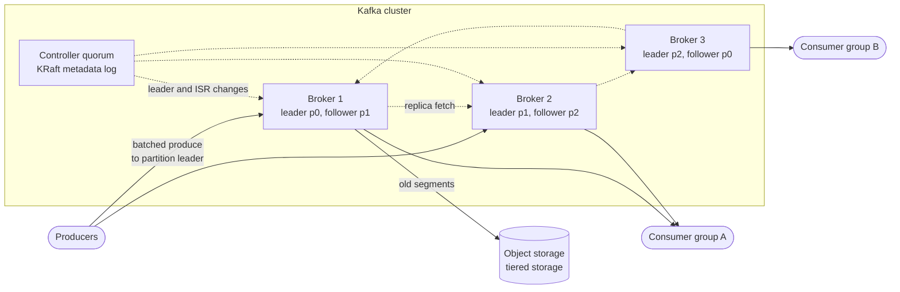
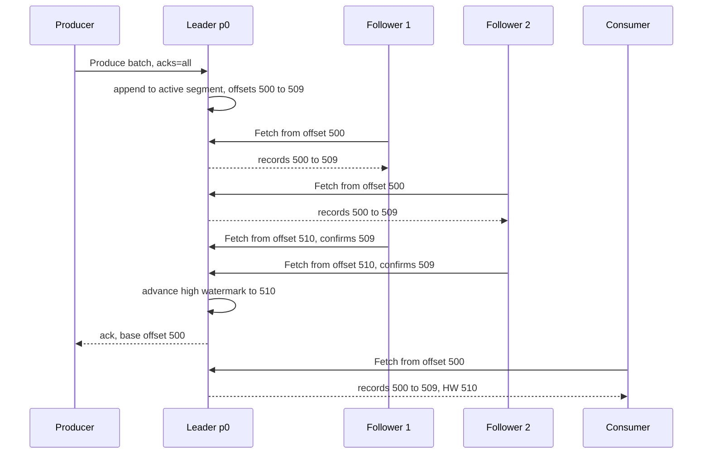

# Design a Distributed Message Queue (Kafka)

## Requirements

**Functional**
1. Producers publish messages (key, value, headers) to a named topic; consumers read them.
2. Topics are split into partitions; messages with the same key go to the same partition.
3. Consumer groups: each partition is read by exactly one consumer in a group, and many groups can read the same topic independently.
4. Consumers can replay from an earlier offset within the retention window (e.g. 7 days).

**Non-functional**
- **High throughput:** ~1M messages/s and ~1 GB/s ingress across the cluster.
- **Durability:** an acknowledged message survives the loss of any single broker (replication factor 3).
- **Ordering per partition:** consumers see a partition's messages in the order they were written. There is no global order across partitions.
- **Low latency:** p99 produce-to-consume under ~100 ms in normal operation.
- **Availability:** a broker failure triggers leader failover within seconds.

**Out of scope:** per-message routing rules (RabbitMQ-style exchanges), delayed or priority messages.

### Back-of-envelope estimates

| Quantity | Estimate | Implication |
|---|---|---|
| Ingress | 1M msg/s × 1 KB = 1 GB/s | Sequential disk writes and batching are mandatory |
| Replicated writes | 1 GB/s × RF 3 = 3 GB/s cluster-wide | Network between brokers carries 2 GB/s of replication traffic |
| Retained data | 1 GB/s × 86,400 s × 7 days ≈ 605 TB, × 3 ≈ 1.8 PB | Storage, not CPU, sets the broker count; consider tiered storage |
| Brokers | 1.8 PB / ~40 TB usable per broker ≈ 45 brokers | Throughput per broker is then ~67 MB/s of writes, comfortable |
| Egress | 3 consumer groups × 1 GB/s = 3 GB/s | Most reads hit the OS page cache if consumers keep up |
| Partitions | ~100 topics × ~30 partitions ≈ 3,000 | Each partition is a unit of parallelism and of leader election |

## Core entities

| Entity | Key fields | Store/Notes |
|---|---|---|
| Topic | `name`, `partition_count`, `replication_factor`, `retention_ms`, `cleanup_policy` | Cluster metadata, held by the controller quorum (KRaft) |
| Partition | `(topic, partition_id)`, `leader`, `replicas`, `isr`, `leader_epoch` | Metadata; the data lives as a log on each replica's disk |
| Message (record) | `offset`, `timestamp`, `key`, `value`, `headers` | Appended to segment files; offset is the position in the partition |
| Segment | base offset, `.log`, `.index`, `.timeindex` files | Rolled at ~1 GB or a time limit; deleted whole on retention |
| Consumer group | `group_id`, members, generation, partition assignment | Coordinated by a broker acting as group coordinator |
| Committed offset | `(group_id, topic, partition)` → `offset` | Stored in the internal compacted topic `__consumer_offsets` |

## API

```
Produce(topic, partition?, key?, value, headers?, acks = 0 | 1 | all)
  → { partition, offset }                    errors: NOT_LEADER, NOT_ENOUGH_REPLICAS, TIMEOUT
Fetch(topic, partition, fromOffset, maxBytes)
  → { records: [...], highWatermark }        errors: OFFSET_OUT_OF_RANGE
JoinGroup(groupId, memberId, subscribedTopics) → { generation, assignment }
CommitOffset(groupId, topic, partition, offset, generation)
  → ok                                       errors: ILLEGAL_GENERATION (fenced, stale member)
Metadata(topics) → { partitions: [{ id, leader, replicas, isr }] }
```

- The client library is fat: it fetches metadata, picks the partition (`hash(key) % partitions`, or a sticky batch when there is no key), batches records, and sends straight to the partition leader. There is no proxy tier.
- Consumers **pull** with `Fetch`. Pull lets each consumer go at its own pace and makes replay trivial: just fetch from an older offset.
- Producers with idempotence enabled send a producer ID and per-partition sequence number so the broker can drop duplicate retries.

## High-level design



**Produce path**
1. The producer looks up the leader of the target partition from cached metadata and sends a batch (e.g. up to 16 KB or 5 ms of records, compressed).
2. The leader appends the batch to the active segment of the partition log (a sequential write to the page cache).
3. Followers continuously fetch from the leader and append the same bytes. With `acks=all`, the leader replies once every replica in the ISR has the batch.

**Consume path**
1. A consumer joins its group; the group coordinator assigns it partitions.
2. It fetches from its committed offset; the broker serves bytes from the page cache, often with zero-copy (`sendfile`).
3. After processing, it commits the next offset to `__consumer_offsets`.

**Failure path:** the controller notices a broker missing heartbeats, picks a new leader for each affected partition from its ISR, bumps the leader epoch, and publishes new metadata. Clients get `NOT_LEADER`, refresh metadata, and retry.



## Deep dives

### The append-only log, explained

- **Weak:** a broker that keeps a queue data structure and deletes each message once consumed. Random I/O, per-message bookkeeping, and no replay or multiple independent readers.
- **Better:** a B-tree or LSM store keyed by message ID. Durable, but every write does index work you never need.
- **Best:** each partition is an **append-only log**. Writes only go to the end; reads are sequential scans from an offset. Sequential disk I/O is fast even on spinning disks, and the OS page cache does the caching.

#### How segments and offsets work

A partition's log is a directory of **segment files**. Only the newest (active) segment receives writes. Each segment is named by the first offset it holds:

```
orders-0/
  00000000000000000000.log        offsets 0 .. 1,048,575   (closed, ~1 GB)
  00000000000000000000.index
  00000000000001048576.log        offsets 1,048,576 .. now (active)
  00000000000001048576.index
  00000000000001048576.timeindex
```

- The **offset** is a 64-bit sequence number per partition. It is the message's identity and the consumer's bookmark.
- The **`.index`** file is sparse: roughly one entry every 4 KB of log, mapping relative offset to byte position.
- **Finding offset 1,050,000:** binary-search the segment names to find the segment with base 1,048,576; binary-search its index for the largest entry at or below relative offset 1,424 (say relative 1,400 at byte 1,433,600); scan forward from that byte to offset 1,050,000. Two binary searches and a short scan, no per-message index.
- **Retention:** when a closed segment's newest message is older than `retention.ms` (default 7 days) or the partition exceeds `retention.bytes`, the whole file is deleted. No compaction of individual records is needed.
- **Log compaction** (an alternative cleanup policy) keeps only the latest record per key, which turns a topic into a changelog. `__consumer_offsets` uses it.

#### Why it's fast

| Technique | Effect |
|---|---|
| Batching + compression (lz4, zstd) | One disk write and one network round trip per many records |
| Sequential append | No seeks; disks and SSDs are at their best |
| Page cache instead of an in-process cache | No double buffering; caught-up consumers read from RAM |
| Zero-copy `sendfile` | Bytes go from page cache to socket without entering user space (when TLS is off) |

### Partitions and consumer groups, with a rebalance

#### How assignment works

A topic with P partitions can be consumed in parallel by at most P consumers in one group; extra consumers sit idle. Ordering holds within a partition, so all events for an entity (e.g. `order_id` as the key) land in one partition and are processed in order by one consumer.

A broker is chosen as **group coordinator** for each group (by hashing `group_id` onto a `__consumer_offsets` partition). Members send heartbeats; when membership changes, the group **rebalances**: members rejoin, the group **generation** increments, and partitions are reassigned.

#### Worked example: topic `orders` with 6 partitions

| Time | Event | Generation | C1 | C2 | C3 |
|---|---|---|---|---|---|
| t0 | C1 and C2 join | 1 | p0, p1, p2 | p3, p4, p5 | |
| t1 | C3 joins | 2 | p0, p1 | p3, p4 | p2, p5 |
| t2 | C2 stops heartbeating (crash) | 3 | p0, p1, p3 | | p2, p5, p4 |
| t3 | C2's zombie tries to commit p3 offset 9,120 with gen 2 | 3 | rejected: `ILLEGAL_GENERATION` | | |

- With the old **eager** protocol, at t1 every consumer revokes all partitions, then gets a new set: the whole group stops briefly.
- With the **cooperative sticky** assignor, only the moved partitions (p2 from C1, p5 from C2) are revoked; C1 keeps processing p0 and p1 throughout. This is the better choice for large groups.
- The generation number fences zombies: at t3 the coordinator rejects commits from a stale generation, so C2 cannot overwrite C1's progress on p3.
- C1 resumes p3 from the last committed offset. Anything C2 processed after its last commit is processed again, which is why consumers must tolerate duplicates (next section).

**Choosing the partition count:** pick it for peak parallelism, e.g. a consumer handles 5 MB/s and the topic peaks at 100 MB/s, so at least 20 partitions; round up to leave headroom (30). Adding partitions later changes `hash(key) % P`, breaking per-key ordering for keyed topics, so over-provision a bit up front.

### Replication, ISR and acks

#### How ISR replication works

Each partition has one **leader** and N−1 **followers**. Followers pull from the leader like consumers do. The **in-sync replica set (ISR)** is the leader plus followers that have caught up within `replica.lag.time.max.ms` (30 s by default in recent versions). A follower that falls behind is removed from the ISR; when it catches up, it is added back.

- **Log end offset (LEO):** the next offset each replica will write.
- **High watermark (HW):** the smallest LEO across the ISR. Only messages below the HW are **committed** and visible to consumers. That way a consumer never reads a message that could disappear in a failover.

**Worked example (RF 3, `min.insync.replicas=2`):**

| Step | Leader B1 LEO | B2 LEO | B3 LEO | ISR | HW | Note |
|---|---|---|---|---|---|---|
| 1 | 510 | 510 | 510 | B1, B2, B3 | 510 | All caught up |
| 2 | 520 | 515 | 510 | B1, B2, B3 | 510 | Batch 510–519 written to leader; acks=all producer still waiting |
| 3 | 520 | 520 | 510 | B1, B2, B3 | 510 | B3 is slow (GC pause) |
| 4 | 520 | 520 | 510 | B1, B2 | 520 | B3 lagged past 30 s, dropped from ISR; HW advances, producer is acked |
| 5 | B1 crashes | 520 | 510 | B2 | 520 | Controller elects B2 (in ISR) as leader with a new epoch; no acked data lost |
| 6 | | 525 | 525 | B2, B3 | 525 | B3 truncates to the leader's log and catches up, rejoins ISR |

At step 5, if B2 also died, the only live replica is B3, which is missing 510–519. **Unclean leader election** (off by default) would let B3 lead and silently lose those acked messages; leaving it off means the partition is unavailable until an ISR member returns. That is the durability vs availability dial. Leader epochs let a returning replica truncate exactly the divergent suffix rather than trusting its own high watermark.

#### Producer acks

| Setting | Leader replies when | Loss risk | Latency |
|---|---|---|---|
| `acks=0` | Never waits | Lost on any failure | Lowest |
| `acks=1` | Leader wrote it | Lost if leader dies before followers copy it | Low |
| `acks=all` + `min.insync.replicas=2` | All ISR members have it, and ISR ≥ 2 | Needs two brokers to fail at once | One extra replication round trip |

If the ISR shrinks below `min.insync.replicas`, `acks=all` produces fail with `NOT_ENOUGH_REPLICAS` instead of silently accepting under-replicated writes. RF 3 with min ISR 2 tolerates one broker down for writes and stays durable. Since Kafka 3.0 the producer defaults are `acks=all` with idempotence on.

### Delivery semantics

#### How each guarantee comes from commit order

| Semantics | Consumer does | On crash after processing |
|---|---|---|
| At-most-once | Commit offset, then process | Message skipped (lost) |
| At-least-once | Process, then commit | Message reprocessed (duplicate) |
| Exactly-once (effectively) | Process and commit atomically, or process idempotently | No loss, no visible duplicate |

**At-least-once plus idempotent processing is the usual answer.** Example: a payments consumer processes offsets 100–149, writes to its DB, and crashes before committing. On restart it resumes at 100. If each write is `INSERT ... ON CONFLICT (event_id) DO NOTHING`, the replay is harmless.

**Kafka's exactly-once** covers read-process-write pipelines that stay inside Kafka:
1. **Idempotent producer:** the broker tracks `(producer_id, partition) → last sequence`. A retried batch with sequence 42 after 42 was already written is dropped, so network retries don't duplicate.
2. **Transactions:** the producer calls `beginTransaction`, writes output records to several partitions, adds the consumer's input offsets with `sendOffsetsToTransaction`, then `commitTransaction`. A transaction coordinator writes commit markers to every involved partition.
3. **Read committed:** downstream consumers with `isolation.level=read_committed` skip records from aborted transactions and only read up to the last stable offset.

```
producer.initTransactions()
loop:
  records = consumer.poll()
  producer.beginTransaction()
  for r in records: producer.send(output_topic, transform(r))
  producer.sendOffsetsToTransaction(offsets_of(records), consumer.groupMetadata())
  producer.commitTransaction()        # outputs and input offsets commit together
```

Side effects outside Kafka (sending an email, calling an API) cannot join the transaction; for those you still need idempotency keys at the destination.

### Metadata and controller

- **Weak:** brokers coordinate peer to peer. Split brain on leadership is hard to rule out.
- **Better:** an external ZooKeeper ensemble stores metadata and elects a controller (classic Kafka). Works, but it's a second system to run and metadata changes for many partitions are slow.
- **Best:** **KRaft**, a Raft quorum of 3 or 5 controller nodes that stores metadata as its own replicated log. Brokers tail that log. Failover of a controller takes seconds and the cluster scales to far more partitions. ZooKeeper support was removed in Kafka 4.0.

## Follow-up questions

### How do you guarantee ordering for all events of one user?
Use the user ID as the message key so every event hashes to the same partition, and have one consumer per partition process it serially. On the producer, idempotence keeps order even with retries in flight (up to 5 in-flight requests per connection). Never increase the partition count of a keyed topic without a migration plan, because the key-to-partition mapping changes.

### What happens when a consumer is much slower than producers?
Its lag (log end offset minus committed offset) grows, but the broker isn't harmed because data stays on disk until retention. You scale out consumers up to the partition count, or speed up processing. If lag exceeds retention, the oldest unread segments are deleted and the consumer gets `OFFSET_OUT_OF_RANGE`, so alert on lag well before that.

### How would you implement a delayed or retry queue on top of this?
Create retry topics with fixed delays (e.g. `orders-retry-1m`, `orders-retry-10m`) and a dead-letter topic. A failed message is produced to the next retry topic with its due time in a header; that topic's consumer pauses until the due time, then reprocesses. After the last retry it goes to the DLQ for inspection.

### Why does Kafka use pull rather than push?
Pull lets each consumer control its rate and batch size, so a slow consumer doesn't get overwhelmed and a fast one can fetch large batches. It also makes replay and multiple independent groups trivial, since the broker keeps no per-consumer delivery state beyond offsets. Long polling (`fetch.max.wait.ms`) avoids busy loops when there's no data.

### How do you keep storage costs down with long retention?
Tiered storage moves closed segments to object storage like S3 and keeps only recent segments on local disk, so brokers size for throughput instead of total history. Compression at the producer (zstd) often shrinks text payloads several times. Compacted topics keep only the latest value per key for changelog-style data.

### How would you replicate a topic to another region?
Run an asynchronous mirroring process (MirrorMaker 2 or Confluent Replicator) that consumes from the source cluster and produces to the destination. Offsets differ between clusters, so it also translates consumer group offsets for failover. Cross-region replication is async, so a regional failover can lose the last seconds of data.

### How is this different from RabbitMQ or SQS?
Those are queues: a message is deleted once acknowledged, with per-message acks, visibility timeouts and flexible routing. Kafka is a log: messages stay for the retention period regardless of consumption, ordering is per partition, and many groups replay independently. Use a queue for task distribution with per-message retries; use a log for event streams, high throughput, and replay.

### What breaks when you have hundreds of thousands of partitions?
Each partition has open files, replication fetches, and leader metadata; failover of a broker means electing new leaders for all its partitions. With ZooKeeper this was slow; KRaft handles far more, but end-to-end latency and memory still grow. Prefer fewer, well-sized partitions and consolidate small topics.
