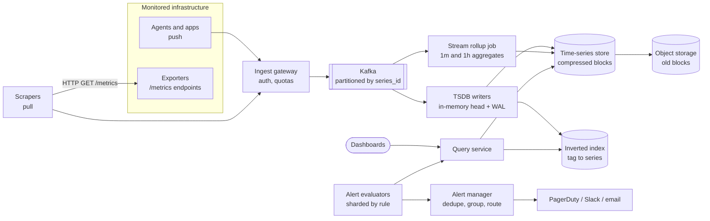
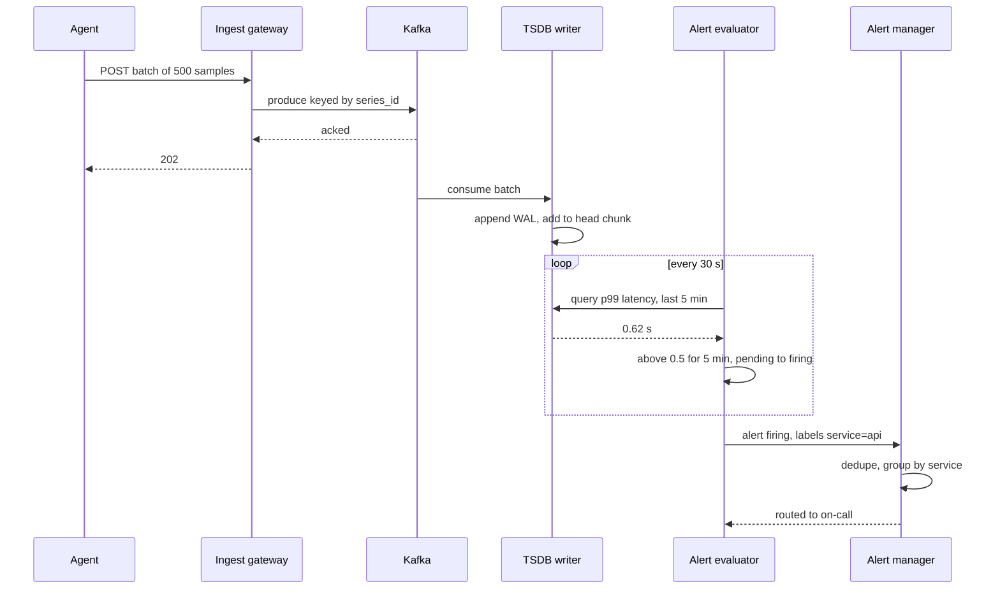

# Design a Metrics & Monitoring System (Datadog / Prometheus)

## Requirements

**Functional**
1. Ingest metrics from hosts, containers and applications: a name, tags (labels), a timestamp and a float value.
2. Query metrics over time ranges with aggregation (sum, avg, rate, percentiles) and group-by on tags; power dashboards.
3. Define alerting rules (e.g. "p99 latency > 500 ms for 5 min") that notify on-call through PagerDuty, Slack or email.

**Non-functional**
- **High write throughput:** ~10M active time series reporting every 10 s, i.e. ~1M samples/s.
- **Efficient storage:** raw data kept 15 days, 1-minute rollups for 90 days, 1-hour rollups for 2 years.
- **Fast queries:** dashboards over the last hour return in under ~1 s.
- **Timely alerts:** an alert fires within ~1 minute of the condition becoming true.
- **The monitoring system must stay up when the things it monitors are down,** so it can't share their failure domains.

**Out of scope:** logs and traces (separate pipelines), anomaly detection with ML.

### Back-of-envelope estimates

| Quantity | Estimate | Implication |
|---|---|---|
| Ingest rate | 10M series / 10 s = 1M samples/s | Must batch writes; a row-per-sample SQL table won't keep up |
| Raw size | 16 bytes per sample (8 B timestamp + 8 B float) × 1M/s = 16 MB/s ≈ 1.38 TB/day | Too big to keep uncompressed for long |
| Compressed (Gorilla-style, ~1.37 B/sample) | 1.37 MB/s ≈ 118 GB/day; 15 days ≈ 1.8 TB | Compression is about 12×; raw retention fits on a modest cluster |
| Points per series per year | 10 s: 3,153,600; 1 min: 525,600; 1 h: 8,760 | Rollups make long-range queries 360× cheaper |
| Alert rules | 100k rules every 30 s ≈ 3,333 evaluations/s | Evaluation must be sharded |

## Core entities

| Entity | Key fields | Store/Notes |
|---|---|---|
| Series | `series_id` = hash(metric name + sorted tags), name, tags | Inverted index: tag → series IDs, for queries like `service=api` |
| Sample | `series_id`, `timestamp`, `value` | Time-series DB, compressed in chunks of ~2 h per series |
| Rollup | `series_id`, `resolution` (1m / 1h), `window_start`, `min`, `max`, `sum`, `count` | Separate tables or blocks per resolution |
| Dashboard | `dashboard_id`, owner, panels (queries, ranges) | Postgres |
| Alert rule | `rule_id`, query, threshold, `for` duration, severity, notification channels | Postgres; cached by evaluators, sharded by `rule_id` |
| Alert state | `(rule_id, label set)` → state (ok / pending / firing), `since` | Evaluator memory, checkpointed to Redis or DB |

## API

```
POST /v1/series                       (agents push; batched, gzip)
  { series: [{ metric: "http_requests_total", tags: {service:"api", host:"h1"},
               points: [[1730000000, 1024.0], ...] }] }
  → 202 Accepted                      429 if the tenant is over its ingest quota

GET  /v1/query?q=avg(cpu.usage{service:api}) by {host}&from=...&to=...&step=60
  → { series: [{ tags: {host:"h1"}, points: [[ts, value], ...] }] }

POST /v1/alerts  { name, query, condition: "> 0.5", for: "5m", severity, channels }
  → 201 { ruleId }
GET  /v1/alerts/{ruleId}/state → { state: "firing", since, labels }
```

- Ingest returns **202** after the batch is durably in Kafka, not after it reaches the TSDB, so ingest stays fast while storage catches up.
- The API key identifies the tenant; quotas on active series count protect the system from **cardinality explosions** (someone tagging by `user_id`).
- `step` lets the server choose the resolution: a 30-day query with `step=3600` reads 1-hour rollups.

## High-level design



**Write path**
1. Agents push batches every 10 s; scrapers pull Prometheus-format endpoints on the same interval. Both hand batches to the ingest gateway.
2. The gateway authenticates, enforces quotas, and writes to Kafka keyed by `series_id`, so all samples of one series go to the same partition and writer.
3. Writers append to a write-ahead log and an in-memory "head" chunk per series. Every 2 hours they compress the head into an immutable block and flush it to disk, later to object storage.
4. A stream job (Flink or similar) consumes the same Kafka topic and emits 1-minute and 1-hour rollups.

**Query path:** the query service resolves tag filters to series IDs through the inverted index, picks a resolution from the time range, fetches chunks from the head and blocks, decompresses, and aggregates.

**Alert path:** evaluators run each rule's query every 30 s, track pending/firing state, and send firing alerts to the alert manager, which deduplicates and routes them.



## Deep dives

### Push vs pull collection

| | Pull (Prometheus) | Push (Datadog agent, StatsD, OTLP) |
|---|---|---|
| How it works | A scraper sends `GET /metrics` to every target on an interval, found through service discovery | Agents send batches to an ingest endpoint |
| Liveness | A failed scrape is itself a signal (`up == 0`) | Silence is ambiguous: dead host or network issue? Needs explicit "no data" alerts |
| Short-lived jobs | Can finish before being scraped; needs a push gateway | Natural fit |
| Network | Scrapers must reach targets (hard across NAT, firewalls, customer networks) | Only outbound from targets; works for SaaS |
| Load control | The server sets the pace | Clients can flood the server; needs quotas |

**Recommendation:** a SaaS product like Datadog uses **push** through an agent, because it can't reach into customer networks. Inside one company, **pull** with service discovery is simpler to operate and gives free liveness. A hybrid is common: a local agent scrapes nearby targets (pull) and pushes batches to the central backend.

### Time-series compression, explained (Gorilla)

Storing each sample as 16 bytes wastes most of them: timestamps arrive at regular intervals and values change slowly. Facebook's Gorilla paper (2015) compresses each series' block separately with two tricks, reaching about **1.37 bytes per sample**.

#### How delta-of-delta timestamps work

Store the first timestamp in full. For each later one, compute the delta from the previous timestamp, then the **delta of that delta**. With a regular scrape interval the delta-of-delta is almost always 0.

| Timestamp | Delta | Delta of delta | Encoded as |
|---|---|---|---|
| 1730000000 | | | 64 bits (block header) |
| 1730000010 | 10 | | delta stored in 14 bits |
| 1730000020 | 10 | 0 | `0` (1 bit) |
| 1730000030 | 10 | 0 | `0` (1 bit) |
| 1730000041 | 11 | +1 | `10` + 7-bit value (9 bits) |
| 1730000050 | 9 | −2 | `10` + 7 bits (9 bits) |

The variable-length buckets are: `0` for zero; `10` + 7 bits for [−63, 64]; `110` + 9 bits for [−255, 256]; `1110` + 12 bits for [−2047, 2048]; `1111` + 32 bits otherwise. Gorilla reported about 96% of timestamps compress to the single `0` bit.

#### How XOR float compression works

Consecutive values are often equal or close, and close floats share their sign, exponent and leading mantissa bits. XOR each value with the previous one:

1. If the XOR is 0 (same value), write a single `0` bit.
2. Otherwise write `1`, then count the XOR's leading and trailing zeros. If the meaningful bits fit inside the previous value's leading/trailing window, write `0` and just those bits.
3. If not, write `1`, then 5 bits for the leading-zero count, 6 bits for the meaningful-bit length, then the meaningful bits.

Example: 12.0 is `0x4028000000000000` and 24.0 is `0x4038000000000000`. Their XOR is `0x0010000000000000`: 11 leading zeros, 52 trailing zeros, one meaningful bit. That costs 2 + 5 + 6 + 1 = 14 bits instead of 64. A gauge stuck at 12.0 costs 1 bit per sample. Gorilla reported about half of all values compress to a single bit.

```
encode_value(v, prev):
  x = bits(v) XOR bits(prev)
  if x == 0: write(0); return
  write(1)
  lz, tz = leading_zeros(x), trailing_zeros(x)
  if lz >= prev_lz and tz >= prev_tz:
      write(0); write(x >> prev_tz, 64 - prev_lz - prev_tz)
  else:
      write(1); write(lz, 5); write(64 - lz - tz, 6); write(x >> tz, 64 - lz - tz)
      prev_lz, prev_tz = lz, tz
```

Because each chunk must be decoded from its start, chunks cover bounded windows (Prometheus cuts a chunk at 120 samples, and its TSDB writes 2-hour blocks). Prometheus and many other TSDBs use this scheme.

### Downsampling and rollups

**The problem:** a 1-year dashboard of 10-second data reads 3.15M points per series, and a panel might cover 500 series.

- **Weak:** keep only raw data and aggregate at query time. Correct, but slow and expensive, and raw retention costs ~43 TB per year at 118 GB/day.
- **Better:** a nightly batch job that rolls up yesterday's data. Cheap, but recent data has no rollups, so a 7-day query still reads raw points.
- **Best:** a **streaming rollup** that emits 1-minute aggregates as data arrives and 1-hour aggregates from those, plus retention per resolution.

#### How a rollup is computed

For each series and window, store **min, max, sum and count**, not an average. The average is `sum / count`, and averages from different windows or series combine correctly only through sums and counts.

| Raw samples in 12:00–12:01 (10 s apart) | 4, 6, 5, 9, 3, 5 |
|---|---|
| Stored 1m rollup | min 3, max 9, sum 32, count 6 |
| Average | 32 / 6 ≈ 5.33 |

Combining two hosts where host A has (sum 32, count 6) and host B has (sum 10, count 2): the true average is 42 / 8 = 5.25. Averaging the averages, (5.33 + 5) / 2 = 5.17, is wrong. **Percentiles can't be rolled up from percentiles at all**; store histograms (fixed buckets) or mergeable sketches such as DDSketch or t-digest per window, and compute percentiles from the merged result.

**Retention tiers:**

| Resolution | Kept for | Points per series | Approx. compressed size per series (~1.37 B per value) |
|---|---|---|---|
| 10 s raw | 15 days | 129,600 | ~178 KB |
| 1 min (4 values) | 90 days | 129,600 windows | ~710 KB |
| 1 h (4 values) | 2 years | 17,520 windows | ~96 KB |

The query service picks the coarsest resolution that still yields at least the requested `step`.

### Alert evaluation at scale

#### How a rule is evaluated

A rule is a query, a condition and a duration, as in Prometheus:

```
alert: HighLatency
expr: histogram_quantile(0.99, sum by (service, le) (rate(http_request_duration_seconds_bucket[5m]))) > 0.5
for: 5m
labels: { severity: page }
```

Every 30 s the evaluator runs the query. Each resulting label set (one per service) has its own state:

| Time | p99 (service=api) | State |
|---|---|---|
| 12:00:00 | 0.31 | ok |
| 12:00:30 | 0.62 | pending (since 12:00:30) |
| 12:03:00 | 0.70 | pending |
| 12:05:30 | 0.58 | firing (true for 5 min), notification sent |
| 12:09:00 | 0.40 | resolved, notification sent |

The `for` clause stops one noisy sample from paging anyone.

**Scaling it:**
- **Weak:** one evaluator process runs every rule. It is a single point of failure, and 100k rules don't fit in 30 s.
- **Better:** shard rules by `hash(rule_id)` across evaluator nodes, with rule state checkpointed so a replacement can resume pending timers.
- **Best:** sharded evaluators plus **streaming evaluation** for the simplest high-volume rules (thresholds on a single metric computed in the Flink job as data arrives), and pre-aggregated recording rules so expensive alert queries read small precomputed series.

**Notification hygiene:** the alert manager deduplicates (two evaluator replicas fire the same alert), groups related alerts into one page (50 hosts in one service), supports silences during maintenance, and inhibits child alerts when a parent is firing (don't page for every service when the database is down). Run evaluators in two replicas for availability and rely on dedupe.

**Meta-monitoring:** alert on the alerting pipeline itself, e.g. a "dead man's switch" alert that always fires; if the external receiver stops hearing it, the pipeline is broken.

### Write path and cardinality

- Kafka absorbs bursts and decouples ingest from storage; writers can be restarted and replay from offsets.
- Writers keep the active 2-hour chunk of each series in memory. 10M series × ~2 KB of head chunk and index ≈ 20 GB, spread over many writers by `series_id`.
- **Cardinality** (the number of distinct series) drives memory and index size, not sample count. One metric tagged by `request_id` creates a new series per request. Enforce per-tenant limits on new series and reject unbounded tag values at ingest.

## Follow-up questions

### How do you handle samples that arrive late or out of order?
Accept them within a window (e.g. the current head chunk, up to an hour old) by inserting into a small out-of-order buffer that is merged when the chunk is cut. Reject or route to a slow path anything older, because rewriting sealed compressed blocks is expensive. Rollup windows close after a grace period, and a late sample after that triggers a re-aggregation of that window.

### How would you compute a rate from a counter that resets?
Counters only go up, except when a process restarts and the counter drops to zero. Compute the per-second increase between adjacent samples, and when a value is lower than its predecessor, treat it as a reset and add the new value as the increase. Prometheus's `rate()` does this and also extrapolates to the window edges.

### Why not store metrics in Cassandra or Postgres?
You can, and early systems did (OpenTSDB on HBase, for example), but a row per sample costs tens of bytes and an index entry. A purpose-built TSDB stores each series' samples contiguously and compresses them to about 1–2 bytes each, which is an order of magnitude smaller and faster to scan. Postgres with TimescaleDB is a reasonable middle ground at smaller scale.

### How do you make dashboards fast for many users?
Cache query results by (query, aligned time range, step) with a short TTL, and align ranges to step boundaries so different users hit the same cache entry. Split long ranges into day-sized pieces cached independently, so only the newest piece is recomputed. Pre-compute expensive panels with recording rules.

### How do you scale a single Prometheus beyond one machine?
Shard scraping by target across several Prometheus servers, and federate or remote-write into a horizontally scalable backend such as Thanos, Cortex or Mimir. These store blocks in object storage and run a query layer that fans out across shards and deduplicates replicas.

### What happens if the TSDB is down during an incident?
Kafka buffers ingest for hours, so no data is lost and writers catch up afterward. Alerting should keep working, so evaluators read from the in-memory head on writers or from a separate streaming path rather than depending on the long-term store. Run the monitoring stack in a separate failure domain from production.

### How would you support percentile queries across many hosts?
Each host emits histogram buckets or a mergeable sketch rather than a precomputed p99. The query merges buckets or sketches across hosts, then computes the percentile once. Averaging per-host p99 values gives a number with no statistical meaning.

### How do you reduce alert fatigue?
Alert on symptoms users feel (error rate, latency, SLO burn rate) rather than every cause, use `for` durations and hysteresis, and group related alerts. Multi-window burn-rate alerts (e.g. fast burn over 1 h and slow burn over 6 h) page only when an SLO is really at risk. Review noisy alerts regularly and delete ones nobody acts on.
