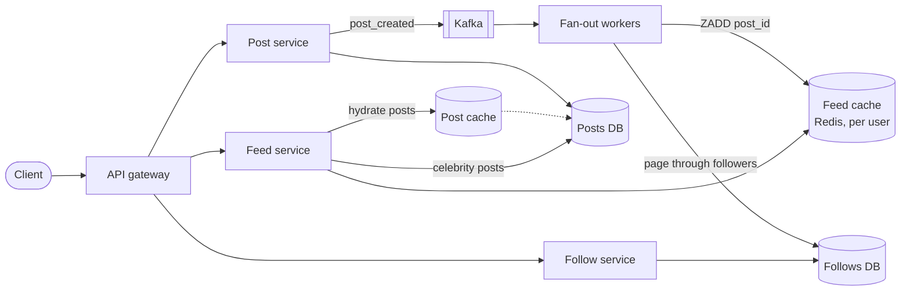
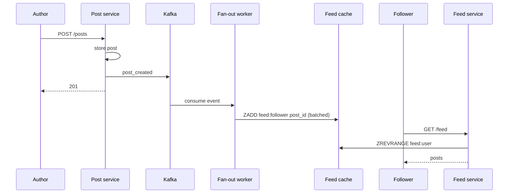

# Design a News Feed (Facebook / Twitter Timeline)

## Requirements

**Functional**
1. Users can create posts.
2. Users can follow other users (one-directional).
3. Users can view a feed of posts from people they follow, newest first, with pagination.

**Non-functional**
- **Fast feed loads:** under ~500 ms at p99.
- **Eventual consistency:** a post can take up to ~1 minute to appear in followers' feeds.
- **Unbounded follows:** some accounts have 100M+ followers.
- **Scale:** ~2B users, ~500M DAU; highly available.

**Out of scope:** ranking (start chronological; mention ML ranking as an extension), likes and comments, media processing.

### Back-of-envelope estimates

| Quantity | Estimate | Implication |
|---|---|---|
| Posts | ~500M/day ≈ 6k writes/s | Post storage is easy; fan-out is the real write load |
| Average followers | ~200 | Naive fan-out ≈ 1.2M feed inserts/s, which is heavy but parallelizable |
| Feed reads | 500M DAU × ~10 refreshes ≈ 5B/day ≈ 60k reads/s (peak 200k) | Feed reads must be one cheap lookup |
| Feed cache | 500M active users × 500 IDs × 8 B ≈ 2 TB | Fits in a sharded Redis fleet |

## Core entities

| Entity | Key fields | Store |
|---|---|---|
| User | `user_id`, profile | Any; heavily cached |
| Follow | `follower_id`, `followee_id`, `created_at` | DynamoDB: PK `follower_id` / SK `followee_id`, plus a GSI the other way round |
| Post | `post_id` (time-sortable), `author_id`, `content`, `created_at` | DynamoDB/Cassandra keyed by `post_id`; index by `author_id, created_at` |
| Feed | `user_id` → list of `post_id` | Redis sorted set or list, capped |

## API

```
POST /posts                          { "content": "..." }       → 201 { "postId" }
PUT  /users/{userId}/followers                                  → 204   (follow; DELETE to unfollow)
GET  /feed?pageSize=20&cursor={c}                               → 200 { "posts": [...], "nextCursor": "..." }
```

Use **cursor pagination** (cursor = the last `post_id` seen, which is time-sortable). Offset pagination breaks when new posts arrive at the top: page 2 would repeat items from page 1.

## High-level design



**Write path**
1. The post service stores the post, then publishes `post_created` to Kafka (an outbox pattern guarantees the event is sent once the post is committed).
2. Fan-out workers page through the author's followers and push the `post_id` into each active follower's feed in Redis (in batches, pipelined).

**Read path**
1. The feed service reads the user's precomputed feed (post IDs) from Redis.
2. It merges in recent posts from any celebrities the user follows (see the hybrid model).
3. It hydrates the post IDs into full posts with one bulk call to the post cache, and returns a page plus a cursor.



## Deep dives

### Fan-out on write vs fan-out on read

- **Fan-out on read (pull):** at request time, query recent posts from every followee and merge. Writes are cheap, but reads are terrible for users following 1,000+ accounts: 1,000 queries per refresh.
- **Fan-out on write (push):** precompute each follower's feed when a post is created. Reads are a single lookup, but a celebrity post means 100M writes, which takes far too long and wastes work on inactive followers.
- **Hybrid (best):** push for regular authors; **don't fan out for celebrities** (over ~100k followers). At read time, merge the precomputed feed with the latest posts from the handful of celebrities the user follows (a cheap query by `author_id, created_at`, served from cache).

### Making fan-out reliable and fast

- Kafka decouples posting from fan-out; workers scale horizontally by partition.
- Workers are **idempotent** (feed entries keyed by `post_id`, so ZADD is naturally idempotent) and retries are safe.
- Batch: read 1,000 followers per page and pipeline Redis writes per shard.
- **Skip inactive users** (not seen in 30 days). Rebuild their feed on demand when they return, using fan-out on read once.
- **Cap feeds** at ~500 entries (trim on write). Pages beyond that fall back to querying followees directly.

### How the precomputed feed is stored (Redis sorted sets)

Each user's feed is a Redis **sorted set**: members are post IDs and the **score** is the post time (or the time-sortable post ID itself). Sorted sets keep members ordered by score, with O(log n) inserts and range reads.

```
# fan-out worker: add a new post to a follower's feed, keep only the newest 500
ZADD   feed:{followerId} 1730419200123 post:98231
ZREMRANGEBYRANK feed:{followerId} 0 -501          # trim everything except the top 500

# first page: newest 20
ZREVRANGEBYSCORE feed:{userId} +inf -inf LIMIT 0 20

# next page: strictly older than the cursor (the last score the client saw)
ZREVRANGEBYSCORE feed:{userId} (1730419100456 -inf LIMIT 0 20
```

The `(` makes the bound exclusive, so the cursor post isn't repeated. Because ZADD with the same member is a no-op update, a retried fan-out doesn't create duplicates: the write is **idempotent**.

### The fan-out cost, worked out

- 6k posts/s × 200 average followers = **1.2M feed inserts/s**. With pipelining, one Redis shard handles ~100k–200k ops/s, so the feed fleet needs roughly 10–20 shards for writes (plus replicas).
- A single author with 50M followers would mean 50M inserts: at 1M inserts/s that's **~50 seconds of the whole fleet's capacity for one post**, and most of those followers are inactive. That's the concrete reason celebrities are handled with fan-out on read.
- Skipping inactive users (say 70% of followers) cuts the work by 70% with no visible effect.

### The outbox pattern (why the event isn't lost)

If the post service writes the post to the DB and then crashes before publishing to Kafka, the post exists but never reaches anyone's feed. Publishing first has the reverse problem. The **transactional outbox** fixes this:

1. In **one DB transaction**, insert the post *and* a row in an `outbox` table (`event_type = post_created`, payload).
2. A relay process (or CDC tool like Debezium reading the DB log) reads new outbox rows, publishes them to Kafka, and marks them sent.
3. If the relay crashes, it re-publishes from the last unsent row. Consumers are idempotent, so duplicates are harmless.

Either both the post and its event exist, or neither does.

### Unfollows and deletes

- **Unfollow:** lazily filter at read time (drop posts whose author you no longer follow), and optionally remove them in the background.
- **Delete post:** mark it deleted in the post store; hydration skips deleted posts, so you don't need to purge millions of feeds.

### Hot posts and counters

- A viral post's body is read millions of times: cache posts with replicas (or an in-process cache for the hottest).
- Keep like and comment counts in separate counters updated asynchronously, not by rewriting the post row.

### Ranking (extension)

- Candidate generation (feed + celebrity posts + recommendations) → feature lookup (affinity, recency, engagement) → ML scoring → re-ranking for diversity. Precompute scores asynchronously where possible to stay within the latency budget.

## Production readiness

### Database choice and consistency

- **DynamoDB/Cassandra for posts and follows.** Both are huge (2B users, 500M posts/day) and only ever accessed by key: posts by `post_id` or `author_id, created_at`, follows by `follower_id` or (via the GSI) `followee_id`. A relational database would need manual sharding at this size, and the only cross-table query, "posts from people I follow", is precisely what we precompute instead of joining. The trade-off is that the reverse follow index (GSI) is updated asynchronously, so a follower list read during fan-out may miss a follow made a moment ago. That's within the 1-minute freshness requirement.
- **Outbox on a NoSQL store:** the deep dive's "one DB transaction" needs atomicity across the post and outbox rows. On DynamoDB that's a two-item `TransactWriteItems`, or simpler, use the table's change stream (DynamoDB Streams, or Cassandra CDC) as the outbox, so the post write alone is the source of the event.
- **Redis for feeds: pure BASE.** A feed is a derived, rebuildable cache, so losing a write only delays a post. Nothing in the feed path needs ACID.
- **What does need stronger guarantees:** a post write must be durable before the 201 (quorum write), and deletes must be honored on read, which is why hydration checks the post store's deleted flag rather than trusting feed contents.
- **CAP stance:** **AP** across the board. The requirement says a post can take a minute to appear, and "highly available" matters more than everyone seeing the same feed at once.

### Service boundaries and communication

- **Post, follow and feed services** plus **fan-out workers**. They're split by load shape: feed reads (60k/s, peak 200k/s) are latency-critical, fan-out (1.2M inserts/s) is bulk background work, and posts (6k/s) are modest writes. Fan-out in its own worker pool means a celebrity storm or a backlog can't slow feed reads.
- **Synchronous:** creating a post (until durable), follow/unfollow, and feed reads with hydration from the post cache.
- **Asynchronous:** everything triggered by a post: fan-out, counters, ranking feature updates, media processing. Kafka absorbs bursts and lets each consumer group fail and replay independently.
- **Not split:** the celebrity merge stays inside the feed service; a separate "merge service" would add a hop to a 500 ms budget.

### Failure modes and reliability

| Failure | Effect | Mitigation |
|---|---|---|
| Fan-out lag grows (a burst of popular authors) | New posts appear late | Autoscale on consumer lag; prioritize active followers; alert when lag nears the 1-minute freshness limit |
| Redis feed shard lost | Affected users have empty feeds | Replica promotion; **graceful degradation** to fan-out on read for those users while workers rebuild |
| Post cache or store slow during hydration | Feed p99 over 500 ms | **Timeout** per bulk call (~100 ms) with one retry; return the posts that hydrated and drop the rest rather than failing the whole page |
| Poison event in Kafka (malformed payload) | Partition consumer stuck | After a few **retries with backoff and jitter**, send to a **DLQ** and continue; alert on DLQ growth |
| Celebrity misclassified, 50M-follower fan-out starts | Fleet saturated for ~50 s, other posts delayed | Check follower count before fan-out; separate worker pool (**bulkhead**) for large fan-outs |
| Read spike after a major event (peak 200k reads/s) | Feed service and Redis overloaded | Short per-user cache of the merged page (~30 s), **load shedding** of ranking extras before basic feed reads |

### High availability and disaster recovery

- **SPOFs:** Kafka (replicated across three zones), Redis (replica per shard in a different zone), the outbox relay (run it as a consumer group so a crashed instance hands off its partitions). Stateless services run in several zones behind the gateway.
- **Regions:** active-active in several regions, since users are global. Replicate posts and follows across regions; each region consumes `post_created` and runs its **own** fan-out into its own Redis, rather than shipping 1.2M feed inserts/s across regions.
- **Targets:** posts and follows **RPO of seconds** (async cross-region replication; a post made seconds before a region dies may be lost, which is acceptable for social content), **RTO of minutes** via DNS or anycast failover. Feeds have no RPO: they're rebuilt. Daily backups plus point-in-time recovery on posts and follows guard against bad deploys and logical corruption.

### Security

- **Authn/authz:** token auth at the gateway; author ID comes from the token. Hydration enforces visibility: blocked users, private accounts and deleted posts are filtered on read, because the feed cache may contain IDs the viewer can no longer see.
- **Encryption:** TLS externally and internally; at-rest encryption on posts, follows and Redis snapshots.
- **Secrets:** service credentials from a secrets manager, rotated automatically.
- **PII:** follows reveal relationships and are sensitive; account deletion must remove posts, follow edges in both directions and feed entries (lazily on read, plus a background purge).
- **Audit:** log moderation actions and admin access to private accounts.
- **Abuse:** per-user post and follow rate limits (follow-spam bots are common), detection of bulk follow/unfollow patterns, and spam scoring before fan-out so spam isn't copied into millions of feeds.

### Observability

**SLIs and SLOs (30-day window):**
- 99% of feed requests return within 500 ms; 99.95% succeed.
- 99% of posts reach active followers' feeds within 60 s (measured by canary accounts that post and read).
- 99.99% of acknowledged posts are durable and visible on the author's profile.

**Metrics:** Kafka consumer lag for fan-out, fan-out inserts/s, Redis memory and ops per shard, cache hit rate for hydration, celebrity merge latency, fallback-to-pull rate.

**Tracing:** feed reads (Redis → celebrity merge → hydration) and post creation through outbox → Kafka → fan-out, linked by `post_id`, so you can see where freshness is lost.

**Paging:** burn rate on feed latency and errors, and canary freshness over 60 s. Rising consumer lag alone is a warning, not a page, until it threatens freshness.

### Performance and cost

- **Main bottleneck:** fan-out, ~1.2M inserts/s. Levers already covered: hybrid push/pull, skip inactive users, pipelining. Tune the celebrity threshold using fan-out lag vs merge latency.
- **Feed cache memory:** ~2 TB, ~4 TB with one replica each. Levers: cap at 200 entries instead of 500 (≈ 0.8 TB, deeper pages fall back to slower pull queries); evict users inactive for 7 days rather than 30 (smaller cache, more on-demand rebuilds).
- **Multi-region:** a full feed cache per region multiplies the 4 TB. Running fan-out per region keeps cross-region traffic to post events: 6k/s × ~1 KB (assumed post size) ≈ 6 MB/s, versus replicating 1.2M inserts/s.
- **Post storage** grows ~500 GB/day at ~1 KB per post before replication; old posts move to cheaper storage tiers since they're rarely read.

## Follow-up questions

### How do you choose the celebrity threshold?
Pick it by cost: fan-out write time and work vs. read-time merge cost. Around 10k–100k followers is typical. Make it dynamic per account (flag accounts above the threshold) and revisit it with metrics such as fan-out lag and p99 feed latency.

### A user follows someone new. When do that person's old posts show up?
Optionally backfill: when the follow happens, enqueue a job that inserts the followee's last N posts into the follower's feed. Otherwise only new posts appear. Either is fine if stated; backfilling feels better for the user.

### How do you handle a user who follows 5,000 accounts, including 50 celebrities?
The precomputed feed covers the regular accounts. The celebrity merge is 50 small "latest posts" lookups, each served from a per-author recent-posts cache, so it remains cheap. If it gets heavy, cache the merged result for the user for ~30 s.

### What happens if the fan-out workers fall behind?
Kafka lag grows and new posts appear late, but nothing is lost. Autoscale workers on consumer lag, prioritize fan-out for active users, and alert when lag exceeds the freshness requirement (~1 minute).

### How would you guarantee a user always sees their own post right away?
Read-your-writes: on the feed read, merge the author's own latest posts from the post store (or have the client insert the post locally after a 201). Don't wait for fan-out.

### How do you avoid showing duplicate posts across pages?
Use cursor pagination keyed on the time-sortable `post_id`: the next page is everything strictly older than the cursor. Since IDs are unique and ordered, newly inserted posts at the top don't shift later pages.

### Redis loses a shard. What happens?
Feeds are a cache derived from posts and follows, so they're rebuildable. Serve affected users by falling back to fan-out on read while workers repopulate. Replicas make this rare; persistence is optional.

### How would you add media (images and video) to posts?
Clients upload directly to object storage with presigned URLs; the post stores media IDs; a pipeline generates resized variants; the CDN serves them. The feed path only carries URLs, so it doesn't change.
