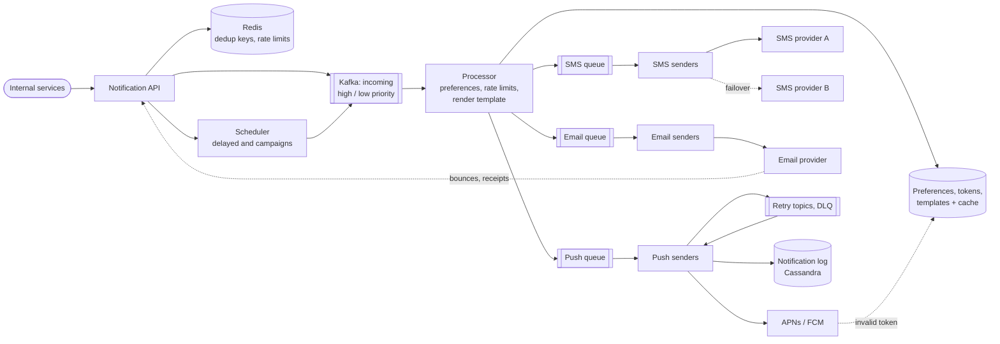
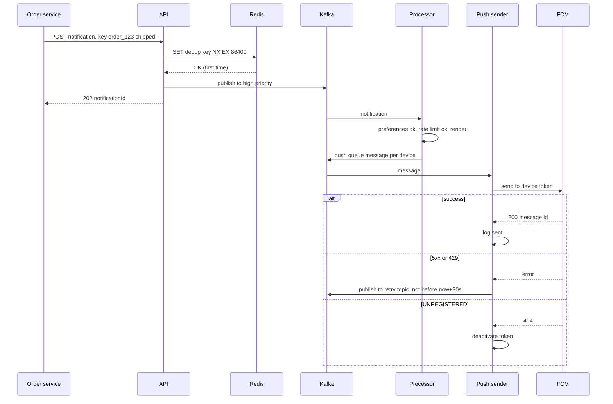

# Design a Notification Service

## Requirements

**Functional**
1. Internal services send notifications to users over push (iOS/Android), SMS and email through one API.
2. Users set preferences per channel and per category (e.g. marketing off, security alerts on) and can opt out; email includes one-click unsubscribe.
3. Messages are rendered from templates with variables and localization.
4. Notifications can be sent now or scheduled for later, including bulk campaigns to millions of users.
5. Callers can query a notification's delivery status.

**Non-functional**
- **At-least-once delivery:** an accepted notification is never silently dropped; rare duplicates are minimized through deduplication.
- **Per-user rate limiting:** caps such as 3 marketing pushes per day; quiet hours respected.
- **Spikes:** campaigns and breaking news produce millions of notifications per minute without delaying critical ones (OTP codes, security alerts).
- **Latency:** transactional notifications reach the provider within ~1–2 s; marketing can lag minutes.
- **Scale:** ~1B notifications/day, ~500M users.

**Out of scope**
- In-app inbox UI and building our own SMS/email delivery infrastructure (we use providers).

### Back-of-envelope estimates

| Quantity | Estimate | Implication |
|---|---|---|
| Average rate | 1B / 86,400 s ≈ 11.6k/s | Steady load is moderate |
| Campaign spike | 5M users in 1 minute ≈ 83k/s | Queues absorb the burst; senders scale out and respect provider limits |
| Channel split | push 70% (8.1k/s), email 25% (2.9k/s), SMS 5% (580/s) | Separate queues and worker pools per channel |
| Notification log | 1B × ~500 bytes = 500 GB/day; 30 days ≈ 15 TB | Wide-column store with TTL, partitioned by user |
| Preferences + device tokens | 500M users × ~1 KB = 500 GB | Sharded store plus a cache; read on every send |
| Dedup keys | ~1B/day × ~100 bytes ≈ 100 GB with 24 h TTL | Redis cluster, keys expire automatically |

## Core entities

| Entity | Key fields | Store/Notes |
|---|---|---|
| Notification | `notification_id`, `user_id`, `category`, `template_id`, `params`, `channels`, `priority`, `send_at`, `idempotency_key` | Cassandra, partition key `user_id`, clustering by `created_at` |
| Delivery attempt | `notification_id`, `channel`, `provider`, `status` (queued / sent / delivered / failed / suppressed), `attempts`, `error` | Same table family, updated by senders and provider callbacks |
| Preference | `user_id`, per (category, channel) on/off, `quiet_hours`, `timezone` | DynamoDB/Cassandra keyed by `user_id`, cached in Redis |
| Device token | `user_id`, `token`, `platform` (apns / fcm), `last_seen`, `active` | Keyed by `user_id`; deactivated when providers report it invalid |
| Contact | `user_id`, verified `email`, `phone` | Owned by the user service; cached |
| Template | `template_id`, `version`, `channel`, `locale`, `body` | Small, versioned, cached in every worker |
| Campaign | `campaign_id`, segment query, `template_id`, `send_at`, `status` | Postgres |

## API

```
POST /v1/notifications
  headers: Idempotency-Key: order_123:shipped
  { userId: "u_9", category: "order_updates", templateId: "order_shipped",
    params: { orderId: "123", eta: "Nov 3" },
    channels: ["push", "email"], priority: "high", sendAt: null }
  → 202 { notificationId }
  → 200 { notificationId }   duplicate key: returns the original
  → 400 unknown template or missing params

POST /v1/campaigns   { segmentId, templateId, category, sendAt } → 202 { campaignId }
GET  /v1/notifications/{id}   → { status per channel, attempts, timestamps }

GET  /v1/users/me/preferences          → { categories: { marketing: { push: false, email: true } }, quietHours }
PUT  /v1/users/me/preferences          { ... } → 200
POST /v1/unsubscribe?token=<signed>    one-click email unsubscribe → 200
POST /v1/providers/{name}/callbacks    delivery receipts, bounces (signed by provider)
```

- **202 Accepted:** the API only validates and enqueues; delivery is asynchronous.
- **Idempotency-Key** is chosen by the caller from the business event, so a retried "order shipped" call doesn't notify twice.
- Callers send a `userId` and a template, never raw phone numbers or rendered text, so preferences, localization and opt-outs are enforced in one place.
- Unsubscribe links carry a signed token so they work without logging in.

## High-level design



**Send flow**
1. A service calls the API. It checks the idempotency key in Redis, stores the notification, and publishes to the high- or low-priority incoming topic (or hands it to the scheduler if `sendAt` is in the future).
2. A processor loads preferences (cached), drops channels the user opted out of, applies quiet hours and per-user rate limits, and renders the template in the user's locale.
3. It fans out one message per channel and device onto per-channel queues.
4. Channel senders call the provider. Success records `sent`; retryable failures go to retry topics; permanent failures are recorded and, for bad tokens or bounced addresses, cleaned up.
5. Provider callbacks update the delivery status to `delivered` or `bounced`.

**Campaign flow:** the scheduler resolves the segment into user IDs in pages and publishes them at a controlled rate onto the low-priority topic, so a 50M-user campaign takes the time we allow it rather than flooding everything.



## Deep dives

### Per-channel queues, retries and dead-letter queues

- **Weak:** the API calls providers synchronously. A slow SMS provider stalls every caller, and a failure loses the message.
- **Better:** one shared queue for all channels. Durable, but an email-provider outage backs up the queue and delays push and SMS behind it.
- **Best:** **separate queues and worker pools per channel and priority**, with **retry topics** and a **DLQ**.

#### How retry topics work

A Kafka consumer processes a partition in order, so it can't sleep 10 minutes on one failed message without blocking everything behind it. Instead:

1. On a retryable failure (timeout, 5xx, 429), the sender republishes the message to `push.retry.30s` with a header `not_before = now + 30s` and `attempt = 2`, then commits the original offset.
2. A retry consumer reads `push.retry.30s`; if the head message isn't due, it pauses the partition until it is (all messages in that topic have the same delay, so they're in due order).
3. When due, it sends again. Further failures move to `push.retry.5m`, then `push.retry.1h`.
4. After the last tier, or on a permanent error, the message goes to `push.dlq` with the error attached. Operators alert on DLQ growth and can replay after fixing the cause.

Worked example, one SMS during a provider incident:

| Time | Attempt | Topic | Result |
|---|---|---|---|
| 10:00:00 | 1 | `sms` | 503 from provider A |
| 10:00:30 | 2 | `sms.retry.30s` | 503 again; circuit for A opens |
| 10:05:30 | 3 | `sms.retry.5m` | routed to provider B: sent |

Permanent errors (invalid phone number, unsubscribed, token unregistered) are **not** retried: they're recorded and trigger cleanup. Time-sensitive messages carry an expiry; an OTP still failing after 5 minutes is dropped rather than delivered late and confusingly. With SQS instead of Kafka, the same pattern is built from visibility timeouts plus a redrive policy (`maxReceiveCount`) to a DLQ.

**Priority isolation:** OTP and security alerts use their own topics and dedicated sender capacity, so a 50M-user marketing campaign can't delay a login code.

### Deduplication

Duplicates come from three places: callers retrying the API, our own at-least-once redelivery, and campaigns that include a user twice.

#### How the dedup key works

1. **API level:** the caller's idempotency key becomes `dedup:{caller}:{key}`. `SET dedup:orders:order_123:shipped <notificationId> NX EX 86400` succeeds only the first time; a repeat finds the key and returns the original `notificationId` with 200.
2. **Delivery level:** each per-channel message has an ID `{notificationId}:{channel}:{device}`. Before calling the provider, the sender does `SET sent:{id} 1 NX EX 86400`; if the key already exists, the message is a redelivery and is skipped.
3. **Campaign level:** the segment export deduplicates user IDs, and the dedup key includes `campaignId:userId`.

Worked example:

| Event | Key | Redis result | Outcome |
|---|---|---|---|
| Order service sends | `order_123:shipped` | OK | queued |
| Order service times out and retries | `order_123:shipped` | nil (exists) | 200, same ID, nothing queued |
| Sender crashes after FCM accepted, Kafka redelivers | `n_77:push:dev_1` | nil (exists) | skipped |

There's a remaining window: if the sender sets the key, the provider call succeeds, and the process dies before committing the offset, redelivery skips correctly; but if it dies after setting the key and **before** calling the provider, the message is wrongly skipped. Set the key to `pending` first and mark it `sent` after the provider's 200; a redelivery that sees `pending` older than a timeout re-sends. That trades a rare duplicate for never losing a message, which matches at-least-once. Most providers have no idempotency key of their own, so exactly-once delivery to the device isn't achievable; dedup makes duplicates rare.

### Third-party provider failures

- **Weak:** a single provider per channel with fixed retries. An outage at that provider means no SMS for the duration, and retries pile onto a struggling service.
- **Better:** retries with exponential backoff and jitter, so recovery isn't met by a synchronized retry storm.
- **Best:** backoff plus **circuit breakers** and **multi-provider failover** where the channel allows it.

#### How a circuit breaker works

Each sender tracks the error rate per provider over a sliding window (say the last 30 s).

| State | Behavior | Transition |
|---|---|---|
| closed | all traffic to provider A | error rate > 50% over ≥ 100 calls → open |
| open | no calls to A; traffic routes to provider B or waits in retry topics | after 30 s → half-open |
| half-open | a small trickle (e.g. 1%) to A | successes → closed; failures → open |

SMS and email have interchangeable providers, so the router fails over. Push has no alternative (Apple devices are only reachable via APNs, most Android devices via FCM), so for push the breaker simply sheds load into retry topics and waits.

**Respect provider limits:** each provider and account has throughput caps (SMS throughput depends on the sender number type and country). Senders use a shared token bucket per provider account so 83k/s of campaign traffic is metered out at the allowed rate instead of triggering 429s.

**Feedback loops:** APNs returns 410 for tokens that are no longer valid and FCM returns `UNREGISTERED`; deactivate those tokens. Email hard bounces and spam complaints suppress the address, which protects sender reputation.

### Preferences, rate limits and quiet hours

The processor applies checks in a fixed order before any rendering or sending:

1. **Category opt-out:** user has marketing push disabled, so the push channel is dropped and recorded as `suppressed`.
2. **Legal suppression lists:** unsubscribed emails, SMS STOP replies.
3. **Quiet hours:** if it's 23:00 in the user's time zone and the category isn't urgent, reschedule for 08:00 local via the scheduler.
4. **Frequency caps:** a token bucket per `(user, category, channel)` in Redis, e.g. capacity 3, refill 3 per day for marketing push. Transactional categories bypass marketing caps but still have a high abuse ceiling (e.g. 10 OTP SMS per hour) to stop SMS-pumping fraud.

Preferences are read on every notification, so they're cached in Redis with a short TTL and invalidated on update; a stale cache for a few seconds after an opt-out is acceptable, a missed opt-out for hours is not.

### Templates and scheduling

- Templates are versioned per channel and locale (`order_shipped`, `email`, `de-DE`, v4). Workers cache them; a new version is rolled out by bumping the active version, and rendering failures (missing variable) fail fast to the DLQ.
- Scheduled sends use the same design as a job scheduler: rows bucketed by send minute, pulled a minute early into the incoming topic. Campaigns at "9 AM local time" become 24+ batches, one per time zone.

## Follow-up questions

### How do you guarantee an OTP is delivered fast during a huge campaign?
Separate high-priority topics, consumers and provider capacity for transactional traffic, so marketing backlog never sits in front of it. Campaign senders draw from a provider rate budget that leaves headroom for transactional sends. Monitor OTP end-to-end latency separately and alert on it.

### How do you send to a user with three devices?
Fan out one push message per active device token, each with its own delivery ID, retry state and dedup key. Tokens unused for a long period or reported invalid by APNs/FCM are deactivated so they stop costing sends.

### How do you track whether a notification was actually delivered or opened?
Providers send delivery receipts and bounces to our callback endpoint; email opens and clicks use tracking pixels and redirect links; push opens are reported by the app SDK. These events update the delivery record and feed analytics through Kafka.

### What happens if Kafka is down when a service calls the API?
The API returns 503 and callers retry with the same idempotency key, which is safe. Kafka itself is replicated (e.g. replication factor 3 with min in-sync replicas 2), so a broker loss doesn't lose acknowledged messages.

### How would you send a breaking-news push to 100M users quickly?
Precompute the audience per topic, shard the user list across many fan-out workers, and send at the maximum rate providers allow. Rendering once per locale instead of per user saves CPU. Expect it to take minutes; rank users by engagement so the most active get it first.

### How do you avoid notifying a user twice through different channels for the same event?
Callers can request channel fallback instead of parallel channels: try push, and only send SMS if push isn't delivered within N minutes or the user has no active device. The processor tracks this per notification with a scheduled check.

### How do you store and query notification history for a user?
Cassandra with `user_id` as the partition key and `created_at` descending as the clustering key, with a 30-day TTL. "Last 50 notifications for user X" is a single partition read.

### How do you prevent abuse of the SMS channel, such as SMS pumping?
Rate-limit OTP sends per phone number, per IP and per country, require CAPTCHA on unusual patterns, block premium-rate prefixes, and alert on spikes in sends to unusual destinations. Fail closed on these limits, since every SMS costs money.
