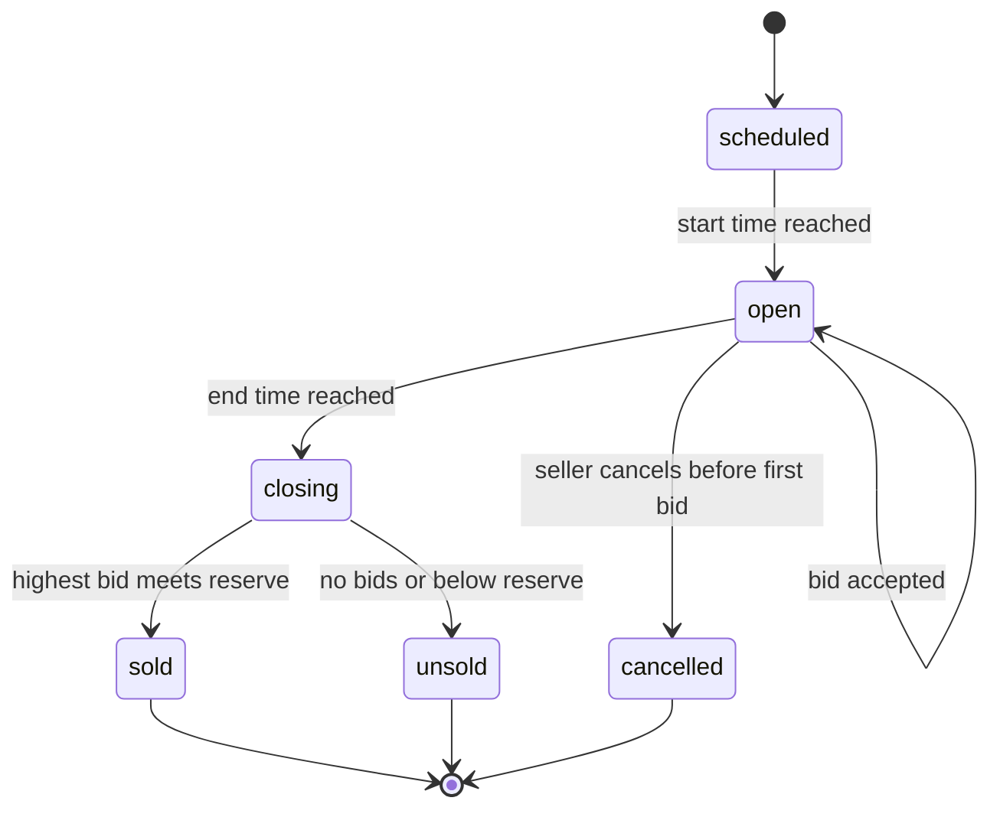
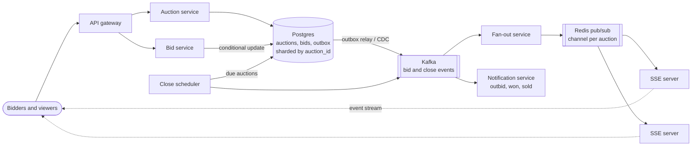
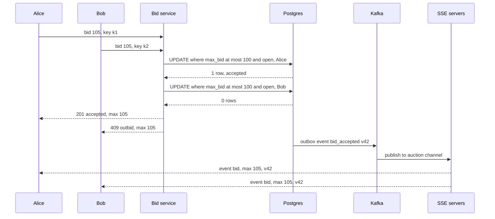

# Design an Online Auction (eBay)

## Requirements

**Functional**
1. A seller posts an item for auction with a starting price, optional reserve price, and an end time.
2. Buyers place bids; a bid is accepted only if it beats the current highest bid by at least the minimum increment and the auction is still open.
3. Everyone viewing an auction sees the current highest bid update live, without refreshing.
4. When the auction ends, the highest bidder wins and both parties are notified.

**Non-functional**
- **Strong consistency on bids:** two bids can never both be accepted as "highest" at the same amount; the accepted order is unambiguous.
- **No lost bids:** once a bidder sees "accepted", the bid survives any single machine failure.
- **Real-time updates:** viewers see a new highest bid within ~1 s.
- **Fair close:** a bid that arrives after the end time is rejected, even under load.
- **Scale:** ~10M active auctions, ~20M bids/day, ~2M concurrent viewers, with hot auctions getting hundreds of bids in the final minute.

**Out of scope:** payments and shipping after the sale, search ranking, fraud detection.

### Back-of-envelope estimates

| Quantity | Estimate | Implication |
|---|---|---|
| Bids | 20M/day ÷ 86,400 ≈ 230/s average, ~2,300/s at a 10× peak | Total write load is modest; contention on single hot auctions is the hard part |
| Hot auction | ~100 bids/s on one item in its last seconds | All contend for one row; the write path must be a single atomic step |
| Viewers | 2M concurrent SSE connections ÷ ~50k per server ≈ 40 servers | Connection servers are a separate, stateless-ish tier |
| Fan-out | One bid on an item with 10k watchers = 10k pushes | Publish once per auction; each connection server delivers to its own local viewers |
| Bid storage | 20M × ~200 bytes ≈ 4 GB/day, ~1.5 TB/year | An append-only bid table, partitioned by auction, is easy to keep |

## Core entities

| Entity | Key fields | Store/Notes |
|---|---|---|
| Auction | `auction_id` (PK), `seller_id`, `item`, `start_price`, `reserve_price`, `min_increment`, `ends_at`, `status` (scheduled / open / closing / sold / unsold), `max_bid`, `max_bidder_id`, `version` | Postgres (or DynamoDB), sharded by `auction_id`; the row holding `max_bid` is the contended record |
| Bid | `bid_id`, `auction_id`, `bidder_id`, `amount`, `created_at`, `accepted` | Append-only, partitioned by `auction_id`; written in the same transaction as the auction update |
| Watcher | `auction_id` → set of connections | In memory on connection servers; subscribed through pub/sub channel `auction:{id}` |
| Outbox event | `event_id`, `auction_id`, `type` (bid_accepted / auction_closed), payload | Same DB, read by a relay into Kafka |



## API

```
POST /auctions        { item, startPrice, reservePrice?, minIncrement, endsAt }
  → 201 { auctionId }
GET  /auctions/{id}   → { item, maxBid, maxBidderMasked, bidCount, endsAt, status, version }
POST /auctions/{id}/bids   Idempotency-Key: <uuid>
     { amount }
  → 201 { bidId, status: "accepted", maxBid }
  → 409 { reason: "outbid", maxBid }          another bid got there first or amount too low
  → 410 { reason: "auction_closed" }
GET  /auctions/{id}/events                     (SSE stream, text/event-stream)
  event: bid    data: { maxBid, bidCount, version }
  event: closed data: { winnerMasked, finalPrice }
```

- The bidder comes from the auth token, never the body.
- The **idempotency key** makes retries safe: a client that times out and resends the same bid gets the original result rather than placing a second bid.
- `version` in every event lets clients drop out-of-order updates (only render a version higher than the one shown).

## High-level design



**Posting:** the auction service writes the auction row with `status = scheduled` and `ends_at`, and the scheduler picks it up by an index on `ends_at`.

**Bidding**
1. The bid service receives `{amount}` and runs one conditional update on the auction row plus an insert into `bids` and `outbox`, in one transaction.
2. If the update affects one row, the bid is accepted and the client gets 201. If zero rows, it reads the current state and returns 409 (outbid) or 410 (closed).
3. The outbox relay publishes `bid_accepted` to Kafka; the fan-out service publishes it on `auction:{id}`; every SSE server with viewers of that auction pushes it to them. The notification service tells the previous high bidder they were outbid.

**Closing:** the scheduler finds auctions whose `ends_at` has passed, flips them to `closing` then `sold` or `unsold`, and emits `auction_closed`.



## Deep dives

### Concurrent bids: optimistic concurrency and conditional writes

**The race:** the current bid is 100 with a 5 increment. Alice and Bob both read 100 and both submit 105. A naive "read, check, write" lets both writes land, and the last writer overwrites the first: two users told they lead, one bid silently lost.

| Approach | How it works | Verdict |
|---|---|---|
| **Weak:** read-check-write in app code | Read `max_bid`, compare, `UPDATE SET max_bid = 105` | Lost updates under concurrency |
| **Better:** pessimistic lock | `SELECT ... FOR UPDATE` on the auction row, check, update, commit | Correct, but bids queue on the lock; acceptable at moderate contention |
| **Best:** conditional write | Put the check inside the write: one atomic statement that only succeeds if the precondition still holds | Correct, one round trip, no held locks |
| Alternative: single writer per auction | Route all bids for an auction to one partition (Kafka) or actor that processes them serially | Great for very hot items; adds latency and a queue to operate |

#### How a conditional write works

The database evaluates the `WHERE` clause and applies the update atomically per row. Under Postgres's READ COMMITTED, if two transactions target the same row, the second one waits for the first to commit, then **re-evaluates the `WHERE` against the new row version**. So the precondition is always checked against the latest committed value.

```sql
BEGIN;
UPDATE auctions
SET    max_bid = 105, max_bidder_id = :alice, version = version + 1
WHERE  auction_id = :id
  AND  status = 'open'
  AND  ends_at > now()
  AND  max_bid + min_increment <= 105
RETURNING version;
-- 1 row returned: accepted. Then, in the same transaction:
INSERT INTO bids (bid_id, auction_id, bidder_id, amount, accepted) VALUES (...);
INSERT INTO outbox (event_id, auction_id, type, payload) VALUES (...);
COMMIT;
-- 0 rows: rollback, re-read the row, return 409 or 410
```

#### How optimistic concurrency (versioning) works

The general pattern, useful when the decision is more complex than one comparison (e.g. proxy bidding logic in app code):

1. Read the row, including `version` (say 41).
2. Compute the new state in the application.
3. `UPDATE ... SET ..., version = 42 WHERE auction_id = :id AND version = 41`.
4. If 0 rows, someone else changed it: re-read and retry (or give up after a few tries).

**Worked example (start 100, increment 5):**

| Time | Event | Row before (max, version) | Condition | Result |
|---|---|---|---|---|
| t1 | Alice bids 105 | 100, v41 | 100 + 5 ≤ 105 | accepted, row = 105, v42 |
| t2 | Bob bids 105 (read v41 earlier) | 105, v42 | 105 + 5 ≤ 105 false | 0 rows, 409 outbid |
| t3 | Bob bids 115 | 105, v42 | 110 ≤ 115 | accepted, row = 115, v43 |
| t4 | Carol bids 120 at `ends_at + 0.2 s` | 115, v43 | `ends_at > now()` false | 0 rows, 410 closed |

On DynamoDB the same idea is a `ConditionExpression`:

```
UpdateItem auctions key={auction_id}
  SET max_bid = :b, max_bidder = :u, version = version + :one
  ConditionExpression: #s = :open AND max_bid <= :b_minus_inc AND ends_at > :now
```

Contention is per auction, so 10M auctions spread fine across shards. For a single item with hundreds of bids per second, most conditional writes fail fast with 0 rows, which is cheap; if that still isn't enough, switch that auction to the single-writer queue.

**Proxy (automatic) bidding:** eBay lets a bidder set a maximum and bids the minimum needed on their behalf. Store each bidder's hidden maximum; on a new bid, compute the visible price as the second-highest maximum plus one increment, and apply it with the same conditional write.

### No lost bids

- **Weak:** accept the bid into Redis or memory and persist it later. A crash loses accepted bids.
- **Better:** write to Kafka first and apply to the DB asynchronously. Durable, but the client can't be told "accepted" until the bid has been validated against the current max, which happens later.
- **Best:** the **database transaction is the commit point**. Reply 201 only after the transaction commits on a primary with synchronous replication to a standby (e.g. Postgres `synchronous_commit = on` with a synchronous replica), so a failover doesn't lose it.

#### How the transactional outbox works

Writing to the DB and then publishing to Kafka are two separate systems; a crash between them loses the event (viewers never see the bid) or a retry duplicates it.

1. In the same transaction as the bid, insert a row into `outbox`.
2. A relay (polling `outbox` or reading the write-ahead log via CDC, e.g. Debezium) publishes each row to Kafka and marks it sent.
3. If the relay crashes, it republishes from where it left off. Delivery is at-least-once, so consumers dedupe by `event_id` and order by `version`.

The bid and its event are now atomic: both exist or neither does.

### Real-time updates with SSE and pub/sub

| Option | How | Verdict |
|---|---|---|
| **Weak:** polling every 1–2 s | `GET /auctions/{id}` on a timer | 2M viewers ≈ 1M+ req/s, mostly unchanged answers |
| **Better:** WebSockets | Full-duplex connection | Works, but bids are rare client-to-server messages that fit plain POST requests |
| **Best:** **Server-Sent Events** | One long-lived HTTP response streaming events server-to-client | One-way updates are exactly the need; built-in reconnect |

#### How SSE works

The browser opens `new EventSource('/auctions/42/events')`. The server responds with `Content-Type: text/event-stream` and keeps the response open, writing events as text:

```
id: 42
event: bid
data: {"maxBid":115,"bidCount":17,"version":43}

: heartbeat every 15 s keeps proxies from closing the idle connection
```

If the connection drops, the browser reconnects automatically and sends `Last-Event-ID: 42`. The server replays anything newer (from a small per-auction buffer in Redis, or by sending the current state), so no update is missed. Use HTTP/2 so many streams share one connection (HTTP/1.1 browsers allow only about 6 connections per domain).

#### How fan-out reaches the right servers

1. A viewer connects to any SSE server, which subscribes to Redis channel `auction:42` if it isn't already (one subscription per server per auction, not per viewer).
2. The fan-out service publishes each `bid_accepted` event once to `auction:42`.
3. Every subscribed server writes it to its local connections for that auction.

With 10k viewers spread over 40 servers, one bid is 1 publish, about 40 deliveries from Redis, and 10k socket writes spread across servers. Redis pub/sub is fire-and-forget, which is fine here: the DB is the truth, `Last-Event-ID` covers reconnects, and clients can refetch `GET /auctions/{id}` if they detect a version gap.

### Auction end-time handling

**Enforce the end in the write, finalize later.** The conditional write includes `ends_at > now()` using the **database's clock**, so a bid that arrives at 12:00:00.200 for an auction ending at 12:00:00 fails regardless of how late the close job runs. App server clock skew doesn't matter because only one clock decides.

The close job only finalizes state:

- **Weak:** a cron job every minute scanning all auctions. Winners wait up to a minute and the scan grows with the table.
- **Better:** poll `SELECT ... WHERE status = 'open' AND ends_at <= now() ORDER BY ends_at LIMIT 500 FOR UPDATE SKIP LOCKED` every second using an index on `(status, ends_at)`. Several workers can run without grabbing the same rows.
- **Best:** add a delayed-message timer (e.g. a Redis sorted set scored by `ends_at`, or a workflow engine timer) that triggers close right at the end time, with the polling query as a safety net for missed timers.

**Closing an auction:** `UPDATE auctions SET status = 'closing' WHERE auction_id = ? AND status = 'open' AND ends_at <= now()`, then decide `sold` (max bid ≥ reserve) or `unsold`, and write an `auction_closed` outbox event. The conditional status change makes closing idempotent if two workers race.

**Sniping:** eBay uses a fixed (hard) end time, which rewards last-second bids. A "soft close" alternative extends `ends_at` by, say, 2 minutes whenever a bid lands in the final 2 minutes: do it in the same conditional update with `ends_at = GREATEST(ends_at, now() + interval '2 minutes')` and push the new end time over SSE.

## Production readiness

### Database choice and consistency

- **Postgres, sharded by `auction_id`, for auctions, bids and outbox.** The core operation is "compare-and-set the max bid, append the bid, emit an event" atomically, and an accepted bid must never be lost. That's an ACID transaction on one shard with synchronous replication. Load is modest (230 bids/s average, ~2,300/s peak, 1.5 TB/year), so a relational store's write ceiling isn't a concern. DynamoDB with `ConditionExpression` plus a transaction is a reasonable alternative; Cassandra was rejected because its lightweight transactions (Paxos-based compare-and-set) are slower and don't extend atomically to the bid and outbox rows.
- **What needs ACID:** the auction row, accepted bids, the outbox row, auction status changes and idempotency keys. These decide who wins and what someone owes.
- **Where BASE is fine:** the live price on viewers' screens, "my bids" (filled from Kafka), search over active auctions, bid history caches, notifications. A viewer seeing 105 a second after it became 110 is harmless because the write path rejects stale bids anyway.
- **CAP stance:** the bid path is **CP**. If a shard's primary is unreachable, bids on its auctions get 503 rather than being accepted somewhere they could be lost or duplicated; the business cost of a wrong winner (disputes, refunds, trust) is far worse than a minute of rejected bids. Viewing and browsing are **AP**: serve cached state with its version.

### Service boundaries and communication

- **Auction service** (listing CRUD), **bid service** (hot, correctness-critical writes), **close scheduler**, **fan-out and SSE tier**, **notification service**. The bid service is split from listings so a surge of bids can be scaled and protected on its own; the SSE tier is split because 2M connections scale with viewers, not bids.
- **Synchronous:** placing a bid (client needs accepted/outbid/closed now), creating a listing, reading an auction.
- **Asynchronous:** everything downstream of a commit, via outbox → Kafka: live updates, outbid notifications, "my bids", search indexing, handing a sold item to payments. Making these synchronous would put email and push providers on the bid's latency path and let their outages fail bids.

### Failure modes and reliability

| Failure | Effect | Mitigation |
|---|---|---|
| Postgres shard primary fails | Bids on that shard fail until failover | Promote the synchronous standby (no committed bid lost); clients **retry with backoff and jitter** using the same idempotency key, so a bid that committed just before the crash isn't placed twice |
| Outage overlaps auction end times | Bidders couldn't bid in the final seconds | Extend `ends_at` for affected auctions by the outage length plus a margin before reopening; a fairness rule, not just a technical one |
| Outbox relay or Kafka lag | Live prices freeze, outbid emails late | Relay runs as several instances with leader election; alert on outbox age; clients refetch on version gaps. Bids still commit |
| Hot auction saturates its row (~100 bids/s) | Bid latency climbs for that shard | Losing bids fail fast; per-bidder rate limits; switch that auction to the single-writer queue; per-shard connection pool limits act as a **bulkhead** so one hot item doesn't starve its neighbors |
| Notification provider down | Outbid/won messages fail | **Circuit breaker** on the provider, retries with backoff, **DLQ** after N attempts; email is not on the bid path |
| Close scheduler misses a timer | Winner not declared | Polling query every second as a safety net; close is idempotent via conditional status update |

### High availability and disaster recovery

- **SPOFs:** each shard's primary (synchronous standby in another zone, automatic failover), the close scheduler (multiple workers with `SKIP LOCKED`), the outbox relay, Redis pub/sub (replicated; a lost channel only delays live updates). SSE servers are interchangeable.
- **Zone vs region:** multi-zone, with each auction's shard homed in one region. Bids for one auction must serialize through one primary, so active-active across regions would need cross-region consensus and add ~100 ms per bid. Instead, keep an async replica in a second region for disaster recovery.
- **Targets:** accepted bids **RPO = 0** within a region (synchronous standby), **RTO under 1 minute** for zone failure. Region failure: **RPO of seconds, RTO of ~30 minutes**, with affected auctions paused and extended, since a lost bid that a user saw accepted is the worst outcome. Daily backups plus WAL archiving for point-in-time recovery cover bad deploys.

### Security

- **Authn/authz:** token auth; bidder ID from the token. Sellers can't bid on their own auctions (shill bidding), checked in the bid service. Only the seller can edit or cancel, and only before the first bid.
- **Privacy:** bidder identities are masked publicly; reserve prices and proxy-bid maximums are secret and never sent to clients, since leaking a maximum lets others bid exactly up to it.
- **Encryption:** TLS everywhere; at-rest encryption for the bid database and backups. Credentials from a secrets manager with automatic rotation.
- **Audit:** bids are already an append-only log; also audit admin actions (cancelling auctions, voiding bids, extending end times) with actor and reason, since these settle disputes.
- **Abuse:** per-user and per-auction bid rate limits, bot detection for sniping scripts, and account-age or verification requirements for high-value auctions to deter fake winning bids.

### Observability

**SLIs and SLOs (30-day window):**
- 99.9% of bid requests get a definitive answer (accepted, outbid or closed) within 500 ms.
- 99% of accepted bids reach connected viewers within 1 s of commit.
- 99.99% of auctions are finalized within 10 s of `ends_at`.

**Metrics:** bid accept/409/410 ratios, conditional-write latency per shard, outbox backlog age, Kafka lag, SSE connections and push latency, auctions past `ends_at` still open.

**Tracing:** bid request → transaction → outbox → Kafka → pub/sub → SSE push, keyed by `bid_id`, to find where the 1 s budget goes.

**Paging:** burn rate on bid success and latency, and any auction open more than 60 s past its end time (a correctness symptom). A rising 409 rate is normal at auction close and should not page.

### Performance and cost

- **Main bottleneck:** row contention on hot auctions in their last seconds. Conditional writes keep the critical section to one statement; pooling connections per shard avoids connection storms; the single-writer queue is the escape hatch.
- **Cost drivers are small by comparison with feed-style systems.** The SSE tier (~40 servers for 2M viewers) is the largest fleet; levers are raising connections per server (fewer servers, bigger blast radius) and closing streams for background tabs. Synchronous cross-zone replication roughly doubles database spend and adds a few ms per commit; it's the price of "no lost bids" and worth paying.
- **Storage:** 4 GB/day of bids, ~1.5 TB/year before replicas. Move closed auctions' bids older than a year to cheaper storage or object storage; the trade-off is slower dispute lookups.

## Follow-up questions

### Why not hold the highest bid in Redis and use a Lua script?
A Lua script would make compare-and-set atomic and very fast, but Redis replication is asynchronous, so a failover can lose bids the user was told were accepted. That breaks the "no lost bids" requirement. Redis is fine as a cache of the current max for reads; the DB stays the commit point.

### How do you show a consistent bid history to users?
Read it from the `bids` table filtered to `accepted = true`, ordered by `version` or commit order, which matches the order the conditional writes succeeded. Cache the last page per auction and invalidate on each `bid_accepted` event. Mask bidder identities as eBay does.

### What if the SSE server a viewer is connected to dies?
The browser's `EventSource` reconnects to another server through the load balancer and sends `Last-Event-ID`. The new server subscribes to the auction channel and sends the current state or the missed events. The viewer sees at most a second or two of delay.

### How do you handle a celebrity item with 50k bids in the last minute?
Most bids lose and fail fast on the condition, which is cheap, but if the row still saturates, route that auction's bids through a single Kafka partition and a dedicated consumer that applies them serially in memory and writes batches. Clients get an "accepted pending" response that resolves within a second. Rate-limit per bidder too.

### How would you notify the outbid user?
The notification service consumes `bid_accepted` events, which carry the previous high bidder, and sends a push or email, deduplicated so a bidding war doesn't produce dozens of emails per minute. Users currently viewing the auction see it over SSE anyway.

### How do you make bid placement idempotent?
Store the idempotency key with a unique constraint alongside the bid. A retry with the same key finds the existing row and returns its original outcome without running the conditional write again. Keys expire after a day.

### How does the system avoid paying for clock skew between servers?
Every time decision happens in one place: the database's `now()` in the conditional write and in the close query. The scheduler's own timing only affects when finalization happens, not which bids count. Clients show a countdown synchronized to server time sent in responses.

### How would you shard the data?
Shard auctions, bids and outbox by `auction_id`, so the bid transaction stays on one shard. Queries by bidder ("my bids") use a secondary table keyed by `bidder_id`, filled asynchronously from Kafka events. Search over active auctions lives in Elasticsearch, fed by CDC.
