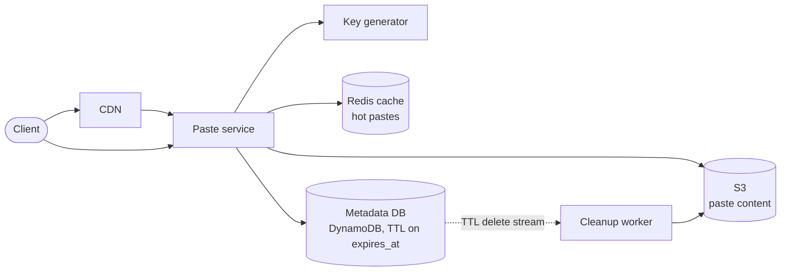
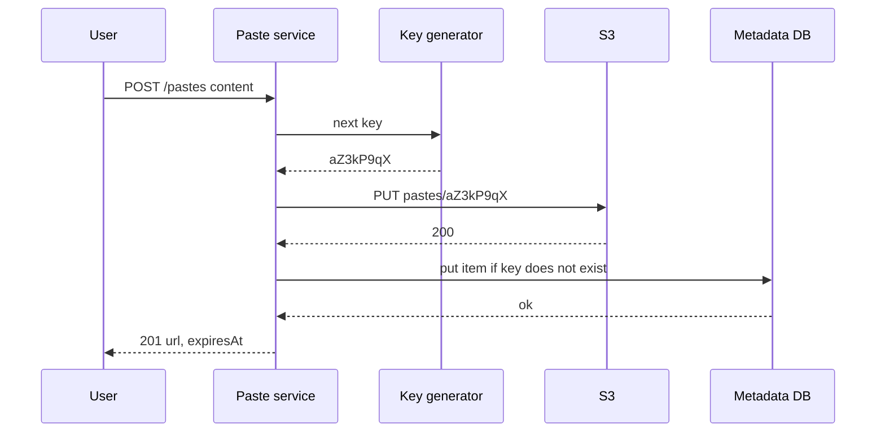

# Design Pastebin

## Requirements

**Functional**
1. A user pastes text (optionally with a title, syntax language and visibility) and gets a short unique URL.
2. Anyone with the URL can view the paste.
3. Pastes can expire: after 10 minutes, 1 day, 1 month, never, or after the first read ("burn after reading").

**Non-functional**
- **Read-heavy:** ~100 reads per write.
- **Low-latency reads:** p99 under ~100 ms; popular pastes served from cache or CDN.
- **Durable:** a paste is never lost before it expires.
- **Unguessable URLs** for unlisted pastes.
- **Scale:** ~1M new pastes/day, average 10 KB, maximum 10 MB.

**Out of scope:** editing pastes, full-text search, user accounts beyond optional login.

### Back-of-envelope estimates

| Quantity | Estimate | Implication |
|---|---|---|
| Writes | 1M/day ÷ 86,400 ≈ 12/s | Trivial write load |
| Reads | 100 × 12 ≈ 1,200/s average, a few thousand at peak | Caching handles most of it |
| New content | 1M × 10 KB = 10 GB/day ≈ 3.65 TB/year | Content goes to object storage, not the DB |
| Metadata | 1M × ~300 bytes = 300 MB/day ≈ 110 GB/year | Fits easily in one DB or a small DynamoDB table |
| Key space | 8 base62 chars = 62^8 ≈ 2.2 × 10^14 | 10 years of pastes (3.65B) use under 0.002% of it |

## Core entities

| Entity | Key fields | Store/Notes |
|---|---|---|
| Paste | `paste_key` (PK), `owner_id?`, `title`, `language`, `visibility`, `size`, `content_location` (inline or S3 key), `created_at`, `expires_at?`, `burn_after_read` | DynamoDB or Postgres, keyed by `paste_key` |
| Content | object `pastes/{paste_key}` | S3; small pastes may be stored inline in the metadata row |
| User | `user_id`, email | Optional; only for listing "my pastes" (secondary index on `owner_id`) |

## API

```
POST /pastes   Idempotency-Key: <uuid>
     { content, title?, language?, visibility: "public" | "unlisted", expiresIn?: "10m" | "1d" | "30d" | "never", burnAfterRead?: bool }
  → 201 { key: "aZ3kP9qX", url: "https://paste.example/aZ3kP9qX", expiresAt, deleteToken }
  → 413 content larger than 10 MB

GET  /pastes/{key}       → 200 { title, language, content, createdAt, expiresAt }
                         → 404 not found or expired
GET  /raw/{key}          → 200 text/plain (CDN-cacheable)
DELETE /pastes/{key}     → 204 (owner, or anyone holding the delete token)
```

- Anonymous users get a **delete token** in the create response, since there is no account to authorize a delete.
- `/raw/{key}` returns plain text with `Cache-Control: max-age` capped at the time left before expiry, so a CDN never serves a paste after it expires.

## High-level design



**Create**
1. The service validates size, gets a key from the key generator, and uploads the content to S3 at `pastes/{key}` (or inlines it if under ~4 KB).
2. It writes the metadata row with a conditional "key must not exist" check and returns the URL.

**Read**
1. The CDN serves cached `/raw` responses for popular pastes.
2. Otherwise the service checks Redis; on a miss it reads metadata, checks `expires_at`, fetches content from S3 (or redirects to a short-lived presigned S3 URL for large pastes), and caches the result.



Writing the content first means a crash leaves at worst an orphaned S3 object (cleaned up later), never a metadata row pointing at nothing.

## Deep dives

### Key generation

| Option | How it works | Verdict |
|---|---|---|
| **Weak:** hash the content (MD5, keep 8 chars) | Same content gives the same key | Identical pastes collide even when expiry or visibility differ; truncated hashes collide too |
| **Better:** counter + base62 | A global counter (DB sequence) encoded in base62 | No collisions, but keys are sequential and guessable, so unlisted pastes can be enumerated |
| **Best:** random key + conditional insert | 8 random base62 chars from a CSPRNG; insert with "not exists" and retry on conflict | Unguessable, stateless, no coordination |
| Alternative: pre-generated key service | A service fills a table of unused random keys and hands out batches | No retries on the hot path; more moving parts |

#### How base62 encoding works

Base62 uses `0-9`, `a-z`, `A-Z`. To encode a number, repeatedly divide by 62 and map remainders to characters. Example: 125 = 2 × 62 + 1, so its digits are (2, 1) and it encodes as `21`. With 8 characters there are 62^8 ≈ 218 trillion keys.

```
def random_key(n=8):
    return "".join(ALPHABET[secrets.randbelow(62)] for _ in range(n))

def create(paste):
    for _ in range(3):
        key = random_key()
        if db.put_if_absent(key, paste):     # DynamoDB: ConditionExpression attribute_not_exists(paste_key)
            return key
    raise Error("retry later")
```

#### How likely is a collision?

When the table already holds N keys, a new random key collides with probability N / 62^8. After 10 years (3.65B keys) that is 3.65 × 10^9 / 2.18 × 10^14 ≈ 1 in 60,000. Needing a third attempt is about 1 in 3.6 billion. The conditional insert guarantees correctness either way; retries stay negligible.

For guessability: an attacker making 1,000 guesses per second against 3.65B existing keys hits one about every 60 seconds, so rate-limit reads per IP and offer longer keys or passwords for sensitive pastes.

### Blob storage for content vs DB metadata

- **Weak:** content in a `TEXT` column in Postgres. Fine at first, but at 3.65 TB/year the DB grows fast, backups and replicas get slow, and big rows hurt cache efficiency.
- **Better:** everything in S3 with metadata as object tags. No queries by owner or expiry, and S3 latency (tens of milliseconds) on every metadata lookup.
- **Best:** **metadata in a database, content in object storage.** The DB stays small (~110 GB/year) and fast; S3 is cheap, durable (designed for eleven nines) and scales without limit. Pastes under ~4 KB can be inlined in the metadata row to save an S3 round trip, since most pastes are small.

Large pastes are served by redirecting to a **presigned S3 URL** (or through the CDN with S3 as origin), so the paste service doesn't stream megabytes.

### Caching reads

- Popularity is very skewed: a paste shared on a forum gets most of its views within hours. Cache-aside in Redis with LRU eviction holds the hot set; 20% of a day's pastes (200k × 10 KB = 2 GB) fits easily.
- Pastes are immutable, so the only invalidation cases are deletion and expiry. Set each cache entry's TTL to `min(1 hour, expires_at − now)`.
- Put `/raw/{key}` behind a CDN with the same capped `max-age`. On delete, purge that path from the CDN.
- Burn-after-reading pastes are never cached.

### Expiry cleanup

Two separate concerns: **never serve an expired paste**, and **eventually reclaim storage**.

1. **On every read, check `expires_at`.** If it has passed, return 404 even if the row still exists. Correctness then doesn't depend on cleanup timing.
2. **Reclaim lazily in bulk:**
   - **Weak:** a cron job running `DELETE FROM pastes WHERE expires_at < now()` over the whole table. Large deletes lock and bloat the table, and S3 objects are left behind.
   - **Better:** a periodic worker scanning an index on `expires_at` in small batches, deleting the S3 object, then the row.
   - **Best:** DynamoDB **TTL** on `expires_at` deletes expired items in the background without consuming write capacity (typically within a few days, not at the exact second, which is why step 1 matters). A worker reading the table's **stream** of TTL deletions removes the matching S3 objects. As a safety net, an S3 lifecycle rule expires objects under a prefix such as `ttl-30d/` after 30 days.

**Burn after reading:** delete atomically with the read. In DynamoDB, a `DeleteItem` with `ReturnValues=ALL_OLD` and a condition that the item exists returns the paste to exactly one reader; a concurrent second reader gets nothing.

| Paste | Created | `expires_at` | Read at 12:05 | Read 2 days later | Row removed |
|---|---|---|---|---|---|
| A, 10 min | 12:00 | 12:10 | served | 404 (expiry check) | by TTL within days |
| B, never | 12:00 | null | served | served | never |
| C, burn | 12:00 | null | served once, deleted | 404 | immediately |

## Follow-up questions

### How do you support custom aliases like /my-config?
Accept an optional alias, validate its characters and length, and insert it with the same conditional "not exists" write; return 409 if it's taken. Reserve system words (`api`, `raw`) and keep aliases in the same key space so lookups don't change.

### How do you prevent abuse such as spam or malware hosting?
Rate-limit creation per IP and per account, cap size, scan content asynchronously for known malware and phishing patterns, and offer a report button that feeds takedowns. Unlisted pastes are excluded from public listings and served with `noindex`.

### How would you add syntax highlighting without slowing reads?
Highlight in the browser with a JavaScript library, so the server returns plain text and the CDN can cache it. Server-side highlighting is an option for SEO, rendered once at creation and stored next to the content.

### Would you deduplicate identical pastes?
You could store content by its SHA-256 hash and point several keys at one object. It complicates deletion (reference counting) and can leak whether someone else pasted the same text, so at 10 GB/day it usually isn't worth it.

### How do you scale reads to 100k/s for a viral paste?
The CDN absorbs it: `/raw` responses are immutable and cacheable, so nearly all requests never reach the origin. Request coalescing at the CDN or in the service makes a cache miss trigger one origin fetch, not thousands.

### How would you support private pastes?
Require login, store `owner_id` and visibility, and check authorization on every read; mark responses `Cache-Control: private` so CDNs don't cache them. For stronger privacy, encrypt client-side and keep the key in the URL fragment, which browsers never send to the server.

### What happens if S3 is slow or unavailable?
Hot pastes still come from Redis and the CDN. For misses, return 503 with a retry hint rather than hanging. S3's durability means nothing is lost, and cross-region replication covers a regional outage.

### How do you list a user's pastes?
Use a secondary index on `owner_id` sorted by `created_at` (a DynamoDB GSI or a Postgres index), paginated with a cursor. Expired pastes are filtered on read until TTL removes them.
