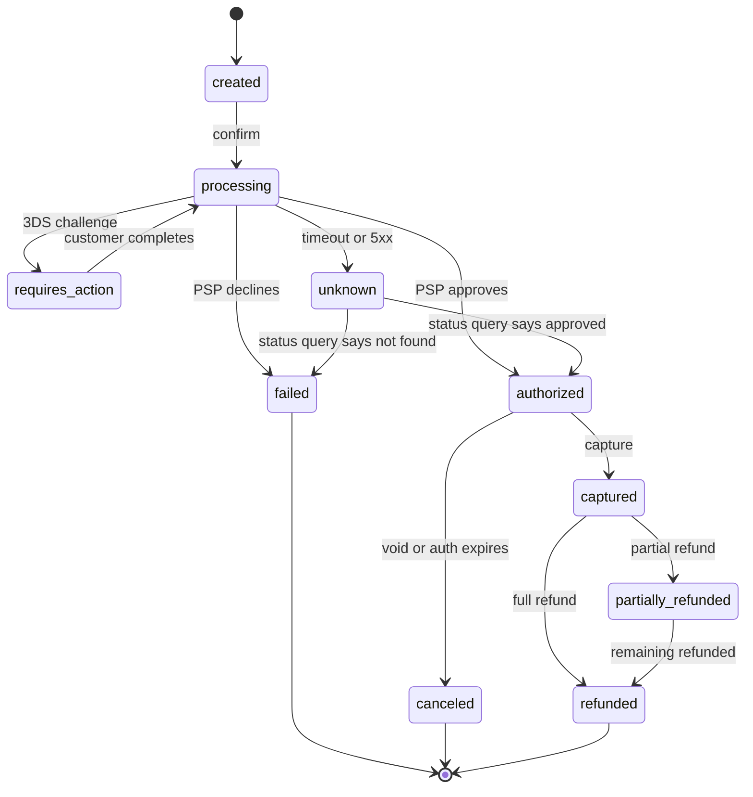
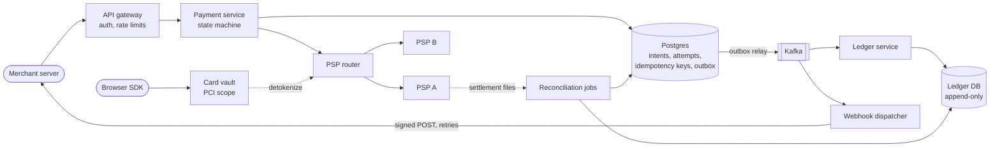
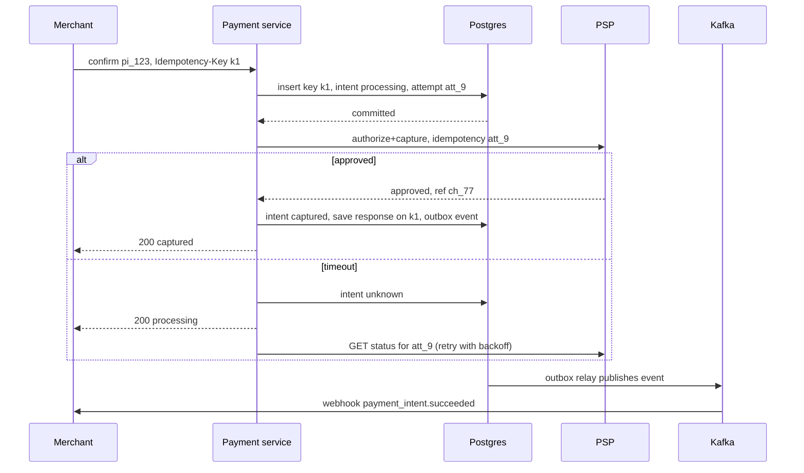

# Design a Payment System (Stripe / PayPal)

## Requirements

**Functional**
1. Merchants create a payment intent (amount, currency, customer) and confirm it with a tokenized payment method.
2. The system charges cards through external payment service providers (PSPs) or card processors: authorize, then capture.
3. Merchants issue full or partial refunds.
4. Merchants receive webhooks for state changes (succeeded, failed, refunded).
5. Every money movement is recorded in a ledger that finance can audit.

**Non-functional**
- **Correctness above all:** a customer is never charged twice for one payment, and the ledger always balances.
- **Auditability:** records are append-only; every balance can be explained by its entries.
- **High availability:** 99.99% for the payments API (about 52 minutes of downtime a year), but when unsure, refuse or delay rather than guess.
- **Latency:** confirm returns in ~1–3 s (dominated by the PSP and card network).
- **Scale:** ~10M payments/day, peaks ~10× average during sales events.
- **Security:** raw card numbers never touch most services (PCI DSS scope kept small).

**Out of scope**
- Fraud model internals, currency conversion, merchant onboarding/KYC.

### Back-of-envelope estimates

| Quantity | Estimate | Implication |
|---|---|---|
| Payments | 10M/day ÷ 86,400 s ≈ 116/s average, ~1,200/s peak | Modest write rate; a sharded relational DB is fine |
| Ledger entries | ~4 entries per payment (charge + settlement) ≈ 40M/day | ~14.6B rows/year; partition by time and account |
| Ledger storage | 40M × ~200 bytes ≈ 8 GB/day | ~2.9 TB/year, kept for 7+ years for audit |
| Webhooks | ~3 events per payment ≈ 30M/day ≈ 350/s | Async delivery with retries; slow merchants must not block us |
| PSP calls | 1–2 per payment, 300 ms–2 s each | Calls must be async-safe and idempotent; timeouts are normal |

## Core entities

| Entity | Key fields | Store/Notes |
|---|---|---|
| PaymentIntent | `intent_id` (PK), `merchant_id`, `amount`, `currency`, `status`, `payment_method_token`, `created_at` | Postgres, sharded by `merchant_id`; state machine below |
| PaymentAttempt | `attempt_id` (PK), `intent_id`, `psp`, `psp_reference`, `status`, `error_code` | One per call to a PSP; `attempt_id` is the idempotency key sent to the PSP |
| Refund | `refund_id`, `intent_id`, `amount`, `status`, `psp_reference` | Sum of refunds ≤ captured amount, enforced in a transaction |
| IdempotencyKey | PK (`merchant_id`, `key`), `request_hash`, `status`, `response`, `expires_at` | Same DB as the intent so both are written in one transaction |
| LedgerEntry | `entry_id`, `txn_id`, `account_id`, `direction` (debit/credit), `amount`, `currency`, `created_at` | Append-only; entries in one `txn_id` must balance |
| Account | `account_id`, `type` (asset / liability / revenue), `owner` | E.g. "merchant 42 payable", "PSP receivable" |
| WebhookEvent | `event_id`, `merchant_id`, `type`, `payload`, `attempts`, `next_attempt_at` | Written via outbox; delivered by workers |



## API

```
POST /v1/payment_intents
  headers: Authorization: Bearer sk_live_..., Idempotency-Key: 7c1e...
  { amount: 5000, currency: "usd", customer: "cus_9", capture: "automatic" }
  → 201 { id: "pi_123", status: "created", client_secret }

POST /v1/payment_intents/{id}/confirm
  headers: Idempotency-Key
  { payment_method: "pm_tok_abc" }
  → 200 { status: "captured" | "requires_action" | "processing" }
  → 402 { error: "card_declined" }
  → 409 request with this key is still in progress
  → 422 key reused with different parameters

POST /v1/refunds        headers: Idempotency-Key   { payment_intent: "pi_123", amount: 2000 } → 201 { id, status }
GET  /v1/payment_intents/{id}                      → 200 { id, status, amount, refunded }
Webhook (us → merchant): POST <merchant url>
  headers: Signature: t=1730000000,v1=<HMAC-SHA256(secret, t + "." + body)>
  { id: "evt_1", type: "payment_intent.succeeded", data: {...} }
```

- **Amounts are integers in minor units** (cents), never floats.
- **Idempotency-Key is required on every mutating call.** It's scoped per merchant; the merchant comes from the API key, not the body.
- `processing` is a legitimate response: if the PSP times out, we tell the merchant the truth and send a webhook when the outcome is known.
- Card numbers are tokenized client-side by a PCI-scoped vault service; the rest of the system only sees `pm_tok_…`.

## High-level design



**Confirm flow**
1. The merchant calls confirm with an idempotency key. The payment service inserts the key row (or finds an existing one) in the same transaction that moves the intent to `processing` and creates a `PaymentAttempt`.
2. The PSP router picks a PSP (by card type, cost, health) and calls it with `attempt_id` as the PSP's idempotency key. The vault swaps the token for card data on that hop only.
3. On approval, one DB transaction updates the intent to `authorized`/`captured`, stores the PSP reference, stores the response on the idempotency row, and writes an outbox event.
4. The outbox relay publishes to Kafka. The ledger service writes balanced entries; the webhook dispatcher notifies the merchant.

**Refund flow:** check in a transaction that `captured − refunded ≥ amount`, insert a pending refund, call the PSP with `refund_id` as the idempotency key, then record the ledger reversal.

**Daily:** reconciliation matches our records against PSP settlement reports and bank deposits.



## Deep dives

### Idempotency: never charging twice

The dangerous case: the merchant sends confirm, we charge the card, and the response is lost on the way back. The merchant retries. Without protection, the card is charged again. There are two hops to protect: merchant → us, and us → PSP.

- **Weak:** dedupe by "same amount, same customer, within 5 minutes". Legitimate repeat purchases get blocked and real duplicates with slightly different requests slip through.
- **Better:** an idempotency key stored in Redis. Fast, but if Redis loses the key or the write to Redis and the DB aren't atomic, the guarantee has holes.
- **Best:** an idempotency key stored in the **same database transaction** as the payment state, plus a second idempotency key toward the PSP.

#### How idempotency keys work

```
def confirm(merchant, key, request):
    h = sha256(canonical(request))
    BEGIN
      row = SELECT * FROM idempotency_keys WHERE merchant_id=:m AND key=:key FOR UPDATE
      if row is None:
          INSERT idempotency_keys(merchant_id, key, request_hash, status) VALUES (:m, :key, h, 'started')
          UPDATE payment_intents SET status='processing' WHERE id=:pi AND status='created'
          INSERT payment_attempts(attempt_id, ...)        -- attempt_id generated now
      elif row.request_hash != h:  return 422          # key reused for a different request
      elif row.status == 'completed': return row.response   # replay the stored result
      else: return 409                                   # another request is mid-flight
    COMMIT
    result = psp.charge(..., idempotency_key=attempt_id)
    BEGIN  -- record outcome and the response in one transaction
      UPDATE payment_intents ...; UPDATE idempotency_keys SET status='completed', response=:r
    COMMIT
    return result
```

Worked example:

| Time | Event | Key row | Card charged |
|---|---|---|---|
| t0 | Confirm with key `k1` arrives | inserted, `started` | no |
| t1 | PSP approves, outcome stored | `completed`, response saved | once |
| t2 | Response lost; merchant retries with `k1` | found `completed` | still once: stored 200 returned |
| t3 | Merchant reuses `k1` for a different amount | hash mismatch | 422, nothing charged |

If our process crashes between the PSP call and recording the outcome, the key stays `started`. A recovery job finds stale `started` rows, queries the PSP by `attempt_id`, and completes them. Because we passed `attempt_id` as the PSP's idempotency key, even re-sending the charge returns the original result instead of charging again. Stripe keeps idempotency keys for at least 24 hours; keep ours for a similar window.

### The double-entry ledger

- **Weak:** a `balance` column per merchant updated in place. A bug or race silently changes money with no trail.
- **Better:** an append-only transaction log, but single-sided entries can't prove where money came from.
- **Best:** **double-entry bookkeeping**, append-only, enforced in the database.

#### How double-entry works

Every financial event is a transaction made of at least two entries, and **total debits equal total credits**. Asset accounts increase with debits; liability and revenue accounts increase with credits. A balance is always computed from entries (and cached in snapshots), never edited.

Worked example: a customer pays $100.00; our fee is 2.9% + $0.30 = $3.20; the merchant is owed $96.80.

| Txn | Account | Type | Debit | Credit |
|---|---|---|---|---|
| T1 capture | PSP receivable | asset | 100.00 | |
| T1 capture | Merchant 42 payable | liability | | 96.80 |
| T1 capture | Fee revenue | revenue | | 3.20 |
| T2 PSP settles to our bank | Cash | asset | 100.00 | |
| T2 PSP settles to our bank | PSP receivable | asset | | 100.00 |
| T3 payout to merchant | Merchant 42 payable | liability | 96.80 | |
| T3 payout to merchant | Cash | asset | | 96.80 |

Each transaction sums to zero (T1: 100.00 = 96.80 + 3.20). After all three, PSP receivable is 0, the merchant is owed 0, and cash holds 3.20, which matches fee revenue. (For simplicity this ignores the PSP's own processing costs, which would be a fourth account.) A refund is **new** entries reversing T1, never a deletion. Mistakes are fixed with correcting entries.

```sql
INSERT INTO ledger_entries (txn_id, account_id, direction, amount) VALUES
  ('T1', 'psp_receivable', 'debit', 10000),
  ('T1', 'merchant_42_payable', 'credit', 9680),
  ('T1', 'fee_revenue', 'credit', 320);
-- a deferred constraint trigger rejects the commit unless
-- SUM(debits) = SUM(credits) for txn T1
```

The ledger service consumes events keyed by `intent_id` and uses the event ID as a unique key, so a redelivered Kafka message doesn't post twice.

### PSP calls, timeouts and retries

A timeout from the PSP means **unknown**, not failed: the card may have been charged.

- **Weak:** treat a timeout as failure and let the merchant retry with a new attempt. That's how double charges happen.
- **Better:** retry immediately with the same PSP idempotency key. Correct, but hammering a struggling PSP makes the outage worse.
- **Best:** mark the intent `unknown`, return `processing`, and resolve it by querying the PSP with **exponential backoff and jitter**; only the resolver moves the state to `authorized` or `failed`.

#### How exponential backoff with jitter works

`delay = random(0, min(cap, base × 2^attempt))`. With base 1 s and cap 60 s, the upper bounds are 1, 2, 4, 8, 16, 32, 60, 60 s. The randomness ("full jitter") spreads retries out so thousands of stuck payments don't all hit the PSP in the same second after it recovers. Retry only retryable errors (timeouts, 5xx, 429); a card decline is final. A **circuit breaker** per PSP stops sending traffic after an error-rate threshold and the router fails over new payments to another PSP. Never fail over an `unknown` attempt to a second PSP, since both might charge.

### Reconciliation with external PSPs

Our database, the PSP and the bank are three separate systems; they will disagree sometimes (lost callbacks, bugs, PSP-side reversals, chargebacks).

#### How reconciliation works

1. Each day, download the PSP's settlement report (every transaction they settled, with their reference, amount, fee and currency).
2. Join it with our attempts on `psp_reference`, and with the ledger.
3. Classify each row and act:

| Our record | PSP report | Classification | Action |
|---|---|---|---|
| `ch_1` captured $50.00 | `ch_1` $50.00 | matched | none |
| `ch_2` unknown | `ch_2` $20.00 | missing locally | mark captured, post ledger entries, webhook merchant |
| `ch_3` captured $30.00 | absent | missing at PSP | query PSP; if never charged, correct ledger and notify |
| `ch_4` captured $10.00 | `ch_4` $1.00 | amount mismatch | open a case for finance |

4. Separately, match the PSP's payout total against the bank deposit, which closes the loop to cash.

Most mismatches are timing (a payment captured at 23:59 settles the next day), so unmatched rows age for a day or two before being escalated.

### Webhooks to merchants

- Write the event to an **outbox table in the same transaction** as the state change, so a committed payment always produces an event and a rolled-back one never does.
- Dispatchers POST with an HMAC signature over timestamp + body; merchants verify it and reject old timestamps to block replays.
- Delivery is at-least-once: retry non-2xx responses with exponential backoff for days (Stripe retries for up to three days in live mode), then mark the endpoint failing. Merchants dedupe on `event.id`.
- Events can arrive out of order, so payloads carry the current object state and merchants can always re-fetch via `GET`.

## Production readiness

### Database choice and consistency

- **Postgres, sharded by `merchant_id`, for intents, attempts, refunds, idempotency keys and outbox.** The core invariants are multi-row and transactional: the idempotency row, the intent's state change and the outbox event must commit together, and "refunds ≤ captured" must be checked and written atomically. At ~116 payments/s (1,200/s peak) a sharded relational DB has plenty of headroom. A NoSQL store was rejected because we'd rebuild transactions, constraints and the state-machine guards in application code, where bugs cost real money.
- **A separate append-only ledger DB (also relational).** ~40M entries/day, ~14.6B rows/year, kept 7+ years. It needs the deferred "debits = credits" constraint and range queries by account and time, which relational partitioning handles well. It's split from the payments DB so heavy finance queries and long retention don't affect the confirm path.
- **ACID vs BASE:** ACID for everything that moves or records money: intents, attempts, refunds, idempotency keys, ledger transactions. BASE is fine for webhooks (at-least-once, merchants dedupe), dashboards, search and analytics fed by CDC.
- **CAP stance:** **CP, explicitly.** The requirement says "refuse or delay rather than guess". During a partition or failover, return 503 or `processing`, never accept a payment we can't durably record. The ledger is eventually consistent *with* the payments DB (it lags by the Kafka hop), but each ledger transaction is itself atomic and balanced; reconciliation proves the two converge.

### Service boundaries and communication

- **Card vault** is split out first, for PCI scope: only it and the detokenizing hop see card numbers, so every other service stays out of the most expensive audit scope.
- **Payment service** (state machine, idempotency), **PSP router**, **ledger service**, **webhook dispatcher**, **reconciliation jobs**. The ledger is separate because it has a different owner (finance), retention, and correctness checks; the webhook dispatcher is separate because merchant endpoints are slow and unreliable and must not hold payment threads.
- **Synchronous:** merchant → payment service → PSP, because the merchant needs an answer at checkout. Bounded by a timeout; past it we answer `processing`.
- **Asynchronous:** ledger posting, webhooks, unknown-state resolution, reconciliation, all through outbox → Kafka. These must happen exactly once in effect, but not within the checkout latency budget.

### Failure modes and reliability

The deep dives cover PSP timeouts, backoff and circuit breakers; these are the rest.

| Failure | Effect | Mitigation |
|---|---|---|
| Payments DB shard primary fails | Confirms on that shard fail | Synchronous standby promoted; 503 during failover; merchants retry with the same idempotency key |
| Ledger consumer bug or bad event | Postings stall; balances stale | Consumer stops on a balance-check failure rather than skipping; poison event goes to a **DLQ** and pages finance on-call; payments keep flowing since ledger is async |
| One merchant's webhook endpoint hangs | Dispatcher threads tied up, all merchants' webhooks delayed | Short **timeouts** (~10 s), per-merchant concurrency caps as a **bulkhead**, backoff with jitter, mark endpoint failing after the retry window |
| Peak sale traffic, 10× (1,200/s) | DB connections or PSP rate limits exhausted | Connection pooling per shard, per-merchant rate limits, **load shedding** of non-payment traffic (listing, reporting APIs) before confirms |
| Recovery job crashes mid-resolution | Intents stuck in `unknown` | Job is idempotent and resumable; alert on count and age of `unknown` intents |
| Card vault unavailable | No payments can be confirmed | Vault runs multi-zone with its own HSM-backed keys; no fallback that bypasses it, so this is a hard dependency with its own tighter SLO |

### High availability and disaster recovery

- **SPOFs:** each shard primary (synchronous standby in another zone), the vault, Kafka (three zones), the outbox relay (multiple instances with leader election), the PSP itself (several PSPs behind the router).
- **Regions:** 99.99% allows ~52 minutes of downtime a year, so a region outage that takes hours to recover from would blow the budget. Run a warm standby region. Synchronous cross-region replication adds tens of ms per commit, which is affordable when PSP calls already take 300 ms–2 s; it buys RPO = 0 for region loss. The trade-off: if the link between regions fails, writes stall (CP again).
- **Targets:** **RPO = 0** for committed payments, idempotency keys and ledger entries. **RTO under 1 minute** for zone failure, **under 15 minutes** for region failure. Backups: daily snapshots plus continuous WAL archiving, stored immutably in a separate account so a compromised operator can't delete them. Practice restores regularly; reconciliation against PSP reports is the final backstop for anything lost.

### Security

- **Authn/authz:** merchants use secret API keys (stored hashed, revocable, scoped per environment: test vs live) plus publishable keys for the browser SDK. Every query is scoped by the `merchant_id` from the key, enforced in the data access layer, so one merchant can never read another's payments.
- **PCI scope:** card data only in the vault, encrypted with keys held in an HSM or KMS, rotated regularly with envelope encryption so rotation re-wraps data keys rather than re-encrypting every card.
- **Encryption:** mutual TLS between internal services; TLS to PSPs; at-rest encryption on all databases and backups.
- **Secrets:** PSP credentials and webhook signing secrets in a secrets manager; merchants can roll their webhook secret with an overlap window where both signatures are sent.
- **Audit:** the ledger is the money audit trail; separately, log every admin action (refund overrides, manual ledger corrections, vault access) immutably with who, what and why.
- **Abuse:** per-merchant rate limits, card-testing detection (many small declined auths from one merchant or IP), and velocity limits on refunds.

### Observability

**SLIs and SLOs (30-day window):**
- 99.99% of confirm requests return a valid response (not 5xx).
- 99.9% of payments reach a final state (`captured`, `failed` or `canceled`) within 5 s; 99.99% within 1 hour.
- 100% of ledger transactions balance; 99.9% of payments are posted to the ledger within 60 s.
- 99% of webhooks delivered within 30 s to healthy endpoints.

**Metrics:** authorization rate per PSP and card brand (a sudden drop is a PSP or routing problem), `unknown` intent count and age, outbox lag, ledger posting lag, reconciliation mismatch counts, webhook backlog per merchant.

**Tracing:** each confirm across gateway → payment service → router → PSP, tagged with `intent_id` and `attempt_id`, linked to the ledger and webhook spans.

**Paging:** burn rate on confirm availability; authorization rate dropping sharply; any unbalanced ledger transaction; `unknown` intents older than 15 minutes. A single PSP's circuit opening is a warning if the router fails over cleanly.

### Performance and cost

- **Main bottleneck:** PSP latency, not our system. Keep our overhead small: connection pooling to Postgres and PSPs, keep-alive connections, and route to the fastest healthy PSP. Ledger writes are batched per Kafka poll.
- **PSP fees dwarf infrastructure cost.** Routing by cost per card type and region is the biggest lever; the trade-off is approval rate, which differs between PSPs, so route on expected revenue, not fee alone.
- **Ledger storage:** 8 GB/day, 2.9 TB/year, ~20 TB over 7 years before replicas. Partition by month and move closed months to cheaper storage or a warehouse; the trade-off is slower audits of old periods.
- **Replication:** synchronous standby plus cross-region copy roughly triples database spend. Worth it: RPO = 0 is a requirement, not a nice-to-have.
- **Operational complexity:** each extra PSP adds integration, reconciliation and on-call work; two or three is typical.

## Follow-up questions

### Why not use a distributed transaction across the payment DB, ledger and PSP?
The PSP is an external HTTP service and can't take part in two-phase commit, and 2PC across our own services couples their availability. Instead, the payment DB is the source of truth, the outbox makes event publication atomic with state changes, and downstream consumers (ledger, webhooks) are idempotent. Compensating steps such as voids and refunds form a saga when a later step fails.

### How do you handle authorization and capture separately?
Authorization places a hold on the card; capture moves the money and can happen later (e.g. when an order ships). Card networks expire uncaptured authorizations after a number of days that varies by network and merchant type, so a scheduler voids or captures before that. Each capture is its own idempotent PSP call keyed by a capture ID.

### How would you shard the data?
Shard intents, attempts and idempotency keys by `merchant_id` so one merchant's operations and their idempotency checks are single-shard transactions. The ledger is partitioned by account and time. Very large merchants can be split further by intent ID hash.

### What happens on a chargeback?
The card network notifies the PSP, which sends us a dispute event. We post ledger entries moving the amount from the merchant's balance to a disputes account, notify the merchant by webhook, and track the evidence workflow. If the merchant wins, a reversing transaction restores the funds.

### How do you keep the ledger fast to query when it has billions of rows?
Balances come from periodic snapshots plus entries since the snapshot, so a balance query reads only recent rows. Entries are partitioned by month and indexed by `(account_id, created_at)`. Reporting runs on a replica or a warehouse fed by CDC.

### How do you achieve high availability if the database primary fails?
Use synchronous replication to a standby in another availability zone so a failover loses no committed payments. During the failover window, return 503 rather than accepting payments you can't record. Merchants retry with the same idempotency key, which makes the retry safe.

### How do you test correctness?
Invariant checks run continuously: every ledger transaction balances, intent states match ledger postings, and refunds never exceed captures. Use PSP sandboxes plus fault injection (dropped responses, timeouts, duplicate webhooks) to prove retries never double-charge.

### How would you choose between multiple PSPs?
A router scores PSPs per transaction by card brand, region, cost and recent approval rate and latency. Unhealthy PSPs are removed by circuit breakers. Card details stay in our vault as network tokens or vault tokens, so we can route the same card to different PSPs.
