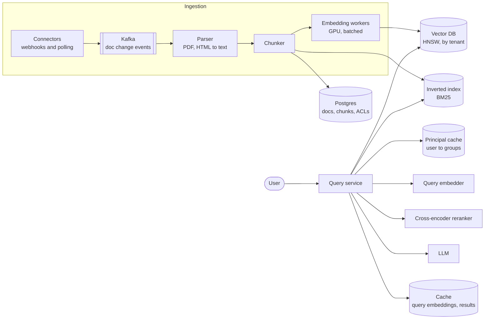
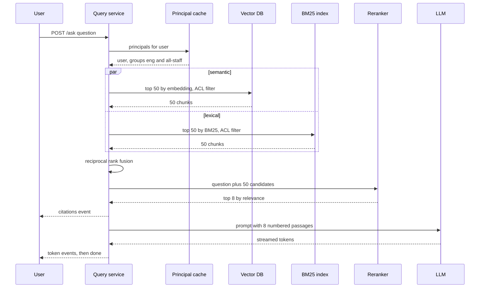

# Design a RAG / Semantic Search System

## Requirements

**Functional**
1. Ingest documents from sources such as uploads, Google Drive, Confluence and wikis (PDF, HTML, Markdown, DOCX), and keep them in sync as they change.
2. Users ask natural-language questions and get an answer generated by an LLM, grounded in the retrieved passages, with citations linking to the source documents.
3. Users can also run plain semantic search and see ranked passages.

**Non-functional**
- **Answer latency:** first token in under ~1.5 s, full answer under ~3 s at p95.
- **Index freshness:** a changed document is searchable within ~5 minutes; a deleted one disappears within ~1 minute.
- **Access control:** a user never sees, and the LLM is never given, content from a document the user can't open in the source system.
- **Scale:** ~10M documents (~100M chunks), ~1M questions/day, multi-tenant.
- **Grounded answers:** if retrieval finds nothing relevant, say so instead of guessing.

**Out of scope:** training or fine-tuning the LLM, multi-turn agents that call tools.

### Back-of-envelope estimates

| Quantity | Estimate | Implication |
|---|---|---|
| Corpus | 10M docs × ~4,000 tokens = 40B tokens | Initial embedding is a large batch job; incremental after that |
| Chunks | 500-token chunks with 50 overlap ≈ 9 per doc ≈ 90M, call it 100M | Index sized for 100M vectors |
| Raw vectors | 100M × 1,024 dims × 4 bytes ≈ 410 GB | Too big for one node in float32; shard and/or quantize |
| Quantized (int8) | 100M × 1,024 bytes ≈ 102 GB | Fits in RAM across a few shards |
| HNSW graph links | ~32 neighbors × 4 bytes ≈ 128 bytes per vector at layer 0 ≈ 13 GB | Graph overhead is small next to the vectors |
| Queries | 1M/day ≈ 12/s average, ~50/s peak | Retrieval load is light; LLM generation dominates cost and latency |
| Updates | ~1% of docs change per day = 100k docs ≈ 900k chunks/day | Streaming re-embed pipeline, ~10 chunks/s on average |

## Core entities

| Entity | Key fields | Store/Notes |
|---|---|---|
| Document | `doc_id`, `tenant_id`, `source`, `source_url`, `title`, `content_hash`, `acl_principals`, `updated_at`, `deleted` | Postgres; the system of record for what is indexed |
| Chunk | `chunk_id` = `doc_id:seq`, `doc_id`, `tenant_id`, `text`, `heading_path`, `char_start`, `char_end`, `chunk_hash` | Postgres or object storage for text; IDs referenced by both indexes |
| Vector entry | `chunk_id`, `embedding`, metadata (`tenant_id`, `acl_principals`, `doc_id`, `updated_at`) | Vector DB (HNSW), partitioned by `tenant_id` |
| Lexical entry | `chunk_id`, `text`, same metadata | Inverted index (Elasticsearch / OpenSearch) for BM25 |
| Principal set | `user_id` → user ID + group IDs | Synced from the identity provider, cached in Redis |
| Answer log | `query_id`, user, question, retrieved chunk IDs, answer, feedback | Warehouse; used for evaluation |

## API

```
POST /documents                     (upload)       → 202 { docId, status: "processing" }
POST /sources                       { type: "confluence", credentials, scope } → 201 { sourceId }
DELETE /documents/{docId}                          → 202
GET  /documents/{docId}/status                     → { status: "indexed", chunks: 14, indexedAt }

POST /ask   { question, filters?: { source?, updatedAfter? }, stream: true }
  → 200 text/event-stream
    event: citations  data: [{ n: 1, docId, title, url, snippet }]
    event: token      data: "Kafka keeps "
    event: done       data: { queryId }
POST /search { query, topK: 10, filters? } → { results: [{ chunkId, docId, title, snippet, score }] }
POST /feedback { queryId, rating, comment? } → 204
```

- Identity and groups come from the auth token; the server expands them to principals. The client never sends its own ACL.
- `/ask` streams over SSE so the user sees tokens within ~1 s instead of waiting for the whole answer. Citations are sent first so the UI can render sources while tokens arrive.
- Ingest is asynchronous (202) because parsing and embedding take seconds to minutes.

## High-level design



**Ingestion**
1. Connectors receive change webhooks (or poll with a cursor) and emit `doc_changed` / `doc_deleted` events to Kafka, keyed by `doc_id` so updates to one document are processed in order.
2. The parser extracts text and structure (headings, tables, page numbers). If the `content_hash` is unchanged and only the ACL changed, skip to step 5.
3. The chunker splits text into chunks; unchanged chunks (same `chunk_hash`) keep their existing embeddings.
4. Embedding workers batch new chunks (e.g. 256 at a time) to a GPU embedding model.
5. Vectors and metadata are upserted into the vector DB, text into the BM25 index, rows into Postgres. Chunks of the old version that no longer exist are deleted.

**Query**
1. Resolve the user's principals, embed the question, and run vector and BM25 search in parallel, both filtered by tenant and ACL.
2. Fuse the two result lists, rerank the top ~50 with a cross-encoder, keep the best ~8.
3. Build a prompt with numbered passages and instructions to cite them, stream the LLM's answer, and verify citations point to passages that were supplied.



## Deep dives

### Chunking and the embedding pipeline

Embeddings represent a passage as one vector, so a chunk must be small enough to be about one thing and large enough to make sense alone.

| Strategy | How it works | Verdict |
|---|---|---|
| **Weak:** whole documents | One vector per document | A 40-page PDF's vector is a blur; LLM context is wasted on irrelevant pages |
| **Better:** fixed-size windows | Every 500 tokens, with 50-token overlap so sentences at a boundary appear in both chunks | Simple, predictable; can cut a table or a section in half |
| **Best:** structure-aware recursive splitting | Split on headings first, then paragraphs, then sentences, until each piece is under ~500 tokens; prepend the heading path (e.g. "Runbook > Kafka > Failover") | Chunks follow meaning; heading context makes short chunks retrievable |

**Worked example:** a 1,800-token page with three sections of 900, 600 and 300 tokens. Fixed 500/50 windows (stride 450) give 4 chunks starting at tokens 0, 450, 900 and 1,350, and the chunk at 450 straddles sections 1 and 2. Recursive splitting gives section 1 as two ~450-token chunks split at a paragraph break, section 2 as two ~300-token chunks, and section 3 as one chunk: 5 chunks, each inside one section.

#### How embeddings work

An embedding model (a transformer trained with contrastive learning) maps text to a fixed-length vector, e.g. 1,024 floats, so that texts with similar meaning land close together. Training pulls a question and its correct passage together and pushes random passages apart. At query time the question is embedded with the same model, and relevance is **cosine similarity**: `cos(q, d) = (q · d) / (|q| |d|)`. With vectors normalized to length 1 this is just the dot product. "How do I rotate API keys?" and "Steps to regenerate credentials" share no words but score high, which keyword search would miss.

**Pipeline details:** batch to keep GPUs busy; cache embeddings by `chunk_hash` so re-ingesting an unchanged document costs nothing; store the model version with each vector, because vectors from different models are not comparable. Changing models means re-embedding everything into a new index and switching over.

### ANN indexes: HNSW explained

Exact search compares the query with all 100M vectors: 100M × 1,024 ≈ 10^11 multiply-adds per query, around seconds even with SIMD. Approximate nearest neighbor (ANN) indexes trade a little recall for orders of magnitude less work.

#### How HNSW works

HNSW (Hierarchical Navigable Small World) is a multi-layer graph:

1. **Layers:** every vector is in layer 0. Each vector is also placed in higher layers with exponentially decreasing probability, so layer 1 has roughly 1/M of the nodes, layer 2 about 1/M² and so on. Upper layers are sparse "highways"; layer 0 is the dense local map.
2. **Edges:** each node links to up to **M** close neighbors in each layer it belongs to (2M at layer 0). M = 16 is a common default.
3. **Search:** start at the single entry point in the top layer. Greedily move to whichever neighbor is closest to the query until no neighbor is closer; drop down one layer and repeat. At layer 0, run a best-first search keeping a candidate list of size **efSearch** (e.g. 100), then return the best k.
4. **Insert:** pick the new node's top layer at random, search down to find its nearest nodes in each layer (with a list of size **efConstruction**), and link to the best M, pruning neighbors' lists to keep them short.

**Worked example (2-D, for intuition):** query at (9, 9). Top layer has nodes A (0, 0) and B (10, 8). Start at A, distance 12.7; neighbor B is at distance 1.4, move to B; B has no closer neighbor in this layer. Drop to layer 0 at B; B's neighbors there include C (9, 9.5) at 0.5 and D (7, 9) at 2.0; move to C; C's neighbors are no closer, so C is the nearest neighbor. A handful of distance computations replaced a scan of every point.

| Parameter | Higher value means |
|---|---|
| M | Better recall, more memory, slower inserts |
| efConstruction | Better graph quality, slower build |
| efSearch | Better recall, slower queries (tune per query at runtime) |

**Alternatives:** **IVF** clusters vectors with k-means into, say, 16k lists and searches only the `nprobe` closest lists; it uses less memory and builds faster, but recall drops near cluster borders. **Product quantization** compresses vectors to a few dozen bytes for billion-scale indexes, at some accuracy cost; it's often combined with IVF and followed by exact re-scoring of the top results. At 100M vectors, HNSW over int8-quantized vectors, sharded by tenant and then by hash, is a solid default.

**Deletes and updates:** HNSW marks deleted nodes as tombstones and filters them from results; segments are rebuilt periodically in the background to reclaim space.

### Hybrid search and reranking

Embeddings miss exact tokens such as error codes (`ERR_4012`), product names and IDs; keyword search misses paraphrases. Run both and fuse.

#### How BM25 works

BM25 scores a document D for query terms q using an inverted index (term → list of chunk IDs with term frequencies):

```
score(D) = Σ over q in query  IDF(q) × f(q,D) × (k1 + 1) / ( f(q,D) + k1 × (1 − b + b × |D| / avgdl) )
IDF(q)   = ln(1 + (N − n(q) + 0.5) / (n(q) + 0.5))
```

`f` is the term's count in D, `|D|` the chunk length, `avgdl` the average length, with typical k1 = 1.2 and b = 0.75. Rare terms get high IDF, repeated terms help with diminishing returns, and long chunks are penalized.

**Worked example:** N = 1,000 chunks, "kafka" appears in 10, so IDF = ln(1 + 990.5 / 10.5) = ln(95.3) ≈ 4.56. A 100-token chunk (avgdl 200) with 3 occurrences: length factor 1 − 0.75 + 0.75 × 0.5 = 0.625, so 3 × 2.2 / (3 + 1.2 × 0.625) = 6.6 / 3.75 = 1.76, score ≈ 8.0. The same 3 occurrences in a 400-token chunk: factor 1.75, 6.6 / 5.1 = 1.29, score ≈ 5.9.

#### How reciprocal rank fusion works

BM25 scores and cosine similarities aren't on the same scale, so fuse by rank: `RRF(d) = Σ 1 / (k + rank_i(d))` with k = 60.

| Chunk | Vector rank | BM25 rank | RRF score |
|---|---|---|---|
| A | 1 | 3 | 1/61 + 1/63 = 0.0323 |
| C | 5 | 1 | 1/61 + 1/65 = 0.0318 |
| B | 2 | not in top 50 | 1/62 = 0.0161 |

Chunks found by both methods rise to the top.

#### How the reranker works

The first stage uses **bi-encoders**: query and chunk are embedded separately, which is what makes indexing possible but loses word-level interaction. A **cross-encoder** reads the question and a chunk together in one transformer pass and outputs a relevance score, which is much more accurate but costs one model call per pair. So rerank only the top ~50 fused candidates (batched on a GPU, ~50–150 ms) and keep the top ~8 for the prompt.

| Stage | Candidates | Typical latency |
|---|---|---|
| Embed query | 1 | 10–30 ms |
| Vector + BM25 in parallel | 50 + 50 | 20–60 ms |
| Fusion + rerank | 50 → 8 | 50–150 ms |
| LLM time to first token | prompt of ~4k tokens | 300–800 ms |
| Generation | ~300 tokens | 1–2 s, streamed |

### Access control filtering

Every chunk carries `acl_principals` copied from its document (e.g. `["user:42", "group:eng", "group:all-staff"]`). At query time the user's principal set is matched against it.

- **Weak: post-filtering.** Retrieve the top 50, then drop chunks the user can't see. If the user can see 1% of the tenant's corpus, on average 0.5 of the 50 survive, so answers are empty or poor. Over-fetching 5,000 helps but is slow.
- **Better: separate indexes per tenant or per group.** Strong isolation, but documents shared with many groups get duplicated, and users in many groups need many searches.
- **Best: pre-filtering inside the index**, partitioned by tenant. The vector DB applies the filter `acl_principals ∩ user_principals ≠ ∅` during HNSW traversal (filtered HNSW, supported by engines such as Qdrant, Weaviate, Elasticsearch and OpenSearch) and falls back to an exact scan of the matching set when the filter is very selective. BM25 applies the same filter as a terms query.

**Keeping ACLs fresh:** permission changes arrive as source events and update only metadata (no re-embedding), so revocations take effect within a minute. For sensitive sources, re-check the final ~8 chunks against the source system's permission API before they go into the prompt. Never put retrieved content into a cache shared across users unless the cache key includes the principal set.

### Freshness and citations

- **Freshness:** event-driven ingestion with per-document ordering, content-hash skipping and chunk-level diffing keeps the 5-minute target; deletes write a tombstone to both indexes immediately and purge later.
- **Citations:** passages go into the prompt numbered `[1]..[8]` with titles, and the instructions require citing a number after each claim and replying "I couldn't find this in the documents" when nothing supports an answer. After generation, check that every cited number exists and map it back to `source_url` plus the character offsets, so the UI can highlight the exact passage.

## Follow-up questions

### How do you evaluate retrieval and answer quality?
Build a labeled set of questions with known relevant chunks and measure recall@k and MRR for retrieval, then use human or LLM-based grading for faithfulness (claims supported by cited passages) and answer relevance. Track thumbs-up/down and citation clicks in production. Run the set on every change to chunking, models or prompts.

### How would you handle a question that needs information from many documents?
Retrieve more broadly (higher k, multiple query rewrites generated by the LLM), then summarize per document before a final synthesis step. For aggregate questions ("how many incidents last quarter?") route to structured data or SQL instead of RAG, since retrieval over chunks can't count reliably.

### What do you cache?
Query embeddings by normalized query text, retrieval results keyed by (query, principal set, index version) for a few minutes, and LLM prompt prefixes via provider-side prompt caching for the fixed system instructions. A semantic answer cache (similar questions reuse answers) is risky with ACLs and freshness, so only use it for public, stable content.

### How do you switch to a better embedding model?
Vectors from different models aren't comparable, so build a new index in parallel: re-embed all chunks in a batch job, dual-write new changes to both indexes, compare quality on the evaluation set, then switch query traffic and drop the old index.

### How do you deal with PDFs that contain tables and scanned pages?
Use layout-aware parsing to keep tables intact (convert each to Markdown or a row-per-line form) and OCR for scanned pages. Store page numbers with chunks so citations can point to a page. Very large tables can be summarized into a separate chunk that links back to the full table.

### How do you prevent prompt injection from documents?
Treat retrieved text as data: wrap passages in clear delimiters, instruct the model to ignore instructions inside them, and never give the RAG answerer tools that act on the world. Scan ingested content for obvious injection patterns and limit which sources are indexed.

### How would you scale to a billion chunks?
Shard the vector index by tenant and hash, use IVF-PQ or quantized HNSW with re-scoring to cut memory, and keep cold tenants on disk-based indexes (e.g. DiskANN-style). Query each relevant shard in parallel and merge.

### What happens when the LLM provider is slow or down?
Set timeouts and fall back to a second model or provider, and as a last resort return the reranked passages as search results without a generated answer. Streaming hides most latency, and rate limits per tenant keep one heavy user from exhausting capacity.
