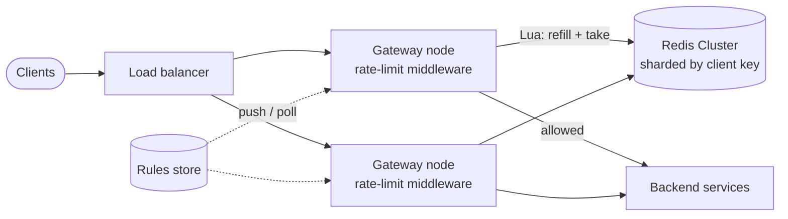
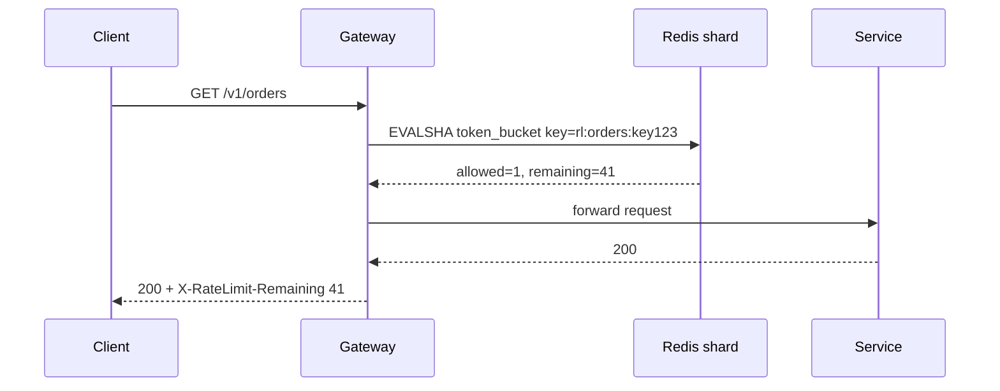
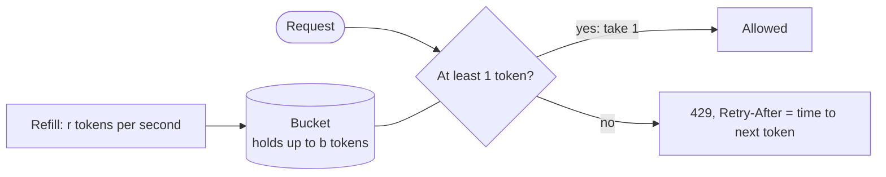

# Design a Distributed Rate Limiter

## Requirements

**Functional**
1. Limit requests per client, identified by user ID, API key, or IP address.
2. Configurable rules per endpoint and client tier (e.g. free: 100 req/min; paid: 10,000 req/min).
3. Over-limit requests are rejected with HTTP 429 and headers telling the client when to retry.

**Non-functional**
- **Low latency:** the check adds under ~10 ms at p99, since it sits in front of every request.
- **Accurate across the fleet:** a client can't get N× their limit by spreading requests over N servers.
- **Highly available:** the limiter must not become the reason the API is down. Decide deliberately whether to fail open or closed.
- **Scale:** ~1M requests/second across ~100 gateway nodes, ~10M distinct clients.

### Back-of-envelope estimates

| Quantity | Estimate | Why it matters |
|---|---|---|
| Checks | 1M/s | Every check is a Redis round trip, so Redis must be sharded |
| State per client per rule | ~20–50 bytes (token bucket: tokens + timestamp) | 10M clients × a few rules ≈ 1–2 GB, so it fits in memory |
| Redis throughput | ~100k ops/s per shard | ~10–20 shards plus replicas |

## Core entities

| Entity | Key fields | Notes |
|---|---|---|
| Rule | `rule_id`, match (endpoint, tier), `limit`, `window`, `algorithm` | Small, read-mostly; cached in every gateway |
| Bucket state | key `rl:{rule}:{client}` → `tokens`, `last_refill_ms` | Hot, in Redis with a TTL so idle clients expire |

## API

The limiter is internal, usually middleware in the API gateway or a sidecar:

```
check(clientKey, ruleId, cost = 1) → { allowed: bool, remaining: int, resetAtMs: int }
```

What the end client sees when limited:

```
HTTP/1.1 429 Too Many Requests
X-RateLimit-Limit: 100
X-RateLimit-Remaining: 0
X-RateLimit-Reset: 1735689600
Retry-After: 12
```

## High-level design



1. A request arrives at any gateway node. The middleware works out the client key (API key, falling back to user ID, then IP) and the matching rules from its in-memory rule cache.
2. It runs one atomic Redis script per rule that refills the bucket and tries to take a token.
3. If allowed, the request goes to the backend with `X-RateLimit-*` headers; if not, the gateway returns 429 immediately without touching the backend.



**Why at the gateway?** Every service gets protection without implementing it, abusive traffic is rejected before it costs backend work, and rules are managed in one place.

## Deep dives

### The rate-limiting algorithms, explained

Interviewers expect you to know the five classic algorithms, explain one or two in detail, and justify your pick. All the examples below use the same scenario so you can compare them.

#### 1. Fixed window counter

**Idea:** split time into fixed windows (e.g. each calendar minute) and count requests per client per window. Reject once the count passes the limit; the count resets when the next window starts.

```
def allow(client, now):
    window = floor(now / 60)              # e.g. minute number
    key = f"rl:{client}:{window}"
    count = INCR(key)                      # atomic in Redis
    if count == 1: EXPIRE(key, 60)         # clean up old windows
    return count <= LIMIT
```

**Worked example (limit 100/min):** 100 requests at 12:00:59 are all allowed (window 12:00). At 12:01:00 a new window starts with count 0, so 100 more are allowed. **200 requests went through in about one second**, double the intended rate. This is the **window-boundary burst** problem.

- **State:** one integer per client per window.
- **Pros:** simplest possible; a single atomic `INCR`.
- **Cons:** up to 2× bursts at window edges; also, everyone's counters reset at the same instant, which can cause synchronized client retries.

#### 2. Sliding window log

**Idea:** remember the timestamp of every accepted request. On each request, drop timestamps older than one window and count what's left.

```
def allow(client, now):
    key = f"rl:{client}"
    ZREMRANGEBYSCORE(key, 0, now - 60)    # evict entries older than 60 s
    if ZCARD(key) < LIMIT:
        ZADD(key, now, unique_id)          # score = timestamp
        return True
    return False
```

**Worked example (limit 100/min):** a client sends 100 requests at 12:00:59. At 12:01:00 the log still holds those 100 (they're only 1 s old), so the request is rejected. Requests are only allowed again from 12:01:59, when the old entries age out. **No boundary burst; it's exact.**

- **State:** one entry per request in the window, O(limit) per client. A 10,000/min limit for 10M clients could mean billions of entries.
- **Pros:** perfectly accurate.
- **Cons:** memory-hungry, and every check does sorted-set work. Fine for low limits (e.g. 5 login attempts per 15 min); not for high-volume APIs.

#### 3. Sliding window counter

**Idea:** keep fixed-window counts, but estimate the count over the *rolling* last minute by weighting the previous window by how much of it still overlaps.

```
estimate = prev_window_count × (1 − elapsed_in_current / window) + current_window_count
allow if estimate < LIMIT
```

**Worked example (limit 100/min):** the previous minute had 80 requests; the current minute has 30 so far; we're 15 s into the current minute (25%). Estimate = 80 × 0.75 + 30 = **90** → allowed. At 45 s in, with 60 so far: 80 × 0.25 + 60 = 80 → allowed. With 85 so far: 80 × 0.25 + 85 = 105 → rejected.

- **State:** two integers per client.
- **Pros:** smooths out the boundary burst at almost no cost; Cloudflare uses this at very large scale and reported very low error rates.
- **Cons:** approximate, since it assumes the previous window's requests were evenly spread.

#### 4. Token bucket (most common answer)

**Idea:** each client has a bucket that holds up to **b** tokens (the burst capacity) and refills at **r** tokens per second (the sustained rate). Each request takes one token; with no tokens left, the request is rejected. You don't need a background refill job: compute the refill **lazily** from the elapsed time whenever a request arrives.



```
def allow(client, now):
    tokens, last = load(client) or (CAPACITY, now)
    tokens = min(CAPACITY, tokens + (now - last) * RATE)   # lazy refill
    if tokens >= 1:
        tokens -= 1; allowed = True
    else:
        allowed = False
    save(client, tokens, now)
    return allowed      # if rejected: Retry-After = (1 - tokens) / RATE
```

**Worked example (capacity b = 4, refill r = 0.5 token/s, i.e. 30/min sustained):**

| Time | Event | Tokens after refill | Result | Tokens left |
|---|---|---|---|---|
| 0 s | 4 requests at once | 4 | all 4 allowed (the burst) | 0 |
| 1 s | 1 request | 0 + 1 × 0.5 = 0.5 | rejected, Retry-After 1 s | 0.5 |
| 2 s | 1 request | 0.5 + 0.5 = 1.0 | allowed | 0 |
| 10 s | 1 request | 0 + 8 × 0.5 = 4 (capped at 4) | allowed | 3 |

- **State:** two numbers (tokens, last refill time), ~16 bytes.
- **Pros:** allows short bursts (good for real clients that send a few calls at once) while enforcing the long-run rate; tiny state; easy to explain. Used by AWS API Gateway and Stripe.
- **Cons:** two parameters to tune: **b** = how big a burst you tolerate, **r** = the sustained rate (for "100/min with bursts of 20", use r = 100/60 per second and b = 20).

#### 5. Leaky bucket

**Idea:** requests pour into a bucket (a FIFO queue) of size **b** and **leak out at a constant rate r** to be processed. If the bucket is full, new requests are dropped. The output is perfectly smooth no matter how bursty the input is.

**Worked example (b = 4, leak 1 request/s):** 6 requests arrive at t = 0. Four fill the bucket and two are dropped. The queued ones are processed at t = 0, 1, 2, 3 s, so the last waits 3 s.

- **State:** a queue per client (or, in the "meter" variant, just a timestamp; see GCRA below).
- **Pros:** smooth, predictable output; protects downstreams that can't absorb bursts.
- **Cons:** adds queueing latency; bursts are delayed rather than served. Better for **traffic shaping** (calling a third-party API with a strict QPS cap) than for API fairness.

#### Bonus: GCRA (generic cell rate algorithm)

A leaky bucket implemented as a meter with **a single timestamp per client**: the "theoretical arrival time" (TAT). With emission interval T = window / limit and burst allowance τ:

```
tat = max(stored_TAT, now)
if tat - now > τ: reject          # arriving too early
else: stored_TAT = tat + T; allow
```

It behaves like a token bucket while storing one number; the `redis-cell` module implements it. Mentioning it shows depth, but token bucket is a perfectly good main answer.

#### Comparison

| Algorithm | State per client | Bursts | Accuracy | Redis implementation |
|---|---|---|---|---|
| Fixed window | 1 counter | Up to 2× at window edges | Low at edges | `INCR` + `EXPIRE` |
| Sliding log | O(limit) timestamps | None | Exact | Sorted set (`ZADD`/`ZREMRANGEBYSCORE`/`ZCARD`) |
| Sliding counter | 2 counters | Smoothed | ~Accurate | 2 keys + arithmetic (Lua) |
| **Token bucket** | 2 numbers | Allowed up to b, by design | Exact for its model | Hash + Lua |
| Leaky bucket / GCRA | Queue / 1 timestamp | Smoothed out | Exact for its model | Lua (or `redis-cell`) |

**What to say in the interview:** "I'll use a token bucket: it allows short bursts while enforcing a sustained rate, needs only two numbers per client, and refills lazily so there's no background job. A fixed window has a 2× edge burst and a sliding log uses too much memory at our scale. If we needed smooth output toward a fragile downstream, I'd use a leaky bucket there."

### Making the check atomic in Redis

- **Weak:** read the bucket, compute in the gateway, write it back. Two gateway nodes handling the same client interleave (read, read, write, write) and both requests get through: a **lost update**.
- **Fixed window only:** `INCR` is atomic on its own, but you inherit the edge burst.
- **Best:** run the whole refill-and-take as a **Lua script**. Redis executes a script atomically on its shard, so nothing interleaves:

```lua
-- KEYS[1] = bucket key   ARGV[1] = capacity, ARGV[2] = refill per ms, ARGV[3] = cost
local capacity = tonumber(ARGV[1])
local rate     = tonumber(ARGV[2])
local cost     = tonumber(ARGV[3])
local t   = redis.call('TIME')                          -- Redis's clock, not the gateway's
local now = t[1] * 1000 + math.floor(t[2] / 1000)       -- milliseconds
local b      = redis.call('HMGET', KEYS[1], 'tokens', 'ts')
local tokens = tonumber(b[1]) or capacity
local ts     = tonumber(b[2]) or now
tokens = math.min(capacity, tokens + (now - ts) * rate)  -- lazy refill
local allowed = 0
if tokens >= cost then tokens = tokens - cost; allowed = 1 end
redis.call('HSET', KEYS[1], 'tokens', tokens, 'ts', now)
redis.call('PEXPIRE', KEYS[1], math.ceil(capacity / rate))  -- idle buckets expire once full
return { allowed, math.floor(tokens) }                   -- Lua numbers return as integers
```

- Load it once with `SCRIPT LOAD` and call `EVALSHA` with the hash, so the script text isn't sent on every request.
- Using `TIME` inside the script avoids clock skew between gateway nodes (fine on Redis 5+, which replicates script effects).

### Scaling and latency

- **Shard by client key** across Redis Cluster hash slots; all of a client's state for a rule lives on one shard, so the script stays single-key.
- Keep persistent, pooled connections from each gateway; place Redis in the same availability zone. One round trip is ~0.5–1 ms.
- **Multiple rules per request** (per-second *and* per-day): put the client in a hash tag (`rl:{key123}:sec`, `rl:{key123}:day`) so the keys share a shard, and check all rules in one script call.
- **Very hot clients:** give each gateway node a local allowance it refills from Redis in batches (e.g. claim 50 tokens at once). Redis load drops ~50×, in exchange for slight overshoot.

### Failure handling

- **Fail open** (allow) when Redis is unreachable for normal API traffic: brief over-admission beats a self-inflicted outage. Keep a coarse local per-node limit as a backstop.
- **Fail closed** for abuse-sensitive endpoints: login, password reset, SMS/OTP sending.
- Use aggressive timeouts (~5 ms) on Redis calls and a circuit breaker, so a slow Redis doesn't pile up gateway threads.
- Replication is asynchronous, so a failover may lose a few seconds of counts. That's acceptable for rate limiting.

### Distributing rule changes

- Store rules in a DB or config service; gateways poll every ~10 s or subscribe to change notifications. Apply them atomically and version them so a bad rule can be rolled back quickly.

## Production readiness

### Database choice and consistency

- **Redis for bucket state.** 1M atomic read-modify-writes per second at sub-millisecond latency rules out any disk-backed database, and purely local in-memory counters fail the "no N× limit across 100 gateways" requirement. The state is small (1–2 GB) and **disposable**: if a bucket is lost, the client gets a full bucket, which means a brief over-admission, not data loss. No durable persistence is needed.
- **Rules in a small relational store or config service.** Rules are edited by people, versioned, and must be applied all-or-nothing. A half-applied change ("free tier: 0 req/min") is an outage. ACID and a version number per rule set suit this; gateways cache the whole set.
- **CAP per path:** counters are **AP**. Replication is async and Redis failover can lose seconds of counts, and on a partition gateways fail open. Over-admitting a few percent for a few seconds is far cheaper than rejecting all API traffic. For login, password reset and OTP rules the stance flips to **CP**: fail closed, because there the limiter is a security control.

### Service boundaries and communication

- **The limiter is a library/middleware in the gateway, not a separate service.** A standalone limiter service would add a network hop to every one of 1M requests/s and another fleet that can fail. The only remote call is the Redis script.
- **Rules service** is separate and off the hot path: gateways poll or subscribe asynchronously, so a rules-store outage just freezes the current rules.
- **Sync vs async:** the check is synchronous by necessity (the request can't proceed without a verdict), so it gets a 5 ms timeout. Everything else is async: rule distribution, emitting 429 events for analytics, and cross-region count syncing (follow-up).

### Failure modes and reliability

| Failure | Effect | Mitigation |
|---|---|---|
| Redis shard primary fails | ~1/15 of clients unlimited for a few seconds | Replica promotion; fail open with the local per-node backstop; fail closed for security rules |
| Redis slow (latency spike) | Gateway threads pile up waiting | 5 ms timeout and circuit breaker (deep dive); alert on fail-open rate |
| One client at 100k req/s (hot key) | Its shard saturates and slows every client sharing it | Local allowance batching (deep dive); a coarse per-IP pre-limit on each node before the Redis call |
| Bad rule pushed (paid tier set to 0) | Mass false 429s | Schema checks and floors on rule values; canary the new version on a few gateways; auto-rollback if the 429 rate jumps |
| Random API key flood | Every fake key creates a new bucket, so Redis memory grows | Limit by key only *after* the key is validated; before that, limit by IP |
| Volumetric DDoS beyond gateway capacity | Gateways saturate before the limiter runs | Not this component's job: edge/CDN filtering and load-balancer load shedding sit in front |

### High availability and disaster recovery

- **SPOFs:** gateways are stateless behind the load balancer; each Redis shard has a replica in another zone; rules are cached in every gateway, so the rules store isn't on the request path.
- **Zone placement tension:** the deep dive puts Redis in the same zone for ~0.5–1 ms round trips, but shard primaries are spread across zones for HA. Accept a cross-zone hop for some shards (still well under 10 ms), or run zone-local limiter clusters with the quota split per zone, which trades accuracy for latency.
- **Region strategy:** each region runs its own Redis cluster and enforces a regional share of the quota (follow-up). Losing a region means its clients reconnect elsewhere with fresh buckets, which is acceptable.
- **Targets:** for API traffic, user-facing **RTO is effectively 0**, since fail-open means the limiter never blocks requests. **Enforcement RTO under 30 s** (replica promotion). **Counter RPO: none required**, since seconds of lost counts don't matter and backups of counters would be stale on restore. **Rules: RPO 0**, with every version kept and restorable.

### Security

- **Identity order:** apply a cheap IP limit first (protects the auth service), then validate the API key or token, then apply the per-client limit. Only trust `X-Forwarded-For` as set by your own load balancer, or attackers pick their own IP.
- **Redis access:** private network, Redis ACLs/AUTH, and TLS if policy requires it (it costs CPU and some latency). Credentials come from a secrets manager and rotate with dual users.
- **No secrets or PII in keys:** use a hash of the API key in `rl:{rule}:{client}`. Key names show up in slow logs and debugging tools.
- **Audit:** every rule change and allowlist entry, with author and reason.
- **Abuse:** the limiter *is* the abuse control. Tune login/OTP rules with security teams, and report top limited clients to bot detection.

### Observability

**SLIs and SLOs (30 days):**
- 99.9% of checks complete within 10 ms (the stated budget).
- Fewer than 0.1% of checks fail open.
- Zero false 429s for a canary client sending at 80% of its limit through several gateways, plus an over-limit canary whose admitted rate must stay within 5% of its limit.

**Dashboards:** 429 rate by rule and tier, top limited clients, Redis ops/s and CPU per shard (to spot hot shards), memory, script latency, fail-open count, and the rule version on each gateway.

**Tracing:** a limiter span in the gateway's request trace, tagged with rule ID and decision.

**Paging:** canary false 429s, check-latency burn rate, and sustained fail-open. A spike of 429s for one client is the limiter working, so it's a dashboard item, not a page.

### Performance and cost

**Bottleneck:** Redis operations. At ~100k ops/s per shard, 1M checks/s needs 10–20 shards, and multiple rules per request multiply that unless they share one script call via hash tags (deep dive). Keep pooled persistent connections and `EVALSHA`; pipeline when a request checks several clients.

**Cost drivers:**
- **Redis nodes are sized for ops, not memory.** 1–2 GB of state fits on one node; it's the 1M ops/s that needs ~20 primaries plus ~20 replicas. Local allowance batching (50 tokens per claim) cuts ops roughly 50×, to a couple of shards, at the cost of overshoot up to the unspent allowance on each of 100 gateways. Use it for high-limit tiers, not for 5-per-minute login rules.
- **Cross-zone traffic.** At an assumed ~200 bytes per request/response, 1M checks/s is 200 MB/s, ~17 TB/day, much of it crossing zones if shards are spread. Zone-local clusters remove it, trading some accuracy.
- **Cross-region sync**, if used, should send aggregated per-client deltas every second or so, not per request.
- **Operational complexity** is modest; a managed Redis service is usually worth it.

## Follow-up questions

### Walk me through what happens at a window boundary with a fixed window counter, and how you'd fix it.
With 100/min, a client can send 100 at 0:59 and 100 at 1:00: 200 in about a second, because the counter resets. Fixes: a sliding window counter (weight the previous window by its overlap: at 1:00, 100 × ~1.0 + 0 already blocks), a sliding log (exact, more memory), or a token bucket (the burst is bounded by its capacity, not by window edges).

### How do you choose the token bucket's capacity and refill rate?
The refill rate is the sustained limit you promise (100/min → 1.67 tokens/s). The capacity is the largest burst you're willing to absorb at once, usually a few seconds' to a minute's worth of the rate, based on real client behavior (page loads fire several calls together). A larger capacity is friendlier to clients but lets more traffic through in a spike.

### Why use a Lua script instead of MULTI/EXEC?
A transaction can't branch on values read inside it: you'd need `WATCH` plus retries (optimistic locking), which degrades under contention on hot keys. A Lua script reads, computes and writes atomically in one round trip, with no retries.

### Where should the limiter live: client, gateway, or each service?
Never trust client-side limiting. The gateway is the default: central, consistent, and it rejects early. Add per-service limits only for internal protection (a fragile downstream), and use load shedding inside services for overload, which is a different problem from per-client fairness.

### How would you rate-limit across multiple regions?
Strict global limits need a cross-region round trip per request, which is too slow. Usually you either split the quota per region (by traffic share) and enforce locally, or enforce locally and asynchronously sync counts between regions, accepting brief overshoot. Only billing-grade quotas justify a single global store.

### How do you rate-limit by IP when many users share one (NAT, corporate proxies)?
Prefer authenticated identity (API key or user ID) whenever it exists. For anonymous traffic, use generous IP limits, aggregate at `/24` for IPv4 or `/64` for IPv6 against abuse, and allowlist known large NATs. Combine with bot detection rather than relying on IP alone.

### Your Redis cluster has a latency spike. What does the user see?
With 5 ms timeouts and a circuit breaker, checks time out quickly and fail open, so users see normal responses; the local per-node backstop keeps the fleet from being overwhelmed. Alert on the fail-open rate so you know limiting is degraded.

### How do you handle requests that cost more than others (e.g. a bulk export)?
Pass a `cost`: the script takes `cost` tokens instead of 1. Expensive endpoints declare their weight in the rule config, e.g. a bulk call costs 50 tokens.

### What should a well-behaved client do on a 429?
Honor `Retry-After`, back off exponentially with jitter, and avoid retry storms. Document the headers so SDKs can implement backoff automatically.

### How would you test that the limiter is correct?
Unit-test the Lua script with a controllable clock (refill math, bursts, the capacity cap). Load-test with many concurrent clients hitting the same key through several gateways and assert that admitted requests ≤ limit plus a small tolerance. Run chaos tests that kill Redis to verify fail-open behavior and timeouts.
