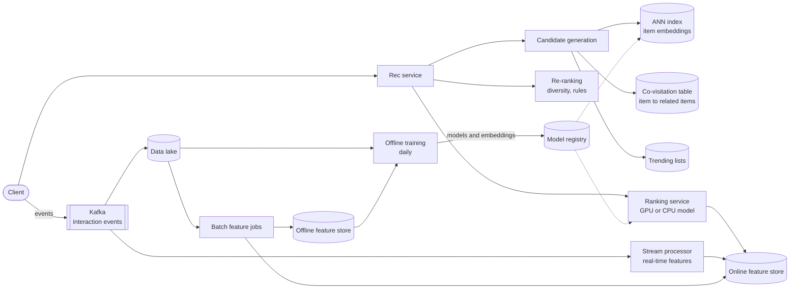
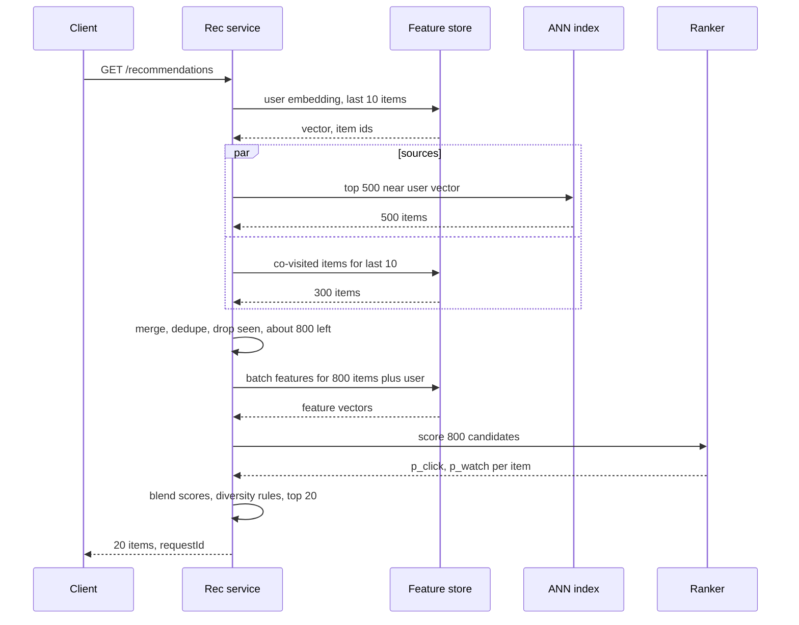

# Design a Recommendation System

## Requirements

**Functional**
1. Show each user a personalized, ranked list of items (videos, products, songs) on the home page and "more like this" lists on item pages.
2. Reflect recent activity within the session: after a user watches three cooking videos, the next refresh shows more cooking.
3. Handle new users and new items (cold start) with sensible defaults.
4. Log impressions and interactions to measure quality and train models.

**Non-functional**
- **Low-latency serving:** p99 under ~200 ms for a page of recommendations.
- **Freshness:** user activity affects recommendations within seconds; new items become recommendable within minutes to an hour.
- **Scale:** ~100M DAU, ~10M items in the catalog.
- **Availability:** if personalization fails, fall back to popular items rather than an empty page.

**Out of scope:** search ranking, ads auctions, content moderation.

### Back-of-envelope estimates

| Quantity | Estimate | Implication |
|---|---|---|
| Rec requests | 100M DAU × 10/day = 1B/day ≈ 11.6k/s, ~35k/s at a 3× peak | Serving must be horizontally scaled and stateless |
| Ranking work | 500 candidates per request × 11.6k/s ≈ 5.8M item scorings/s | The heavy model can't score all 10M items; needs a retrieval stage |
| Item embeddings | 10M × 128 dims × 4 bytes ≈ 5.1 GB | The whole ANN index fits in memory on each retrieval node |
| Interaction events | 100M × 50/day = 5B/day ≈ 58k/s | Kafka plus stream processing for real-time features |
| Training data | 5B events × ~200 bytes ≈ 1 TB/day | Batch training on a data lake; sample negatives |
| Online features | ~500 candidates × ~50 features per request | Feature store must answer batched lookups in under ~10 ms |

## Core entities

| Entity | Key fields | Store/Notes |
|---|---|---|
| User | `user_id`, locale, signup date, declared interests | Postgres; profile features copied to the feature store |
| Item | `item_id`, category, creator, tags, `created_at`, availability | Catalog DB; item features and embeddings derived offline |
| Interaction event | `user_id`, `item_id`, type (impression, click, watch, like, purchase), `watch_ms`, `ts`, `request_id` | Kafka, then data lake partitioned by date |
| Embedding | `entity_id` → vector (user or item), `model_version` | Item vectors in the ANN index; user vectors in the online feature store |
| Feature | `(entity_id, feature_name)` → value, `event_time` | Offline store (warehouse) + online store (Redis / Cassandra / DynamoDB) |
| Served list | `request_id`, `user_id`, items, scores, logged feature values | Logged to Kafka for training and debugging |

## API

```
GET /recommendations?surface=home&limit=20&cursor=...
  → 200 { requestId, items: [{ itemId, reason: "Because you watched X" }], nextCursor }
GET /items/{itemId}/similar?limit=20      → 200 { requestId, items: [...] }
POST /events  [{ type: "impression" | "click" | "watch", itemId, requestId, watchMs?, ts }]
  → 202
```

- The user comes from the auth token. `requestId` ties later clicks back to the exact list and model version that produced it, which training and A/B analysis need.
- Events are batched from the client and accepted with 202; losing a few is acceptable, blocking the UI is not.
- The cursor encodes the request ID so page 2 continues the same ranked list instead of re-ranking and showing duplicates.

## High-level design



**Serving flow**
1. The rec service loads the user's embedding and recent items from the online feature store.
2. **Candidate generation** pulls ~1,000 candidates from several sources in parallel: ANN search with the user embedding (~500), items co-watched with the user's last 10 items (~300), trending in the user's region (~100), and new items from followed creators (~100). Already-seen items are filtered out.
3. **Ranking** fetches features for all candidates in one batched lookup and scores them with a heavier model predicting click and watch probabilities.
4. **Re-ranking** applies diversity (no more than 2 items from one creator in the top 10), freshness boosts and business rules, then returns 20 items and logs the list with its features.

**Learning flow:** events flow to Kafka; a stream processor updates real-time features (recent items, session category counts) within seconds; daily batch jobs compute long-term features and retrain models; new item embeddings are pushed to the ANN index.



## Deep dives

### Two-stage candidate generation and ranking

Scoring all 10M items with a model that uses hundreds of features would take ~10M × 11.6k ≈ 10^11 scorings per second. Instead, use a **funnel**:

| Stage | Input → output | Model | Budget |
|---|---|---|---|
| Candidate generation | 10M → ~1,000 | Cheap: ANN over embeddings, lookup tables, heuristics | ~30 ms |
| Ranking | ~1,000 → ~100 | Expensive: GBDT or deep network with rich user × item features | ~50–80 ms |
| Re-ranking | ~100 → 20 | Rules and diversity | ~5 ms |

- **Weak:** one global popularity list. Fast, no personalization.
- **Better:** a single model (e.g. matrix factorization) that both retrieves and ranks. Personal, but can't use rich context such as time of day, device or item freshness.
- **Best:** **multiple retrieval sources plus a learned ranker.** Retrieval optimizes recall (don't miss good items); ranking optimizes precision on the small set, where it can afford cross features like "user's watch rate for this creator". YouTube described this two-stage design in its 2016 deep neural network recommendations paper, and it is now the standard pattern.

The ranker typically predicts several outcomes and blends them: `score = p(click) × E[watch time | click] + w_like × p(like) − w_skip × p(skip)`. The weights encode product goals and are tuned with A/B tests.

### Collaborative filtering and embeddings, explained

Collaborative filtering uses the behavior of similar users rather than item content: "people who watched what you watched also watched this".

#### How item-item collaborative filtering works

Represent each item as the set of users who interacted with it, and measure similarity by **cosine** of those vectors: `sim(i, j) = |U_i ∩ U_j| / sqrt(|U_i| × |U_j|)`.

| Item | Users who watched |
|---|---|
| Pasta video | u1, u2, u3, u4 |
| Pizza video | u2, u3, u4, u5 |
| Football video | u1, u6 |

sim(pasta, pizza) = 3 / sqrt(4 × 4) = 0.75; sim(pasta, football) = 1 / sqrt(4 × 2) ≈ 0.35. A user who just watched the pasta video gets pizza first. In production this is a **co-visitation table**: a batch job counts item pairs watched by the same user within a session, keeps the top 100 neighbors per item, and stores them in a key-value store for millisecond lookup.

#### How matrix factorization works

Build a matrix R of users × items with observed interactions (mostly empty). Learn a k-dimensional vector `p_u` for each user and `q_i` for each item so that `p_u · q_i ≈ R[u][i]` for the observed entries. Similar items end up with similar vectors because they're liked by the same users.

Training minimizes `Σ (R[u][i] − p_u · q_i)² + λ(|p_u|² + |q_i|²)` with SGD or **alternating least squares** (fix item vectors and solve each user vector exactly as a small least-squares problem, then swap; it parallelizes well). For implicit data (watches, no ratings), weight observed entries by confidence and treat unobserved ones as weak negatives.

**Worked example (k = 2, dimensions roughly "cooking" and "sports"):**

| Item | Vector | Score for user (0.9, 0.1) |
|---|---|---|
| Pizza video | (0.95, 0.05) | 0.9 × 0.95 + 0.1 × 0.05 = 0.86 |
| Cooking contest | (0.7, 0.4) | 0.63 + 0.04 = 0.67 |
| Football highlights | (0.1, 0.98) | 0.09 + 0.098 = 0.19 |

Real models use 64–256 dimensions that aren't humanly interpretable, but the dot-product logic is the same.

#### How the two-tower model works

Matrix factorization can't embed a brand-new user or item. A **two-tower** network fixes this: a user tower turns user features (recent item IDs, demographics, context) into a vector, and an item tower turns item features (ID, category, text, creator) into a vector of the same size. The score is their dot product. Training uses observed clicks as positives and the other items in the same batch as negatives (**in-batch negatives**, with a correction for popular items appearing too often).

After training, run the item tower over the whole catalog offline and load the 10M vectors into an ANN index (HNSW or ScaNN-style). At request time, run the user tower once (~5 ms) and query the index for the nearest ~500 items. Because the user tower reads recent activity, the user vector changes as soon as the features do, with no retraining.

### Feature store

The ranker needs the same features at training time and at serving time, computed the same way. Mismatches (**training-serving skew**) silently degrade quality.

- **Weak:** training pipelines compute features in SQL on the warehouse while the serving code reimplements them in Java. Definitions drift; a bug in one shows up as a mysterious quality drop.
- **Better:** log the exact feature values used at serving time and train on those logs. No skew, but a new feature needs weeks of logging before it can be trained on.
- **Best:** a **feature store** with one feature definition materialized to two stores, plus serving-time logging for the most critical features.

#### How the offline and online stores work together

| | Offline store | Online store |
|---|---|---|
| Holds | Full history of feature values with timestamps | Latest value per entity |
| Backed by | Warehouse / data lake (Parquet, BigQuery, Hive) | Redis, Cassandra, DynamoDB |
| Used by | Training: build examples from past events | Serving: batched lookups in under ~10 ms |
| Written by | Batch jobs (daily) and stream sink | Same jobs, plus the stream processor for real-time features |

**Point-in-time correctness:** a training example for a click at time t must use feature values as they were just before t, not today's. Otherwise the model learns from the future (label leakage).

| Event | Click time | `user_cooking_watches_7d` (wrong: latest) | Correct: as of click time |
|---|---|---|---|
| u1 clicks pizza | Mar 3 10:00 | 14 | 5 |
| u1 clicks pasta | Mar 9 18:00 | 14 | 11 |

The offline store keeps timestamped values, so the training join picks, for each event, the latest feature row with `event_time < click_time`:

```sql
SELECT e.*, f.value AS user_cooking_watches_7d
FROM events e
JOIN LATERAL (
  SELECT value FROM features
  WHERE entity_id = e.user_id AND name = 'user_cooking_watches_7d' AND event_time < e.ts
  ORDER BY event_time DESC LIMIT 1
) f ON true;
```

Open-source tools such as Feast implement this pattern; large companies run in-house equivalents.

### Offline training vs online serving, and freshness

Different parts of the system update on different clocks:

| Component | Updated | How |
|---|---|---|
| Model weights (two-tower, ranker) | Daily, or hourly incremental fine-tuning | Batch training on the data lake, validated, pushed via the model registry |
| Item embeddings and ANN index | When the model changes (full rebuild); new items within minutes | Item tower runs on new items as they're published; index supports inserts |
| Long-term features (30-day counts, creator affinity) | Daily | Batch Spark jobs |
| Real-time features (last 10 items, session category counts) | Seconds | Flink job consuming Kafka, writing to the online store |
| Co-visitation table | Hourly | Batch or streaming pair counts |

**How session freshness works, end to end:** at 10:00:00 the user finishes a cooking video. The client sends a `watch` event; within ~2 s the stream job appends the item to `recent_items` and increments `session_category:cooking` in the online store. On the next refresh, the user tower reads those features and produces a vector shifted toward cooking, the co-visitation source looks up neighbors of the just-watched item, and the ranker's `session_category_match` feature boosts cooking candidates. No model was retrained; freshness comes from features.

**Safe rollouts:** a new model is evaluated offline (AUC, recall@k on held-out days), then shadowed, then A/B tested on a small traffic slice measuring watch time and retention, and rolled back from the registry if metrics drop. The model and the ANN index must be versioned together, since a user vector from model v8 is meaningless against item vectors from v7.

**Cold start:** new users get popular and trending items for their region and device, then exploration based on the first few clicks (the user tower works from those immediately). New items get embeddings from content features via the item tower, plus a small exploration boost so they collect enough interactions to be judged.

## Follow-up questions

### How do you avoid a feedback loop where the system only shows what it already shows?
Reserve a small share of slots for exploration (e.g. epsilon-greedy or bandit-based slots for uncertain items) and log the probability each item was shown. Training can then weight examples by inverse propensity to correct for position and exposure bias. Diversity rules in re-ranking also widen what users see.

### How do you measure whether recommendations are good?
Offline metrics (AUC, recall@k, NDCG) gate a model, but the decision comes from online A/B tests on long-term metrics: watch time, return visits, satisfaction surveys. Clicks alone reward clickbait, so blend in completion rate and explicit feedback such as likes and "not interested".

### What happens if the feature store or ranker is slow?
Each stage has a timeout: if ranking misses its budget, return candidates in retrieval order; if retrieval fails, serve a cached per-user list from the last successful request or regional trending items. Missing features fall back to defaults the model saw during training.

### How would you precompute recommendations instead of computing them online?
A nightly batch job can write the top 100 items per user to a key-value store, making serving a single lookup. It's cheap and fast but stale and wasteful for the many users who don't visit. A common hybrid stores precomputed candidates offline and re-ranks them online with fresh session features.

### How do you handle items that go out of stock or get removed?
Apply an availability filter after candidate generation using a fast lookup of item status, and remove items from the ANN index via deletes or tombstones. Policy removals propagate as events so they take effect within seconds.

### How would you explain a recommendation to the user?
Record which retrieval source produced each candidate ("because you watched X" from the co-visitation source, "popular in your area" from trending). Show the strongest source for the final item. True explanations of the ranker's score are hard; source-based reasons are honest and cheap.

### How do you train on 1 TB of events per day efficiently?
Downsample negatives (impressions without clicks) and reweight to keep probabilities calibrated, train incrementally from yesterday's checkpoint rather than from scratch, and use distributed training over data-parallel GPU workers. Embedding tables for 10M items are sharded across parameter servers or GPUs.

### Why use several candidate sources instead of one good embedding model?
Each source captures something the others miss: embeddings generalize, co-visitation captures strong short-term associations, trending captures what's new, and follows capture explicit intent. Merging them raises recall, and the ranker decides which candidates actually win.
