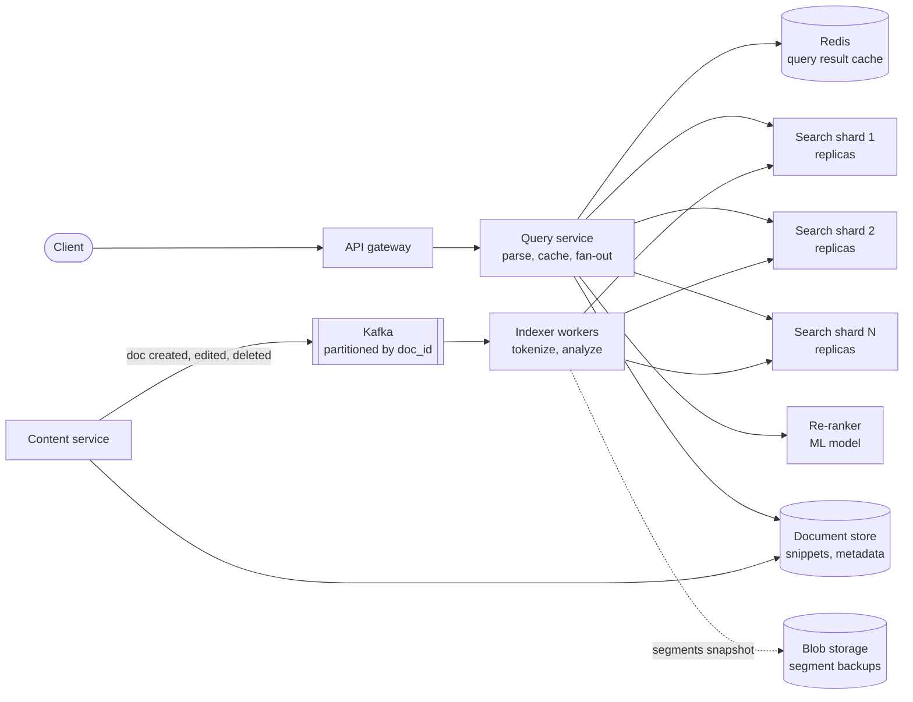
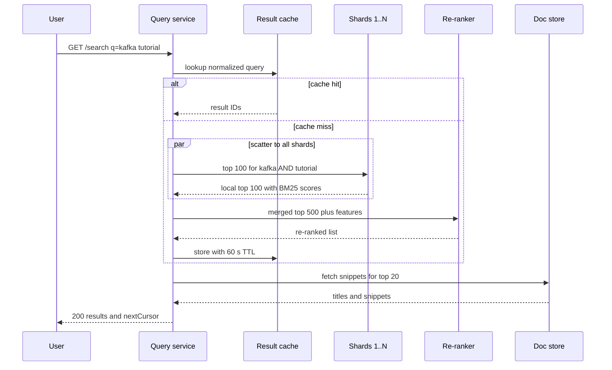

# Design a Search Engine / Post Search (Google, FB Search)

## Requirements

**Functional**
1. Users search by keyword and get a ranked page of matching documents (posts or web pages) with snippets.
2. Results can be sorted by relevance or by recency.
3. New and edited content becomes searchable within seconds; deleted content disappears just as quickly.

**Non-functional**
- **Latency:** p99 query latency under 500 ms end to end, p50 under ~100 ms.
- **Freshness:** a new post is searchable within ~5 s of creation.
- **Scale:** ~100B indexed documents, ~500M new documents/day, ~1B queries/day.
- **Availability:** search degrades (fewer or slightly stale results) rather than failing; losing one shard must not fail queries.

**Out of scope:** crawling (see the web crawler question), spelling correction and typeahead, ads.

### Back-of-envelope estimates

| Quantity | Estimate | Implication |
|---|---|---|
| Index writes | 500M/day ÷ 86,400 s ≈ 5,800 docs/s | A streaming indexer, not nightly batch rebuilds |
| Queries | 1B/day ÷ 86,400 ≈ 11,600 QPS, ~35k at 3× peak | Result caching and replicas carry the read load |
| Postings size | 100B docs × ~50 unique terms × ~2 bytes compressed ≈ 10 TB | Too big for one machine, so the index must be sharded |
| Shard count | 10 TB ÷ 50 GB per shard = 200 shards | Each shard fits in RAM or fast SSD; × 3 replicas = 600 shard copies |
| Raw documents | 100B × ~1 KB ≈ 100 TB | Stored in a separate document store; the index holds only IDs |

## Core entities

| Entity | Key fields | Store/Notes |
|---|---|---|
| Document | `doc_id`, `author_id`, `text`, `created_at`, `visibility`, `engagement` | Document store (Cassandra/Bigtable), keyed by `doc_id`; source of truth |
| Posting list | `term` → [(`doc_id`, `tf`, positions)] | Inverted index segments on search shards; sorted by `doc_id` |
| Index segment | `segment_id`, `shard_id`, min/max `doc_id`, deleted-docs bitset | Immutable files, merged in the background |
| Shard map | `shard_id` → replica hosts, doc range or hash range | Coordination service (ZooKeeper/etcd) |
| Query cache entry | normalized query + sort + page → result IDs | Redis, TTL 30–60 s |

## API

```
GET /v1/search?q=kafka+tutorial&sort=relevance|recent&limit=20&cursor=abc
  200 { results: [{ docId, title, snippet, authorId, createdAt, score }],
        nextCursor: "def" }
  400 empty or overlong query
  429 rate limited

# internal, called by the content service via Kafka or RPC
PUT    /internal/index/{docId}  { text, authorId, createdAt, visibility }  → 202
DELETE /internal/index/{docId}                                           → 202
```

- **Cursor pagination:** the cursor encodes the last (score, docId) or (createdAt, docId) seen, so page 2 is stable even as new documents arrive. Offset pagination would shift results and force deep offsets to rescore everything.
- **Identity from the token:** the viewer's user ID comes from the auth token and is used for visibility filtering (friends-only posts); it is never a query parameter.
- **Index writes return 202:** indexing is asynchronous; the document is durable in the document store first.

## High-level design



**Write path**
1. The content service stores the post in the document store, then publishes a `doc_created` event to Kafka.
2. Indexer workers consume it, tokenize and normalize the text (lowercase, stemming, stop words), and route the document to its shard (`hash(doc_id) mod 200`).
3. The shard adds the document to its in-memory segment; after the next refresh (~1 s) it is searchable. Segments are flushed to disk and backed up to blob storage.

**Read path**
1. The query service normalizes the query and checks the result cache.
2. On a miss it sends the query to one replica of every shard (scatter). Each shard intersects posting lists, scores with BM25, and returns its local top 100.
3. The query service merges the lists (gather), sends the top ~500 to the re-ranker, filters by visibility, fetches snippets for the final 20, and caches the result.



## Deep dives

### The inverted index, explained

A forward index maps a document to its words. Search needs the reverse: a map from each **term** to the list of documents containing it (the **posting list**). Scanning 100B documents per query is impossible; looking up two posting lists is fast.

#### How index construction works

1. **Tokenize:** split text into tokens on whitespace and punctuation.
2. **Normalize:** lowercase, strip accents, stem ("tutorials" → "tutorial"), and drop stop words ("in", "the").
3. **Emit postings:** for each (term, doc) pair, record the term frequency and positions.
4. **Sort and group by term**, keeping each posting list sorted by `doc_id`.

**Worked example** with three documents:

| Doc | Text | Terms after analysis |
|---|---|---|
| D1 | "Kafka Streams tutorial" | kafka, streams, tutorial |
| D2 | "Kafka Connect guide" | kafka, connect, guide |
| D3 | "Streams in Rust: a tutorial" | streams, rust, tutorial |

The resulting index:

| Term | Posting list (doc:tf:positions) |
|---|---|
| connect | D2:1:[1] |
| guide | D2:1:[2] |
| kafka | D1:1:[0], D2:1:[0] |
| rust | D3:1:[1] |
| streams | D1:1:[1], D3:1:[0] |
| tutorial | D1:1:[2], D3:1:[2] |

Query `kafka tutorial` with AND semantics intersects `[D1, D2]` and `[D1, D3]`. Because both lists are sorted, a two-pointer merge walks them in O(m + n): compare heads, advance the smaller, emit on equality. Result: **D1**. OR semantics takes the union: D1, D2, D3. A phrase query `"kafka streams"` additionally checks that `streams` appears at position = `kafka` position + 1, which holds in D1.

```
def intersect(a, b):            # both sorted by doc_id
    i = j = 0; out = []
    while i < len(a) and j < len(b):
        if a[i] == b[j]: out.append(a[i]); i += 1; j += 1
        elif a[i] < b[j]: i += 1
        else: j += 1
    return out
```

Real engines add **skip pointers** so that intersecting a short list (`kafka`, 1M docs) with a long one (`tutorial`, 100M docs) jumps ahead instead of stepping one by one.

#### How posting lists are compressed

Doc IDs are stored as **deltas** from the previous ID, then encoded with a variable-length integer scheme. `[1000, 1003, 1010, 1042]` becomes `[1000, 3, 7, 32]`; the small gaps fit in 1 byte each instead of 4 or 8. That is how 10 TB of postings stays roughly 2 bytes per entry.

#### Segments

Lucene (under Elasticsearch and OpenSearch) never edits an index in place. New documents go into a small in-memory buffer that is periodically written out as an **immutable segment**; a query searches all segments and merges results. Background merges combine small segments into larger ones. Deletes mark the document in a per-segment bitset and are physically removed during merges; an edit is a delete plus a re-insert.

### Ranking: TF-IDF and BM25 with numbers

Matching finds candidates; ranking orders them. The intuition: a document is relevant if it mentions the query terms **often** (term frequency) and those terms are **rare** across the corpus (inverse document frequency), adjusted for **document length**.

#### How TF-IDF works and why it falls short

Classic TF-IDF: `score = Σ tf(t, d) × log10(N / df(t))`. With N = 1,000,000 documents, `kafka` in df = 1,000 documents (idf = 3) and `tutorial` in df = 100,000 (idf = 1):

| Doc | Length | tf(kafka) | tf(tutorial) | TF-IDF |
|---|---|---|---|---|
| A | 100 words | 3 | 1 | 3×3 + 1×1 = 10 |
| B | 400 words | 6 | 5 | 6×3 + 5×1 = 23 |

B wins only because it is long and repetitive. Raw TF grows without limit, so keyword stuffing pays.

#### How BM25 fixes it

BM25 (Elasticsearch's default similarity since 5.0) saturates term frequency and normalizes by length:

```
idf(t)   = ln(1 + (N - df + 0.5) / (df + 0.5))
score(d) = Σ idf(t) × tf × (k1 + 1) / (tf + k1 × (1 - b + b × len(d) / avgLen))
k1 = 1.2 (saturation), b = 0.75 (length normalization), avgLen = 100
```

- idf(kafka) = ln(1 + 999,000.5 / 1,000.5) = ln(999.5) ≈ **6.91**
- idf(tutorial) = ln(1 + 900,000.5 / 100,000.5) = ln(10.0) ≈ **2.30**

| Doc | Length factor k1×(1−b+b×len/avg) | kafka TF part | tutorial TF part | BM25 |
|---|---|---|---|---|
| A (100 words) | 1.2 × (0.25 + 0.75) = 1.2 | 3×2.2/(3+1.2) = 1.57 | 1×2.2/(1+1.2) = 1.00 | 6.91×1.57 + 2.30×1.00 ≈ **13.2** |
| B (400 words) | 1.2 × (0.25 + 3.0) = 3.9 | 6×2.2/(6+3.9) = 1.33 | 5×2.2/(5+3.9) = 1.24 | 6.91×1.33 + 2.30×1.24 ≈ **12.1** |
| C (50 words, no "kafka") | 1.2 × (0.25 + 0.375) = 0.75 | 0 | 4×2.2/(4+0.75) = 1.85 | 2.30×1.85 ≈ **4.3** |

Now the short, focused document A wins, and C ranks low because it lacks the rare term. Each term's contribution is capped at idf × (k1 + 1), so the 20th mention adds almost nothing.

#### Two-phase ranking

- **Phase 1 (on each shard):** BM25 plus cheap static signals (document quality, recency boost) to pick the local top 100. This must be fast because it runs over every matching document.
- **Phase 2 (in the query service):** a learned model (gradient-boosted trees or a small neural net) re-ranks the merged top ~500 using expensive features: engagement, author affinity to the viewer, click-through history, freshness.
- **Sort by recency:** assign doc IDs in increasing time order, so posting lists are also time-ordered. Walking them backward yields the newest matches first, and the shard can stop after finding k matches (**early termination**) instead of scoring everything.

### Sharding: by document vs by term

| | Document-partitioned (local index) | Term-partitioned (global index) |
|---|---|---|
| What a shard holds | A full inverted index for its subset of documents | Complete posting lists for a subset of terms |
| Query `kafka tutorial` | Sent to **all** shards; each intersects locally | Sent to the shard(s) owning `kafka` and `tutorial`; long lists must be shipped to one place to intersect |
| Indexing one doc | Touches **one** shard | Touches ~50 shards (one per unique term) |
| Hot spots | Even, if doc IDs are hashed | Popular terms ("the", trending hashtags) overload one shard |
| Failure of one shard | Lose ~1/200 of results, still answer | Lose every query containing those terms |

- **Weak:** a single index on one machine. 10 TB doesn't fit, and one box can't serve 35k QPS.
- **Better:** term partitioning. Fewer shards per query in theory, but multi-term intersection needs network transfer of huge lists, writes amplify ~50×, and load is skewed.
- **Best:** **document partitioning** with scatter-gather, which Google, Elasticsearch and most production engines use. Each shard returns only its top k, so the network carries 200 × 100 small results, not posting lists.

#### How to keep scatter-gather fast

- **Tail latency** grows with fan-out: with 200 shards, the slowest one sets the latency. Send **hedged requests** (if a replica hasn't answered in ~p95 time, ask another replica and take the first answer) and allow partial results after a deadline.
- **Tiering by time:** put the last 7 days in a small "hot" index on fast hardware. Recency-sorted queries and most relevance queries are satisfied there; older tiers are queried only if more results are needed.
- **Replicas** (3 per shard) spread the query load: each shard replica sees roughly 35k ÷ 3 ≈ 12k QPS at peak, which a large cache-friendly in-memory index can handle, and more replicas can be added independently of shard count.
- **Global IDF:** each shard computes idf from its own documents. With hash-distributed IDs the local statistics are close to global; for small shards a periodic global df table can be pushed out.

### Real-time indexing pipeline

- **Weak:** rebuild the index nightly in batch (MapReduce). Cheap, but content is up to a day stale.
- **Better:** index synchronously inside the post-create request. Fresh, but a slow shard slows down posting, and spikes hit the index directly.
- **Best:** **stream through Kafka** to indexer workers that write to shards, with near-real-time segment refresh.

#### How near-real-time indexing works

1. The post is committed to the document store, then a `doc_created` event lands on Kafka (via the outbox pattern or change data capture, so the event is never lost if the service crashes between the two writes).
2. An indexer analyzes the text and sends it to the shard's primary, which appends it to an in-memory buffer and a **write-ahead log** (Elasticsearch calls it the translog) for crash recovery.
3. Every **refresh interval** (Elasticsearch defaults to 1 s) the buffer becomes a new searchable segment in the OS page cache, without an expensive fsync.
4. Periodically a **flush** fsyncs segments and truncates the log; merges compact small segments.
5. Replicas apply the same operations. Kafka offsets are committed only after the shard acknowledges, so a crashed indexer replays rather than drops events. Indexing is idempotent because writes are keyed by `doc_id` with a version number; an older version never overwrites a newer one.

Timeline for one post: t = 0 s committed, t ≈ 0.2 s on Kafka, t ≈ 0.5 s in a shard buffer, t ≈ 1.5 s searchable. That meets the 5 s target with headroom for consumer lag.

**Deletes and privacy changes** must be fast too: they go through the same pipeline but on a high-priority topic, and the query service also filters results against the document store's current visibility before returning, so a deleted post never shows even if the index lags.

### Caching

- **Result cache:** query traffic is heavily skewed, so caching the top results for popular normalized queries (keyed by query + sort + locale + page) with a 30–60 s TTL absorbs a large share of traffic. Personalized filtering happens after the cache, so the cached list is shared.
- **Posting list cache:** frequently used posting lists and skip data stay in RAM on each shard; the OS page cache does much of this for free.
- **Short TTLs** keep freshness: a trending query's results are at most a minute old.

## Production readiness

### Database choice and consistency

- **Document store (Cassandra or Bigtable) is the source of truth.** 100 TB, ~5,800 writes/s, single-key reads by `doc_id`, no joins: a relational database would need hand-built sharding and add nothing. Writes need quorum durability before the 202, because the index can be rebuilt but a lost post cannot.
- **The inverted index is a derived, eventually consistent view.** BASE is right: a post can be unsearchable for ~1.5 s and nobody is harmed. Search reads are AP. If a shard is unreachable, return partial results from the other 199 rather than an error, as the requirements say.
- **The exception is deletes and visibility.** Showing a deleted or friends-only post to the wrong person is a privacy incident, not a quality blip. So the final visibility check reads the document store's current state (quorum read on Cassandra, or Bigtable's single-row strong reads), and it **fails closed**: if that check can't complete, drop non-public results instead of showing them.
- **Shard map in ZooKeeper/etcd (CP).** Two replicas both believing they are primary for shard 17 would diverge silently. During a partition, it is better to pause indexing on that shard than to split-brain.
- **Redis query cache** is pure BASE: a 60 s TTL, no persistence, and losing it costs only latency.

### Service boundaries and communication

- **Query service** is stateless fan-out and merge, scaled on QPS. **Search shards** are stateful, scaled on index size, and replaced slowly. They are split because their scaling and deployment cadence differ.
- **Re-ranker** is separate because its ML model needs different hardware and ships on the ranking team's schedule.
- **Indexers** are split from the content service so analyzer bugs or slow shards never block posting: writes are async via Kafka, queries sync scatter-gather with a deadline (deep dive).

### Failure modes and reliability

| Failure | Effect | Mitigation |
|---|---|---|
| One shard replica slow (GC pause, merge storm) | Tail latency of every uncached query | Per-shard deadline, hedged request to another replica, partial results after the deadline (see deep dive) |
| Re-ranker down or slow | Latency or errors on cache misses | ~50 ms timeout, then return BM25 order; circuit breaker opens on error rate so requests stop paying the timeout |
| Poison document crashes the analyzer | Indexer partition stalls; freshness breaks for 1/N of docs | Bounded retries with exponential backoff and jitter, then send to a DLQ with the offset and move on; DLQ is replayed after a fix |
| Indexing backlog (viral spike, bulk import) | New posts miss the 5 s SLO | Autoscale indexers on lag; separate topics keep deletes and live posts ahead of backfills |
| Redis cache cluster lost | Up to 35k QPS falls straight onto shards | Request coalescing for identical queries, shed deep-page and anonymous traffic first, per-client rate limits |
| Document store slow | Snippet and visibility fetch stall | Short timeout; return titles without snippets for public docs; drop non-public results (fail closed) |

### High availability and disaster recovery

- **Within a region:** 3 replicas per shard spread across 3 zones, so a zone loss leaves 2 copies of every shard. A replica lost for good is rebuilt from a peer or from blob segments: 50 GB copies in minutes. The coordination service runs 5 nodes across 3 zones, so it keeps quorum through a zone outage.
- **Across regions:** run a full index stack in each serving region, fed by its own indexers from replicated document changes. Don't copy segments between regions. The changes cost ~5,800 docs/s × 1 KB ≈ 5.8 MB/s, or ~500 GB/day of egress per extra region. Copying segments would ship every background merge again and cost far more.
- **Backups and RPO:** the document store is the source of truth (RF 3, cross-region replica), with an RPO of seconds. The index's effective RPO is zero because it is derived, but its **RTO** is the problem: replaying 100B documents at the live rate of 5,800/s would take 100B ÷ 5,800 ≈ 17M s, about 200 days. So snapshot segments to blob storage hourly, and keep Kafka retention (e.g. 3 days) well above the snapshot interval. Restore is then "load snapshot plus replay a few hours", giving shard-level RTO in minutes and region-level RTO of hours. Meanwhile DNS fails users over to another region in under 5 minutes.

### Security

- **Authn/authz:** the viewer comes from the token. Visibility filtering is the authorization layer, applied after the shared cache and re-checked against the document store. The cached entry holds only IDs, never pre-rendered private snippets.
- **Internal index API** is reachable only by the content service and indexers over mTLS. A forged `DELETE /internal/index` is effectively censorship.
- **Query logs are sensitive** (health, legal, and personal searches). Keep user-linked logs for a short window (e.g. 30 days), then aggregate or anonymize them for ranking work, and audit-log every analyst access.
- **Encryption:** TLS everywhere; document store and segment backups encrypted at rest with KMS keys rotated on a schedule.
- **Abuse:** rate-limit per user and IP (the 429); cap query length and term count and disallow leading wildcards so one crafted query can't scan huge posting lists; HMAC-sign cursors and cap pagination depth to slow scraping.

### Observability

- **SLIs and SLOs (30 days):**
  - 99.9% of queries return a successful response.
  - 99% complete within 500 ms.
  - 99% of new documents are searchable within 5 s, measured by a synthetic canary that posts and then queries a document every few seconds.
  - 99.9% of deletes are invisible within 5 s.
- Also track a **completeness** SLI: the share of queries where all 200 shards answered. Partial results are allowed, but they shouldn't become normal.
- **Dashboards:** per-shard p99 heatmap, hedge rate, cache hit ratio, Kafka lag per topic, merge times and segment counts, DLQ depth.
- **Tracing:** a full trace is 200+ spans, so use tail-based sampling that keeps slow and errored queries. That makes "which shard was slow" answerable.
- **Paging:** burn-rate alerts on availability, latency and the freshness/delete canaries. A single replica dying or a high merge rate is a ticket, not a page.

### Performance and cost

**Bottleneck:** tail latency of a 200-way fan-out, plus posting-list intersection on cache misses. Beyond what the deep dives cover (hedging, hot tier, early termination, compression), there are two levers:
- Batch index writes into bulk requests of a few hundred documents, which cuts per-request overhead and segment churn.
- Keep each 50 GB shard sized so its hot postings stay in page cache.

**Cost drivers:**
- **Index serving footprint:** 600 copies × 50 GB = 30 TB of RAM or fast SSD per region. This is the biggest line item. Run older time tiers on cheaper SSD with 2 replicas instead of 3, since they serve a small share of queries. The trade-off is less headroom when an old-tier node fails.
- **Document store:** 100 TB × RF 3 = 300 TB. Compress text (often 2–4× for prose) and move cold documents to cheaper storage tiers, at the cost of slower snippet fetches for old results.
- **Re-ranker compute** scales with cache misses. Raising the cache hit ratio from 50% to 70% cuts that load by 40%. It also makes results up to a minute staler.
- **Each extra region** duplicates the 30 TB fleet; small regions can query a nearby large one instead, paying ~50–100 ms. Segment backups stay cheap because immutable segments upload incrementally.

## Follow-up questions

### How do you show only posts the viewer is allowed to see?
Public posts need no filtering. For friends-only posts, index the visibility level and author ID, and at query time filter candidates against the viewer's friend list (fetched once per query, often cached) on each shard. Over-fetch candidates so the page is still full after filtering, and re-check visibility in the document store before returning.

### How would you support typo tolerance?
Index character n-grams or use a spelling correction step: generate candidate corrections within edit distance 1–2 using a term dictionary (an FST or BK-tree), and pick the one with the highest corpus frequency. Show "did you mean" when the corrected query has far more results.

### What happens when a shard's replica goes down mid-query?
The query service has a deadline per shard; it retries another replica (hedging) and, if all replicas are slow, returns partial results from the other 199 shards. Missing ~0.5% of candidates rarely changes the top 20 noticeably.

### How do you rebuild or reindex everything, e.g. after changing the analyzer?
Build a new index version in parallel from the document store (a batch job writing segments directly), then replay Kafka events since the job started, and atomically switch an alias to the new index. The old index serves traffic until the switch, so there's no downtime.

### Why not use a relational database with LIKE queries?
`LIKE '%kafka%'` can't use a B-tree index, so it scans every row, and it offers no relevance ranking, stemming or tokenization. Postgres full-text search works for millions of documents, but not for 100B with 35k QPS.

### How do you handle a trending term that suddenly gets huge query volume?
With document partitioning the load spreads across all shards, so no single shard melts. The result cache absorbs repeat queries for the same term, and you can add read replicas. The real risk is long posting lists, which early termination and recency tiers bound.

### How would you evaluate ranking quality?
Offline, use labeled query-document relevance judgments and metrics like NDCG@10. Online, run A/B tests on click-through rate, time to first click, and query reformulation rate (users rephrasing suggests bad results).

### How do you keep doc IDs time-ordered across many indexers?
Use a Snowflake-style ID: a millisecond timestamp in the high bits plus a worker ID and sequence. IDs are roughly time-sorted globally, which enables recency early termination and lets the doc ID double as a cursor.
