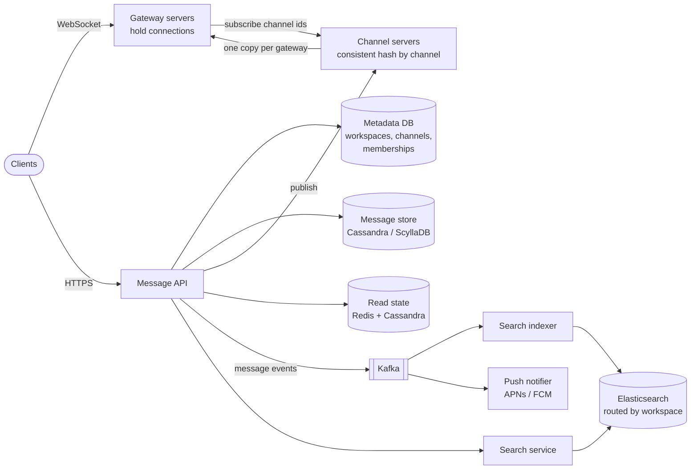
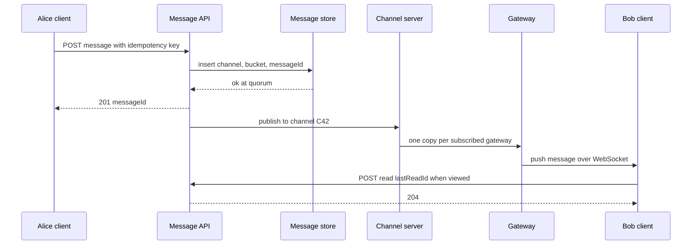

# Design Slack / Discord

## Requirements

**Functional**
1. Users belong to workspaces (Discord: servers) containing public channels, private channels and DMs.
2. Users send messages to a channel and reply in threads; messages appear for everyone in the channel in real time.
3. Each user sees per-channel unread indicators and mention counts, synced across their devices.
4. Users search message history across all channels they can access in a workspace.

**Non-functional**
- **Real-time:** a message reaches online recipients within ~500 ms p99.
- **Large channels:** channels with 100k+ members must work without degrading small ones.
- **Durable history:** an acknowledged message is never lost; history is kept indefinitely.
- **Ordering:** messages within a channel appear in the same order for everyone.
- **Scale:** ~20M DAU, ~10M concurrent WebSocket connections at peak, ~1B messages/day.

**Out of scope:** voice/video, file previews, bots and integrations.

### Back-of-envelope estimates

| Quantity | Estimate | Implication |
|---|---|---|
| Message writes | 1B/day ÷ 86,400 s ≈ 11,600/s, ~35k/s at 3× peak | Sharded message store; one DB primary is not enough |
| Deliveries | 11,600 msgs/s × ~20 online members avg ≈ 230k socket writes/s | Fan-out happens in memory on gateways, not via DB writes |
| Connections | 10M ÷ ~50k per gateway host ≈ 200 gateway hosts | Need a routing layer from channel to gateways |
| Storage | 1B × ~1 KB ≈ 1 TB/day ≈ 365 TB/year | Partition messages by channel and time |
| Read state | 20M users × ~200 channels ≈ 4B (user, channel) rows | Small per row; keyed by user so one read loads a user's state |

## Core entities

| Entity | Key fields | Store/Notes |
|---|---|---|
| Workspace | `workspace_id`, name, plan | MySQL/Postgres; shard key for most metadata |
| Channel | `channel_id`, `workspace_id`, type (public / private / dm), `last_message_id` | Metadata DB sharded by `workspace_id` |
| Membership | (`channel_id`, `user_id`), role, `notify_pref` | Two indexes: by channel (fan-out) and by user (sidebar) |
| Message | `channel_id`, `bucket`, `message_id` (Snowflake), `author_id`, text, `thread_ts?` | Cassandra/ScyllaDB, partition (`channel_id`, `bucket`), clustered by `message_id` desc |
| Read state | (`user_id`, `channel_id`) → `last_read_id`, `mention_count` | Partitioned by `user_id`; cached in Redis |
| Search doc | `message_id`, `workspace_id`, `channel_id`, text, author, ts | Elasticsearch, routed by `workspace_id` |

## API

```
WebSocket wss://gateway.example.com/connect   (auth token in handshake)
  server → client: { type: "message", channelId, message }
                   { type: "read_state", channelId, lastReadId }
  client → server: { type: "typing", channelId }

POST /v1/channels/{channelId}/messages
     Idempotency-Key: 7f3c...
     { text, threadParentId? }            → 201 { messageId, ts }
     403 not a member   409 duplicate key returns original
GET  /v1/channels/{channelId}/messages?before=<messageId>&limit=50
                                          → { messages: [...], nextCursor }
POST /v1/channels/{channelId}/read       { lastReadId }   → 204
GET  /v1/unreads                          → { channels: [{ channelId, hasUnread, mentions }] }
GET  /v1/search?q=deploy+failed&in=<channelId>&from=<userId>&cursor=
                                          → { results: [{ messageId, channelId, snippet }], nextCursor }
```

- **Sends go over HTTP, delivery over WebSocket.** HTTP gives a clear acknowledgment, retries and idempotency; the socket is a push channel.
- **Idempotency key:** a client that retries after a timeout gets the original message back instead of posting twice.
- **Cursor pagination by message ID:** Snowflake IDs are time-ordered, so `before=<id>` pages backward through history efficiently.
- The user ID always comes from the token.

## High-level design



**Send flow**
1. The client POSTs the message with an idempotency key. The API checks membership, assigns a Snowflake ID, and writes to the message store (quorum write). Now it is durable.
2. The API publishes the message to the channel server that owns this channel (consistent hashing on `channel_id`).
3. The channel server forwards it once to each gateway that has at least one subscriber for this channel. Each gateway writes it to its local sockets.
4. Asynchronously, Kafka feeds the search indexer and the push notifier (for offline users with mentions or DMs).

**Connect flow**
1. The client opens a WebSocket to any gateway (via a load balancer). The gateway authenticates the token, loads the user's channel list, and subscribes to those channels on the channel servers.
2. The client calls `GET /v1/unreads` and fetches recent messages for the open channel to catch up on anything missed while offline.



## Deep dives

### Fan-out to huge channels

A message in a 100k-member channel must reach every online member quickly, without 100k database writes or 100k network hops from one server.

- **Weak: fan-out on write to per-user inboxes** (the WhatsApp/Twitter-timeline approach). One message becomes 100k inbox rows. At 35k msgs/s with big channels that is millions of writes per second, and storage multiplies.
- **Better: store once per channel, push per user.** Storage is one row, but the sender's server looks up all members and sends each one a network message. A 100k-member channel still costs 100k RPCs from one place.
- **Best: store once, fan out through a two-level pub/sub tree.** Channel servers know which *gateways* care about a channel, and gateways know which *sockets* do. This is the shape of Slack's channel server and gateway server design.

#### How the two-level fan-out works

1. When a user connects, their gateway sends `subscribe(channel_ids)` to the channel servers owning those channels. Each channel server keeps a map `channel_id → set of gateway_ids`, and each gateway keeps `channel_id → set of local sockets`.
2. A new message goes to the single channel server for that channel, which sends **one copy per subscribed gateway**.
3. Each gateway loops over its local sockets for that channel and writes the frame.

**Worked example:** a #announcements channel has 100k members, 10k of them online, spread over 200 gateways.

| Approach | Network messages from the publishing tier | DB writes |
|---|---|---|
| Per-user inbox | 10k pushes + 100k inbox writes | 100,000 |
| Per-user push | 10,000 | 1 |
| Channel server to gateways | **200** | 1 |

Each gateway then does ~50 local socket writes, which is cheap. Because each channel is owned by one channel server, that server also defines the delivery order for the channel.

#### Extra tricks for the largest channels

- **Lazy delivery:** clients with the channel not open don't need the message body, only "C42 has new activity". The gateway can send a tiny unread hint and let the client fetch messages when the channel is opened. Discord applies similar lazy loading to large servers' member lists.
- **Rate limiting posts:** very large channels can be restricted to admins or slow mode, which bounds fan-out rate.
- **Hot channel sharding:** if one channel server is overloaded by a huge channel, replicate that channel's subscriber map across several channel servers and split gateways among them.
- **Typing indicators and presence** are not sent to large channels at all; they are the biggest source of fan-out traffic and have little value there.

### Per-user unread state

Every user has unread state for every channel they belong to, across phone, laptop and browser.

- **Weak: an unread counter per (user, channel), incremented on every message.** A message in a 100k-member channel means 100k counter writes, which is exactly the fan-out on write we avoided.
- **Best: store one pointer per (user, channel) and derive unreads.** Store `last_read_id` per user per channel and `last_message_id` per channel. "Has unread" is `channel.last_message_id > read_state.last_read_id`. A message updates one channel row, not 100k user rows.

#### How derived unread state works

| Time | Event | C42 `last_message_id` | Bob's `last_read_id` | Bob's sidebar |
|---|---|---|---|---|
| 10:00 | Bob reads C42 | 1005 | 1005 | read |
| 10:02 | Alice posts 1006 | 1006 | 1005 | **bold** (1006 > 1005) |
| 10:03 | Carol posts 1007 mentioning @bob | 1007 | 1005 | bold, mentions = 1 |
| 10:05 | Bob opens C42 on his laptop | 1007 | 1007 | read; phone updated too |

- **Mentions** are rare, so they are counted on write: when a message mentions @bob (or @here for online members), increment Bob's `mention_count` for that channel. `@channel` in a huge channel is usually restricted by admins for this reason.
- **Exact counts** ("12 new messages"), when shown, are computed lazily when the channel is opened: count message IDs greater than `last_read_id` in the channel partition, capped at "99+".
- **Cross-device sync:** `POST /read` writes the new pointer (only if it is greater than the stored one, so out-of-order requests can't move it backward) and publishes a `read_state` event to the user's own channel, which all their connected devices subscribe to.
- **Storage:** read state is partitioned by `user_id`, so loading the sidebar is one partition read. Hot users' state is cached in Redis.

```
def mark_read(user, channel, msg_id):
    # monotonic: never move the read pointer backward
    UPDATE read_state SET last_read_id = msg_id, mention_count = 0
    WHERE user_id = :user AND channel_id = :channel AND last_read_id < :msg_id
    publish(f"user:{user}", {"type": "read_state", "channelId": channel, "lastReadId": msg_id})
```

### The WebSocket gateway

#### How a gateway handles millions of connections

- Each gateway host holds ~50k long-lived connections using an event loop (epoll), so a connection costs a few KB of memory, not a thread.
- Clients send a **heartbeat** every ~30 s; the gateway drops connections that miss two, which also tells presence the user went offline.
- On deploys or crashes, clients reconnect with **exponential backoff plus jitter**, so 50k clients don't reconnect in the same second.

#### How clients catch up after a disconnect

1. On reconnect, the client sends the last message ID it saw per open channel (or a global sequence it last processed).
2. The client fetches `GET /messages?after=<id>` for those channels, and `GET /unreads` for the sidebar.
3. Messages pushed during the gap aren't lost: the message store is the source of truth, and the socket is only a notification path. Clients de-duplicate by message ID, so a message received both by push and by fetch shows once.

#### How the message store is laid out

Discord's approach (ScyllaDB): partition key (`channel_id`, `bucket`) where the bucket is a fixed time window (Discord uses 10 days), and messages are clustered by Snowflake ID descending. Reading "the latest 50 messages in C42" is one partition read. Buckets stop a busy channel's partition from growing without limit.

### Search across a workspace

- **Weak:** `LIKE '%term%'` over the message table, which scans everything.
- **Better:** one global Elasticsearch index with a workspace filter. It works, but a huge customer's data shares shards with everyone, and every query touches every shard.
- **Best:** index messages asynchronously from Kafka into Elasticsearch, **routed by `workspace_id`**, so one workspace's documents live on one shard (or a dedicated index for very large enterprises), and filter by the channels the user can access.

#### How permission-aware search works

1. The search service loads the user's channel memberships (cached; typically tens to a few thousand channel IDs).
2. It sends a query like: match `deploy failed` on text, `filter: workspace_id = W1 AND channel_id IN [...]`, sorted by relevance or recency. Filters are cached as bitsets in Elasticsearch, so they are cheap.
3. Public channels the user hasn't joined can be included for "search all public channels".
4. Results are re-checked against current membership before returning, since memberships change.

Edits and deletes flow through the same Kafka topic keyed by `message_id`, so the index converges within seconds. Per-user permission filtering after retrieval alone is a weak approach: if most top hits are filtered out, the page comes back nearly empty.

## Follow-up questions

### How do you guarantee message order within a channel?
Snowflake IDs give a time-based order; the single owning channel server defines the delivery order, and clients sort by message ID. Two messages sent in the same millisecond on different API servers are ordered by the tiebreak bits, which is fine because users can't perceive that difference. If strict causal order matters, assign a per-channel sequence number in the channel server.

### How do threads work?
A thread reply is a message with `thread_parent_id`. It is stored in the same channel partition and delivered only to thread participants and to clients viewing the thread; the parent message stores a reply count and latest reply time. Thread read state is a separate pointer per (user, thread) for participants.

### How do you implement presence for 10M users?
Gateways know who is connected; they publish online/offline changes to a presence service keyed by user. Clients subscribe only to presence for users they can see (DM list, open channel member list), not the whole workspace. Large channels don't broadcast presence.

### What happens if a channel server crashes?
Consistent hashing moves its channels to the next server; gateways detect the failure and resubscribe their channels there. Messages published during the gap are still durable in the message store, and clients catch up by fetching after their last seen ID.

### How would you handle a workspace with 500k members, like a large enterprise?
Shard that workspace's metadata on its own, give it a dedicated search index, and enable large-channel behavior: lazy delivery, no typing or presence broadcast, and restricted @channel. The two-level fan-out keeps the publish cost proportional to gateways, not members.

### How do push notifications work for offline users?
The notifier consumes message events from Kafka, checks recipients' notification preferences and whether they are online on any device (gateway presence), and sends to APNs/FCM only for mentions and DMs for offline or idle users. It delays slightly (a few seconds) to skip notifications for messages the user reads immediately on desktop.

### Why Cassandra/ScyllaDB instead of MySQL for messages?
Messages are append-heavy, read by (channel, recent range), and huge in volume, which fits a wide-column store partitioned by channel and time bucket with linear horizontal scaling. Slack itself runs on sharded MySQL via Vitess, which also works; the key decision is the partition key, not the engine.

### How do you support message edits and deletes in real time?
An edit updates the row (or appends an edit event) and is published through the same channel server path as a new message, with the same message ID; clients replace the existing message. Deletes publish a tombstone event, and search and push consumers process them from Kafka.
