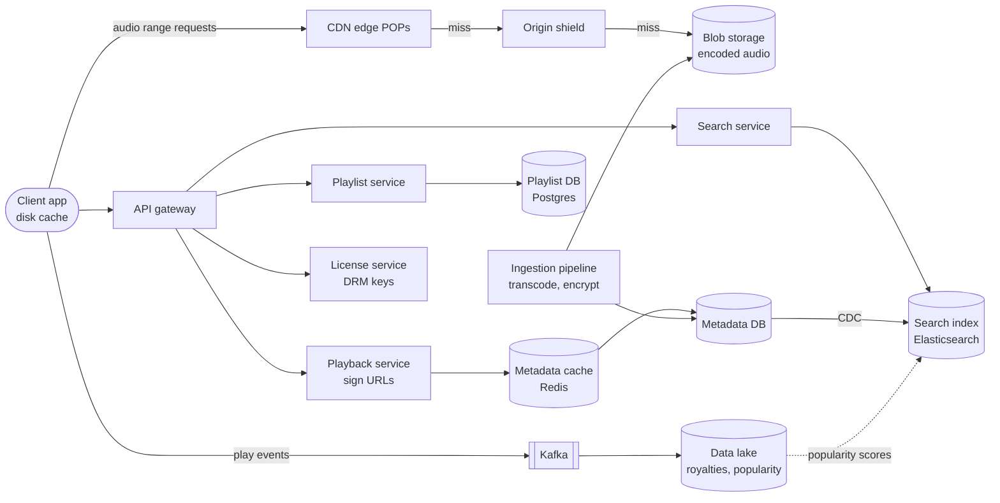
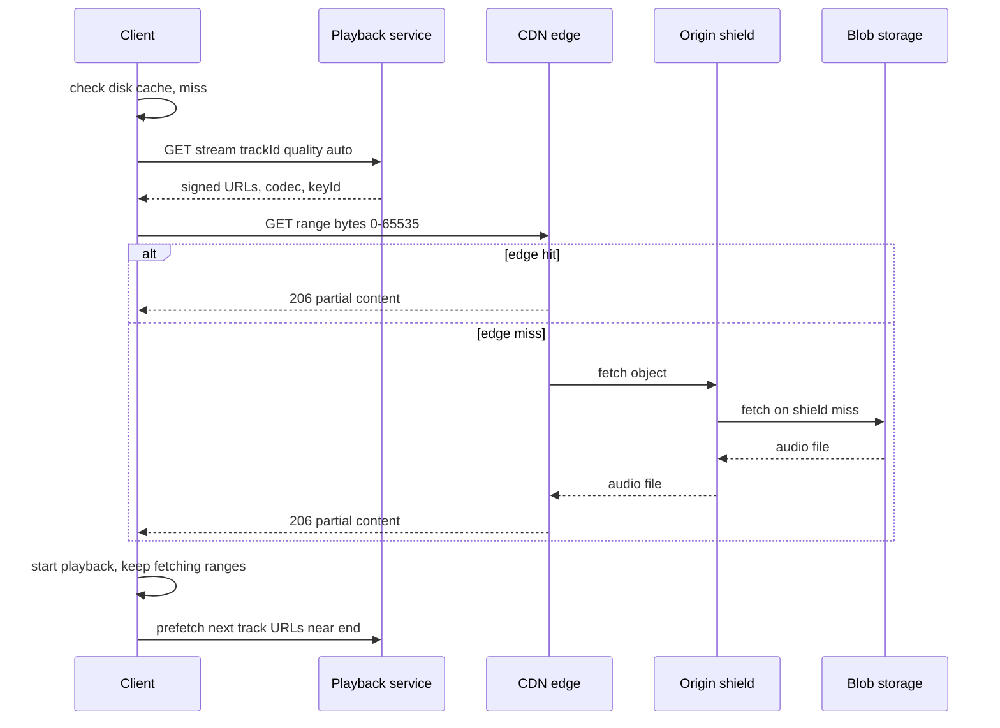

# Design Spotify

## Requirements

**Functional**
1. Users stream any song in the catalog, choosing a quality level (or letting it adapt to the network).
2. Users search the catalog for songs, artists, albums and playlists, with results as they type.
3. Users create, edit, reorder and follow playlists.

**Non-functional**
- **Low start latency:** playback starts within ~200 ms for a cached or prefetched track, ~1 s p99 for a cold one.
- **No stalls:** gapless transitions between tracks; rebuffering under 1% of play time.
- **High availability:** playback keeps working if a region, the search service or the playlist service has problems.
- **Global scale:** ~200M DAU, ~30M concurrent streams at peak, 100M tracks.

**Out of scope:** recommendations and podcasts, artist uploads and royalties (mention only where they touch the design).

### Back-of-envelope estimates

| Quantity | Estimate | Implication |
|---|---|---|
| One track, all bitrates | 210 s × (12 + 20 + 40) KB/s for 96/160/320 kbps ≈ 2.5 + 4.2 + 8.4 ≈ 15 MB | Audio is small per file but huge in total |
| Catalog storage | 100M tracks × 15 MB = 1.5 PB, ~4.5 PB with 3× replication | Blob storage (S3/GCS), not a database |
| Peak egress | 30M streams × 160 kbps = 4.8 Tbps | Must be served by CDN edges, not origin |
| Plays | 200M DAU × 20 plays = 4B/day ≈ 46k track starts/s | Track metadata and URL signing must be cached and cheap |
| Search | 200M × 5 searches = 1B/day ≈ 11.6k QPS, several times more with typeahead keystrokes | Dedicated search cluster with prefix indexing |

## Core entities

| Entity | Key fields | Store/Notes |
|---|---|---|
| Track | `track_id`, title, `artist_ids`, `album_id`, duration, `popularity`, available markets | Metadata DB (Postgres/Cassandra), heavily cached |
| Audio file | `track_id`, codec, bitrate, `blob_key`, file size, encryption `key_id` | Blob storage; one object per (track, codec, bitrate) |
| Artist / Album | `artist_id`, name, `album_id`, release date, `track_ids` | Metadata DB |
| Playlist | `playlist_id`, `owner_id`, name, `version`, `collaborative` | Postgres, sharded by `playlist_id` |
| Playlist item | (`playlist_id`, `position_key`), `track_id`, `added_by`, `added_at` | Same shard as playlist; ordered by a sortable position key |
| Play event | `user_id`, `track_id`, ts, ms played, device | Kafka → data lake for royalties and analytics |

## API

```
GET  /v1/tracks/{trackId}/stream?quality=auto|96|160|320
     → 200 { cdnUrls: ["https://edge1.../a1b2?sig=...&exp=..."], codec, bitrate, keyId }
     403 track not available in user's market
GET  /v1/licenses/{keyId}                       → 200 { key } (encrypted for this device)
GET  /v1/search?q=bohem&type=track,artist&limit=10&cursor=
     → 200 { tracks: [...], artists: [...], nextCursor }
POST /v1/playlists         { name }             → 201 { playlistId, version: 1 }
POST /v1/playlists/{id}/items
     If-Match: <version>
     { trackIds: [...], position: 5 }           → 200 { version: 2 }
     412 version changed, refetch and retry
GET  /v1/playlists/{id}?cursor=                 → { name, items: [...], version, nextCursor }
POST /v1/events/plays      [{ trackId, msPlayed, ts }]   → 202
```

- **Signed, short-lived CDN URLs:** the API never streams bytes; it returns URLs signed with an expiry (minutes to hours), so edges can verify access without calling back to us.
- **Multiple CDN URLs:** the client fails over to the second URL (a different CDN provider or POP) without another API call.
- **`If-Match` versioning on playlists:** optimistic concurrency so two devices editing the same playlist don't silently overwrite each other.
- **Play events are batched** and sent asynchronously; they feed royalties, so they're idempotent on (user, track, ts).

## High-level design



**Play flow**
1. The user taps a track. The client checks its local disk cache; if the track (or its first chunk) is there, playback starts immediately.
2. Otherwise it calls the playback service, which checks entitlement and market availability, picks a bitrate, and returns signed CDN URLs plus the encryption key ID.
3. The client fetches a small first range at low bitrate from the nearest edge, starts playing, then continues with larger ranges at the chosen bitrate. It fetches the decryption key from the license service (cached per key).
4. Near the end of the track, the client prefetches the next queued track so the transition is gapless.

**Ingestion flow:** labels deliver masters; a pipeline transcodes each into every codec and bitrate, encrypts the files, writes them to blob storage and writes metadata, which change data capture copies into the search index.



## Deep dives

### Audio storage and CDN delivery

- **Weak:** stream from application servers that read the blob store. 4.8 Tbps through our servers is enormously expensive and far from users.
- **Better:** put files on a CDN with default pull-through caching. Popular songs are fast, but every edge miss goes to blob storage, and long-tail tracks are slow to start.
- **Best:** encode once per bitrate, store immutable objects in blob storage, and serve via CDN with an **origin shield**, range requests and long TTLs, plus push-warming of expected hits (new releases).

#### How the files are prepared

1. Transcode each master into several bitrates (Spotify uses Ogg Vorbis at roughly 96, 160 and 320 kbps, plus AAC for some clients).
2. Encrypt each file with a per-file content key (DRM), so cached copies on devices and edges are useless without a license.
3. Name objects by content (`/audio/{track_id}/{codec}_{bitrate}`). The files never change, so they get **TTLs of a year** and never need purging.

#### How range requests give fast starts

A single file with HTTP `Range` requests works as well as pre-chunked segments for audio. The client asks for `bytes=0-65535` first. At 96 kbps (12 KB/s), 64 KB is about 5 s of audio, enough to start while the next range downloads. It then requests 512 KB ranges at its chosen bitrate. If bandwidth drops, the next range comes from the lower-bitrate file at the matching time offset, so quality adapts mid-track.

#### How the cache hierarchy handles a skewed catalog

Play counts follow a power law: a small fraction of tracks gets most plays. Worked example for one edge POP with a 50 TB cache:

| Tier | Holds | Share of plays served (illustrative) |
|---|---|---|
| Edge POP (50 TB) | ~3M hottest tracks at 160 kbps (4.2 MB each ≈ 12.6 TB) plus other bitrates | ~90% |
| Origin shield (regional, larger) | the regional long tail | ~8% |
| Blob storage | everything | ~2% |

Without the shield, 10% of plays (the misses) from each of hundreds of POPs would hit blob storage separately; with it, a long-tail track is fetched from origin at most once per region, and the shield **coalesces** concurrent misses for the same object into one origin request.

### Client prefetching and caching

Start latency is mostly network round trips, so the best request is one the client never makes.

#### How the client cache works

- The client keeps an **encrypted on-disk LRU cache** of recently played audio, bounded by a size the user can change (e.g. 1–10 GB). Downloaded (offline) tracks are pinned and excluded from eviction.
- Each entry is keyed by (`track_id`, bitrate). A hit plays instantly without any API call except a cached license check.

Worked example with a 20 MB cache (tiny, for clarity) and 160 kbps tracks of ~4 MB each:

| Step | Action | Cache contents (most recent first) | Size |
|---|---|---|---|
| 1 | play A, B, C, D, E | E, D, C, B, A | 20 MB |
| 2 | replay B (hit, instant start) | B, E, D, C, A | 20 MB |
| 3 | play F (miss) | F, B, E, D, C (A evicted) | 20 MB |
| 4 | replay A | A, F, B, E, D (C evicted) | 20 MB |

#### How prefetching works

```
on_progress(track, position):
    if track.duration - position < 30 s and not prefetched(next_in_queue):
        urls = playback_api.stream(next_in_queue)      # sign URLs ahead of time
        fetch_range(urls, 0, 512 KB)                    # first ~25 s at 160 kbps
on_track_end():
    play_from_buffer(next_in_queue)                     # gapless, no network wait
```

- **What to prefetch:** the next track in the queue or playlist; for shuffle, the client picks the next random track early so it can prefetch it. Prefetch only the first few hundred KB on cellular, to save data if the user skips.
- **Metadata prefetch:** when a playlist opens, fetch track metadata and cover art for the visible rows, so taps don't wait on metadata.
- **Signed URL caching:** URLs are valid for a while, so a prefetched URL can be reused, and the client refreshes it on a 403.

Historically, Spotify's desktop client also used a peer-to-peer network to offload delivery; it was phased out around 2014 as CDN costs fell. Mentioning that shows the trade-off between delivery cost and complexity.

### Search index

- **Weak:** `WHERE title LIKE 'bohem%'` on the metadata DB. No typo tolerance, no ranking, and it puts read load on the primary store.
- **Better:** Elasticsearch with full-text matching and BM25. Good for full words, but prefix queries on every keystroke are slow and ranking by text similarity alone puts obscure covers above the famous original.
- **Best:** Elasticsearch fed by CDC, with **edge n-gram** fields for prefix matching, fuzzy matching for typos, and **popularity-weighted ranking**, behind a short-TTL cache for common prefixes.

#### How edge n-gram prefix matching works

At index time, the analyzer emits every prefix of each word as a token:

| Field value | Tokens indexed |
|---|---|
| "Bohemian Rhapsody" | b, bo, boh, bohe, bohem, bohemi, bohemia, bohemian, r, rh, rha, ... rhapsody |

Then the query `bohem` is a cheap **exact term lookup** for `bohem` in the inverted index, not a scan for words starting with it. The cost is a larger index (several tokens per word), which is fine for a catalog of ~100M tracks plus artists and albums.

#### How ranking combines text and popularity

```
score = bm25(query, title, artist) × w_text
      + log(1 + plays_last_30d) × w_pop
      + (artist exact match ? boost : 0)
```

Worked example for `bohem`: the original "Bohemian Rhapsody" by Queen has billions of plays and a cover has thousands. Their text scores are nearly equal, so popularity puts the original first. Personalization (the user's listening history) can add a small boost in a re-ranking step. Popularity scores are recomputed daily from play events in the data lake and pushed into the index with partial updates.

Typeahead traffic is skewed toward short prefixes, so results for the top prefixes per market are cached in Redis or at the CDN for a few minutes.

### Playlists

- Store playlists in Postgres sharded by `playlist_id`; items ordered by a **position key** rather than a contiguous integer.

#### How fractional position keys work

With integer positions, inserting at position 2 of a 10,000-track playlist rewrites 9,998 rows. With sortable string keys, an insert between keys `"a"` and `"b"` gets `"an"`; between `"a"` and `"an"` gets `"ag"`. Only the new row is written. Reads use `ORDER BY position_key`.

- **Concurrent edits:** every change bumps `version`; writes carry `If-Match`, and a 412 makes the client refetch and reapply its change. For collaborative playlists, append operations commute (each gets a unique key), so most conflicts resolve automatically.
- **Hot playlists** (official charts followed by millions) are read-mostly: cache them at the CDN or in Redis by `(playlist_id, version)`, so a new version is simply a new cache key.

## Production readiness

### Database choice and consistency

- **Audio in blob storage, never a database.** 1.5 PB of immutable objects read by byte range fits object storage plus a CDN. A database adds transactions nobody needs.
- **Catalog metadata in Postgres behind Redis.** Tracks, albums, artists and per-market rights are relational and change slowly; the ~46k reads/s for track starts are almost all cache hits. A wide-column store would scale writes we don't have. Rights changes commit atomically; reads can be minutes stale.
- **Playlists in sharded Postgres, ACID per playlist.** The `If-Match` version check and the item insert must happen in one transaction, or two devices lose each other's edits. All rows for one playlist live on one shard, so no cross-shard transactions are needed.
- **Play events are BASE with strict reconciliation.** Kafka plus the data lake gives at-least-once ingestion. Idempotency keys and the daily reconciliation turn that into accurate royalty counts. Payouts need eventual correctness, not a transaction per play.
- **CAP stance:**
  - Playback is AP. The requirements say it must survive regional and dependency failures, so cached entitlements and licenses are honoured until they expire, rather than blocking on a live check.
  - Playlist writes are CP per shard: a 412 or a brief write outage beats a silent lost edit, while reads can come from a stale replica.
  - Search is AP.

### Service boundaries and communication

- **Playback, license, search, playlist, ingestion and event intake** are separate so their blast radius differs: people must keep listening while search or playlists are down, so playback has no synchronous dependency on them.
- **Synchronous:** URL signing, license fetch (cached on the client per `keyId`), search, playlist reads and writes. The user waits for all of these.
- **Asynchronous:** play events into Kafka, CDC into Elasticsearch, daily popularity scores, and ingestion, where a job queue fans out transcode tasks and publishes the track only once every codec and bitrate exists.

### Failure modes and reliability

| Failure | Effect | Mitigation |
|---|---|---|
| A CDN provider or POP degrades | Slow starts or rebuffering in one geography | Client switches to the second `cdnUrl` on a short connect/first-byte timeout; traffic steering shifts share away from the provider using client-reported metrics |
| Playback service or metadata DB slow | New tracks can't start | Redis plus in-process caches with stale-while-revalidate; prefetched signed URLs keep queued tracks playing; strict timeouts so gateway threads aren't tied up |
| License service outage | Cold tracks can't decrypt | Licenses cached per key on device (offline licenses last ~30 days); license service runs on its own isolated capacity (bulkhead) |
| Typeahead overload on search | Search slow or erroring | Client debounce, prefix result cache, circuit breaker in the gateway; load shedding returns cached top results; playback unaffected |
| Release-time stampede on origin | Shield and blob storage swamped | Pre-warming and shield request coalescing (deep dive); rate-limited origin fetches |
| Transcode fails on a malformed master | Track missing bitrates | Retries with exponential backoff and jitter, then a DLQ for manual review; track isn't published until complete |

### High availability and disaster recovery

- **Playback** runs active-active in several regions. Metadata is replicated read-only into each one, which is easy because the catalog is small and slow-changing. Clients carry two CDN URLs, so the edge has no single provider as a SPOF.
- **Playlist DB:** each shard's primary has a synchronous standby in another zone, plus an asynchronous cross-region replica. Zone failure gives RPO 0 and an automatic failover in about a minute. Region failure gives RPO of seconds and RTO of ~15 minutes, during which playlists stay readable from the replica.
- **Masters are the crown jewels.** Label deliveries are irreplaceable, so they go in versioned, write-protected storage in a separate account and region. Encoded files can be regenerated from masters. So the 4.5 PB of encodes needs cross-region copies only for availability, not for recovery.
- **Play events:** Kafka with RF 3 and `acks=all`, mirrored cross-region, with RPO ≈ 0 once acked. Unacked events sit in the client's queue, which is the design's real buffer.
- **Targets:** 99.95% of play attempts succeed; playback RTO is seconds (client failover); playlist and search RTO is minutes.

### Security

- **Authn:** OAuth tokens for users. Device registration binds license keys to devices.
- **Authz:** entitlement and market are checked before signing URLs. CDN edges verify the HMAC and expiry without calling back. Signing keys carry a key ID, so they can be rotated with an overlap window where edges accept old and new.
- **Content keys** live in a KMS/HSM-backed key store and are only released wrapped for an entitled device. Access to keys and masters is audit-logged, as are royalty-data corrections.
- **PII:** listening history is personal data. Keep it pseudonymised in the lake with role-restricted access. Payment details stay with a payment processor; we hold only tokens.
- **Abuse:** stream farming is the main attack, because plays mean money: bot accounts loop 31-second plays. Detect it in the stream processor (shared IPs or devices, inhuman patterns) and exclude those plays before payouts. Also limit concurrent streams per account, license requests per device and search calls per client.

### Observability

- **Client-side telemetry is primary.** The CDN is third-party, so server metrics alone are blind to most failures.
- **SLIs and SLOs (30 days):**
  - 99% of cold track starts play within 1 s.
  - Rebuffering under 1% of play time.
  - 99.95% of play attempts succeed.
  - 99% of typeahead requests answered within 200 ms.
  - 99.99% of acked play events land in the lake within 1 hour.
- **Dashboards:** start time and rebuffer ratio sliced by CDN provider, POP, ISP and app version; edge and shield hit ratios; license errors.
- **Tracing:** a correlation ID flows from the playback API call through to the client's CDN fetch, so a slow start can be split into API, DNS/TLS and first-byte time.
- **Paging:** burn-rate alerts on start success and start latency per region or per CDN. A falling cache hit ratio on one POP is a ticket.

### Performance and cost

**Bottleneck:** cold-start latency through the edge → shield → blob chain (deep dive). Signing at 46k starts/s is a cheap HMAC as long as metadata is cached. Beyond that, reuse HTTP/2 connections and TLS sessions to the edge so a track start costs no fresh handshake.

**Cost drivers:**
- **CDN egress dominates everything.** 4B plays × ~4.2 MB (a full 160 kbps track) ≈ 17 PB/day, about 500 PB/month. That averages ~1.6 Tbps against the 4.8 Tbps peak. Levers:
  - **Client cache hits:** each 10% saves ~1.7 PB/day, at the cost of disk space on the user's device.
  - **Smart bitrate defaults:** 320 kbps doubles bytes per stream over 160, so default to 160 on mobile.
  - **A more efficient codec:** same quality at lower bitrate, but every track must be re-transcoded and older clients still need the old files.
  - **Committed-volume CDN contracts or an own edge**, which is cheaper at this scale but a big operational investment.
- **Storage:** 4.5 PB is small next to egress. Long-tail files can use an infrequent-access class, never archive tiers, which would break the 1 s cold start.
- **Search:** keystroke traffic runs several times 11.6k QPS, so the prefix cache is the cost lever. It trades a few minutes of staleness for far fewer Elasticsearch nodes.

## Follow-up questions

### How does offline mode work?
The user marks playlists for download; the client fetches the encrypted files into a pinned area of its cache and stores licenses that expire (requiring the device to come online periodically, e.g. every 30 days, to renew). Play events recorded offline are queued and uploaded later for royalty accounting.

### How do you pick the bitrate automatically?
The client measures throughput of recent range downloads and buffer level, then picks the highest bitrate whose rate stays comfortably under measured bandwidth, falling back as the buffer drains. It also respects user settings (data saver on cellular) and device type.

### How do you handle a huge new album release?
Pre-warm: push the album's files to the edge and shield caches before release time, and pre-populate metadata caches and the search index. At release, cached signed URLs and edge hits absorb the spike instead of origin.

### How do you prevent people from downloading songs from the CDN?
Files are encrypted with per-file keys, so the bytes alone are useless. Signed URLs expire, and the license service gives keys only to authenticated, entitled devices with keys bound to the device. This raises the bar; no DRM is perfect.

### How do you enforce regional licensing?
Each track has a list of available markets. The playback service checks the user's market (from account and IP) before signing URLs, and search filters by market. CDN edges can also check a market claim inside the signed URL.

### How are play counts made accurate for royalties?
Play events go to Kafka with idempotency keys (user, track, start timestamp), are de-duplicated in the stream processor, and count only if listened past a threshold (commonly 30 s). Results land in the data lake and are reconciled daily before payouts.

### Why a CDN instead of running your own servers everywhere?
Commercial CDNs already have thousands of POPs, peering with ISPs, and capacity for spikes. At very large scale companies often build their own edge (as Netflix did with Open Connect) to cut cost, but the cache hierarchy design is the same either way.

### How would you design "continue on another device"?
Each device reports playback state (track, position, queue) to a playback-state service keyed by user, and devices maintain a WebSocket to receive commands. Transferring playback sends a command to the target device with the current position; it starts from its cache or the CDN at that offset.
