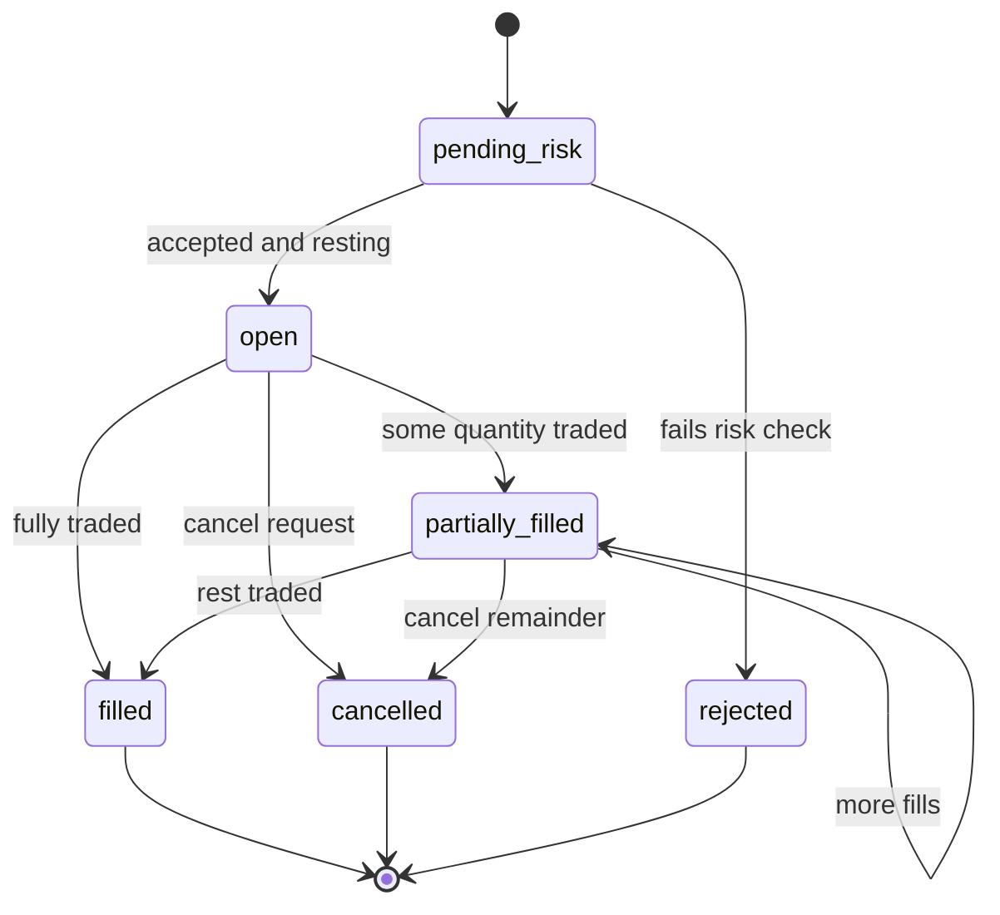
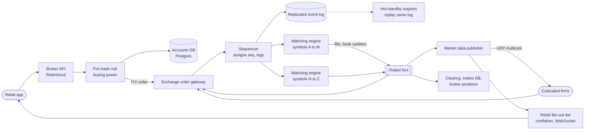
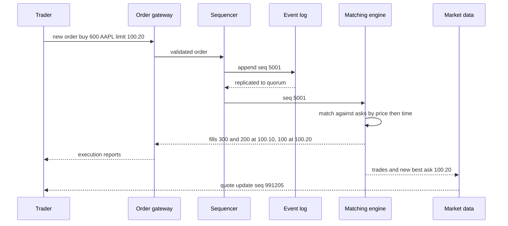

# Design a Stock Exchange / Trading Platform (Robinhood)

## Requirements

**Functional**
1. Clients place limit and market orders (buy/sell, symbol, quantity, price) and cancel open orders.
2. The exchange matches buy and sell orders by price-time priority and reports fills to both sides.
3. Clients receive live market data: last trade price, best bid/ask, and order book depth.
4. A broker layer (Robinhood) checks buying power and positions before an order reaches the exchange.

**Non-functional**
- **Ultra-low latency:** matching in tens of microseconds; order acknowledgment under ~1 ms at the gateway for colocated clients, under ~100 ms for retail apps.
- **Deterministic ordering:** the same input sequence always produces the same trades, so the system can be replayed and audited.
- **Fairness:** orders at the same price are filled strictly in arrival order; no client gets a hidden head start.
- **Durability and correctness:** no acknowledged order or trade is ever lost; no double fills.
- **Scale:** ~10,000 symbols, ~1B order messages/day, peaks of ~500k messages/s; ~10M retail clients watching prices.

**Out of scope:** clearing and settlement (T+1), margin lending, options.

### Back-of-envelope estimates

| Quantity | Estimate | Implication |
|---|---|---|
| Average order rate | 1B ÷ 23,400 s (6.5 h session) ≈ 43k msgs/s | A single machine handles this; the challenge is latency, not throughput |
| Peak order rate | ~10× average ≈ 430k–500k msgs/s, concentrated in a few symbols | Shard by symbol; one thread per shard must stay ahead of bursts |
| Event log | 1B × ~100 bytes ≈ 100 GB/day | Fits on local NVMe; replicated and archived daily |
| Order book memory | 10k symbols × ~10k resting orders × ~100 bytes ≈ 10 GB | Whole book lives in RAM |
| Market data to retail | 10M clients × ~20 watched symbols, conflated to ≤10 updates/s each | Up to ~2B updates/s naive, so conflation and tiered fan-out are required |

## Core entities

| Entity | Key fields | Store/Notes |
|---|---|---|
| Order | `order_id`, `client_id`, `symbol`, side, type, `price`, `qty`, `filled_qty`, `status`, `seq` | In memory in the matching engine; persisted as events in the log |
| Trade (fill) | `trade_id`, `symbol`, `buy_order_id`, `sell_order_id`, `price`, `qty`, `seq` | Event log; downstream to clearing and a trades DB |
| Order book | `symbol` → bids (price desc), asks (price asc), each a FIFO queue per price | In memory only; rebuilt from snapshots + log |
| Event log | `seq` (global per shard), event type, payload | Append-only, replicated; the source of truth |
| Account (broker) | `account_id`, cash, buying power, positions | Postgres at the broker, strongly consistent |
| Market data snapshot | `symbol`, bid, ask, last, volume, depth levels | Derived from trades and book events; cached for clients |



## API

```
POST   /v1/orders
       Idempotency-Key: c-81f2...
       { symbol: "AAPL", side: "buy", type: "limit", price: "189.25",
         qty: 100, timeInForce: "day" }
       → 202 { orderId, status: "pending_risk" }
       400 invalid tick size   403 insufficient buying power   409 duplicate key
DELETE /v1/orders/{orderId}      → 202 { status: "cancel_pending" }
GET    /v1/orders?status=open&cursor=  → { orders: [...], nextCursor }

WebSocket /v1/stream   (token in handshake)
  client → { subscribe: ["AAPL.quote", "AAPL.depth10", "orders"] }
  server → { ch: "AAPL.quote", bid: "189.24", ask: "189.26", last: "189.25", seq: 991204 }
           { ch: "orders", orderId, status: "partially_filled", filledQty: 40, avgPrice: "189.25" }
```

- **202, not 201:** the order is accepted for processing; its outcome (rest, fill, reject) arrives asynchronously on the stream. Colocated institutions use a binary protocol (FIX or a native protocol like Nasdaq's OUCH) over TCP instead of HTTP.
- **Idempotency key:** a retried submission never creates a second order. This matters far more here than in most systems.
- **Prices as decimal strings or integer ticks,** never floats: 189.25 is stored as 18925 cents (or ticks), so equality and ordering are exact.
- **Sequence numbers on market data** let clients detect gaps and request a snapshot.

## High-level design



**Order flow**
1. The retail app sends an order to the broker. Pre-trade risk reserves buying power (cash × price × qty) in Postgres in one transaction, then forwards the order over FIX.
2. The exchange gateway validates format and tick size and passes the order to the sequencer.
3. The sequencer stamps a monotonically increasing sequence number, appends it to the replicated log, and hands it to the matching engine thread that owns the symbol.
4. The engine matches against the book, emits events (accepted, fills, book changes) in sequence order, and those flow to the gateway (execution reports), market data, and clearing.
5. The broker consumes fills, updates positions, releases unused buying power, and pushes status to the app.



## Deep dives

### The order book, explained

An order book holds all resting limit orders for one symbol: **bids** (buyers) sorted highest price first, **asks** (sellers) sorted lowest price first. A trade happens when the best bid ≥ the best ask.

#### How price-time priority matching works

1. An incoming buy order looks at the best (lowest) ask. If the ask price ≤ the buy's limit price, they trade at the **resting order's price**.
2. Within a price level, orders fill in **arrival order** (FIFO), which is the "time" in price-time priority.
3. Repeat until the incoming order is filled or no ask is priced acceptably. Any remainder of a limit order rests on the book; the remainder of a market order is cancelled (or the order sweeps until filled).

**Worked example.** The AAPL book before a new order:

| Side | Price | Orders in time order (id: qty) |
|---|---|---|
| Ask | 100.20 | S3: 500 |
| Ask | 100.10 | S1: 300 (arrived 09:30:01), S2: 200 (09:30:03) |
| Bid | 100.00 | B1: 400 |
| Bid | 99.90 | B2: 100 |

Spread: best bid 100.00, best ask 100.10. Now B3 arrives: **buy 600 limit 100.20**.

| Step | Best ask level | Match | B3 remaining |
|---|---|---|---|
| 1 | 100.10 | 300 with S1 at 100.10 (S1 filled, removed) | 300 |
| 2 | 100.10 | 200 with S2 at 100.10 (S2 filled, level now empty) | 100 |
| 3 | 100.20 | 100 with S3 at 100.20 (S3 has 400 left) | 0, B3 filled |

Book after: asks 100.20 S3: 400; bids unchanged. Three trades are published. S1 filled before S2 only because it arrived earlier at the same price, which is the fairness guarantee. If B3 had been a limit at 100.10, it would have filled 500 and rested 100 shares as the new best bid at 100.10.

#### How the data structure supports this

| Operation | Frequency | Structure | Cost |
|---|---|---|---|
| Find best price | every order | cached pointer to the top level of each side | O(1) |
| Add order at price | very frequent | price → level map (sorted tree, or array indexed by tick) + append to the level's doubly linked list | O(log P) tree, O(1) array |
| Cancel by order ID | very frequent (most orders are cancelled) | hash map `order_id → list node`, unlink from the doubly linked list | O(1) |
| Fill at front of level | on matches | pop head of the linked list | O(1) |

```
class Level:  price; orders = DoublyLinkedList(); total_qty
class Book:
    bids = SortedMap(desc)   # price -> Level, or array indexed by (price - base) / tick
    asks = SortedMap(asc)
    index = {}               # order_id -> (Level, node)

def match_buy(order):
    while order.qty > 0 and asks and asks.best().price <= order.limit:
        lvl = asks.best()
        resting = lvl.orders.head
        q = min(order.qty, resting.qty)
        emit_trade(price=lvl.price, qty=q, buy=order.id, sell=resting.id)
        order.qty -= q; resting.qty -= q
        if resting.qty == 0: lvl.orders.pop_head(); del index[resting.id]
        if lvl.orders.empty(): asks.remove(lvl.price)
    if order.qty > 0 and order.type == "limit": rest(bids, order)
```

Prices cluster near the current price, so production engines often use an array of levels indexed by tick offset around the current price, which avoids tree rebalancing and is cache-friendly.

### Sequencer and single-threaded matching engine

- **Weak:** many threads matching the same symbol with locks. Lock contention adds unpredictable microseconds, and two threads racing make the outcome depend on scheduling, which breaks determinism and fairness.
- **Better:** a database transaction per order. Correct but milliseconds per order, far too slow.
- **Best:** a **sequencer** gives every input a total order, and a **single-threaded matching engine per symbol shard** applies them one at a time in memory. This is the LMAX architecture, and major exchanges use the same principle.

#### How the sequencer works

1. All gateways send inbound messages (new, cancel, modify) to the sequencer for that shard.
2. The sequencer assigns `seq = last_seq + 1` and appends the message to a replicated log; once replicated (to a backup in the same data center, often in microseconds over a fast network), the message is released to the engine.
3. Arrival at the sequencer *is* the definition of time for fairness. Exchanges also equalize physical access, for example giving every colocated client the same cable length.

#### Why a single thread is fast enough

- The engine does no I/O, no locks and no allocation on the hot path; everything is in RAM and in CPU cache. A tight loop like `match_buy` runs in well under a microsecond for typical orders, so one core can process millions of operations per second.
- Inputs arrive through a lock-free ring buffer (the LMAX Disruptor pattern): the sequencer writes slots, the engine reads them, and they coordinate with memory barriers instead of locks.
- Threads are pinned to dedicated cores, GC pauses are avoided (C++, Rust, or Java with zero-allocation code), and kernel-bypass networking cuts gateway latency.
- **Scaling** is by symbol: shard A–M and N–Z (or by load) onto separate engines. Orders never span symbols, so shards are independent.

### Event sourcing, replay and failover

The event log, not the in-memory book, is the source of truth. Because the engine is deterministic, **state = replay(log)**.

#### How recovery works

1. Every N events (or every minute) the engine writes a **snapshot** of all books tagged with the last applied `seq`.
2. A **hot standby** engine consumes the same sequenced log in real time and applies every event, so its book is identical to the primary's. It produces outputs but they are suppressed.
3. If the primary fails, the standby already has the state; it is promoted and starts publishing from the next `seq`. Downstream consumers de-duplicate by `seq`, so a message emitted by both is processed once.
4. A cold restart loads the latest snapshot and replays events after its `seq`:

| Item | Value |
|---|---|
| Snapshot | taken at seq 40,000,000 |
| Crash | at seq 40,350,000 |
| Replay | 350,000 events at ~2M events/s ≈ 0.2 s |

**Why determinism matters:** the engine must never read the wall clock, random numbers or thread timing while matching. Timestamps come from the sequencer and are part of the event. Then a replay produces byte-identical trades, which also makes audits and regulators' reconstructions possible.

### Market data fan-out

| Feed level | Contents | Who uses it |
|---|---|---|
| L1 | best bid, best ask, last trade | retail apps, tickers |
| L2 | aggregated quantity per price level, top N levels | active traders |
| L3 | every order add, cancel, execute | market makers, HFT |

- **Institutional:** the publisher sends sequenced events over **UDP multicast** inside the colocation network; one packet reaches all subscribers at the same time, which is also fair. Gaps are detected by sequence number and repaired from a retransmission server or a snapshot channel.
- **Retail (Robinhood):** millions of WebSocket clients can't each get every L3 event. A fan-out tier subscribes to the feed, maintains the current book per symbol, and **conflates**.

#### How conflation works

Each connection keeps at most one pending update per symbol. A new update replaces the pending one, and a flush timer sends pending updates every 100 ms.

| Time (ms) | Feed event for AAPL | Pending for client | Sent |
|---|---|---|---|
| 0 | bid 100.00 | bid 100.00 | |
| 30 | bid 100.01 | bid 100.01 (replaced) | |
| 70 | last 100.02 | bid 100.01, last 100.02 | |
| 100 | flush | | bid 100.01, last 100.02 |

Three events became one message; a slow client never builds an unbounded backlog, and the client always shows the latest price. Fan-out servers are organized as a tree (publisher → regional relays → edge WebSocket servers), each subscribing only to symbols its clients watch, so a popular symbol costs one stream per server rather than per client.

### Pre-trade risk at the broker

- Reserve buying power atomically before forwarding: `UPDATE accounts SET buying_power = buying_power - :cost WHERE id = :acct AND buying_power >= :cost`. Zero rows updated means reject.
- Fills and cancels release or convert the reservation. Exchanges add their own risk checks (price bands, fat-finger limits, kill switches) in the gateway, and market-wide circuit breakers halt symbols that move too fast.

## Production readiness

### Database choice and consistency

- **The matching core uses no database, only a replicated append-only log on local NVMe plus in-memory books.** A database transaction costs milliseconds (the deep dive's "better" option). A general-purpose broker like Kafka adds latency the microsecond budget can't absorb. The log is ~100 GB/day, trivial in size. What matters is replication latency to the backup.
- **Broker accounts in Postgres (ACID, non-negotiable).** The conditional `UPDATE ... WHERE buying_power >= :cost` must be atomic, or two concurrent orders spend the same cash. Positions and cash movements belong in the same transactional store so they reconcile.
- **Trades DB and clearing feed (relational, ACID)** are built from the output bus, keyed by `seq`/`trade_id` so re-delivery is idempotent; regulators and settlement need exact, queryable records, not speed.
- **BASE is fine only for derived views:** retail quote caches, order-status read models in the app, and charts. A quote 200 ms old with a sequence number is acceptable. A wrong fill is not.
- **CAP stance:** the core is firmly CP. If the sequencer can't replicate to its backup, the shard **halts** rather than acking unreplicated orders, because a lost ack or two engines matching after a split brain means double fills and legal liability. Retail market data is AP.

### Service boundaries and communication

- **The engine is split off from everything** (validation, risk, formatting, persistence) so the hot thread does only matching. Inside the exchange, sequencer → engine is a lock-free ring buffer in one process, not an RPC. A network hop there would cost more than matching does.
- **Synchronous:** retail order → broker API → risk transaction → 202. The app needs an immediate accept or reject.
- **Asynchronous:**
  - Broker → exchange over a FIX session: sequenced messages, with no request/response coupling.
  - Fills going back to positions, clearing and market data.
  - The order outcome reaching the app on the stream. That's why the API returns 202.
- **The engine never waits on a consumer.** A slow clearing system or WebSocket tier must not back-pressure matching.

### Failure modes and reliability

| Failure | Effect | Mitigation |
|---|---|---|
| Primary engine crashes | Matching stops for its shard | Hot-standby promotion (deep dive), with **fencing**: an epoch number in every output so a "zombie" old primary's messages are rejected downstream |
| Sequencer can't reach its log backup | Can't durably accept orders | Halt the shard and reject new orders with a retriable status. Never ack unreplicated input |
| Broker–exchange FIX session drops mid-order | Broker doesn't know if the order rested or filled | Reconnect and resend from the last sequence number (FIX built-in). Dedupe by client order ID; buying power stays reserved until the state is known; never blindly resubmit |
| Accounts DB slow | Retail orders can't pass risk | Short timeout and a "try again" reject; circuit breaker on the risk service. **Fail closed**: never skip the risk check |
| Meme-stock spike floods retail market data | Fan-out tier CPU and bandwidth saturate | Graceful degradation: widen conflation from 100 ms to 250–500 ms, shed L2 depth before L1, admission control on new sockets |
| Runaway algorithm floods a session | Hot shard falls behind | Per-session message-rate throttles at the gateway, fat-finger price bands, and a member kill switch |

### High availability and disaster recovery

- **In the primary site:** the sequencer replicates synchronously to a backup on separate power and network, a hot-standby engine applies the same log, and gateways and publishers run in pairs. Acked orders have **RPO 0**; engine failover **RTO is seconds**, since a longer pause in market hours is a public incident.
- **Disaster recovery site** in another metro, fed **asynchronously**. Synchronous replication over that distance adds milliseconds per order (see the follow-up). After a site loss the RPO is a sub-second window of events. On DR activation, the exchange halts trading, members reconcile open orders against the DR state using their execution reports, and trading restarts. The target RTO is in the order of an hour or two. US rules for critical market systems set a two-hour resumption goal, and the drills are designed around it.
- **Broker:** Postgres with a synchronous standby (RPO 0) and point-in-time recovery from WAL archives.
- **Backups:** the daily event log (100 GB) and snapshots go to write-once storage with multi-year retention. They are the legal record and allow exact replay.

### Security

- **Exchange authn:** member firms connect over private cross-connects or dedicated lines with per-session credentials and allowlisted endpoints. **Authz** is per session: which firm IDs, accounts and credit limits it may trade against. Inside colocation, latency budgets often push encryption down to physical isolation or the network layer. State that trade-off explicitly rather than pretending TLS is free.
- **Broker authn:** short-lived OAuth tokens, MFA and device binding for login, new-device orders and withdrawals; takeover signals (new device plus a full withdrawal) trigger holds.
- **Encryption at rest** with HSM-backed keys and scheduled rotation; SSNs and bank details get field-level encryption readable only by KYC and payments roles.
- **Audit:** the sequenced log already reconstructs every order and trade. Add tamper-evident logs for operator actions: symbol halts, kill switches, risk-limit and price-band changes, and who approved them. US firms also report to the Consolidated Audit Trail.
- **Abuse:** surveillance jobs over the log look for spoofing, layering and wash trades. Throttles and price bands sit at the gateway.

### Observability

- **SLIs and SLOs, measured over trading hours only:**
  - 99.9% of colocated order acks within 1 ms at the gateway.
  - 99% of retail orders acknowledged to the app within 100 ms.
  - 99.9% of retail quote updates delivered within 300 ms of the trade (the 100 ms conflation window plus network).
  - 99.99% availability of order entry per trading session.
- **Correctness invariants are not SLOs; any violation pages instantly:**
  - sequence gaps
  - primary/standby book checksum mismatch (compare hashes every N events)
  - a crossed book after matching
- **Metrics:** per-stage microsecond latency histograms (gateway in, sequenced, matched, out), ring-buffer occupancy, backup and DR replication lag, message rate per symbol and session.
- **Tracing:** normal distributed tracing is too expensive on the hot path. Instead, stamp `seq` and hardware timestamps at each hop and reconstruct latency out of band from network taps. The broker side uses ordinary tracing.
- **Paging:** latency-SLO burn, any invariant violation, and DR lag above threshold.

### Performance and cost

**Bottleneck:** one thread per shard at ~500k msgs/s peak, concentrated in a few symbols. Beyond the deep dive's tuning:
- The sequencer **group-commits**: it batches whatever arrived in the last few microseconds into one replication write, which raises throughput at a tiny latency cost.
- Hot symbols are rebalanced onto their own shards before the open, based on the previous day's volume.

**Retail fan-out:** sending one frame per client per flush, carrying all its changed symbols, caps the worst case at 10M × 10 frames/s = 100M frames/s instead of ~2B per-symbol updates/s.

**Cost drivers:**
- **Redundant low-latency hardware:** primary, hot standby and DR site, roughly 3× the compute, with dedicated cores, kernel-bypass NICs and colocation space. This is the price of RPO 0 and fast failover; cutting it is rarely acceptable.
- **Retail fan-out bandwidth:** at ~200 bytes per frame, 100M frames/s is ~20 GB/s (160 Gbps) worst case. Using 500 ms conflation for backgrounded or mobile clients cuts their frames 5×, at the cost of visibly slower ticks.
- **Storage is cheap:** 100 GB/day × ~252 trading days ≈ 25 TB/year, kept for years.
- **Operational complexity:** a custom log and engine need a specialized team; the broker side, where milliseconds are fine, should stick to standard components.

## Follow-up questions

### How do you handle a cancel that races a fill?
Both go through the sequencer, so one is ordered first. If the fill is sequenced first, the cancel is rejected as "too late to cancel" for the filled quantity; if the cancel is first, the order leaves the book and the incoming order matches the next resting order. The outcome is deterministic and clients get explicit reports either way.

### Why not run the matching engine across multiple data centers?
Synchronous replication across distance adds milliseconds per order, which defeats the latency goal. Exchanges run the primary and a synchronous backup within one site and an asynchronous disaster recovery site elsewhere, accepting a small recovery window in a site-wide disaster.

### How does Robinhood execute orders if it is not an exchange?
A broker routes orders to market makers or exchanges (via payment for order flow arrangements in the US), subject to best-execution rules. Its internal design centers on risk checks, order routing, position tracking and market data fan-out rather than matching.

### How do you implement market orders safely?
A market order sweeps the book until filled, which can execute at terrible prices in a thin book. Exchanges and brokers apply price protection: convert to a limit order a few percent away from the current price, or reject it if the book lacks depth.

### What about stop orders?
Stop orders don't rest in the visible book. The engine keeps them in a separate structure keyed by trigger price, and when a trade crosses the trigger, it converts them into market or limit orders and sequences them as new events. Triggering must be deterministic too.

### How do you guarantee clients see every fill exactly once?
Execution reports carry the sequence number; the gateway persists the outbound stream and supports resend from a sequence on reconnect (FIX has this built in). Clients de-duplicate by `exec_id`, giving effectively-exactly-once processing over an at-least-once transport.

### How would you scale a single extremely hot symbol?
You can't split one book across threads without breaking price-time priority. Instead, make that engine faster: move non-matching work (validation, risk, market data formatting) off its thread, give it a dedicated core and shard, and keep its book compact. One core can handle millions of operations per second, which is enough for any single symbol.

### How do you test a matching engine?
Replay recorded production logs and compare outputs byte for byte with the previous version, since the engine is deterministic. Add property-based tests (no crossed book after matching, quantities conserved, FIFO within a level) and randomized order streams.
