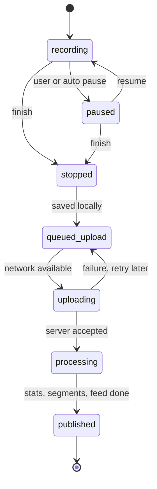
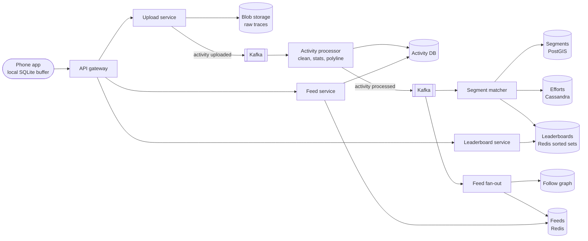
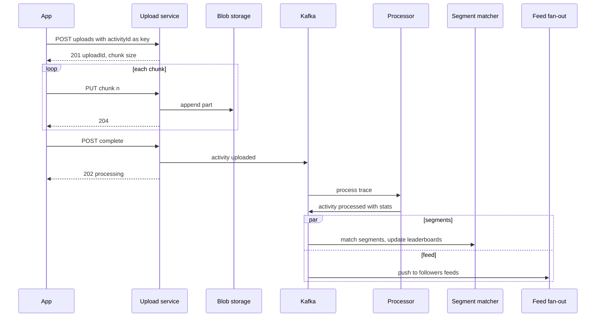

# Design Strava (Fitness Tracking)

## Requirements

**Functional**
1. Users start, pause, resume and stop an activity (run, ride) while the phone records a GPS track.
2. After stopping, the activity is saved with stats (distance, time, pace, elevation, map) and shared with followers.
3. Users see a feed of activities from people they follow.
4. Activities are matched against **segments** (user-defined stretches of road or trail), and each segment has a leaderboard of fastest times.

**Non-functional**
- **Works offline:** recording never depends on connectivity; nothing is lost if the phone has no signal for hours.
- **Accurate tracking:** distance within a few percent of truth; GPS noise doesn't inflate distance or create fake records.
- **Scale:** ~100M MAU, ~5M activities uploaded/day, with sharp peaks on weekend mornings.
- **Freshness:** an uploaded activity appears in followers' feeds and on leaderboards within ~1 minute.

**Out of scope:** live tracking for spectators (discussed in follow-ups), clubs and challenges, route planning.

### Back-of-envelope estimates

| Quantity | Estimate | Implication |
|---|---|---|
| Points per activity | 1 hour at 1 point/s = 3,600 points | Store as one blob per activity, not one row per point |
| Raw trace size | 3,600 × ~32 bytes (lat, lng, elevation, time, heart rate) ≈ 115 KB | Delta encoding and compression shrink it ~5× to ~20–25 KB |
| Upload rate | 5M/day ÷ 86,400 s ≈ 58/s average, ~600/s at a 10× weekend peak | Processing goes through a queue to absorb peaks |
| Trace storage | 5M × 115 KB ≈ 575 GB/day raw, ~210 TB/year | Blob storage (S3), cheap tiers for old traces |
| Feed reads | 30M DAU × 10 opens ≈ 300M/day ≈ 3,500/s | Precomputed feeds in a cache |
| Segment efforts | 5M activities × ~5 segments matched ≈ 25M efforts/day | Leaderboard writes ≈ 290/s average |

## Core entities

| Entity | Key fields | Store/Notes |
|---|---|---|
| Activity | `activity_id` (client UUID), `user_id`, type, `start_time`, distance, moving time, elevation gain, `polyline`, `trace_key`, visibility | Postgres/Cassandra, partitioned by `user_id` |
| Trace | `trace_key` → compressed stream of (t, lat, lng, ele, hr) | Blob storage (S3), immutable |
| Segment | `segment_id`, start/end points, polyline, distance, bounding box, geohash cells | Postgres + PostGIS; spatial index on geometry |
| Segment effort | (`segment_id`, `effort_id`), `user_id`, `activity_id`, elapsed time, date | Cassandra partitioned by `segment_id`; source of truth for leaderboards |
| Leaderboard | `segment_id` → sorted set of (user, best time) | Redis sorted sets, rebuildable from efforts |
| Follow | (`follower_id`, `followee_id`) | Graph table, indexed both ways |
| Feed | `user_id` → list of recent `activity_id`s | Redis lists, capped at ~500 entries |



## API

```
POST /v1/uploads
     Idempotency-Key: <activity_id, generated on device>
     { activityId, type, startTime, totalBytes, sha256 }
     → 201 { uploadId, chunkSize: 262144 }   200 if already uploaded
PUT  /v1/uploads/{uploadId}/chunks/{n}     (binary, compressed trace chunk)   → 204
POST /v1/uploads/{uploadId}/complete       → 202 { activityId, status: "processing" }
GET  /v1/activities/{activityId}           → { stats, polyline, segmentEfforts: [...] }
GET  /v1/feed?cursor=&limit=20             → { activities: [...], nextCursor }
GET  /v1/segments/{segmentId}/leaderboard?filter=all|following|age_35_44&limit=10
     → { entries: [{ rank, userId, elapsedS, date }], me: { rank, elapsedS } }
POST /v1/activities/{activityId}/kudos     → 204
```

- **The activity ID is generated on the device** and doubles as the idempotency key, so retrying an upload after a dropped connection never creates a duplicate activity.
- **Chunked, resumable uploads:** on a flaky connection the client resumes from the last acknowledged chunk instead of starting over.
- **202 on complete:** stats, segment matching and feed fan-out happen asynchronously; the client polls or gets a push when processing finishes.
- **Cursor pagination** on the feed, encoded as (start_time, activity_id).

## High-level design



**Record and upload**
1. During recording the app samples GPS (and sensors) about once a second and appends points to a local SQLite database, flushing every few seconds so a crash loses at most a few points.
2. On stop, the app computes provisional stats locally (shown immediately), marks the activity `queued_upload`, and uploads when online.
3. The upload service stores the compressed trace in blob storage, records the activity as `processing`, and publishes an event.

**Processing**
1. The processor smooths the trace, detects pauses, computes distance, elevation gain and moving time, and generates a simplified polyline for maps.
2. The segment matcher finds segments the trace covers, records efforts and updates leaderboards.
3. Feed fan-out pushes the activity ID into each follower's feed; followers get a push notification.



## Deep dives

### Client-side buffering vs server streaming

| Approach | How it works | Pros | Cons |
|---|---|---|---|
| **Weak:** stream every point to the server | POST each second, server assembles the activity | Live view for free | Fails offline, drains battery (radio always on), 1M concurrent recorders = 1M writes/s |
| **Better:** stream in batches every 30 s | Buffer locally, send batches when connected | Live-ish view | Still needs reconciliation for gaps, many partial activities server-side |
| **Best:** record locally, upload the complete activity at the end | Device is the source of truth until upload succeeds | Works fully offline, one write per activity, simple server | No live view by default (add an opt-in beacon) |

#### How offline-first recording works

1. **Durable local buffer:** points go into SQLite in WAL mode with an `activity_id` column. Flushing every ~5 s bounds loss on a crash; on app restart, an unfinished activity is offered for resume.
2. **Upload queue:** finished activities sit in a local queue with state (`queued_upload`, `uploading`, `uploaded`). A background job (iOS background tasks, Android WorkManager) retries with exponential backoff when connectivity returns.
3. **Idempotency:** the device-generated UUID is the server's primary key. If the app uploads, loses the response, and retries, the server returns `200` with the existing activity.
4. **Resumable chunks:** a 115 KB trace is small, but a multi-day ride with sensors may be several MB. Chunks of 256 KB with a server-side record of received parts let the app resume.
5. **Local-only data is deleted** only after the server confirms the activity is processed, never just on HTTP 2xx for a chunk.

Live tracking (Strava's Beacon feature) is a separate, optional stream of a point every ~15–30 s to a small service so a contact can follow along; it never replaces the full upload.

### Storing GPS traces

- **Weak:** one row per GPS point in a relational table. 5M activities × 3,600 points = 18B rows per day; indexes alone would dwarf the data, and nobody queries individual points.
- **Better:** store the trace as a JSON array in the activity row. Simpler, but bloats the primary DB with large, rarely-read blobs.
- **Best:** store the **full trace as a compressed blob** in object storage, and keep only summary stats plus a **simplified encoded polyline** in the activity DB for map rendering.

#### How delta encoding shrinks traces

Consecutive points are close together, so store differences instead of absolute values. Google's encoded polyline format scales coordinates by 1e5 (about 1.1 m precision), stores deltas from the previous point, and writes them as variable-length base64-like characters.

| Point | Lat | Lng | Stored as (×1e5 deltas) |
|---|---|---|---|
| 1 | 37.77490 | −122.41940 | 3777490, −12241940 (full value) |
| 2 | 37.77495 | −122.41932 | +5, +8 |
| 3 | 37.77502 | −122.41921 | +7, +11 |

A full coordinate needs ~5 characters per number; a small delta needs 1. Time deltas are almost always "+1 s", which compresses to nearly nothing with a general-purpose compressor (zstd) on top.

#### How the simplified polyline is made

The Ramer-Douglas-Peucker algorithm drops points that lie within a tolerance (e.g. 5 m) of the straight line between their neighbors. A straight 1 km road segment sampled every second collapses from ~250 points to 2. A typical 3,600-point run becomes a few hundred points, which loads quickly in feeds and maps. The full trace stays in blob storage for analysis and segment matching.

#### How accuracy is protected

- **Smoothing:** a Kalman filter or moving average reduces jitter; without it, a stationary phone wanders a few meters per second and adds fake distance.
- **Drop bad fixes:** discard points with reported horizontal accuracy worse than ~30 m or implied speed above the sport's plausible maximum.
- **Auto-pause:** treat sustained speed below a threshold (e.g. under 1 km/h for several seconds) as stopped, so moving time excludes traffic lights.
- **Elevation:** phone GPS elevation is noisy; correct it with a digital elevation model or the barometer when available.

### Segment matching

A segment is a fixed path, such as a 1.2 km hill climb. For each new activity we must find which of millions of segments it fully traversed, and how long each took.

#### How matching works

1. **Candidate search (spatial index):** compute the activity's bounding box, or the set of geohash cells its simplified polyline passes through, and query PostGIS for segments whose geometry lies in those cells. This cuts millions of segments to tens of candidates.
2. **Start and end detection:** walk the trace and find points within ~25 m of the segment's start, then a later point within ~25 m of its end.
3. **Path verification:** check that the trace between those points stays within a corridor (e.g. 30 m) of the segment polyline for most of its length, so riding from start to end by a shortcut doesn't count.
4. **Timing:** elapsed time = time at the end crossing − time at the start crossing, interpolating between the two GPS points nearest each line for sub-second accuracy.
5. Write the effort to Cassandra (partition `segment_id`) and update the leaderboard.

**Worked example:** segment "Hawk Hill", 1.2 km, start S and end E.

| Trace point | Time | Distance to S | Distance to E | Within corridor? |
|---|---|---|---|---|
| p410 | 07:12:05 | 60 m | 1.2 km | |
| p415 | 07:12:10 | **8 m** (start crossing) | 1.19 km | yes |
| p415–p701 | | | | 97% of points within 30 m: valid |
| p702 | 07:16:57 | 1.2 km | **12 m** (end crossing) | yes |

Elapsed time = 07:16:57 − 07:12:10 = 4 min 47 s = 287 s. Speed check: 1,200 m / 287 s ≈ 4.2 m/s (15 km/h), plausible for a climb on a bike, so the effort is accepted.

### Segment leaderboards

- **Weak:** `SELECT user_id, MIN(elapsed) FROM efforts WHERE segment_id = ? GROUP BY user_id ORDER BY 2 LIMIT 10` on every view. Popular segments have millions of efforts, so this is slow.
- **Best:** keep each user's best time in a **Redis sorted set per segment**, with Cassandra efforts as the durable source of truth.

#### How the sorted set leaderboard works

```
ZADD lb:seg:42 LT 287 user:alice     # LT: add if new, update only if lower (Redis 6.2+)
ZRANGE lb:seg:42 0 9 WITHSCORES      # top 10, fastest first
ZRANK lb:seg:42 user:alice           # alice's 0-based rank, O(log N)
```

| Event | Set before | Command | Set after |
|---|---|---|---|
| Bob rides, 301 s | {} | ZADD LT 301 bob | {bob: 301} |
| Alice rides, 287 s | {bob: 301} | ZADD LT 287 alice | {alice: 287, bob: 301} |
| Alice rides again, 295 s | {alice: 287, bob: 301} | ZADD LT 295 alice | unchanged (295 > 287) |
| Bob rides, 280 s | {alice: 287, bob: 301} | ZADD LT 280 bob | {bob: 280, alice: 287} |

- **Filtered leaderboards:** "people I follow" is computed on read: get the followee IDs (a few hundred) and `ZMSCORE` their best times, then sort in the service. Age, gender and "this year" boards are separate sorted sets updated at the same time, since those dimensions are fixed per effort.
- **Memory:** one entry is ~100 bytes; even 500M (segment, user) bests ≈ 50 GB, sharded across a Redis cluster by segment ID.
- **Integrity:** flagged or deleted activities remove their efforts, and the leaderboard entry is recomputed from Cassandra (the next best effort for that user). Implausible efforts (speed far above the sport's record) are held for review before entering top ranks.

### Feed fan-out

Most users have under a few hundred followers, so **fan-out on write** works: on publish, push the activity ID into each follower's Redis list (`LPUSH` then `LTRIM` to 500). For accounts with millions of followers (professional athletes), skip fan-out and merge their recent activities at read time. Feed reads fetch IDs from Redis, then hydrate summaries and polylines from the activity DB through a cache.

## Production readiness

### Database choice and consistency

- **Activities in Postgres, sharded by `user_id`.** Writes are low (~58/s average, ~600/s peak) and the data is relational. The device UUID as primary key makes the idempotent upload a plain `INSERT ... ON CONFLICT DO NOTHING`, and "my activities" is a single-shard query. Cassandra would scale too, but at this rate it buys nothing and loses unique constraints and transactions.
- **Segments in PostGIS** because matching needs real geometry: spatial indexes, distance-to-line, corridor checks. A key-value store with geohash keys could find candidates, but the matcher would have to reimplement geometry. Segments are read-mostly, so read replicas carry the load.
- **Efforts in Cassandra:** ~25M/day of append-only rows (~9B/year), always read by `segment_id`. That access pattern is a natural partition key, and the volume outgrows a single Postgres.
- **Redis for leaderboards and feeds:** derived and rebuildable, so BASE is fine. A leaderboard a minute behind is within the freshness requirement.
- **What needs ACID:** activity creation (exactly once), visibility and privacy-zone settings, and account deletion. When a user switches an activity to "only me", feed hydration and leaderboards must honour it on the next read. So the feed service re-checks visibility in the activity DB instead of trusting the cached feed.
- **CAP stance:** the phone is the buffer, so the upload path can be CP. Refusing an upload during a partition costs nothing, because the device retries later. Reads (feeds, leaderboards) are AP and can serve stale data.

### Service boundaries and communication

- **Upload service** is thin, I/O-bound and must always accept bytes. **Activity processor** is CPU-bound (smoothing, stats, polyline). **Segment matcher** is spatial and heavy, and it also runs backfills for new segments. **Feed fan-out, feed service and leaderboard service** are read-optimized.
- They are split because they scale on different resources, and so a matcher outage leaves uploads and feeds working (see follow-up).
- **Synchronous:** chunk uploads, `complete` → 202, feed and leaderboard reads.
- **Asynchronous via Kafka:** everything after `complete`.
- The upload service writes the blob, the activity row and the Kafka event. Use an outbox row in the same Postgres transaction as the activity insert, so a crash can't leave an activity stuck in `processing` with no event.

### Failure modes and reliability

| Failure | Effect | Mitigation |
|---|---|---|
| Weekend-morning 10× surge (~600 uploads/s) | Processing lag; 1-minute freshness slips | Kafka absorbs the burst; autoscale processors and matchers on consumer lag; pause segment backfills (a separate topic and consumer group) during peaks |
| Corrupt or huge trace (multi-day ride) crashes the processor | Partition blocked; that user's activity never publishes | Bounded retries with backoff, then DLQ; activity marked `failed` with the raw blob kept for reprocessing after a fix |
| Upload interrupted mid-chunk | Partial trace on the server | Resumable chunks; `complete` verifies `sha256` and all parts before emitting the event; client keeps its local copy until processed |
| Redis leaderboard shard lost | Segment pages show no ranks | Replica promotion; otherwise rebuild that shard's sets from Cassandra efforts; segment page renders with "leaderboard updating" instead of failing |
| Feed Redis slow or cold | Feed reads time out | Short timeout, then fall back to pulling recent activities of followees from the activity DB (slower, bounded to top N followees) |
| Segment backfill hammers PostGIS | Live matching slows | Backfills read from a dedicated replica (bulkhead) and are rate-limited |

### High availability and disaster recovery

- **Zone level:** Postgres synchronous standbys, Cassandra RF 3 across zones, Kafka RF 3 with `min.insync.replicas=2`, Redis replicas (rebuildable anyway), stateless services in three zones. Zone failure RTO is minutes and automatic.
- **Region level:** one active region with a warm standby is justified here. Unlike chat, a regional outage mostly means delayed uploads: recording works offline, and devices keep activities until the server confirms processing. Once processed, the server holds the only copy of someone's years of training history. So:
  - Activity DB and efforts replicate asynchronously cross-region (**RPO under 1 minute**).
  - Blob storage uses cross-region replication plus object versioning against accidental deletes.
  - **Regional RTO target is ~1 hour.**
- **Backups:** nightly Postgres snapshots with WAL archiving for point-in-time recovery, and Cassandra snapshots. Leaderboards and feeds are not backed up, only rebuilt.

### Security

- **Authn:** OAuth tokens for the app and for third-party apps using the public API, with scoped permissions such as reading private activities. Partner device imports (Garmin and others) use per-partner credentials held in a secrets manager and rotated.
- **Authz:** activity visibility (public, followers, only me) is enforced at every read path: activity fetch, feed hydration, leaderboards, segment efforts. Privacy zones are applied when building public polylines.
- **PII:** GPS traces reveal home and work addresses, and heart rate is health data. Encrypt the blob store and databases at rest with KMS-managed keys, restrict raw-trace access to the processing services, and audit-log any staff access. Account deletion must remove traces, efforts, leaderboard entries and feed entries, and drop the user from the next heatmap build.
- **Aggregate leaks are real.** Strava's public heatmap famously exposed military bases in 2018. Exclude private activities and privacy zones from aggregates, and let users opt out.
- **Abuse:** per-user upload limits with a separate bulk-import quota, rate limits on profile and segment APIs to slow location scraping, and audit logs for leaderboard moderation.

### Observability

- **SLIs and SLOs (30 days):**
  - 99% of activities appear in feeds and leaderboards within 60 s of `complete`, measured from timestamps carried on the Kafka events.
  - 99.9% of upload API requests succeed (non-5xx).
  - 99% of feed reads within 300 ms.
  - 99.99% of accepted uploads reach `published` or an explicit `failed` within 1 hour, so nothing silently gets stuck.
- **Client telemetry:** track the age of activities in the app's `queued_upload` state. A spike reveals auth or upload bugs that look like silence from the server side.
- **Dashboards:** Kafka lag per consumer group, processing time, DLQ depth, PostGIS latency.
- **Tracing:** `activity_id` is the correlation key, with trace context propagated in Kafka headers. One trace then follows upload → processor → matcher → fan-out.
- **Paging:** burn rate on freshness and upload success, and DLQ growth. Lag alone is a ticket unless it threatens the 60 s SLO.

### Performance and cost

**Bottleneck:** the weekend-morning burst through processing and segment matching. Levers:
- Cache segment candidates by geohash cell in matcher memory, since segments are read-mostly. Most activities then never hit PostGIS for candidate lookup.
- Pipeline Redis leaderboard writes.
- Autoscale workers on lag rather than CPU.

**Cost drivers:**
- **Trace storage:** 575 GB/day raw is ~210 TB/year. Storing the ~5× compressed form (~20–25 KB each, ~125 GB/day) makes it ~46 TB/year. Move traces older than ~90 days to an infrequent-access tier: the map uses the polyline in the DB, so old raw traces are rarely read. The trade-off is retrieval fees and slower reprocessing when a new segment's backfill touches old traces.
- **Redis memory:** leaderboards (~50 GB) plus feeds, which take 500 IDs × 8 bytes ≈ 4 KB per user, about 120 GB for 30M DAU before Redis overhead. Keep materialized feeds only for active users and rebuild on demand for returners, who then pay a slower first load.
- **Peak-shaped compute:** provisioning for 10× all week is wasteful. Queue-fed, idempotent workers can run on autoscaled or preemptible capacity, since a preempted job just retries.

## Follow-up questions

### How would you build live tracking for spectators?
An opt-in mode streams a point every ~15 s over HTTPS to a live-location service that keeps the latest position in Redis and publishes it to watchers over WebSocket. It runs alongside local recording, and the final activity is still uploaded in full at the end.

### How do you handle privacy zones around a user's home?
Users define circles (e.g. 200 m around home). When generating public polylines and maps, the processor trims points inside those zones; the raw trace stays private. Segment matching can still use the full trace for the owner's own efforts.

### What if a user's phone clock is wrong?
Use GPS timestamps, which come from satellite time and are accurate, rather than the device clock. The server also records receipt time and rejects activities with impossible dates.

### How do you create new segments?
A user selects a stretch of one of their activities; the server snaps it to the trace, de-duplicates against existing nearby segments, and inserts it into PostGIS. A backfill job matches historical activities near the segment to seed its leaderboard asynchronously.

### How do you prevent cheating on leaderboards?
Speed and acceleration checks per sport, flagging rides done in a car (sustained speeds too high), comparing heart rate or power data when present, and community flagging. Suspicious efforts are excluded from top ranks until reviewed.

### What happens if the segment matcher is down for an hour?
Uploads and feeds keep working because matching is a separate Kafka consumer. Events pile up in Kafka, and when the matcher recovers it processes the backlog; leaderboards are briefly stale, then catch up.

### How would you support importing from Garmin and other devices?
Devices produce FIT or GPX files, which go through the same upload path after a parser normalizes them into the internal trace format. De-duplicate imports that overlap with an activity recorded on the phone by comparing start time and track overlap.

### How do you compute heatmaps of popular routes?
A batch job (Spark) rasterizes all public traces into map tiles, counting passes per pixel, and renders tiles at multiple zoom levels. Tiles are static files served from a CDN and rebuilt periodically.
