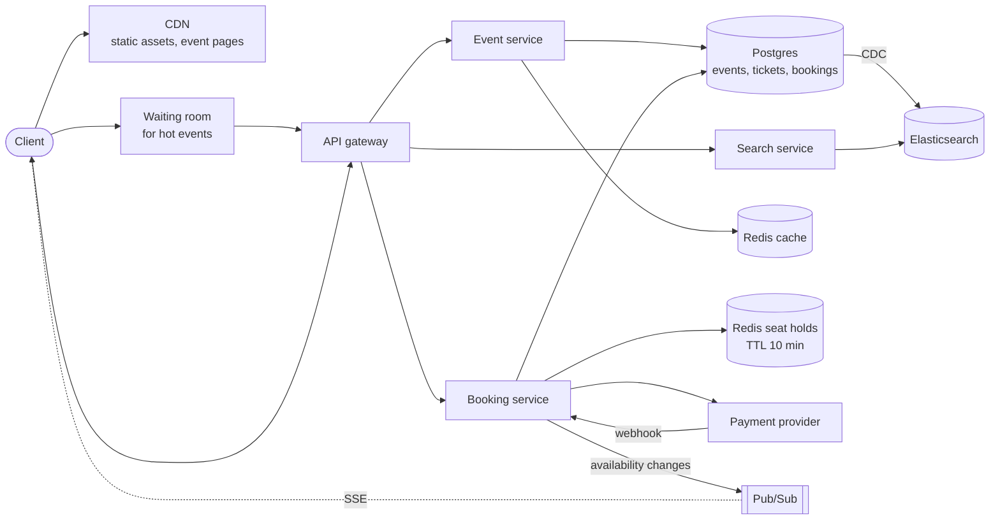
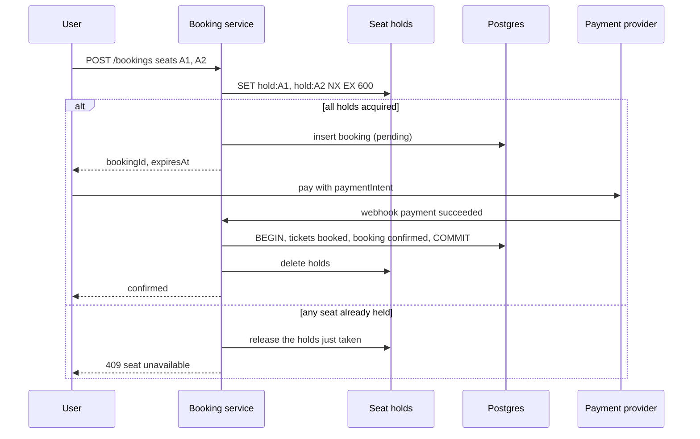

# Design Ticketmaster

## Requirements

**Functional**
1. View an event: venue, performers, seat map with live availability.
2. Search events by keyword, date, location and category.
3. Book tickets: select seats, hold them briefly while paying, then confirm.

**Non-functional**
- **Strong consistency for booking:** a seat is never sold twice.
- **High availability** for viewing and search (eventual consistency is fine there).
- **Extreme spikes:** a popular on-sale brings ~10M users for ~50k seats within minutes.
- **Read-heavy:** ~100:1 views to bookings.
- **Scale:** ~100M DAU browsing, ~10k events on sale at once.

### Back-of-envelope estimates

| Quantity | Estimate | Implication |
|---|---|---|
| Normal traffic | ~100M views/day ≈ 1k–5k req/s | Easy with caching |
| Hot on-sale | 10M users refreshing at once ≈ millions of req/s on one event | Needs admission control (a waiting room), not just more servers |
| Booking writes | ~50k seats sold in minutes ≈ 100s–1,000s of contended writes/s on one event | Concurrency control on seat rows is the core problem |
| Tickets table | 10k events × ~20k seats ≈ 200M rows | One Postgres cluster (partitioned by event) is fine |

## Core entities

| Entity | Key fields | Notes |
|---|---|---|
| Event | `event_id`, `venue_id`, `performer_id`, `starts_at`, `on_sale_at` | Mostly static; cache heavily |
| Venue | `venue_id`, location, seat map (sections, rows, seats) | Static |
| Performer | `performer_id`, name, genre | Static |
| Ticket | `ticket_id`, `event_id`, `seat`, `price`, `status` (available / reserved / booked), `reserved_until`, `booking_id?` | The contended entity |
| Booking | `booking_id`, `user_id`, `ticket_ids`, `total`, `status` (pending / confirmed / expired), `payment_intent_id` | |

## API

```
GET  /events/{eventId}                         → { event, venue, performer, tickets: [{id, seat, price, status}] }
GET  /events/search?q=&start=&end=&lat=&lng=   → { events: [...] }
POST /bookings                { ticketIds }   → 201 { bookingId, expiresAt }       (reserve)
POST /bookings/{id}/confirm   { paymentIntentId } → { status: "confirmed" }
POST /webhooks/payments                         (Stripe → us)
```

The user ID comes from the session or JWT, never the request body. Card details never touch our servers; the client tokenizes them with the payment provider.

## High-level design





## Deep dives

### Concurrency control, explained

**The race:** Alice and Bob both click seat A1 at the same moment. Each request reads `status = available`, each decides it can book, and each writes `booked`. Both get a confirmation for one seat. This is a **check-then-act race**, and every option below is a way to make the check and the write one indivisible step.

| Technique | How it works | Good for | Watch out for |
|---|---|---|---|
| **Pessimistic lock** | `SELECT … FOR UPDATE` locks the rows; others wait until commit | Short transactions with real contention | Holding locks while waiting on payment would block everyone, so never lock across user think-time |
| **Optimistic concurrency** | Read a `version`; update `WHERE version = :read_version`; 0 rows updated means someone else won, so retry or fail | Low contention, simple code | Many retries under heavy contention |
| **Conditional update** | Fold the check into the write: `UPDATE … WHERE status = 'available'` | Exactly this case: one statement, no explicit lock | Check the affected row count |
| **Distributed lock with TTL** | `SET lock:seat NX EX 600` in Redis; whoever sets it holds the seat | Holds that must expire on their own across minutes | The lock can expire mid-payment, so re-check at confirm time |

**Pessimistic locking, concretely:**

```sql
BEGIN;
SELECT status FROM tickets WHERE ticket_id IN (101, 102) FOR UPDATE;   -- others now wait here
-- application checks both are 'available'
UPDATE tickets SET status = 'reserved', reserved_until = now() + interval '10 minutes', booking_id = 555
WHERE ticket_id IN (101, 102);
COMMIT;                                                                   -- locks released
```

Locks are held for milliseconds (only during the reservation step, never while the user pays). Lock seats in a consistent order (by `ticket_id`) so two multi-seat bookings can't deadlock.

**Optimistic, concretely:**

```sql
UPDATE tickets SET status = 'reserved', version = version + 1, booking_id = 555
WHERE ticket_id = 101 AND version = 7;          -- 7 = the version we read
-- 1 row → we won; 0 rows → someone changed it first
```

**Isolation levels:** under Postgres's default READ COMMITTED, two transactions can both read "available" and both write, so you need one of the techniques above. SERIALIZABLE isolation would detect the conflict and abort one transaction, at the cost of more aborts under load. In interviews, explicit row locks or conditional updates are the clearest answer.

### Preventing double booking

- **Weak:** read status, then write if available. Two users interleave and both "win".
- **Option A, database only:** a status column plus an expiry, with a conditional update:
  `UPDATE tickets SET status='reserved', reserved_until=now()+'10 min', booking_id=? WHERE ticket_id = ANY(?) AND (status='available' OR (status='reserved' AND reserved_until < now()))`, then check that the affected row count equals the number of seats requested (otherwise roll back). It's transactional and simple; expired holds free themselves through the predicate.
- **Option B, Redis holds plus DB truth:** `SET hold:{ticket} {bookingId} NX EX 600` per seat for the temporary hold (fast, self-expiring), and the final `booked` write happens in a Postgres transaction. This keeps hot contention off the database.
  - **Edge case:** a hold expires while payment is still processing. Before confirming, re-check that the seat is still held by this booking (or extend the hold when payment starts). If not, refund automatically.
- Either way, **the final sale is an ACID transaction** in Postgres, guarded by status checks.

### Surviving the on-sale spike

- More servers don't fix 10M users fighting over 50k seats. **Admission control** does.
- **Virtual waiting room:** for flagged hot events, users enter a queue (a Redis sorted set by arrival time, with randomization inside the pre-sale window for fairness). A controller admits N users per minute based on booking-service capacity and remaining inventory; admitted users get a signed, short-lived access token that the booking service requires.
- Queue position updates go over **SSE/WebSocket**, so clients don't hammer the API by refreshing.
- **How the waiting room works, step by step:**
  1. Joining: `ZADD queue:{eventId} <joinTimestamp> <userId>`, so position = `ZRANK queue:{eventId} userId`.
  2. Every few seconds the controller pops the next N users (`ZPOPMIN queue:{eventId} N`), where N is sized so the booking service stays below capacity (e.g. 2,000 per minute), and issues each a **signed token** (JWT: user, event, expiry ~15 min).
  3. Those users are notified over their SSE stream and redirected to checkout; the booking service **rejects requests without a valid token** for that event.
  4. When inventory sells out, the controller tells everyone still waiting immediately, rather than letting them wait for nothing.
  5. For fairness at the opening moment, users who arrive before the sale starts get **random** positions instead of by-the-millisecond order, which removes the advantage of bots refreshing fastest.
- **Bot defenses:** verified fan presales, CAPTCHAs at queue entry, per-account limits, and device fingerprinting.

### Keeping the seat map fresh

- Event metadata is cached at the CDN and in Redis with long TTLs.
- Availability changes quickly during on-sales: publish seat status changes to pub/sub and push them to viewers of that event over SSE, or poll a compact availability bitmap every few seconds.
- Under extreme load, show section-level counts instead of individual seats.

### Search

- Elasticsearch, kept in sync from Postgres via **change data capture** (Debezium → Kafka → indexer). This is more reliable than dual writes from application code.
- Full text on names, geo-distance filters, date ranges, facets. Cache common queries at the CDN or in Redis for short periods.

## Production readiness

### Database choice and consistency

- **Postgres is the source of truth for tickets and bookings.** The data is small (~200M ticket rows), relational (event → tickets → booking → payment), and needs constraints, conditional updates and multi-row transactions for money. A NoSQL store would push the "never sold twice" invariant into application code. The deep dives cover the locking techniques. Add a **unique constraint on (`event_id`, `seat`)** as a safety net no code path can bypass.
- **Redis seat holds are BASE on purpose.** They take hot contention off Postgres, but replication is asynchronous. A failover can lose recent holds, so two users may briefly "hold" one seat. That is safe because confirmation re-checks with a conditional update in Postgres. The worst case is one user getting an error after paying, followed by an automatic refund. That outcome is rare and recoverable, and it's the price of using a fast hold store.
- **Waiting-room queue (Redis sorted set)**: losing it is a public fairness incident, so run it with replicas and append-only persistence.
- **Elasticsearch and the CDN** serve views and search: eventually consistent, AP, fine to be seconds stale.
- **CAP per path:** reserve and confirm are CP (better a 503 than a double sale); browse and search are AP; the waiting room leans CP (pause admissions rather than admit inconsistently).

### Service boundaries and communication

- **Waiting room / admission controller** runs at or near the edge because it alone faces millions of req/s. Its only output is a signed token, so the origin never sees the crowd.
- **Booking service** is the CP core, kept small and separately scaled, with its own on-call.
- **Event and search services** are read-heavy and cache-friendly.
- **A payment webhook handler and reconciliation job** live with booking because they mutate the same rows.
- **Synchronous:** reserve (Redis + Postgres), confirm, event page reads. The client calls the payment provider directly with a tokenized card.
- **Asynchronous:**
  - the provider's webhook back to us
  - CDC → Kafka → Elasticsearch
  - seat-availability pub/sub → SSE
  - waitlist notifications
  - the reconciliation sweep
- Admissions are paced: 50k seats at ~2 tickets per order is ~25k orders. At the example 2,000 admissions/min, if most admitted users buy, the inventory clears in roughly 12–13 minutes. That is the knob to tune against booking-service and Postgres capacity.

### Failure modes and reliability

| Failure | Effect | Mitigation |
|---|---|---|
| Payment provider slow or down | Holds expire while users pay; seats churn | Extend the hold when payment starts; circuit breaker on provider calls; the controller **pauses admissions** so no new users take holds they can't complete |
| Webhook lost or delivered twice | Paid booking stuck pending, or double-processed | Handler idempotent on `payment_intent_id`; reconciliation polls the provider before hold expiry (follow-up) |
| Postgres primary fails over mid on-sale | ~30–60 s of failed reserves | Clients retry with idempotency key, exponential backoff and jitter; admission paused; access-token expiry extended by the outage length |
| Redis hold node fails over and loses holds | Duplicate holds on a few seats | Postgres conditional update at confirm decides the winner; loser gets 409 and automatic refund |
| Bot flood at queue entry | Edge and controller overloaded | Edge rate limits per IP/device, CAPTCHA at entry, load shedding of unauthenticated traffic |
| SSE fan-out overloaded by seat churn | Seat maps lag or connections drop | Degrade to section counts or a polled availability bitmap (20k seats ≈ 2.5 KB) |

### High availability and disaster recovery

- **Postgres:**
  - A synchronous standby in a second zone gives **RPO 0** for bookings. A confirmed booking whose payment was taken must never vanish.
  - Automatic failover has **RTO under ~1 minute**.
  - An asynchronous replica in another region has RTO ~30 minutes.
  - Point-in-time recovery is kept for the financial-records retention period.
- **Stateless services** run in three zones. Redis holds and the queue have replicas in other zones.
- **Edge:** event pages are served with stale-if-error from the CDN, so browsing survives an origin outage. Optionally use two CDN providers for the waiting room on the biggest on-sales.
- **On-sales are scheduled**, which gives a cheap DR lever: if a region or the payment provider is impaired at on-sale time, **postpone the on-sale**. That beats running a 10M-user event on degraded infrastructure.

### Security

- **Authn:** sessions/JWT for users. Booking requires the waiting-room token (signed, ~15 min, bound to user and event). Signing keys carry a key ID and are rotated with an overlap window.
- **Authz:** promoter and venue staff roles can manage only their own events, inventory and holds-for-sale.
- **Payments:** cards are tokenized client-side, which keeps us out of most PCI scope. Webhooks are verified with the provider's signature and a timestamp to block replays. Provider API keys live in a secrets manager and are rotated.
- **PII:** names, emails, addresses and purchase history are encrypted at rest with KMS keys, and access to customer records is audit-logged.
- **Audit:** an append-only log of booking state changes, refunds, price changes and manual inventory edits. Disputes and chargebacks need the full history.
- **Abuse:**
  - Enforce per-account and per-card purchase limits **inside the booking transaction** (count existing bookings for the user and event), not just at the edge.
  - Rate-limit reserve calls per account and device.
  - Defend login against credential stuffing, since accounts with presale access are valuable.

### Observability

- **SLIs and SLOs:**
  - 99.9% of reserve requests from admitted users return success or a correct 409 within 500 ms, over each on-sale and over 30 days.
  - 99.95% of successful payments become confirmed bookings within 30 s, with reconciliation catching the rest before hold expiry.
  - 99.95% of event-page requests succeed (CDN-measured).
  - **Zero double-sold seats** is an invariant, not an SLO. A continuous audit query plus the unique constraint; any violation pages.
- **On-sale dashboard**, pre-staged per hot event: queue length and admission rate, reserve success and 409 rates, hold expiry rate (high means payment friction), Postgres lock waits and pool saturation, payment latency and errors.
- **Tracing:** trace reserve → Redis → Postgres → payment → webhook → confirm with `booking_id` as the correlation key.
- **Paging:** burn rates on reserve and confirm success, payment-confirmation lag, and invariant violations. High database CPU during an on-sale is expected and not paged.

### Performance and cost

**Bottleneck:** contended writes for one event on one Postgres primary. Redis holds and short conditional-update transactions keep each write to milliseconds. A connection pooler (e.g. PgBouncer) stops hundreds of booking pods from exhausting Postgres connections. The admission rate is the master throttle.

**Cost drivers:**
- **Spike capacity for minutes of millions of req/s.** On-sales are scheduled, so pre-scale for them instead of holding peak capacity all year. Serving the waiting room as a mostly static edge page with signed tokens costs far less than origin servers. The trade-off is logic split between edge and origin.
- **Holding 10M SSE connections for queue position:** users at position 5M don't need second-by-second updates. Poll every 30–60 s with jitter, and switch to push only near the front. Updates for those far back become coarser.
- **Search pipeline:** with only ~10k events on sale, Postgres full-text and PostGIS could serve search without Debezium, Kafka and Elasticsearch. Elasticsearch earns its operational cost through facets, typo tolerance and isolating search load from the booking database.
- **Storage is negligible:** 200M ticket rows fit in one partitioned Postgres cluster.

## Follow-up questions

### How do you make the booking API idempotent?
The client sends an idempotency key (or the booking ID is created client-side); retries return the existing booking instead of reserving again. The payment webhook handler is idempotent on the payment intent ID, so duplicate webhooks don't double-confirm.

### What happens if the payment webhook never arrives?
The booking stays pending until the hold expires. A reconciliation job queries the payment provider for pending bookings near expiry: confirm if paid, release seats if not. The confirm endpoint can also check the payment status synchronously.

### How would you handle "best available" seat selection instead of picking specific seats?
A seat allocator service per event keeps an in-memory model of the seat map (loaded from the DB), chooses the best contiguous block for the requested quantity, then reserves those seats with the same conditional update. Serialize allocation per section to avoid repeated conflicts.

### How do you scale the tickets table for a single hot event?
Contention is per row, not per table, so row-level locks handle concurrent buyers of different seats. If a single Postgres primary becomes the bottleneck, the waiting room throttles demand to what it can handle. Partition tickets by `event_id` so one event's rows are co-located and indexes stay small.

### Why not just use Redis for everything?
Redis is great for short-lived holds and queues, but you want durable, transactional, auditable records for money and tickets. Postgres provides constraints, transactions and point-in-time recovery. Use Redis for speed, Postgres as the source of truth.

### How do you prevent scalpers from buying everything?
Per-account and per-card purchase limits, verified-fan registration with lottery access codes, bot detection at the waiting room, non-transferable or dynamic tickets (rotating QR codes), and an official resale marketplace with price caps.

### How would you notify users when tickets become available again (cancellations)?
A waitlist per event and section: when a booking expires or is refunded, emit an event, and a notifier sends offers to waitlisted users in order with a short claim window (another time-boxed hold).

### What consistency do you need for the event page vs. checkout?
The event page tolerates staleness (seconds); checkout must be strongly consistent. Show availability as "likely available" and let the reservation step be the source of truth, returning 409 with alternatives if a seat was just taken.
