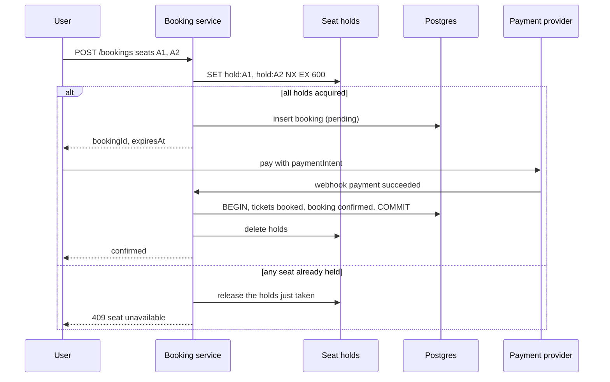

# Design Ticketmaster

## Requirements

**Functional**
1. View an event: venue, performers, seat map with live availability.
2. Search events by keyword, date, location and category.
3. Book tickets: select seats, hold them briefly while paying, then confirm.

**Non-functional**
- **Strong consistency for booking:** a seat is never sold twice.
- **High availability** for viewing and search (eventual consistency is fine there).
- **Extreme spikes:** a popular on-sale brings ~10M users for ~50k seats within minutes.
- **Read-heavy:** ~100:1 views to bookings.
- **Scale:** ~100M DAU browsing, ~10k events on sale at once.

### Back-of-envelope estimates

| Quantity | Estimate | Implication |
|---|---|---|
| Normal traffic | ~100M views/day ≈ 1k–5k req/s | Easy with caching |
| Hot on-sale | 10M users refreshing at once ≈ millions of req/s on one event | Needs admission control (a waiting room), not just more servers |
| Booking writes | ~50k seats sold in minutes ≈ 100s–1,000s of contended writes/s on one event | Concurrency control on seat rows is the core problem |
| Tickets table | 10k events × ~20k seats ≈ 200M rows | One Postgres cluster (partitioned by event) is fine |

## Core entities

| Entity | Key fields | Notes |
|---|---|---|
| Event | `event_id`, `venue_id`, `performer_id`, `starts_at`, `on_sale_at` | Mostly static; cache heavily |
| Venue | `venue_id`, location, seat map (sections, rows, seats) | Static |
| Performer | `performer_id`, name, genre | Static |
| Ticket | `ticket_id`, `event_id`, `seat`, `price`, `status` (available / reserved / booked), `reserved_until`, `booking_id?` | The contended entity |
| Booking | `booking_id`, `user_id`, `ticket_ids`, `total`, `status` (pending / confirmed / expired), `payment_intent_id` | |

## API

```
GET  /events/{eventId}                         → { event, venue, performer, tickets: [{id, seat, price, status}] }
GET  /events/search?q=&start=&end=&lat=&lng=   → { events: [...] }
POST /bookings                { ticketIds }   → 201 { bookingId, expiresAt }       (reserve)
POST /bookings/{id}/confirm   { paymentIntentId } → { status: "confirmed" }
POST /webhooks/payments                         (Stripe → us)
```

The user ID comes from the session or JWT, never the request body. Card details never touch our servers; the client tokenizes them with the payment provider.

## High-level design




## Deep dives

### Concurrency control, explained

**The race:** Alice and Bob both click seat A1 at the same moment. Each request reads `status = available`, each decides it can book, and each writes `booked`. Both get a confirmation for one seat. This is a **check-then-act race**, and every option below is a way to make the check and the write one indivisible step.

| Technique | How it works | Good for | Watch out for |
|---|---|---|---|
| **Pessimistic lock** | `SELECT … FOR UPDATE` locks the rows; others wait until commit | Short transactions with real contention | Holding locks while waiting on payment would block everyone, so never lock across user think-time |
| **Optimistic concurrency** | Read a `version`; update `WHERE version = :read_version`; 0 rows updated means someone else won, so retry or fail | Low contention, simple code | Many retries under heavy contention |
| **Conditional update** | Fold the check into the write: `UPDATE … WHERE status = 'available'` | Exactly this case: one statement, no explicit lock | Check the affected row count |
| **Distributed lock with TTL** | `SET lock:seat NX EX 600` in Redis; whoever sets it holds the seat | Holds that must expire on their own across minutes | The lock can expire mid-payment, so re-check at confirm time |

**Pessimistic locking, concretely:**

```sql
BEGIN;
SELECT status FROM tickets WHERE ticket_id IN (101, 102) FOR UPDATE;   -- others now wait here
-- application checks both are 'available'
UPDATE tickets SET status = 'reserved', reserved_until = now() + interval '10 minutes', booking_id = 555
WHERE ticket_id IN (101, 102);
COMMIT;                                                                   -- locks released
```

Locks are held for milliseconds (only during the reservation step, never while the user pays). Lock seats in a consistent order (by `ticket_id`) so two multi-seat bookings can't deadlock.

**Optimistic, concretely:**

```sql
UPDATE tickets SET status = 'reserved', version = version + 1, booking_id = 555
WHERE ticket_id = 101 AND version = 7;          -- 7 = the version we read
-- 1 row → we won; 0 rows → someone changed it first
```

**Isolation levels:** under Postgres's default READ COMMITTED, two transactions can both read "available" and both write, so you need one of the techniques above. SERIALIZABLE isolation would detect the conflict and abort one transaction, at the cost of more aborts under load. In interviews, explicit row locks or conditional updates are the clearest answer.

### Preventing double booking

- **Weak:** read status, then write if available. Two users interleave and both "win".
- **Option A, database only:** a status column plus an expiry, with a conditional update:
  `UPDATE tickets SET status='reserved', reserved_until=now()+'10 min', booking_id=? WHERE ticket_id = ANY(?) AND (status='available' OR (status='reserved' AND reserved_until < now()))`, then check that the affected row count equals the number of seats requested (otherwise roll back). It's transactional and simple; expired holds free themselves through the predicate.
- **Option B, Redis holds plus DB truth:** `SET hold:{ticket} {bookingId} NX EX 600` per seat for the temporary hold (fast, self-expiring), and the final `booked` write happens in a Postgres transaction. This keeps hot contention off the database.
  - **Edge case:** a hold expires while payment is still processing. Before confirming, re-check that the seat is still held by this booking (or extend the hold when payment starts). If not, refund automatically.
- Either way, **the final sale is an ACID transaction** in Postgres, guarded by status checks.

### Surviving the on-sale spike

- More servers don't fix 10M users fighting over 50k seats. **Admission control** does.
- **Virtual waiting room:** for flagged hot events, users enter a queue (a Redis sorted set by arrival time, with randomization inside the pre-sale window for fairness). A controller admits N users per minute based on booking-service capacity and remaining inventory; admitted users get a signed, short-lived access token that the booking service requires.
- Queue position updates go over **SSE/WebSocket**, so clients don't hammer the API by refreshing.
- **How the waiting room works, step by step:**
  1. Joining: `ZADD queue:{eventId} <joinTimestamp> <userId>`, so position = `ZRANK queue:{eventId} userId`.
  2. Every few seconds the controller pops the next N users (`ZPOPMIN queue:{eventId} N`), where N is sized so the booking service stays below capacity (e.g. 2,000 per minute), and issues each a **signed token** (JWT: user, event, expiry ~15 min).
  3. Those users are notified over their SSE stream and redirected to checkout; the booking service **rejects requests without a valid token** for that event.
  4. When inventory sells out, the controller tells everyone still waiting immediately, rather than letting them wait for nothing.
  5. For fairness at the opening moment, users who arrive before the sale starts get **random** positions instead of by-the-millisecond order, which removes the advantage of bots refreshing fastest.
- **Bot defenses:** verified fan presales, CAPTCHAs at queue entry, per-account limits, and device fingerprinting.

### Keeping the seat map fresh

- Event metadata is cached at the CDN and in Redis with long TTLs.
- Availability changes quickly during on-sales: publish seat status changes to pub/sub and push them to viewers of that event over SSE, or poll a compact availability bitmap every few seconds.
- Under extreme load, show section-level counts instead of individual seats.

### Search

- Elasticsearch, kept in sync from Postgres via **change data capture** (Debezium → Kafka → indexer). This is more reliable than dual writes from application code.
- Full text on names, geo-distance filters, date ranges, facets. Cache common queries at the CDN or in Redis for short periods.

## Follow-up questions

### How do you make the booking API idempotent?
The client sends an idempotency key (or the booking ID is created client-side); retries return the existing booking instead of reserving again. The payment webhook handler is idempotent on the payment intent ID, so duplicate webhooks don't double-confirm.

### What happens if the payment webhook never arrives?
The booking stays pending until the hold expires. A reconciliation job queries the payment provider for pending bookings near expiry: confirm if paid, release seats if not. The confirm endpoint can also check the payment status synchronously.

### How would you handle "best available" seat selection instead of picking specific seats?
A seat allocator service per event keeps an in-memory model of the seat map (loaded from the DB), chooses the best contiguous block for the requested quantity, then reserves those seats with the same conditional update. Serialize allocation per section to avoid repeated conflicts.

### How do you scale the tickets table for a single hot event?
Contention is per row, not per table, so row-level locks handle concurrent buyers of different seats. If a single Postgres primary becomes the bottleneck, the waiting room throttles demand to what it can handle. Partition tickets by `event_id` so one event's rows are co-located and indexes stay small.

### Why not just use Redis for everything?
Redis is great for short-lived holds and queues, but you want durable, transactional, auditable records for money and tickets. Postgres provides constraints, transactions and point-in-time recovery. Use Redis for speed, Postgres as the source of truth.

### How do you prevent scalpers from buying everything?
Per-account and per-card purchase limits, verified-fan registration with lottery access codes, bot detection at the waiting room, non-transferable or dynamic tickets (rotating QR codes), and an official resale marketplace with price caps.

### How would you notify users when tickets become available again (cancellations)?
A waitlist per event and section: when a booking expires or is refunded, emit an event, and a notifier sends offers to waitlisted users in order with a short claim window (another time-boxed hold).

### What consistency do you need for the event page vs. checkout?
The event page tolerates staleness (seconds); checkout must be strongly consistent. Show availability as "likely available" and let the reservation step be the source of truth, returning 409 with alternatives if a seat was just taken.
