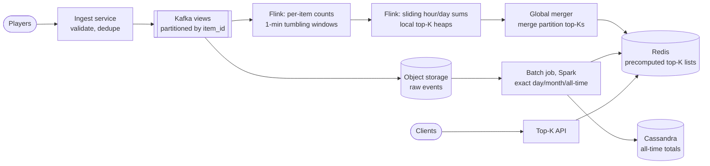
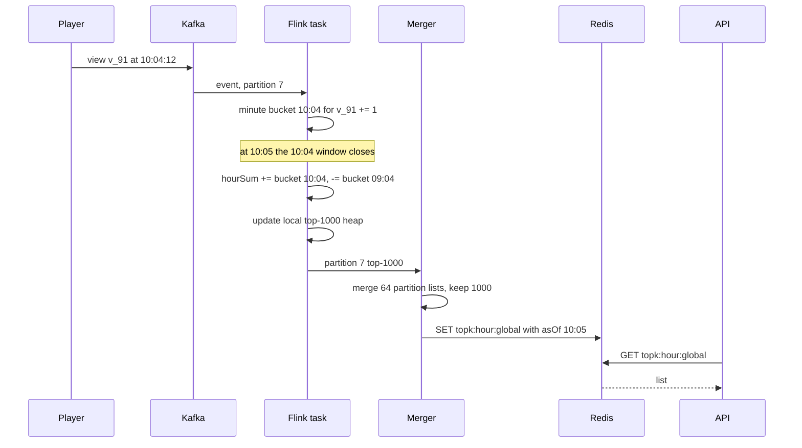

# Design Top-K / Trending (Top YouTube Videos, Heavy Hitters)

## Requirements

**Functional**
1. Return the top K most viewed items (K up to 1,000) for the last hour, last day, last month and all time.
2. Optionally filter by region or category.
3. Each result shows the item and its approximate view count for that window.

**Non-functional**
- **Freshness:** results reflect events within ~1–2 minutes.
- **Massive event volume:** ~10B view events/day, peaks ~3× average.
- **Low query latency:** p99 under ~50 ms; the read path must not scan raw events.
- **Accuracy:** the hour/day lists can be approximate in real time but must be exact (or nearly) after batch correction; small count errors are acceptable for ranking.
- **Scale:** ~1B distinct items, ~100M of them seeing at least one view on a given day.

**Out of scope**
- Personalized ranking and "velocity" trending scores beyond a note in the follow-ups.

### Back-of-envelope estimates

| Quantity | Estimate | Implication |
|---|---|---|
| Events/s | 10B / 86,400 ≈ 116k/s average, ~350k/s peak | Needs a partitioned log (Kafka) and parallel stream processors |
| Raw event volume | 10B × ~100 bytes = 1 TB/day | Raw events go to cheap storage for batch jobs, not a database |
| Events per hour | 116k × 3,600 ≈ 418M | Sets the error bound for an approximate sketch |
| Exact per-item state for a day | 100M active items × ~50 bytes = 5 GB | Too big for one machine's heap comfortably, fine across 20 sharded workers |
| Count-min sketch (ε = 10⁻⁵, δ = 1%) | 5 rows × 271,829 counters × 4 bytes ≈ 5.4 MB | Fixed, tiny memory regardless of distinct items |
| Query traffic | ~10k req/s | Serve precomputed lists from cache |

## Core entities

| Entity | Key fields | Store/Notes |
|---|---|---|
| View event | `item_id`, `user_id`, `region`, `ts` | Kafka topic partitioned by `item_id`; archived to object storage (S3/Parquet) |
| Window count | (`item_id`, `window_start`, granularity) → `count` | Flink keyed state for minute buckets; OLAP/warehouse for daily rollups |
| Top-K list | key `topk:{window}:{region}:{category}` → ordered (`item_id`, `count`), `as_of` | Redis sorted set or JSON blob; written by the aggregator, read by the API |
| All-time count | `item_id` → `total` | Wide-column store (Cassandra), incremented from daily rollups |

## API

```
GET /v1/top?window=hour|day|month|all&k=100&region=US&category=music
  → 200 { window: "hour", asOf: "2026-11-01T10:05:00Z",
          items: [ { itemId: "v_91", views: 1840221, rank: 1 }, ... ] }
  → 400 if k > 1000 or unknown window
```

- Responses include `asOf` so clients and caches know freshness; the list is precomputed and cached with a TTL of ~30–60 s.
- `k` is capped: the system maintains the top 1,000 per window and slices it.
- No pagination needed for K ≤ 1,000; the whole list is a few tens of KB.
- Ingestion is not a public API: players emit view events to a collection service that writes to Kafka.

## High-level design



**Streaming path (hour and day)**
1. View events land in Kafka partitioned by `item_id`, so every event for an item reaches the same Flink task.
2. Flink keeps an exact count per item per 1-minute tumbling window.
3. A second operator maintains each item's sliding hour and day sums from those minute buckets and keeps a top-1,000 heap per partition.
4. Every ~30 s, each partition emits its local top-K; a merger combines them into the global list and writes it to Redis.

**Batch path (month, all-time, corrections)**
1. Raw events are archived hourly to object storage.
2. A daily Spark job computes exact per-item daily counts, rolls them into month and all-time totals, and publishes those top-K lists.
3. It also overwrites the previous day's streaming result with exact numbers.

**Query path:** the API reads one Redis key and returns the first `k` entries.



## Deep dives

### Exact counting vs the count-min sketch

- **Weak:** `UPDATE counts SET views = views + 1` in a database, then `ORDER BY views DESC LIMIT 100`. At 350k writes/s on hot rows and a sort over 100M rows per query, it falls over.
- **Better:** a hash map of exact counts per item in each stream task. Exact, but memory grows with distinct items (5 GB/day across the cluster, more per window granularity).
- **Best for this scale:** exact keyed counts sharded across Flink (memory is affordable when split 20+ ways), with a **count-min sketch** where memory per node must be fixed, such as long-tail filtering, per-region-per-category combinations, or edge pre-aggregation.

#### How a count-min sketch works

A count-min sketch is a 2D array of counters with **d rows** and **w columns**, plus d independent hash functions, one per row.

1. **Update(x):** for each row i, increment `C[i][h_i(x)]`.
2. **Query(x):** return `min over i of C[i][h_i(x)]`.

Collisions only ever add to a counter, so every row's value is ≥ the true count, and the minimum is the least-polluted estimate. It **never underestimates**, and it overestimates by at most εN with probability 1 − δ, where N is total events, `w = ⌈e/ε⌉` and `d = ⌈ln(1/δ)⌉`.

Worked example with d = 3, w = 8. Stream: A × 5, B × 2, C × 1. The hashes are:

| Item | h1 | h2 | h3 |
|---|---|---|---|
| A | 1 | 4 | 7 |
| B | 1 | 2 | 5 |
| C | 3 | 2 | 7 |

Counters after the stream (only non-zero columns shown):

| Row | col 1 | col 2 | col 3 | col 4 | col 5 | col 7 |
|---|---|---|---|---|---|---|
| 1 | 7 (A+B) | | 1 (C) | | | |
| 2 | | 3 (B+C) | | 5 (A) | | |
| 3 | | | | | 2 (B) | 6 (A+C) |

Queries: A = min(7, 5, 6) = **5** (exact); B = min(7, 3, 2) = **2**; C = min(1, 3, 6) = **1**. An unseen item D hashing to (1, 2, 7) returns min(7, 3, 6) = **3**, an overestimate caused by collisions in every row.

Sizing for one hour: with N ≈ 418M events and ε = 10⁻⁵, the error bound is ~4,180 views, using w = 271,829 and d = 5 (δ = 1%), about 5.4 MB. Heavy hitters in a top-100 have far more than 4,180 views, so ranking is barely affected; the long tail is where the error is relatively large, and we don't rank the tail.

```
class CountMin:
    def __init__(self, w, d): self.C = [[0]*w for _ in range(d)]
    def add(self, x, n=1):
        for i in range(d): self.C[i][hash_i(x) % w] += n
    def estimate(self, x):
        return min(self.C[i][hash_i(x) % w] for i in range(d))
```

Sketches with the same w, d and hashes **merge by adding arrays element-wise**, so per-partition or per-minute sketches combine cheaply. A sketch only answers "how many for x?"; it doesn't list items, so it's always paired with a heap.

| Approach | Memory | Accuracy | Mergeable | Lists top items itself |
|---|---|---|---|---|
| Exact hash map | O(distinct items) | exact | yes (sum maps) | no, needs a heap or sort |
| Count-min sketch | fixed, O(w × d) | overestimates by ≤ εN | yes (add arrays) | no, needs a heap |
| Misra-Gries / Space-Saving | O(k) counters | guarantees items above N/k are kept | yes | yes |

### Maintaining the top K with a heap

#### How the min-heap works

Keep a **min-heap of size K** keyed by count, plus a map from item to its heap entry. The root is the smallest count still in the top K, the bar a new item must clear.

- On a count change for item x: if x is in the heap, update its count and re-heapify (O(log K)). Otherwise, if `count(x) > root.count`, pop the root and push x. Otherwise ignore.
- Reading the list: sort the K entries (O(K log K)), done only when publishing.

Worked example, K = 3:

| Event | New count | Heap (min first) | Action |
|---|---|---|---|
| start | | (A 10), (B 12), (C 15) | |
| D viewed | D = 4 | unchanged | 4 < root 10, ignore |
| B viewed 5× | B = 17 | (A 10), (C 15), (B 17) | update in place |
| E viewed | E = 11 | (E 11), (C 15), (B 17) | 11 > 10: pop A, push E |

Cost per event is O(log K) at worst, and most events from the long tail are a single comparison against the root. A heap of 1,000 per partition is trivial.

#### Merging partition heaps correctly

Because Kafka is partitioned by `item_id`, each item's **full** count lives in exactly one partition. The global top K is therefore contained in the union of the partitions' local top Ks: an item outside its own partition's top K has at least K items above it already. With 64 partitions, the merger takes 64 × 1,000 = 64,000 candidates and keeps the top 1,000. This only holds when partitioning is by item; if an item's counts were spread across partitions, local lists could miss it.

### Windowed aggregation for hour, day, month and all-time

Merging top-K lists across **time** is not exact: an item ranked 1,001st in each of 60 minutes could be top 10 for the hour. So you merge counts across time and rank last.

- **Weak:** recount the last hour of raw events on every query. Far too slow.
- **Better:** a sliding window in Flink with a 1-hour size and 1-minute slide. Correct, but Flink assigns each event to 60 overlapping windows, multiplying state and work by 60.
- **Best:** **tumbling minute buckets plus a running sum**. Each item keeps 60 minute counts (a ring buffer) and an hour total; when a minute closes, add the new bucket and subtract the bucket that left the window.

#### How the bucketed sliding window works

Item v_91, hour window computed at each minute boundary:

| Minute closes | New bucket | Bucket leaving (60 min ago) | Hour total |
|---|---|---|---|
| 10:01 | 300 | 09:01 = 120 | 10,000 + 300 − 120 = 10,180 |
| 10:02 | 900 | 09:02 = 100 | 10,180 + 900 − 100 = 10,980 |
| 10:03 | 50 | 09:03 = 2,000 | 10,980 + 50 − 2,000 = 9,030 |

Each event is processed once; each window update is O(1) per item. Items with no views in 60 minutes are evicted from state. The day window works the same way with 24 hourly buckets fed from the minute buckets, computed every few minutes.

**Late events:** Flink uses event time with watermarks (e.g. allow 1 minute of lateness). Events later than that are dropped from the streaming result but still land in raw storage, and the batch job corrects the numbers.

**Month and all-time:** a daily Spark job aggregates raw events into exact per-item daily counts, keeps 30 daily partitions for the month window (same add-new, drop-old trick), and adds each day to the all-time totals. Streaming gives freshness; batch gives exactness. This is the lambda architecture; a pure streaming (kappa) version replays Kafka for corrections instead.

### Precomputing, caching and hot keys

- **Query side:** the merger writes each list to Redis (`topk:hour:US:music`) every ~30 s. Every combination of window × region × category is precomputed, since the number of combinations is bounded (4 windows × ~200 regions × ~30 categories = 24,000 lists of ≤ 1,000 entries). The API is a single key read; a CDN can cache the global lists for 30 s.
- **Ingest side, viral items:** one item getting 100k views/s would overwhelm its partition. Pre-aggregate before the shuffle: each ingest node keeps a local count per item for 1–5 s and emits `(item, n)` instead of n separate events, which cuts traffic to the hot partition by orders of magnitude.
- **Deduplication and abuse:** drop repeated views from the same user and item within a short period, and filter bots before counting, or trending becomes trivially gameable.

## Production readiness

### Database choice and consistency

- **Kafka as the system of intake, not a database.** It absorbs 350k events/s and keeps them replayable for 7 days; a counter database was rejected in the deep dive.
- **Flink keyed state** (on local disk, checkpointed to object storage) holds minute buckets. An external counter store would add a round trip per event and lose the atomic state-plus-offset checkpoint behind exactly-once counts.
- **Redis for serving.** The whole serving dataset is at most 24,000 lists × ~30 KB ≈ 720 MB, and the API needs one key lookup.
- **Cassandra for all-time totals:** 100M upserts a day, keyed lookups only. Have Spark compute `new_total = old_total + daily` and write the absolute value rather than using Cassandra counters, because counter increments aren't idempotent and a retried batch would double-count.
- **Object storage + Parquet** for raw events: cheapest per TB, read natively by Spark.

**Consistency stance.** Everything here is BASE and AP: a trending list two minutes stale, or off by a few thousand views, is invisible to users, while an error page is not. The one exception is anything with money attached. If creator payouts or ad billing use view counts, they must come from the exact batch path, never from the streaming numbers. Batch publishes write corrected lists under new keys and then flip a version pointer, so the API never serves a half-corrected mix.

### Service boundaries and communication

- **Ingest service** (validate, dedupe, bot filtering, 1–5 s pre-aggregation) is separate because it's the only internet-facing piece and scales with players.
- **Flink jobs and the merger** do the counting. The merger can be a parallelism-1 Flink operator; it only merges 64 × 1,000 candidates every 30 s.
- **Spark batch** and the **Top-K API** are separate because they scale on completely different axes (daily TB scans vs 10k req/s of key reads).
- **Synchronous:** player → ingest (acknowledged once the event is in Kafka) and client → API → Redis. **Asynchronous:** everything between, through Kafka and scheduled batch. So a Flink outage shows up as a stale `asOf`, not failed video views.

### Failure modes and reliability

| Failure | Effect | Mitigation |
|---|---|---|
| Redis primary down | API can't read lists | Replica promotion; API keeps the last list per key in process memory and serves it with its old `asOf` (graceful degradation); CDN serves stale for 30 s |
| Viral item floods one partition | That Flink task lags, freshness SLO slips for its partition | Ingest pre-aggregation (deep dive); Flink backpressure slows reading rather than dropping; alert on per-partition lag skew |
| Malformed or wildly mis-timestamped event | Deserializer crash loop stalls the partition | Validate at ingest; anything unparseable in Flink goes to a side output / dead-letter topic with a counter, never a crash |
| Player retries a view upload | Duplicate counts | Client-generated `event_id`; ingest dedupes over a short window; Flink exactly-once state and idempotent Redis overwrites cover the rest |
| Kafka broker or AZ loss | Partitions move leaders | Replication factor 3 across AZs, `acks=all` with at least 2 in-sync replicas, producers retry with backoff and jitter |
| Daily Spark job fails | Month/all-time lists don't update | Keep serving yesterday's lists (still correct within a day); retry the job idempotently since it overwrites by date partition |

### High availability and disaster recovery

- **Kafka** is the durability point: RF 3 across three AZs. Once acked, an event survives an AZ loss. RPO for raw events ≈ 0, apart from what's buffered in players.
- **Flink** runs with a highly available job manager and checkpoints to object storage every ~30–60 s, so a crash costs at most that much reprocessing, which Kafka replay covers.
- **Redis is a cache, not a source of truth.** The merger rewrites every list every 30 s, so even total Redis loss heals within a minute; a replica avoids even that gap.
- **Region loss:** ingest runs in every region and mirrors to the processing region. If the processing region dies, the API (also multi-region, behind the CDN) serves the last lists with a stale `asOf` while a standby region replays mirrored Kafka. **RTO: 30 minutes for freshness**, since a frozen trending list is a mild degradation. **RPO: near zero for raw events**, which feed creator analytics and possibly payouts.
- **Backups:** versioned raw Parquet is the real backup; every derived store can be recomputed from it.

### Security

- **Abuse is the main threat.** Trending is worth gaming. Require a signed playback session token on every view event, rate-limit per user, device and IP at ingest, count one view per user/item per window, and run bot scoring before counting.
- **AuthN/AuthZ:** the Top-K API is public and read-only, rate-limited per client. Internally, mTLS between services and Kafka ACLs so only ingest can produce to the views topic and only the Flink job can consume it.
- **PII:** `user_id` + `region` + timestamp is viewing history. Replace `user_id` with a keyed hash before archiving, drop IPs after dedupe, and set a retention limit on raw Parquet. The published lists contain no PII.
- **Encryption:** TLS in transit; KMS-managed keys for object storage, Kafka disks and checkpoints, rotated on a schedule. Rotating the pseudonymization key breaks joins across the rotation, so rotate it at the retention boundary.
- **Audit:** log warehouse queries on raw events and any editorial override that removes an item from trending.

### Observability

**SLIs and SLOs (30 days):**
- **Freshness:** in 99% of minutes, the global hour list's `asOf` is under 2 minutes old.
- **Latency:** 99.9% of API requests under 50 ms.
- **Availability:** 99.95% of API requests return 200.
- **Accuracy:** at least 95% overlap between the streaming and batch top-100 for each day.

**Metrics:** Kafka consumer lag per partition, checkpoint duration and failures, backpressure, late events dropped, dedupe and bot-filter rates, per-partition event-rate skew. **Tracing:** at 350k events/s, don't trace events; stamp ingest time on each event and measure ingest-to-publish delay at the merger. Trace API requests normally. **Page on:** freshness and API error-budget burn rates. A single task restart is not a page.

### Performance and cost

**Bottleneck: ingest and partition skew.** Producers batch (short linger, compression such as zstd or lz4), and pre-aggregation turns a viral item's 100k events/s into a few thousand `(item, n)` records. Incremental Flink checkpoints keep checkpoint cost proportional to changed state.

**Cost drivers:**
- **Raw storage:** 1 TB/day ≈ 365 TB/year before compression. Parquet's columnar encoding typically shrinks this several-fold; move partitions older than a month to a cold tier and delete after the retention limit. Trade-off: less history for backfills.
- **Kafka disk:** 1 TB/day × RF 3 × 7 days = 21 TB. Cutting retention to 3 days gives 9 TB but shrinks the outage you can replay through.
- **Cross-region egress:** shipping raw events to one processing region moves most of the 1 TB/day across regions. Pre-aggregating per region per minute before mirroring cuts that by orders of magnitude, at the cost of keeping raw archives regional.
- **Operational complexity:** the lambda architecture means two pipelines that must agree. A kappa design (replay Kafka for corrections) removes Spark but needs longer, costlier Kafka retention.

## Follow-up questions

### Why not just use Redis sorted sets for everything (ZINCRBY on every view)?
`ZINCRBY` is O(log n) and ZREVRANGE gives the top K directly, so it works at moderate scale. At 350k events/s it puts every write on one key per window, which can't be sharded, and sliding windows would still need per-bucket sets plus `ZUNIONSTORE` across 60 of them. Using Redis only for the final precomputed lists keeps it off the write path.

### When would you choose the count-min sketch over exact counts?
When distinct keys per node make exact maps too large, or when you need many independent counters (every region × category × window) in fixed memory, or to aggregate at the edge cheaply. If the cluster can afford exact keyed state, as here for hour and day, exact is simpler to explain and correct.

### How would you compute "trending" rather than "most viewed"?
Trending rewards acceleration, not volume. Score each item by the ratio of recent views to its baseline, e.g. last-hour views divided by the average hourly views over the past week, with smoothing for small counts, and run the same top-K machinery on the score.

### What happens if a Flink task crashes?
Flink checkpoints keyed state and Kafka offsets together (asynchronous barrier snapshots), so after a restart it restores the last checkpoint and replays events since then from Kafka. Counts stay consistent with exactly-once state semantics; the Redis write is an idempotent overwrite, so republishing is harmless.

### How do you handle different K values per request?
Maintain the largest supported K (1,000) and slice. Supporting arbitrary K would mean maintaining unbounded heaps, which removes the point of the design.

### Why partition Kafka by item_id rather than randomly?
Partitioning by item puts all of an item's events on one task, which makes per-item counts exact without a second shuffle and makes merging local top Ks correct. The cost is skew from viral items, handled by pre-aggregation upstream.

### How accurate is the hourly list right after an outage of the stream processor?
The list's `asOf` stops advancing, so clients and monitors see staleness instead of wrong data. When processing resumes it replays from Kafka and catches up; Kafka retention (e.g. 7 days) must exceed the longest outage you plan for.

### How would you serve top K per user segment, like per country and age group?
Precompute only common segments; the combinations multiply quickly. For rarer slices, run the query on an OLAP store such as Druid or ClickHouse over minute-level rollups, which can group and sort millions of rows in well under a second.
