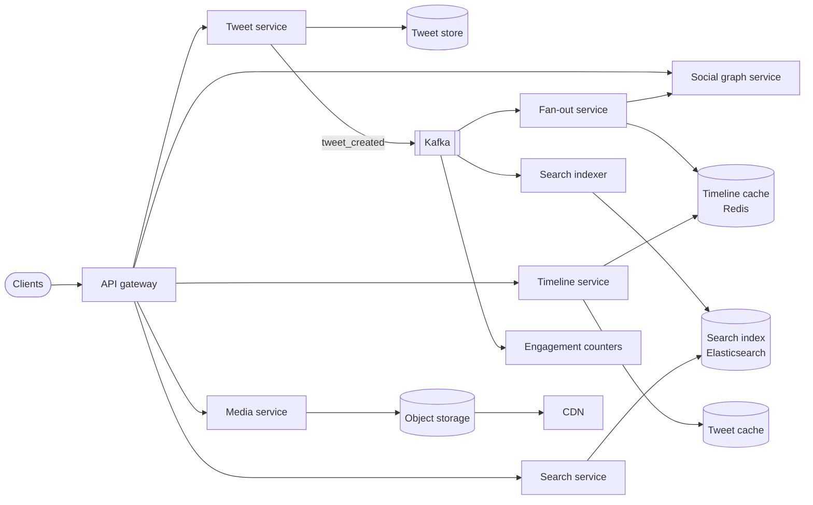
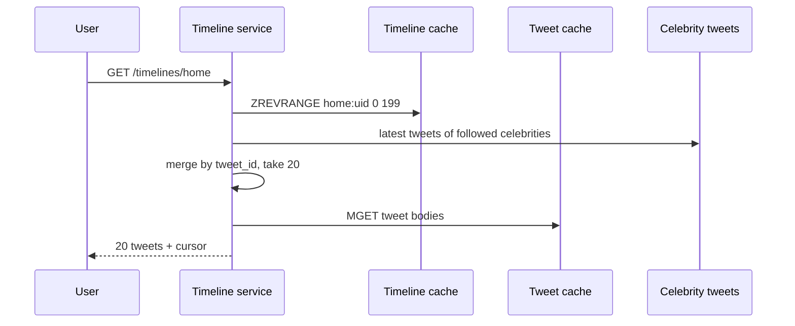

# Design Twitter / X

## Requirements

**Functional**
1. Post tweets (up to 280 characters, with optional media).
2. Follow and unfollow users.
3. View the home timeline: tweets from accounts you follow, newest first.
4. Like and retweet.
5. Search tweets by keyword.

**Non-functional**
- **Read-heavy** (~100:1); home timeline p99 under ~200 ms.
- New tweets reach followers within a few seconds (eventual consistency is fine).
- Search results include tweets within ~10 seconds of posting.
- Availability over consistency; survive the loss of a region.
- **Scale:** ~300M DAU, ~500M tweets/day.

### Back-of-envelope estimates

| Quantity | Estimate | Implication |
|---|---|---|
| Tweet writes | 500M/day ≈ 6k/s (peak ~20k/s, e.g. live events) | Writes are fine; fan-out and indexing multiply them |
| Timeline reads | 300M × ~20 ≈ 6B/day ≈ 70k/s (peak 300k/s) | Timelines must be precomputed |
| Tweet storage | 500M × ~300 B ≈ 150 GB/day ≈ 55 TB/year (excluding media) | Needs a horizontally scalable store |
| Timeline cache | 200M active × 800 IDs × 8 B ≈ 1.3 TB | Sharded Redis |

## Core entities

| Entity | Key fields | Store |
|---|---|---|
| Tweet | `tweet_id` (Snowflake), `author_id`, `text`, `media_ids`, `reply_to?`, `retweet_of?` | Cassandra / Manhattan, partitioned by `tweet_id` |
| User | `user_id`, handle, follower count | Sharded MySQL + cache |
| Follow edge | `follower_id`, `followee_id` | Graph service (both directions) |
| Like | `user_id`, `tweet_id` | Wide-column store, plus an aggregated counter |
| Home timeline | `user_id` → [`tweet_id`] | Redis |

**Snowflake IDs:** a 64-bit value made of a timestamp, a worker ID and a sequence number. That gives time-sortable, unique IDs without central coordination, and they double as pagination cursors (see the deep dive for the bit layout).

## API

```
POST   /tweets                    { "text", "mediaIds"?, "replyTo"? } → 201 { "tweetId" }
POST   /tweets/{id}/likes                                             → 204
POST   /tweets/{id}/retweets                                          → 201
PUT    /users/{id}/followers                                          → 204
GET    /timelines/home?cursor=&limit=20                               → { "tweets": [...], "nextCursor" }
GET    /search?q=&cursor=                                             → { "tweets": [...], "nextCursor" }
POST   /media                                                         → { "mediaId", "uploadUrl" }
```

## High-level design



**Posting a tweet:** the client uploads any media first (presigned URL → S3), then sends `POST /tweets` with the media IDs. The tweet service stores the tweet and publishes `tweet_created`. Three consumers react independently: fan-out (timelines), search indexing, and counters/notifications.

**Reading the home timeline:** the timeline service reads tweet IDs from Redis, merges in celebrity tweets, hydrates them from the tweet cache (author info, counts, media URLs), and returns a page.



## Deep dives

### Home timeline at scale

- **Hybrid fan-out:** push tweet IDs to followers' Redis timelines for normal accounts; for accounts above ~100k followers, pull and merge at read time.
- Store only IDs (8 bytes each), about 800 per user; hydrate bodies from a separate tweet cache, so one cached tweet serves millions of timelines.
- Maintain timelines only for users active in the last ~30 days; rebuild on login for everyone else.
- Retweets fan out as a reference (`retweet_of`), so the original's counts stay authoritative.

### How Snowflake IDs work

Every tweet needs a unique ID, generated by thousands of servers at ~20k/s, ideally sortable by time. A database auto-increment would be a single bottleneck; random UUIDs are 128 bits and not time-ordered. Snowflake packs three parts into a 64-bit integer:

| Bits | Field | Meaning |
|---|---|---|
| 1 | sign | Always 0, so IDs are positive |
| 41 | timestamp | Milliseconds since a custom epoch → 2⁴¹ ms ≈ **69 years** |
| 10 | machine ID | Up to **1,024** generator processes (often 5 bits datacenter + 5 bits worker) |
| 12 | sequence | Counter within the same millisecond → **4,096 IDs per ms per machine** |

```
id = (now_ms - EPOCH) << 22 | machine_id << 12 | sequence
```

- **Unique:** two machines differ in machine ID; the same machine differs in timestamp or sequence. If a machine uses up 4,096 IDs in one millisecond, it waits for the next one.
- **Sortable:** the timestamp occupies the high bits, so sorting by ID ≈ sorting by creation time. Pagination cursors can just be IDs.
- **No coordination:** each machine needs only its own machine ID (assigned at startup, e.g. from ZooKeeper or config).
- **The catch, clock skew:** if a machine's clock moves backwards (an NTP correction), it could reissue IDs. Generators refuse to issue IDs (or wait) until the clock passes the last timestamp they used.

### How trending detection counts with little memory (count-min sketch)

Counting every distinct hashtag and phrase exactly, per region, per window needs a huge hash map. A **count-min sketch** estimates counts in fixed memory:

- A grid of **d rows × w columns** of counters, and d independent hash functions, one per row.
- **Add item x:** for each row i, increment `counter[i][hash_i(x) mod w]`.
- **Estimate count(x):** take the **minimum** of those d counters.

Other items can collide into the same cells and inflate a counter, but never deflate it, so the estimate **never undercounts**, and taking the minimum across rows cancels most collision noise. The standard bound: with w = e/ε columns and d = ln(1/δ) rows, each estimate exceeds the true count by at most ε × (total count) with probability 1 − δ. So w = 2,000 and d = 5 (10,000 counters ≈ 40 KB) gives error ≤ ~0.14% of all events, ~99% of the time, no matter how many distinct items there are.

To get the *top* items, keep a small min-heap of the current top-K alongside the sketch: after each add, if the item's estimate beats the heap's smallest, swap it in.

### Search

- **How an inverted index works:** instead of scanning tweets for a word, keep a map from each **term → list of tweet IDs containing it** (a postings list), sorted by ID (newest first). A query for "world cup" intersects the postings lists for "world" and "cup". Elasticsearch/Lucene builds these per shard, with compression and skip lists so intersections stay fast.
- **Indexing:** a consumer of `tweet_created` tokenizes text (handling hashtags, mentions and language), then writes to Elasticsearch. Expect ~6k–20k documents/s.
- **Partition by time:** daily indexes. Most queries hit the last few days, so hot indexes live on fast nodes and older ones are merged and moved to cheaper storage.
- **Query:** fan out to shards, take the top-K per shard by relevance blended with recency and engagement, then merge. Cache popular queries for a few seconds during spikes.

### Like and retweet counts

- Viral tweets get thousands of likes per second, so a single counter row would be a hot spot.
- Write the like relationship (`user_id`, `tweet_id`) for "did I like this?" and dedupe; increment counters asynchronously: Kafka → aggregator → batched `+N` updates every few seconds.
- For extreme hot keys, use **sharded counters** (N sub-counters summed on read).

### Trending topics

- Flink consumes the tweet stream, extracts hashtags and phrases, and counts per region over sliding windows using **count-min sketches** (bounded memory) and **heavy-hitter** detection (top-K heap).
- Rank by velocity (current vs. baseline) rather than raw volume, otherwise "good morning" would always trend.
- Publish the top-K per region to a cache every ~30–60 s.

### Reliability and multi-region

- Kafka absorbs spikes; consumers can lag without failing user writes.
- Use active-active regions with asynchronous replication of tweets; timelines and caches are rebuildable per region.
- Snowflake worker IDs are unique per region and machine, so IDs never collide across regions.

## Follow-up questions

### How do you handle a celebrity with 100M followers tweeting during a live event?
Don't fan out. Followers' timeline reads merge the celebrity's latest tweets from a small, heavily replicated per-author cache. Read QPS spikes, so pre-warm that cache entry and serve it from many replicas or in-process caches.

### How do replies and threads work?
Store `reply_to` (and a `conversation_id` for the root). Conversation views query by `conversation_id` with an index on (`conversation_id`, `tweet_id`). Replies usually fan out only to users who follow both participants, to avoid noise.

### How would you implement mentions and notifications?
Parse mentions when the tweet is created. A notification service consumes `tweet_created` and engagement events, writes to per-user notification inboxes, and sends pushes (APNs/FCM) with rate limiting and batching ("X and 20 others liked your tweet").

### A user deletes a tweet. What needs to happen?
Mark it deleted in the tweet store (a tombstone) so hydration drops it from all timelines immediately. Asynchronously remove it from the search index and the caches, and decrement counters. You don't need to rewrite millions of timeline entries.

### How do you keep timeline reads fast if Redis is cold, e.g. after a failover?
Fall back to fan-out on read for affected users (query recent tweets of followees, served from the per-author cache), and repopulate the timeline in the background. Rate-limit rebuilds to avoid a thundering herd.

### How would you add a ranked "For you" timeline?
Candidate generation: the network timeline plus out-of-network recommendations from embedding similarity or graph walks. Then ranking with an ML model on engagement features, then filtering (blocked users, seen tweets) and diversity rules. Precompute candidates asynchronously and score at request time within ~100 ms.

### Why Cassandra for tweets instead of Postgres?
The write volume (tens of thousands/s), the dataset size (tens of TB a year), and simple key lookups favor a horizontally scalable wide-column store with tunable consistency. Relational features (joins, multi-row transactions) aren't needed on this path. Postgres with application sharding can work too, but costs more operational effort at this size.

### How do you prevent spam and bots from polluting timelines and trends?
Rate-limit posting per account and IP; run abuse classifiers on the tweet stream (Kafka consumers) and down-rank or hide flagged content; require phone or email verification for new accounts; exclude low-reputation accounts from trend counts.
