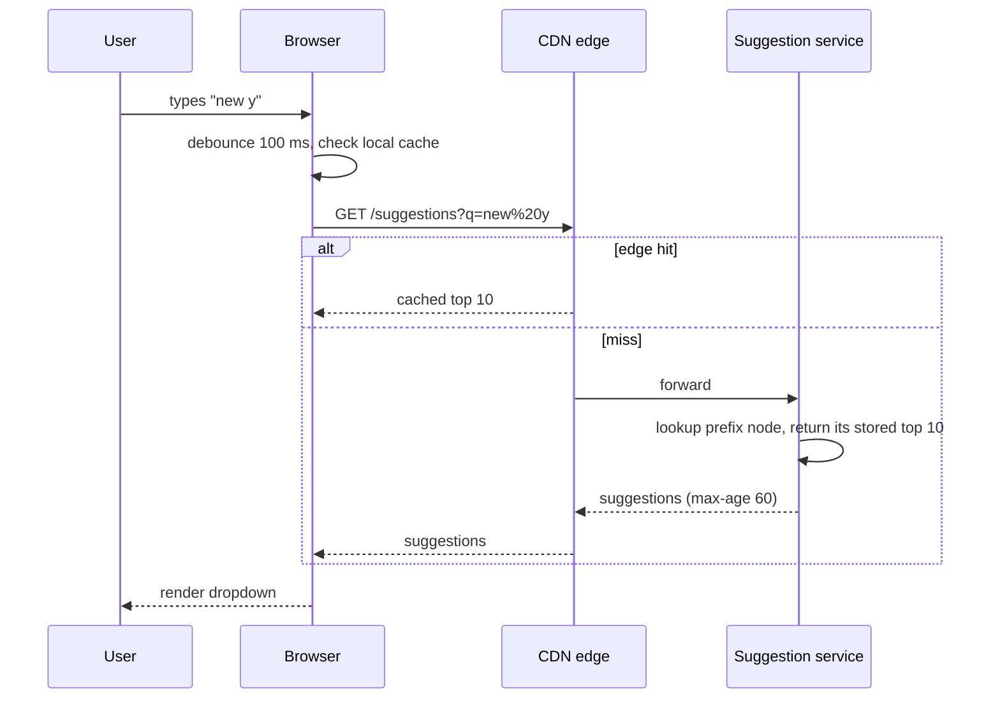
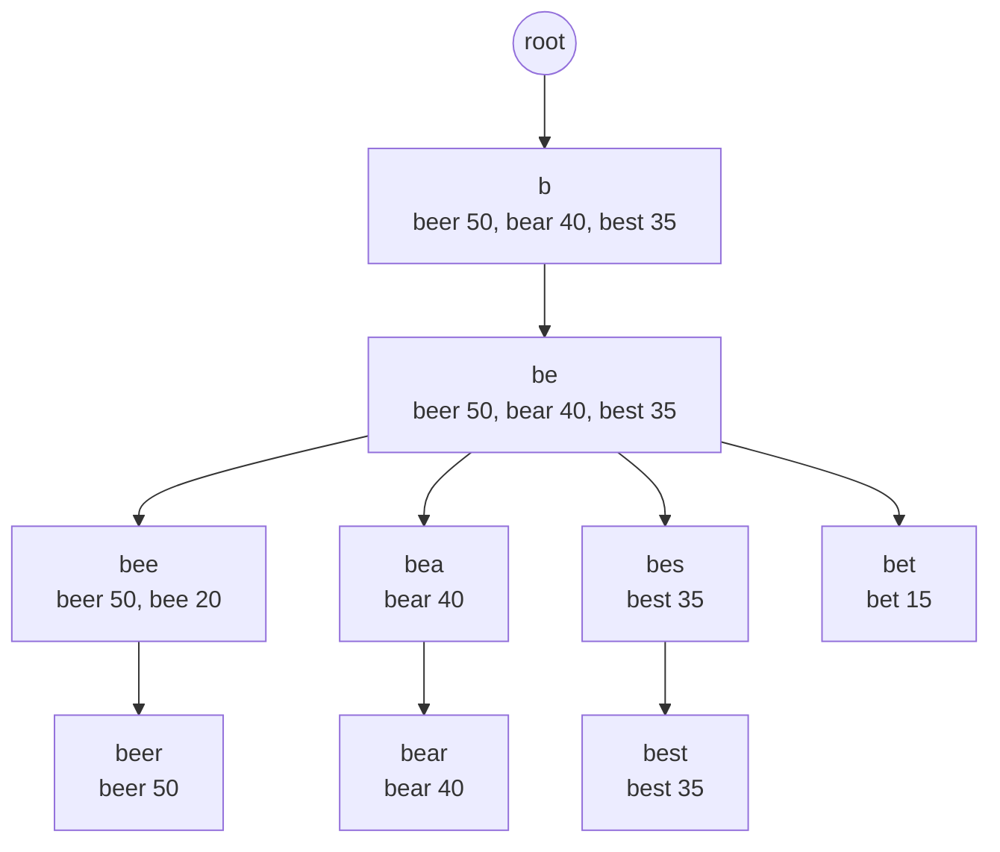

# Design Search Autocomplete / Typeahead

## Requirements

**Functional**
1. As the user types, return the top ~10 completions for the current prefix.
2. Suggestions are ranked by popularity, which reflects recent search activity (fresh within hours; trending within minutes is a bonus).

**Non-functional**
- **Very low latency:** under ~100 ms end to end per keystroke; the backend budget is ~10–20 ms.
- **Highly available;** slightly stale suggestions are fine.
- **Scale:** ~10B searches/day.
- No offensive or unsafe suggestions.

**Out of scope:** spell correction, personalization (mention them as extensions).

### Back-of-envelope estimates

| Quantity | Estimate | Implication |
|---|---|---|
| Searches | 10B/day ≈ 115k/s | Query logs: ~1 TB/day to aggregate |
| Suggestion requests | ~5 keystrokes per search after debouncing ≈ 600k/s (peak 1M+) | Must come from memory, or better, from caches |
| Distinct queries worth suggesting | ~100M after filtering rare ones | |
| Index size | 100M phrases × ~20 chars, plus top-10 per prefix node | Tens of GB; fits in memory per shard |

## Core entities

| Entity | Key fields | Notes |
|---|---|---|
| Query log | `query`, `ts`, locale | Raw input to the aggregation pipeline |
| Phrase stat | `phrase`, decayed `score` | Output of aggregation |
| Prefix index | `prefix` → top-K `[ (phrase, score) ]` | What the online service serves |

## API

```
GET /suggestions?q=new%20yo&limit=10&locale=en-US
→ 200 { "suggestions": ["new york", "new york times", "new york weather", ...] }
Cache-Control: public, max-age=60
```

## High-level design




## Deep dives

### The data structure

- **Weak:** `SELECT phrase FROM phrases WHERE phrase LIKE 'new y%' ORDER BY score DESC LIMIT 10`. Even indexed, it's far too slow at 600k/s.
- **Okay:** a plain trie, walking the subtree under the prefix and sorting. Lookup is O(prefix) but collecting the top-K is O(subtree size), and short prefixes have huge subtrees.
- **Best:** a **trie where every node stores its precomputed top-K completions**. A lookup is O(prefix length) and returns immediately. The memory cost is K entries per node, bounded by limiting depth (~20 characters) and K = 10.
- An equivalent and simpler alternative: a **hash map from prefix → top-K** for every prefix up to N characters (in memory or Redis). It uses more memory but is trivially sharded and served.

#### Worked example: a trie with top-K at every node

Suppose the aggregated counts are: `bee` 20, `beer` 50, `best` 35, `bet` 15, `bear` 40, and we keep **K = 3** suggestions per node.



- **Query "be":** walk b → e (2 steps) and return the stored list `[beer, bear, best]` immediately. No subtree traversal, no sorting at query time. Note that `bee` and `bet` exist but didn't make the top 3 for this prefix.
- **Query "bee":** 3 steps, returns `[beer, bee]`.
- **Building:** for each phrase, walk its path and offer `(phrase, count)` to every node on the way, keeping each node's list as a size-K min-heap. Each phrase touches at most its length in nodes, so the build is O(total characters × log K).
- **Cost:** O(prefix length) per lookup, and K extra entries per node in memory, which is why depth and K are capped and phrase IDs are stored instead of full strings.

#### Why decay scores over time

Raw all-time counts would keep last year's news at the top forever. A common choice is **exponential decay**: `score = Σ count_day × 0.5^(age_in_days / half_life)`. With a 7-day half-life, searches from a week ago count half as much, so suggestions track what people search for *now*.

### Building and refreshing the rankings

- **Batch (Spark, hourly or daily):** count queries per phrase with **exponential time decay** (yesterday counts half as much as today), drop rare queries (privacy, noise), apply blocklists, and emit top-K per prefix.
- **Streaming (Flink, minutes):** detect fast-rising queries (breaking news) over short windows and merge a "trending boost" into the served results between batch builds.
- Build the index offline as an immutable snapshot, write it to object storage, then have servers load it into a second memory slot and **atomically swap** (blue/green). No downtime and easy rollback.

### Sharding and scaling

- Shard by prefix range (e.g. first character or two), but **rebalance by traffic**: "s" and "c" are much hotter than "x" or "q". Keep a shard map in config.
- Replicate each shard; the service is read-only between swaps, so replicas scale reads linearly.
- **Caching is the biggest lever:** one- to three-character prefixes are identical for everyone in a locale and make up a huge share of requests. Cache them at the CDN with ~1-minute TTLs to absorb most traffic.

### The client matters

- **Debounce** keystrokes (~100 ms) and cancel in-flight requests when the user types more.
- Cache responses in the browser per prefix; when the user backspaces, the answer is local.
- If the user typed "new y" and the result list for "new " already contains all completions starting with "new y", filter locally without a request.

### Safety and quality

- Blocklists and classifiers remove offensive, sexual and violent suggestions, plus names in sensitive contexts. Run this offline during the build, and keep an emergency "kill list" that servers apply at runtime for instant removals.
- Require a minimum query count and number of distinct users before a phrase can be suggested, which prevents both manipulation and leaking private queries.

## Follow-up questions

### How would you personalize suggestions?
Keep the global index as-is. Blend in the user's own recent searches (stored client-side or in a small per-user store) and locale or region signals at request time with a light re-ranking step. Never let personalization add latency to the critical path; fetch it in parallel.

### How do you get breaking news into suggestions within minutes?
A Flink job over the query stream computes velocity (current rate vs. baseline) per phrase. Phrases crossing a threshold are written to a small "trending" overlay that the suggestion service merges into results for matching prefixes, reloaded every minute.

### How much memory does the trie need, and how do you reduce it?
Roughly: number of nodes × (children pointers + K stored suggestions). Reduce it with a compressed (radix) trie, storing phrase IDs instead of strings in the top-K lists, capping depth, and dropping low-score phrases. Shard if a single node's memory isn't enough.

### Why not just put everything in Elasticsearch with a prefix query?
Elasticsearch completion suggesters work well at moderate scale and make updates easy. At ~1M req/s with a ~10 ms budget, a purpose-built in-memory index plus CDN caching is cheaper and more predictable. Elasticsearch is a fine answer if you state the trade-off.

### How do you support multiple languages?
Build separate indexes per locale; normalize text (case, accents, Unicode normalization) before building and querying; for CJK languages, use character-based tries or pinyin/romaji input mappings. Route by the request's locale.

### What happens when a suggestion server restarts?
It loads the latest snapshot from object storage into memory (seconds to minutes) and reports healthy only after loading, so the load balancer sends traffic elsewhere meanwhile. Since servers are stateless replicas, losing one has no effect on correctness.

### How would you handle typos ("new yrok")?
Add fuzzy matching: precompute common misspellings to canonical phrases from query-reformulation logs (users who typed X and then searched Y), or run an edit-distance search over the trie with a small budget (distance 1). Show fuzzy results only when exact prefix results are sparse.

### How do you measure whether suggestions are good?
Track the click-through rate on suggestions, keystrokes saved, the share of searches that started from a suggestion, and the abandonment rate. A/B test ranking changes against these metrics.
