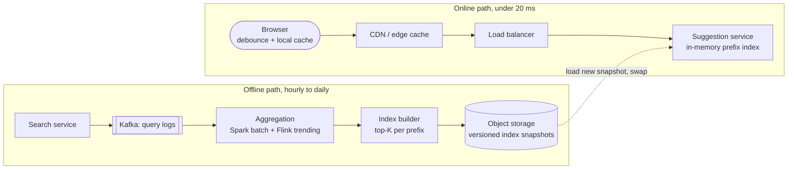
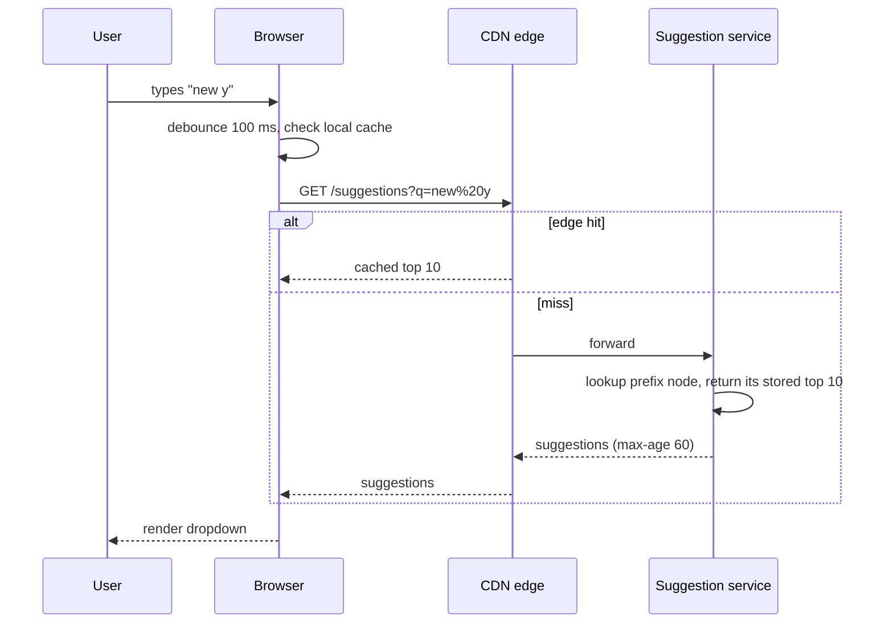
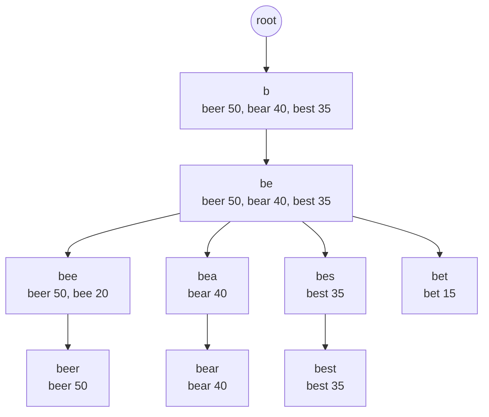

# Design Search Autocomplete / Typeahead

## Requirements

**Functional**
1. As the user types, return the top ~10 completions for the current prefix.
2. Suggestions are ranked by popularity, which reflects recent search activity (fresh within hours; trending within minutes is a bonus).

**Non-functional**
- **Very low latency:** under ~100 ms end to end per keystroke; the backend budget is ~10–20 ms.
- **Highly available;** slightly stale suggestions are fine.
- **Scale:** ~10B searches/day.
- No offensive or unsafe suggestions.

**Out of scope:** spell correction, personalization (mention them as extensions).

### Back-of-envelope estimates

| Quantity | Estimate | Implication |
|---|---|---|
| Searches | 10B/day ≈ 115k/s | Query logs: ~1 TB/day to aggregate |
| Suggestion requests | ~5 keystrokes per search after debouncing ≈ 600k/s (peak 1M+) | Must come from memory, or better, from caches |
| Distinct queries worth suggesting | ~100M after filtering rare ones | |
| Index size | 100M phrases × ~20 chars, plus top-10 per prefix node | Tens of GB; fits in memory per shard |

## Core entities

| Entity | Key fields | Notes |
|---|---|---|
| Query log | `query`, `ts`, locale | Raw input to the aggregation pipeline |
| Phrase stat | `phrase`, decayed `score` | Output of aggregation |
| Prefix index | `prefix` → top-K `[ (phrase, score) ]` | What the online service serves |

## API

```
GET /suggestions?q=new%20yo&limit=10&locale=en-US
→ 200 { "suggestions": ["new york", "new york times", "new york weather", ...] }
Cache-Control: public, max-age=60
```

## High-level design





## Deep dives

### The data structure

- **Weak:** `SELECT phrase FROM phrases WHERE phrase LIKE 'new y%' ORDER BY score DESC LIMIT 10`. Even indexed, it's far too slow at 600k/s.
- **Okay:** a plain trie, walking the subtree under the prefix and sorting. Lookup is O(prefix) but collecting the top-K is O(subtree size), and short prefixes have huge subtrees.
- **Best:** a **trie where every node stores its precomputed top-K completions**. A lookup is O(prefix length) and returns immediately. The memory cost is K entries per node, bounded by limiting depth (~20 characters) and K = 10.
- An equivalent and simpler alternative: a **hash map from prefix → top-K** for every prefix up to N characters (in memory or Redis). It uses more memory but is trivially sharded and served.

#### Worked example: a trie with top-K at every node

Suppose the aggregated counts are: `bee` 20, `beer` 50, `best` 35, `bet` 15, `bear` 40, and we keep **K = 3** suggestions per node.



- **Query "be":** walk b → e (2 steps) and return the stored list `[beer, bear, best]` immediately. No subtree traversal, no sorting at query time. Note that `bee` and `bet` exist but didn't make the top 3 for this prefix.
- **Query "bee":** 3 steps, returns `[beer, bee]`.
- **Building:** for each phrase, walk its path and offer `(phrase, count)` to every node on the way, keeping each node's list as a size-K min-heap. Each phrase touches at most its length in nodes, so the build is O(total characters × log K).
- **Cost:** O(prefix length) per lookup, and K extra entries per node in memory, which is why depth and K are capped and phrase IDs are stored instead of full strings.

#### Why decay scores over time

Raw all-time counts would keep last year's news at the top forever. A common choice is **exponential decay**: `score = Σ count_day × 0.5^(age_in_days / half_life)`. With a 7-day half-life, searches from a week ago count half as much, so suggestions track what people search for *now*.

### Building and refreshing the rankings

- **Batch (Spark, hourly or daily):** count queries per phrase with **exponential time decay** (yesterday counts half as much as today), drop rare queries (privacy, noise), apply blocklists, and emit top-K per prefix.
- **Streaming (Flink, minutes):** detect fast-rising queries (breaking news) over short windows and merge a "trending boost" into the served results between batch builds.
- Build the index offline as an immutable snapshot, write it to object storage, then have servers load it into a second memory slot and **atomically swap** (blue/green). No downtime and easy rollback.

### Sharding and scaling

- Shard by prefix range (e.g. first character or two), but **rebalance by traffic**: "s" and "c" are much hotter than "x" or "q". Keep a shard map in config.
- Replicate each shard; the service is read-only between swaps, so replicas scale reads linearly.
- **Caching is the biggest lever:** one- to three-character prefixes are identical for everyone in a locale and make up a huge share of requests. Cache them at the CDN with ~1-minute TTLs to absorb most traffic.

### The client matters

- **Debounce** keystrokes (~100 ms) and cancel in-flight requests when the user types more.
- Cache responses in the browser per prefix; when the user backspaces, the answer is local.
- If the user typed "new y" and the result list for "new " already contains all completions starting with "new y", filter locally without a request.

### Safety and quality

- Blocklists and classifiers remove offensive, sexual and violent suggestions, plus names in sensitive contexts. Run this offline during the build, and keep an emergency "kill list" that servers apply at runtime for instant removals.
- Require a minimum query count and number of distinct users before a phrase can be suggested, which prevents both manipulation and leaking private queries.

## Production readiness

### Database choice and consistency

- **There is no database on the online path.** The suggestion service serves an immutable, in-memory prefix index loaded from a versioned snapshot in object storage. A relational DB was rejected for the reasons in the data-structure deep dive (`LIKE 'new y%'` at 600k/s), and a remote key-value store (Redis) adds a network hop to a 10–20 ms budget for no benefit, since the data only changes at snapshot time.
- **Object storage for snapshots:** cheap, durable, and naturally versioned, which is what makes the blue/green swap and rollback work. Nothing needs to be queried there, only loaded whole.
- **Kafka for query logs:** an append-only, replayable log fits ~1 TB/day of events that two consumers (Spark batch, Flink trending) read at their own pace. If the aggregation job has a bug, you fix it and replay.
- **ACID is not needed anywhere in this system.** Losing or double-counting a few log events changes a decayed score by a rounding error. BASE everywhere is the right call.
- **CAP stance: AP on every path.** During a partition, a replica serving an hour-old snapshot is far better than an error; the requirements say stale is fine. The one thing that must propagate quickly is the runtime **kill list**: treat it as a small, separately pushed config that servers poll every few seconds, so removing an offensive suggestion doesn't wait for the next build.

### Service boundaries and communication

- **Online:** CDN → load balancer → suggestion service. That's it. Keep it a single, dumb, read-only service; splitting ranking or filtering into separate services would add hops to a per-keystroke call.
- **Offline:** search service → Kafka → aggregation → index builder → object storage. These are separate because they scale on different axes (batch compute vs. memory-bound serving) and fail independently: if Spark is down for a day, users still get yesterday's suggestions.
- **Synchronous:** only the `GET /suggestions` request. **Asynchronous:** everything else. The search service fires query logs at Kafka and never waits on the suggestion system, and servers pull new snapshots rather than having the builder push to them.

### Failure modes and reliability

| Failure | Effect | Mitigation |
|---|---|---|
| A suggestion shard's replicas are all overloaded or down | Prefixes in that range return nothing | Short client timeout (~150 ms) and render no dropdown, which is acceptable; load shedding at the LB before replicas tip over; over-provision hot shards ("s", "c") |
| Bad snapshot (corrupt, empty, or offensive results) | Wrong or harmful suggestions everywhere | Validate before swap (size, phrase count within ±10% of last build, canary prefixes); canary to a few servers first; one-command rollback to the previous version |
| Spark aggregation fails or is late | Rankings go stale | Keep serving the last good snapshot; alert on snapshot age, not job failure; Flink overlay keeps trending terms fresh |
| Kafka consumer lag during a traffic spike | Trending overlay lags reality | Producers fire-and-forget with bounded local buffers so search is never slowed; lag is tolerable by design |
| CDN edge outage or purge | Origin load jumps from the miss fraction to near 100% | Size origin for at least 2× the normal miss load; per-PoP rate limits; browser cache and debounce absorb some of it |
| Thundering herd when a new snapshot loads | Many servers download tens of GB at once and GC/pause | Staggered rollout with jitter; servers report healthy only after load (as in the restart follow-up) |

### High availability and disaster recovery

- **SPOFs:** none on the online path once each shard has 3+ replicas across zones. The shard map in config is a quiet SPOF: version it and keep a last-known-good copy on each server.
- **Multi-region:** deploy the suggestion service in every region where users are, active-active, mainly for latency (the 100 ms end-to-end budget doesn't survive a cross-ocean round trip). DNS or anycast steers traffic away from a failed region.
- **Backups:** keep the last ~7 days of snapshots in object storage (cross-region replicated) and the aggregated phrase scores. Raw logs can be rebuilt from Kafka retention only for a few days, which is fine.
- **RPO/RTO:** online RTO under 1 minute (traffic shifts to other replicas/regions). Ranking RPO is effectively "last good snapshot", hours at worst; nobody is harmed by suggestions an hour old. Kill-list RPO should be near zero because it's a safety control.

### Security

- **Authn/authz:** the endpoint is public and unauthenticated by design (it's cacheable with `Cache-Control: public`). Internal writes (snapshot upload, kill list edits) require service identities with least privilege; kill-list changes need named-human authz and are audit-logged.
- **PII:** query logs contain what people type, including names, addresses and medical terms. Strip user IDs and IPs before aggregation, enforce the minimum-distinct-users threshold, and set short retention on raw logs. Encrypt logs and snapshots at rest; TLS from browser to CDN and CDN to origin.
- **Abuse:** the main attack is manipulation, bots searching a phrase to push it into suggestions. Count distinct users, not raw searches, discount traffic flagged by bot detection, and rate-limit per IP at the edge. Secrets (storage credentials) live in a secrets manager and rotate automatically.

### Observability

- **SLIs/SLOs:** 99.9% of origin suggestion requests served within 20 ms, and 99% end-to-end within 100 ms (measured client-side), over 30 days. Availability: 99.95% of requests return 200. Freshness: the served snapshot is under 3 hours old 99% of the time.
- **Dashboards:** CDN hit rate by prefix length, origin QPS per shard, p50/p99 latency, snapshot version and age per server (mixed versions mean a stuck rollout), Kafka consumer lag, and product metrics like suggestion CTR.
- **Tracing:** sample origin requests; track pipeline lineage (which log window built which snapshot).
- **Paging:** fast error-budget burn on latency or availability, and snapshot age over threshold. A single Spark retry failing is a ticket, not a page.

### Performance and cost

- **Bottleneck:** the 600k/s (1M+ peak) request rate. The CDN is the main tuning knob: 1–3 character prefixes are shared by everyone. At an 80% edge hit rate, origin sees ~120k/s on average and ~200k/s at peak; if each server does ~50k lookups/s, that's only ~4 servers' worth of CPU, so replica count is set by availability and memory, not compute. Raising TTL past 60 s increases hit rate but delays trending terms; the trade-off is freshness.
- **Memory:** tens of GB of index per full copy, multiplied by replicas and regions. Storing phrase IDs instead of strings, a radix trie and capping depth (follow-ups) cut it; the cost is a slightly more complex build.
- **Log storage:** ~1 TB/day of raw query logs is ~365 TB/year if kept. Keep raw logs ~30 days (~30 TB) and only aggregated phrase scores long-term; this is also the privacy-friendly choice. The trade-off is you can't re-run a new ranking model over old raw data.
- **Cross-region egress:** shipping a full tens-of-GB snapshot hourly to every region adds up (30 GB × 3 regions × 24 ≈ 2 TB/day). Ship deltas, or build per locale only where it's served. Simpler still: full snapshots daily, and let the small Flink overlay carry hourly freshness.

## Follow-up questions

### How would you personalize suggestions?
Keep the global index as-is. Blend in the user's own recent searches (stored client-side or in a small per-user store) and locale or region signals at request time with a light re-ranking step. Never let personalization add latency to the critical path; fetch it in parallel.

### How do you get breaking news into suggestions within minutes?
A Flink job over the query stream computes velocity (current rate vs. baseline) per phrase. Phrases crossing a threshold are written to a small "trending" overlay that the suggestion service merges into results for matching prefixes, reloaded every minute.

### How much memory does the trie need, and how do you reduce it?
Roughly: number of nodes × (children pointers + K stored suggestions). Reduce it with a compressed (radix) trie, storing phrase IDs instead of strings in the top-K lists, capping depth, and dropping low-score phrases. Shard if a single node's memory isn't enough.

### Why not just put everything in Elasticsearch with a prefix query?
Elasticsearch completion suggesters work well at moderate scale and make updates easy. At ~1M req/s with a ~10 ms budget, a purpose-built in-memory index plus CDN caching is cheaper and more predictable. Elasticsearch is a fine answer if you state the trade-off.

### How do you support multiple languages?
Build separate indexes per locale; normalize text (case, accents, Unicode normalization) before building and querying; for CJK languages, use character-based tries or pinyin/romaji input mappings. Route by the request's locale.

### What happens when a suggestion server restarts?
It loads the latest snapshot from object storage into memory (seconds to minutes) and reports healthy only after loading, so the load balancer sends traffic elsewhere meanwhile. Since servers are stateless replicas, losing one has no effect on correctness.

### How would you handle typos ("new yrok")?
Add fuzzy matching: precompute common misspellings to canonical phrases from query-reformulation logs (users who typed X and then searched Y), or run an edit-distance search over the trie with a small budget (distance 1). Show fuzzy results only when exact prefix results are sparse.

### How do you measure whether suggestions are good?
Track the click-through rate on suggestions, keystrokes saved, the share of searches that started from a suggestion, and the abandonment rate. A/B test ranking changes against these metrics.
