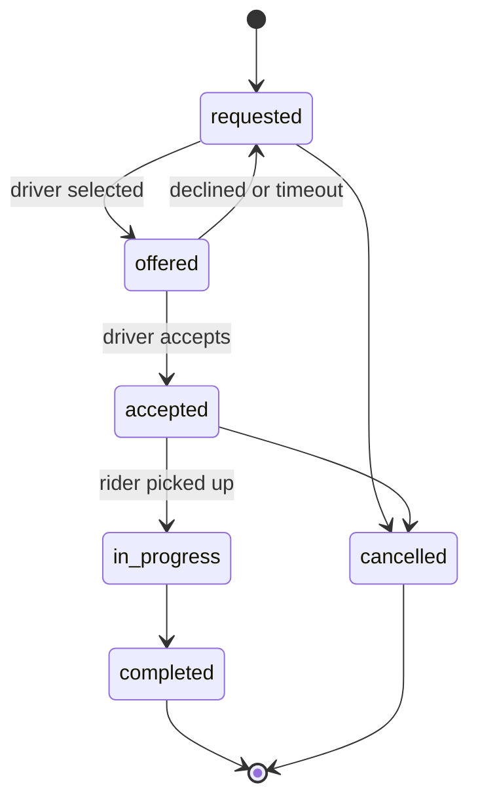
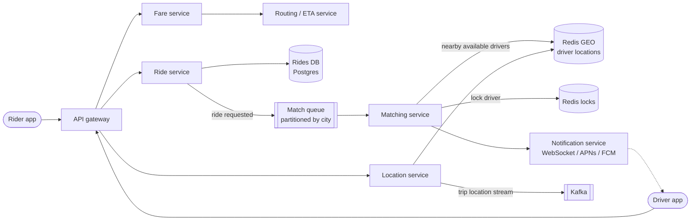
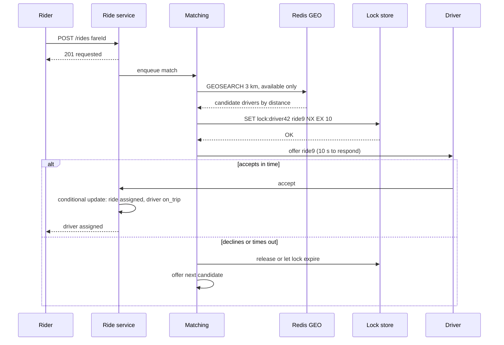

# Design Uber / Lyft

## Requirements

**Functional**
1. A rider enters pickup and destination and gets a fare estimate.
2. The rider requests a ride and is matched with a nearby available driver.
3. The driver accepts or declines; on decline or timeout, the next driver gets the offer.
4. Rider and driver see each other's live location during pickup and the trip.

**Non-functional**
- **Fast matching:** a driver is found (or failure reported) within ~1 minute.
- **Strong consistency in matching:** a driver gets at most one offer at a time and is never assigned two rides.
- **High write throughput:** drivers report location every ~5 s.
- **Highly available** everywhere except the matching consistency above; spikes (concerts, New Year's Eve) are local.
- **Scale:** ~10M rides/day, ~5M drivers, ~1M online at peak.

### Back-of-envelope estimates

| Quantity | Estimate | Implication |
|---|---|---|
| Location updates | 1M online drivers / 5 s ≈ 200k writes/s | Overwrite-only, in memory; no history on the hot path |
| Ride requests | 10M/day ≈ 120/s average, ~10× at peak, very bursty by city | Matching load is modest overall but local spikes matter |
| Nearby search | ~1k/s, each over a few km radius | Needs a geospatial index |

## Core entities

| Entity | Key fields | Notes |
|---|---|---|
| Rider | `rider_id`, payment method | |
| Driver | `driver_id`, vehicle, `status` (offline / available / offered / on_trip) | Status changes need consistency |
| Fare | `fare_id`, `rider_id`, pickup, destination, price, ETA, expires_at | Locks in the quoted price |
| Ride | `ride_id`, `rider_id`, `driver_id?`, `fare_id`, `status` | State machine (below) |
| Location | `driver_id` → (lat, lng, ts) | Latest only, in Redis GEO |



## API

```
POST  /fares             { pickup: {lat,lng}, destination: {lat,lng} } → { fareId, price, eta }
POST  /rides             { fareId }                                   → 201 { rideId, status: "requested" }
POST  /drivers/location  { lat, lng, heading }                        (every ~5 s while online)
PATCH /rides/{id}        { action: "accept" | "decline" | "pickup" | "complete" | "cancel" }
GET   /rides/{id}                                                      → { status, driver, driverLocation }
```

Real-time updates (offers to drivers, the driver's location to riders) go over a WebSocket or push notifications. The rider ID comes from the auth token, never the request body.

## High-level design





## Deep dives

### Geospatial indexing, explained

**The problem:** "find available drivers within 3 km of (37.7749, −122.4194)". A normal B-tree index sorts on one column. An index on latitude finds a horizontal band of the planet, and you'd still scan everyone in that band for longitude. You need an index that keeps nearby points close together.

#### Geohash

A geohash turns a (lat, lng) pair into a short string where **a shared prefix means nearby**:

1. Halve the longitude range [−180, 180]: is the point in the left or right half? Write 0 or 1. Then do the same for latitude [−90, 90]. Keep alternating, narrowing the box each time.
2. The interleaved bits identify a smaller and smaller rectangle; group them 5 at a time and write each group as a base32 character.

San Francisco's city center encodes as `9q8yy…`. Every extra character shrinks the cell about 32×:

| Geohash length | Cell size (approx.) | Typical use |
|---|---|---|
| 4 | 39 km × 20 km | Region |
| 5 | 4.9 km × 4.9 km | Neighborhood search radius |
| 6 | 1.2 km × 0.6 km | Nearby drivers |
| 7 | 153 m × 153 m | Street level |

**Querying:** store each driver's geohash; to search near a point, compute its geohash at length 6 and find drivers whose geohash starts with that prefix (a range scan on a sorted index or sorted set).

**The edge problem:** two drivers 10 m apart can sit on opposite sides of a cell border and share no prefix. The fix is to always query the **target cell plus its 8 neighbors** (9 prefix scans), then filter by exact distance.

#### Quadtree

Recursively split the map into 4 quadrants, splitting any cell that holds more than N points (e.g. 100). Dense downtown areas end up with tiny cells and empty desert with huge ones, so each cell holds a manageable number of points. The cost: moving points require removing and re-inserting them, and splits and merges. At 200k location updates per second that's expensive, so quadtrees suit **mostly static** data (restaurants, businesses), not moving drivers.

#### H3 (Uber's hexagonal grid)

H3 tiles the earth with **hexagons** at 16 resolutions. Every hexagon's 6 neighbors are the same distance away (squares have 4 near and 4 diagonal neighbors), which makes "k rings around me" searches and supply/demand heatmaps for surge pricing clean. Querying is the same idea as geohash: compute the cell ID, then look up that cell plus its rings.

#### Redis GEO in practice

Redis GEO stores members in a sorted set whose score is a 52-bit geohash, so nearby points are adjacent in the sort order:

```
GEOADD drivers:sf -122.4194 37.7749 driver:42                       # on every 5 s update (overwrites)
GEOSEARCH drivers:sf FROMLONLAT -122.4194 37.7749 BYRADIUS 3 km ASC COUNT 20 WITHDIST
```

Internally `GEOSEARCH` does the 9-cell lookup and distance filtering for you.

### Finding nearby drivers

- **Weak:** `SELECT ... WHERE lat BETWEEN ... AND lng BETWEEN ...` on a regular DB. Two-dimensional range queries are slow, and 200k updates/s would melt it.
- **Better:** geohash strings in a regular index (prefix = cell). Simple, but neighbors at cell edges need extra lookups.
- **Best:** **Redis GEO** (a sorted set using geohash scores): `GEOADD` on each update, `GEOSEARCH BYRADIUS` for matching. It's in memory, fast at this write rate, and sharded by city or region. Uber itself uses **H3 hexagons**, which have uniform neighbor distances and are nice for surge pricing.
- **Quadtrees** adapt to density but are expensive to update at 200k moves/s, so they're better for static points of interest.
- Remove stale drivers: keep a per-driver `last_seen` with a TTL, or filter by timestamp, so offline drivers aren't matched.

### Handling 200k location writes per second

- Only the **latest** position matters for matching, so overwrite in Redis; nothing goes to a disk-based DB on the hot path.
- Send trip locations to Kafka asynchronously for trip history, receipts and ETA models.
- **Adaptive reporting:** clients report more often when moving fast or on a trip, and less when parked.
- Partition by city: each city's Redis and matching service are independent, which isolates hot spots.

### Never double-assigning a driver

- **Problem:** two matchers (or two requests) pick the same nearby driver at the same moment.
- **Best:** a **distributed lock per driver with a TTL** equal to the offer window: `SET lock:driver:{id} {rideId} NX EX 10`. Matchers skip drivers they can't lock. If the driver never answers, the TTL frees them automatically.
- On accept, a **conditional DB update** makes the assignment authoritative: `UPDATE rides SET driver_id=?, status='accepted' WHERE id=? AND status='offered'`, and the driver's status changes in the same transaction. That makes accepts idempotent and race-free.

### Making matching durable

- Ride requests go on a queue partitioned by city. If a matcher dies, another consumer picks up the request; nothing is silently dropped.
- The offer → wait → next-driver loop is a long-running workflow with timers. A workflow engine (Temporal) or a state machine persisted in the DB keeps it correct across crashes.
- If no driver accepts within the time limit, notify the rider and offer to retry or widen the radius.

### Surge pricing and peaks

- Compute supply (available drivers) and demand (requests) per H3 cell over the last few minutes in a stream processor, then derive a multiplier, smoothed so it doesn't flap.
- The fare quote locks the surge multiplier until `expires_at`, so the rider pays what they were shown.

## Follow-up questions

### How do you rank candidate drivers? Is the nearest always best?
No: use ETA by road, not straight-line distance (a river or highway can make "near" far). Rank with the routing service's ETA, plus driver rating, acceptance rate, and fairness (spreading trips). Precompute ETAs for the top ~10 by distance only, to limit routing calls.

### What if the driver's app loses connectivity right after accepting?
The accept was a durable conditional update, so the ride stays assigned. The rider sees the last known location with a "connection lost" indicator. If there's no heartbeat for N minutes, an automated policy can reassign the ride and notify both sides.

### How would you show the driver's live location to the rider smoothly?
The location service publishes the assigned driver's updates to a channel for that ride; the rider's WebSocket server is subscribed. The client interpolates between 5-second updates along the route, so the car moves smoothly.

### How does the system handle a stadium emptying out (10k requests in one area)?
Partitioning by city isolates the load. Within the city, batch matching works better than greedy one-by-one: collect requests for a few seconds and solve a bipartite assignment that minimizes total ETA. Surge pricing rebalances supply and demand, and you can open a queue/pickup zone.

### How would you implement ETA and fare estimation?
A routing service over a road graph (contraction hierarchies for fast shortest paths), with edge weights from live traffic derived from trip location streams. Fare = base + per-minute and per-km rates × surge, computed at quote time and stored with an expiry.

### What data store for rides, and why?
A relational DB (Postgres) per region: rides need transactional state transitions and conditional updates, and ~10M rides/day is modest. Shard by city if needed. Hot location data stays in Redis; trip history goes to a data lake via Kafka.

### How would you prevent GPS spoofing?
Validate on the server: impossible speeds or jumps, positions not on roads, and device integrity checks. Compare against trip distance from the route. Flag accounts with anomalies for review.

### How do you handle cancellations and partial failures in payment?
Cancellation is a state-machine transition with policy (fees after a grace period). Payment is authorized at request time and captured at completion; capture is async and retried idempotently with the ride ID as the idempotency key.
