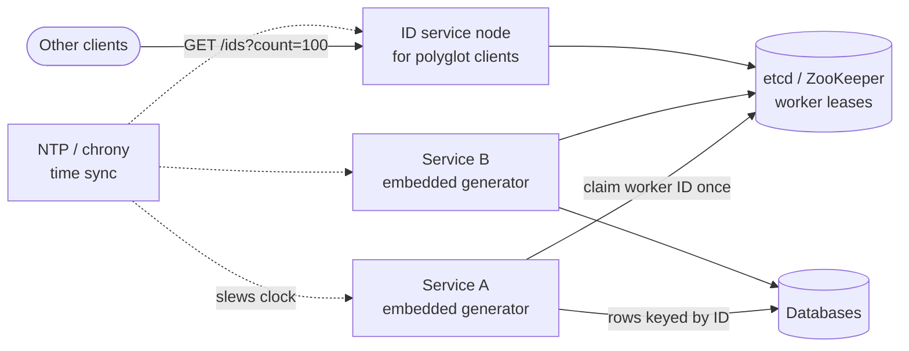
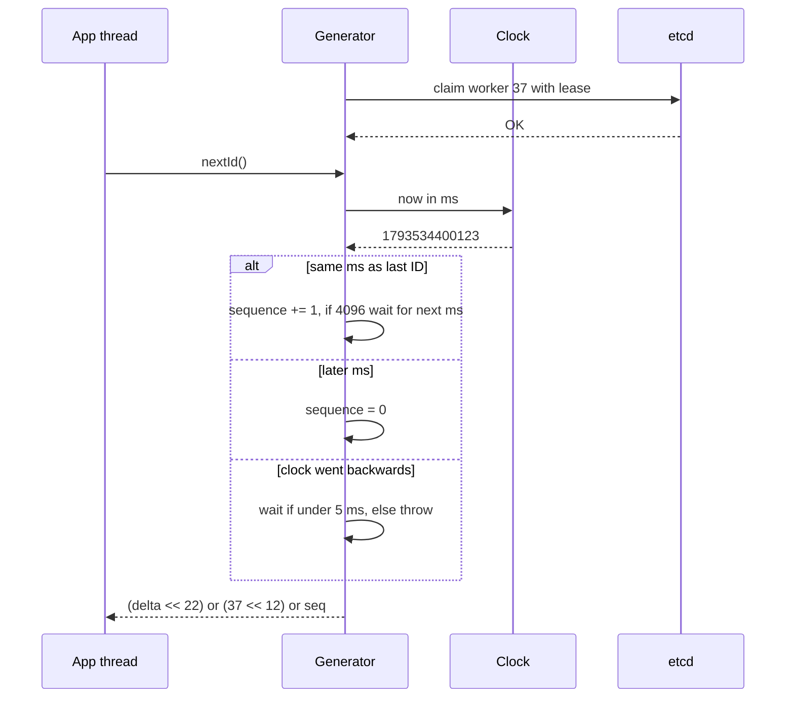

# Design a Distributed Unique ID Generator

## Requirements

**Functional**
1. Generate IDs that are unique across every machine and data center, forever.
2. IDs fit in 64 bits (a signed `BIGINT`), so they work as primary keys in any database and as JSON numbers in most languages.
3. IDs are roughly time-ordered: an ID created later is almost always larger, so sorting by ID approximates sorting by creation time.

**Non-functional**
- **High throughput:** at least 10k IDs/s per node and ~1M IDs/s across the fleet at peak.
- **Low latency:** under 1 ms per ID; ideally generated in-process with no network hop.
- **No coordination bottleneck:** generating an ID must not need a central service on the hot path.
- **Highly available:** a single failure must not stop ID generation.
- **Lifetime:** the scheme must last for decades without running out of space.

**Out of scope**
- IDs that are unguessable (use a separate random token for anything security-sensitive).
- Strict global ordering (that needs a single sequencer).

### Back-of-envelope estimates

| Quantity | Estimate | Implication |
|---|---|---|
| Peak demand | ~1M IDs/s across the fleet | A single DB sequence (a few thousand inserts/s) can't serve it directly |
| Timestamp space | 41 bits of milliseconds = 2^41 ms ≈ 69.7 years | A custom epoch (e.g. 2020-01-01) lasts until ~2089 |
| Per-worker capacity | 12-bit sequence = 4,096 IDs/ms = 4.096M IDs/s | One worker alone covers peak; throughput is never the limit |
| Worker space | 10 bits = 1,024 workers | Worker IDs must be assigned carefully, not hashed randomly |
| UUIDv4 collision odds | 50% chance only after ~2.7 × 10^18 IDs (birthday bound on 122 random bits) | Random IDs are safe, but need 128 bits, not 64 |
| Index cost of 128-bit keys | 1B rows × 8 extra bytes ≈ 8 GB more per index that holds the key | A real reason to prefer 64-bit IDs |

## Core entities

| Entity | Key fields | Store/Notes |
|---|---|---|
| ID | 64 bits: sign (1) + timestamp ms (41) + worker (10) + sequence (12) | Not stored by the generator; returned to callers |
| Worker lease | `worker_id` (0–1023), `owner` (host/pod), `lease_expires_at` | ZooKeeper/etcd ephemeral node, or a DB row with a lease; prevents two live processes sharing a worker ID |
| Generator state | `last_timestamp_ms`, `sequence` | In memory per process; `last_timestamp_ms` optionally persisted to detect clock rollback after restart |
| Segment (alternative design) | `biz_tag` (PK), `max_id`, `step` | DB row used by segment allocation; one row per ID namespace |

## API

```
In-process library (preferred):
  nextId() → int64                         # e.g. 904701306986450949
  decode(id) → { timestampMs, workerId, sequence }

Optional network service (for languages/services without the library):
  GET /ids?count=100            → 200 { ids: [int64, ...] }
                                → 503 if the clock moved backwards beyond tolerance
  GET /ids/{id}/decode          → 200 { createdAt, workerId, sequence }
```

Notes:
- Prefer a library embedded in each service: zero network hops and no shared failure point. The service form exists for polyglot clients and supports batch requests so callers amortize the round trip.
- IDs above 2^53 lose precision as JavaScript numbers, so APIs serialize them as strings in JSON (Twitter returns both `id` and `id_str` for this reason).
- `decode` is handy for debugging: any ID tells you when and where it was minted.

## High-level design



1. **Startup:** each generator process claims an unused worker ID from etcd/ZooKeeper (an ephemeral key with a lease), or reads a fixed one from its deployment config (e.g. Kubernetes StatefulSet ordinal). It renews the lease while alive.
2. **Generate:** `nextId()` reads the local clock, increments the in-memory sequence for the current millisecond, and packs timestamp, worker ID and sequence into 64 bits. No network calls.
3. **Clock check:** if the clock reads earlier than the last timestamp used, the generator waits or refuses (see deep dives) rather than risk a duplicate.
4. **Shutdown or lease loss:** the worker ID is released; another process may claim it only after the lease expires, so two live processes never share one.



## Deep dives

### Comparing the approaches

| Approach | Size | Time-ordered | Coordination | Main weakness |
|---|---|---|---|---|
| UUIDv4 | 128 bits | No | None | Too big; random keys fragment B-tree indexes |
| UUIDv7 | 128 bits | Yes (ms) | None | Still 128 bits |
| DB auto-increment / ticket server | 64 bits | Yes | Every ID hits the DB | Throughput and single point of failure |
| Segment (range) allocation | 64 bits | Roughly, per node | One DB call per range | IDs from different nodes interleave unevenly; gaps on restart |
| Snowflake | 64 bits | Yes (ms) | Only worker ID assignment | Depends on the clock |

- **Weak:** a single database `AUTO_INCREMENT`. Simple and strictly ordered, but every ID is a write to one machine.
- **Better:** UUIDv7 if 128 bits is acceptable, or segment allocation if you want dense integers.
- **Best for this question:** Snowflake. It meets 64 bits, time ordering and zero hot-path coordination.

#### How UUIDv4 and UUIDv7 work

A UUIDv4 is 122 random bits plus 6 fixed version/variant bits. Uniqueness comes from probability: you would need about 2.7 × 10^18 of them for a 50% chance of a single collision. The problem for databases is that consecutive inserts land at random positions in a B-tree, so pages split everywhere and the working set is the whole index.

UUIDv7 (standardized in RFC 9562, 2024) puts a 48-bit Unix millisecond timestamp first, then the version bits, then 74 random bits. New IDs sort after old ones, so inserts append to the right edge of the index like an auto-increment. It is the best choice when you can afford 128 bits and want zero setup.

#### How a ticket server works

Flickr's well-known design used a MySQL table with one row and an auto-increment column:

```sql
REPLACE INTO Tickets64 (stub) VALUES ('a');   -- deletes and reinserts the row, bumping the counter
SELECT LAST_INSERT_ID();                      -- per-connection, so concurrent callers don't collide
```

For availability they ran two servers, one with `auto_increment_increment = 2, auto_increment_offset = 1` (odd IDs) and one with offset 2 (even IDs), and clients round-robin between them. If one dies the other keeps issuing. The cost is a network round trip and a DB write per ID, and the two servers drift apart, so IDs are only loosely ordered.

#### How segment allocation works

Each node asks the database for a block of IDs, then hands them out from memory. Meituan's Leaf "segment" mode is a well-known example.

```sql
BEGIN;
UPDATE segments SET max_id = max_id + step WHERE biz_tag = 'order';
SELECT max_id, step FROM segments WHERE biz_tag = 'order';
COMMIT;            -- this node now owns (max_id - step, max_id]
```

**Worked example (step = 1,000):**

| Time | Event | Row `max_id` after | Node's range |
|---|---|---|---|
| t0 | Node A allocates | 1,000 | A: 1–1,000 |
| t1 | Node B allocates | 2,000 | B: 1,001–2,000 |
| t2 | A uses 900 IDs, prefetches next block in background | 3,000 | A next: 2,001–3,000 |
| t3 | A crashes after using 950 | 3,000 | IDs 951–1,000 and 2,001–3,000 are lost forever (gaps are fine) |

One DB write per 1,000 IDs means 1M IDs/s costs 1,000 DB writes/s. Prefetching the next segment when 10–20% of the current one remains (a "double buffer") hides the DB latency. The downside: node A hands out 900 while B hands out 1,500, so ordering across nodes is weak, and IDs reveal business volume.

### Snowflake bit layout, explained

#### How Snowflake works

Twitter's Snowflake (2010) packs three fields into a 64-bit integer:

```
| 1 bit | 41 bits                         | 10 bits   | 12 bits     |
| sign  | ms since custom epoch           | worker ID | sequence    |
|   0   | ~69.7 years                     | 1,024     | 4,096 / ms  |
```

- **Sign bit = 0** keeps the value positive in signed 64-bit types.
- **Timestamp first** makes IDs sort by time. Using a custom epoch (e.g. 2020-01-01) instead of 1970 means the 41 bits last until ~2089 instead of ~2039.
- **Worker ID** guarantees two machines never produce the same ID in the same millisecond. Twitter split it as 5 bits datacenter + 5 bits machine.
- **Sequence** distinguishes IDs from one worker in the same millisecond; it resets to 0 each new millisecond.

```
EPOCH = 1577836800000            # 2020-01-01T00:00:00Z in ms
last_ts = -1; seq = 0

def next_id():
    ts = now_ms()
    if ts < last_ts:
        if last_ts - ts <= 5: sleep_until(last_ts); ts = last_ts
        else: raise ClockMovedBackwards(last_ts - ts)
    if ts == last_ts:
        seq = (seq + 1) & 4095
        if seq == 0:                         # 4,096 used this ms
            ts = wait_until_next_ms(last_ts)
    else:
        seq = 0
    last_ts = ts
    return ((ts - EPOCH) << 22) | (WORKER_ID << 12) | seq
```

The whole function runs under a lock (or a CAS loop) per process; it takes well under a microsecond.

#### Worked encode and decode example

Worker 37 generates its 6th ID (sequence 5) at 2026-11-01T12:00:00.123Z = 1,793,534,400,123 ms since 1970.

| Step | Value |
|---|---|
| Timestamp − epoch | 1,793,534,400,123 − 1,577,836,800,000 = 215,697,600,123 |
| Shift left 22 | 215,697,600,123 × 4,194,304 = 904,701,306,986,299,392 |
| Worker 37 shifted left 12 | 37 × 4,096 = 151,552 |
| Sequence | 5 |
| OR them together | **904,701,306,986,450,949** (0x0C8E250B9EC25005) |

Decoding reverses it: `id >> 22` = 215,697,600,123, plus the epoch gives the creation time; `(id >> 12) & 1023` = 37; `id & 4095` = 5.

#### How worker IDs are assigned

Duplicate worker IDs break uniqueness, so assignment must be deliberate:
- **Static config:** StatefulSet ordinal or a config file. Simple, but humans make mistakes.
- **Coordination service:** on startup, create an ephemeral sequential node in ZooKeeper or a leased key in etcd for the first free ID in 0–1023. If the process loses its session, it must stop generating before the lease can be reclaimed.
- **Avoid** hashing the IP or MAC into 10 bits: with ~1,000 slots, collisions are likely after a few dozen machines (birthday problem).

### Clock skew and clocks moving backwards

#### Why the clock matters

Snowflake is unique only if a worker never reuses a (timestamp, sequence) pair. If the clock jumps back 10 ms, the worker re-enters milliseconds it already used, and sequence numbers restart at 0, producing duplicates.

#### How clocks move and how to respond

- **NTP slewing:** `chronyd`/`ntpd` normally correct small drift by running the clock slightly faster or slower, so time never goes backwards. Configure this (and disable step corrections after boot) on generator hosts.
- **Steps:** a large correction, VM migration, or leap-second handling can still step the clock back.

| Backward jump | Response |
|---|---|
| ≤ ~5 ms | Sleep until the clock passes `last_ts`, then continue. Costs a few ms of latency |
| Larger | Refuse to generate (throw/503), alert, and either wait or move this process to a fresh worker ID |
| After restart | Persist `last_ts` periodically (e.g. every second, writing `now + 1 s` ahead); on boot, wait until the clock passes the saved value |

**Example:** `last_ts` = 1,000,050. NTP steps the clock to 1,000,047. The next call sees a 3 ms rollback, sleeps 3 ms, and resumes at 1,000,050 with the next sequence number. If it were stepped to 999,000 (a 1,050 ms rollback), the generator refuses and the load balancer routes callers to other nodes.

**Cross-machine skew** only affects ordering, never uniqueness: worker 37 running 20 ms fast produces IDs that sort ahead of worker 12's simultaneous IDs. That's why the requirement says "roughly" time-ordered (k-sorted).

### Variants used in practice

- **Instagram:** 41 bits time, 13 bits logical shard ID, 10 bits per-shard sequence, generated inside Postgres with a PL/pgSQL function, so the ID also tells you which shard holds the row.
- **Sonyflake:** 39 bits of 10 ms units (~174 years), 8 bits sequence, 16 bits machine ID; fewer IDs per second per machine, many more machines.
- **Discord:** Snowflake with an epoch of 2015-01-01.

Choose the split by asking: how many generators will ever exist, and how many IDs per millisecond does each need?

## Production readiness

### Database choice and consistency

- **Worker leases need a linearizable, CP store.** Two processes holding worker 37 at once can mint the same ID: a failed insert at best, an overwritten order at worst. So leases go in etcd or ZooKeeper (consensus-replicated), or a Postgres row updated in a transaction. **Rejected:** an AP store such as Cassandra, where two sides of a partition could each grant the same slot, and Redis with async replication, where a failover can lose a just-granted lease and hand it out again.
- **Segment table (alternative design) needs ACID** for exactly the reason shown in the deep dive: the `UPDATE ... max_id + step` must be atomic under a row lock so two nodes never get overlapping ranges.
- **`last_ts` is local state** on the host's disk. It only protects that host after a restart, so no replication.
- **CAP stance:** the lease path is CP. A node that can't renew its lease must stop generating, choosing unavailability over a possible duplicate. The hot path is effectively AP because a node with a valid lease generates with no coordination at all.

### Service boundaries and communication

- **Library first, small service second** (as the follow-ups explain). The only shared pieces are the lease store and time sync, both off the per-call path.
- **Synchronous:** claiming a worker ID at startup. The process stays not-ready until it has one, so a pod without a lease never receives traffic. `nextId()` is a local call; `GET /ids?count=100` is synchronous for polyglot clients.
- **Asynchronous:** lease renewal on a background timer, periodic `last_ts` persistence, and chrony slewing the clock.

### Failure modes and reliability

| Failure | Effect | Mitigation |
|---|---|---|
| etcd unavailable | Running generators are fine; new pods can't claim IDs, so scale-ups and deploys stall | Lease TTL (e.g. 30 s) comfortably longer than renewal interval; startup retries with exponential backoff and jitter so 1,000 pods don't stampede etcd when it returns |
| Process paused (GC, VM freeze) longer than its lease | Lease expires, another process claims worker 37, the paused one wakes and keeps minting: duplicates | Track a local deadline on the monotonic clock; refuse to generate once `now > last_renewal + TTL − margin`, then re-claim |
| Large clock step backwards | That node can't safely generate | Refuse and fail readiness (deep dive); the load balancer or caller moves to other nodes |
| Worker-ID pool exhausted (pod churn, more than 1,024 processes) | New pods fail to start | Alert at 80% utilization; shorter TTLs so dead pods free slots faster; give high-churn batch jobs segment allocation instead |
| ID service node slow or down | Polyglot callers wait | Short client timeout, retry another node. Retries are always safe: a lost batch just leaves a gap |
| A duplicate slips through anyway | Insert fails on the unique primary key | Treat any duplicate-key error on a generated ID as sev-1: a lease or clock invariant broke |

### High availability and disaster recovery

- **No SPOF on the hot path.** Every service embeds the generator; the ID service runs across three zones behind a load balancer. etcd runs 3 or 5 members across three zones and is needed only for claims and renewals.
- **Regions never coordinate.** Give each region a disjoint slice of worker IDs (Twitter used 5 of the 10 bits for the data center) and its own etcd. A cross-region partition then can't cause collisions, and losing a region has **RTO 0** for ID generation everywhere else.
- **RPO is mostly not applicable:** the generator holds no business data. The one trap is the lease store. **Never restore etcd leases from a backup**: an hours-old snapshot would show slots as free that live processes still hold. If the lease store is lost, rebuild it empty and make every generator wait one full TTL before claiming again. That wait also guarantees the previous holder of a slot has stopped.
- **Availability target:** ID generation sits on the write path of every service that uses it, so it needs at least the availability of its most critical consumer, e.g. 99.99%.

### Security

- **IDs are not secrets** (out of scope), but they enable enumeration: anyone holding one can guess neighbours. Every API that takes an ID must check ownership, not just existence. For public URLs, expose a random or encrypted public ID instead.
- **Information leakage:** `decode` reveals creation time and worker; sequence values hint at volume.
- **Lease store access control:** mTLS plus etcd RBAC so only the generator's service identity can write under the `/workers` prefix. A buggy script deleting a live lease causes duplicates, so audit every lease grant, release and manual override.
- **ID service:** mTLS for authn, an allow-list of calling services for authz, `count` capped (e.g. at 1,000) and a per-caller rate limit so one caller can't burn a node's CPU.
- **Encryption:** TLS in transit for etcd and the ID service. Leases hold only host names, so encryption at rest matters little.

### Observability

**SLIs and SLOs (30 days):**
- **Uniqueness:** zero duplicate-key errors caused by generated IDs. This is an invariant, not a percentage; any occurrence pages.
- **Availability:** 99.999% of `nextId()` calls succeed (they fail only on a large clock rollback or lost lease).
- **ID service latency:** 99% of `GET /ids?count=100` calls complete within 5 ms in-zone.

**Metrics:** clock-rollback events and size, chrony offset per host, sequence-exhaustion waits per second, lease-pool utilization, lease renewal failures and time remaining, etcd request latency and leader changes. **Tracing:** never per ID; trace ID-service batch calls only. **Paging:** duplicate keys, ID-service error-budget burn, and the same clock-offset alarm firing on many hosts at once (a fleet-wide time problem is about to become a correctness problem).

### Performance and cost

**Bottleneck: contention inside `nextId()`**, not throughput (4.096M IDs/s per worker). With dozens of threads, a mutex becomes a hot spot; pack `(timestamp, sequence)` into one 64-bit word and update it with compare-and-swap. For the service, batching amortizes the round trip: 1M IDs/s in batches of 100 is only 10k requests/s.

**Downstream performance trade-off:** time-ordered keys append to the right edge of a B-tree, which is cache-friendly for single-node databases. In range-partitioned stores the same property sends all inserts to the last range, a hot spot. Hash-partition such tables, or prefix the key with a shard ID as Instagram does.

**Cost drivers:**
- **The generator itself is nearly free:** a few etcd nodes and a small ID-service fleet.
- **Key size downstream is the real cost.** 64-bit instead of 128-bit keys save ~8 GB per index per billion rows, and in clustered-index engines such as InnoDB every secondary index carries the primary key, so the saving repeats per index.
- **Operational complexity:** etcd-based leasing is another cluster to run. Static StatefulSet ordinals avoid it but rely on configuration being right; segment allocation swaps it for one DB write per 1,000 IDs.

## Follow-up questions

### Why not just use UUIDs everywhere?
UUIDv4 is 128 bits, not time-ordered, and its random distribution causes B-tree page splits and poor cache locality on insert-heavy tables. UUIDv7 fixes the ordering, so it's a good default when 128 bits is acceptable. When the requirement is 64-bit keys, Snowflake-style IDs are the answer.

### What happens if a worker needs more than 4,096 IDs in one millisecond?
It spins until the next millisecond and continues from sequence 0. That caps one worker at ~4.1M IDs/s, far above what one process usually needs. If a workload exceeds it, give that service multiple worker IDs or shift bits from worker to sequence.

### Are Snowflake IDs strictly increasing across the whole system?
No. They increase per worker, but different machines' clocks differ by a few milliseconds, so IDs from different workers created close together may sort out of order. Strict global order needs a single sequencer (one DB sequence or a consensus log), which reintroduces the bottleneck.

### Do Snowflake IDs leak information?
Yes: anyone can decode the creation time and worker, and estimate volume from sequence values. Don't use them as secrets (password reset tokens, unguessable URLs). If that matters, expose an encrypted or random public ID and keep the Snowflake internal.

### How do you test that IDs are unique?
Run many generator threads and processes with distinct worker IDs, collect hundreds of millions of IDs, and check for duplicates with a hash set or sort. Inject fake clocks that jump backwards and verify the generator waits or fails instead of repeating IDs. A unique constraint on the primary key in production is the final safety net.

### What happens in 2089 when the 41 bits run out?
The timestamp overflows into the sign bit. Well before then you'd migrate to a new epoch combined with a version marker, or move to 128-bit IDs. Choosing a recent custom epoch at launch is what buys the ~70 years.

### How does a ticket server stay available?
Run two or more with interleaved sequences (offset 1 and 2, increment 2) and have clients fail over between them. Each issues disjoint IDs, so they don't coordinate. You lose strict ordering and still pay a network round trip per ID, which is why segment allocation or Snowflake usually wins at scale.

### Would you run the generator as a service or a library?
A library, if every service can embed it: no network hop and no shared dependency. The only shared piece is worker ID assignment at startup. A small service with batch endpoints is useful for languages without the library, and it must be deployed across zones behind a load balancer.
