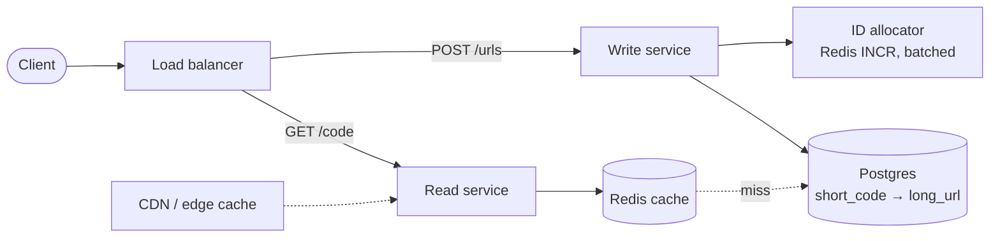
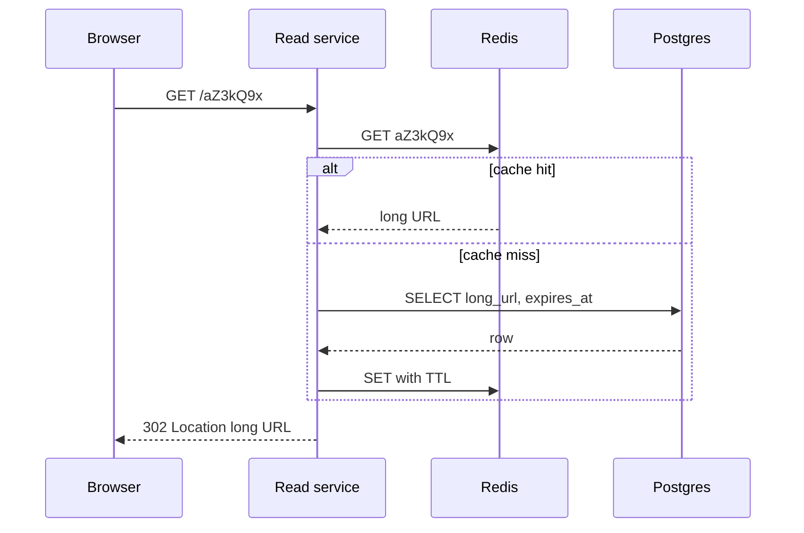

# Design a URL Shortener (Bit.ly)

## Requirements

**Functional**
1. Create a short URL from a long URL, optionally with a custom alias and an expiration time.
2. Visiting a short URL redirects to the original URL.

**Non-functional**
- **Uniqueness:** one short code never maps to two URLs.
- **Low latency:** redirects in under ~100 ms at p99, since they sit in front of every click.
- **Availability over consistency** for redirects: a brand-new link taking a second to work everywhere is fine; redirects failing is not.
- **Scale:** ~1B stored URLs, ~100M DAU, heavily read-skewed.

**Out of scope:** user accounts, rich analytics dashboards, spam/malware detection (mention them, then park them).

### Back-of-envelope estimates

| Quantity | Estimate | Why it matters |
|---|---|---|
| New URLs | ~1M/day ≈ 12 writes/s (peak ~100/s) | Writes are tiny; one primary DB handles them |
| Redirects | ~100M DAU × ~10 clicks ≈ 1B/day ≈ 12k reads/s (peak ~100k/s) | Reads dominate, so the design centers on caching |
| Storage | 1B rows × ~500 B ≈ 500 GB | Fits on one large Postgres node; sharding is optional |
| Code length | 62^7 ≈ 3.5 trillion | 7 base62 characters is plenty |

## Core entities

| Entity | Key fields | Notes |
|---|---|---|
| URL mapping | `short_code` (PK), `long_url`, `created_at`, `expires_at`, `user_id?` | Primary key lookups only, which suits any store |
| User | `user_id`, ... | Only needed for custom aliases or managing links |

## API

```
POST /urls
  body: { "longUrl": "https://...", "customAlias"?: "summer-sale", "expiresAt"?: "2026-12-31T00:00:00Z" }
  → 201 { "shortUrl": "https://sho.rt/aZ3kQ9x" }
  → 409 if customAlias is taken, 400 if longUrl is invalid

GET /{shortCode}
  → 302 Location: https://...        (found)
  → 404 (unknown)  |  410 (expired)
```

**302 vs 301:** a 301 (permanent) is cached by browsers, so later clicks never reach you. That breaks analytics, expiration and editing. Use 302 unless the interviewer explicitly wants minimum server load.

## High-level design



**Create flow**
1. The write service validates the URL (scheme, length, optionally a blocklist).
2. If there's a custom alias, insert it directly and rely on the primary key's uniqueness (409 on conflict).
3. Otherwise get the next unique integer from the ID allocator, base62-encode it, and insert the row.

**Redirect flow**
1. The read service looks up the code in Redis.
2. On a miss, it reads Postgres and fills the cache (with a TTL no later than `expires_at`).
3. It returns 302 to the long URL, or 404/410.



**Why split read and write services?** Their load differs by ~1000×, so they scale independently. The read path stays tiny and can be deployed close to users.

## Deep dives

### How do you generate unique short codes?

- **Weak: random 7 characters.** Collisions grow as the table fills, so every insert needs check-and-retry, and retries rise over time.
- **Okay: hash the long URL** (MD5/SHA-256, base62, first 7 characters). The same URL always gets the same code (free dedupe), but truncation causes collisions that need check-and-retry, and two users can't get separate links for the same URL.
- **Best: global counter + base62.** A Redis `INCR` returns a unique integer; encoding it gives a guaranteed-unique code with no retries.
  - **Remove the bottleneck:** each write server reserves a block of IDs (e.g. `INCRBY 1000`) and hands them out locally. Redis gets ~1/1000 of the traffic, and a Redis blip doesn't stop writes right away.
  - **Durability:** use Redis persistence (AOF) or a DB sequence as the fallback; if the counter ever goes backwards you'd mint duplicates, so on restart begin from max(id) + a safety gap.

#### How base62 encoding works

Base62 writes a number using 62 symbols, `0-9a-zA-Z` (digits are 0–9, `a` = 10 … `z` = 35, `A` = 36 … `Z` = 61), the same way decimal uses 10 symbols. Repeatedly divide by 62; the remainders are the digits, least significant first.

**Worked example: encode ID 1,000,000**

| Step | Division | Quotient | Remainder → symbol |
|---|---|---|---|
| 1 | 1,000,000 ÷ 62 | 16,129 | 2 → `2` |
| 2 | 16,129 ÷ 62 | 260 | 9 → `9` |
| 3 | 260 ÷ 62 | 4 | 12 → `c` |
| 4 | 4 ÷ 62 | 0 | 4 → `4` |

Read the remainders bottom-up: **`4c92`**. Check: 4×62³ + 12×62² + 9×62 + 2 = 953,312 + 46,128 + 558 + 2 = 1,000,000 ✓.

```
ALPHABET = "0123456789abcdefghijklmnopqrstuvwxyzABCDEFGHIJKLMNOPQRSTUVWXYZ"
def encode(n):
    s = ""
    while n > 0:
        n, r = divmod(n, 62)
        s = ALPHABET[r] + s
    return s.rjust(7, "0")     # fixed length 7
```

Why 7 characters: 62⁶ ≈ 57 billion and 62⁷ ≈ 3.5 trillion, so 7 characters cover 1B URLs with huge headroom. Base62 (not base64) avoids `+` and `/`, which are awkward in URLs.

#### Making codes unguessable

Sequential IDs give sequential codes (`…4c92`, `…4c93`), so anyone can enumerate every link. Scramble the integer with a **bijection** (a one-to-one mapping) on [0, 62⁷) before encoding. Because it's one-to-one, unique inputs still give unique outputs, so uniqueness is preserved.

- **Multiply by a constant mod 62⁷:** `scrambled = (id × P) mod 62⁷`, where P is coprime to 62⁷. Since 62⁷ = 2⁷ × 31⁷, P must be **odd and not divisible by 31**. Simple and fast, but the pattern is weak against a determined attacker.
- **A Feistel network** (a few rounds of a keyed hash over the two halves of the number) gives a properly shuffled, keyed permutation and is just as cheap.
- You never need to reverse it: the code → URL mapping is stored, so decoding is just a lookup.

#### Cache-aside on the read path

The read service follows the **cache-aside** pattern: read Redis first; on a miss, read the DB and write the result into Redis with a TTL. Only the hot links end up cached. Under memory pressure Redis evicts using **LRU** (least recently used), which suits the power-law click distribution. Writes don't need to touch the cache, because new links aren't hot yet.

### How do redirects stay fast at 100k reads/s?

- Traffic follows a power law: a small set of links gets most clicks. An LRU Redis cache of a few GB gives a 90%+ hit rate.
- Read replicas absorb cache misses; the primary only takes writes.
- Put a CDN or edge workers in front for the hottest links: a 302 from the edge saves the round trip to your region. Use a short cache TTL so expirations still take effect quickly.
- The read service is stateless, so scale it horizontally behind the load balancer.

### Expiration

- Check `expires_at` on every read (cache entries carry it too) and return 410.
- Set the Redis TTL to the smaller of the default TTL and the time remaining before expiry, so expired links fall out on their own.
- A nightly batch job deletes expired rows (or moves them to cold storage) to keep the table small.

### Scaling storage beyond one node

- At 500 GB a single Postgres primary with replicas is fine. If growth demands it, **shard by hash of `short_code`**: lookups always include the code, so each request hits exactly one shard and load spreads evenly.
- DynamoDB or Cassandra are equally good fits for a pure key-value pattern if you'd rather not manage sharding yourself.

## Production readiness

### Database choice and consistency

- **Postgres for mappings.** 500 GB and ~100 writes/s at peak fit one primary with read replicas, and Postgres gives you the one guarantee that actually matters: a `PRIMARY KEY` on `short_code` that makes custom-alias conflicts a clean 409 instead of a race. DynamoDB or Cassandra would also work (see "Scaling storage"); the reason not to start there is that a single relational node is simpler to operate and you'd want conditional-put semantics for aliases anyway. Pick the KV store if the team doesn't want to run sharding later.
- **ACID where it matters:** inserting a mapping (especially a custom alias) and editing a link's target must be atomic and unique. That's single-row, so you don't need multi-row transactions; a unique constraint is the ACID feature doing the work.
- **BASE where it's fine:** Redis cache, CDN copies, cross-region replicas and click analytics are all eventually consistent. A new link 404ing for a second far away is acceptable per the requirements.
- **CAP:** redirects are **AP**: during a partition, serve whatever the cache or replica has. Creation is **CP**: if the primary is unreachable, fail `POST /urls` rather than mint a code that might collide. The asymmetry matches the business: a failed click loses traffic for every customer whose links are in circulation; a failed create affects one user who can retry.
- **The ID allocator is the one place eventual consistency is dangerous.** As the follow-up notes, an async Redis failover can reissue a block. Allocating blocks from a Postgres sequence removes that risk at negligible cost (one call per 1,000 IDs).

### Service boundaries and communication

- **Read service** and **write service**, split for the ~1000× load difference (already covered). Don't split further: an "alias service" or "expiry service" adds hops to a 100 ms budget for no scaling gain. Expiry cleanup is a batch job, not a service.
- **Synchronous:** the redirect (cache → DB on miss) and the create (allocator → DB insert). Both are on the user's critical path and short.
- **Asynchronous:** click events to Kafka (fire-and-forget with a bounded in-process buffer), malware rescans of existing links, cache/CDN purge fan-out on delete or edit (retried until acked), and the nightly expiry job.

### Failure modes and reliability

| Failure | Effect | Mitigation |
|---|---|---|
| Redis cache cluster down | All 12k–100k reads/s hit Postgres replicas | Replicas sized to survive a cold cache for a while; in-process LRU on read servers for top keys; shed load (503 with `Retry-After`) on cold misses rather than let replicas collapse |
| Postgres primary fails | Creates fail; redirects unaffected | Automatic failover to a sync replica in another zone (~30 s); write service retries with backoff + jitter, idempotent on the allocated ID |
| Slow DB on cache miss | Redirect p99 blows the 100 ms budget | Read timeout ~50 ms and a circuit breaker around the DB; serve stale cached entry if present |
| Kafka unavailable | Click events can't be published | Bulkhead: the analytics producer has its own small buffer and drops events when full; redirects never block. Analytics loses data, users don't notice |
| Delete/edit purge fails at CDN | Removed phishing link keeps redirecting | Purge jobs retry with backoff; failures go to a DLQ that pages trust & safety; short CDN TTLs bound the damage |
| Viral link (1M req/s) | Hot Redis shard saturates | Edge cache with a few-seconds TTL plus in-process cache (see follow-up) |

### High availability and disaster recovery

- **SPOFs:** Postgres primary (sync replica + automatic failover), the ID allocator (block reservations ride out short outages; DB sequence is replicated with the DB), and the load balancer (managed, multi-zone).
- **Deployment:** read path in multiple regions with local Redis and async DB replicas, because redirects are latency-sensitive and global. Writes in one primary region across 3 zones; a whole-region write outage only stops link creation, which is acceptable for minutes.
- **Backups:** daily snapshots plus continuous WAL archiving, copied cross-region. 500 GB restores in well under an hour.
- **RPO/RTO:** mappings RPO **0** within the primary region (sync replica), because a lost row means a printed short link that 404s forever, which is the worst failure this product has. Cross-region RPO of seconds is acceptable for regional disaster. Redirect RTO under 1 minute (traffic shifts to another region); create RTO under 15 minutes.

### Security

- **Authn/authz:** anonymous creation is allowed but heavily rate-limited; API keys or OAuth for higher limits, custom aliases, editing and deletion. Only a link's owner (`user_id`) can edit or delete it.
- **Encryption:** TLS everywhere, including HSTS on the short domain so redirects can't be tampered with; encryption at rest for Postgres and backups. Long URLs can contain tokens in query strings (password-reset links, signed URLs), so treat `long_url` as sensitive and keep it out of application logs.
- **Secrets:** the Feistel key used to scramble codes lives in a secrets manager. Be careful rotating it: a new permutation can map a new ID onto a code the old key already issued. If it must rotate (say it leaked), let the `short_code` primary key catch collisions and retry with the next ID, or move new links to 8-character codes.
- **Audit:** log every edit and delete with actor and old target, since changing where a printed link points is a classic account-takeover payoff.
- **Abuse:** the main risk is phishing and malware links on your trusted domain (see follow-up). Add per-IP and per-key creation limits, rescans, and a fast takedown path that purges cache and CDN. Rate-limit 404s per IP to slow enumeration.

### Observability

- **SLIs/SLOs:** 99.95% of redirects return a correct 302/404/410 (not 5xx) over 30 days; 99% of redirects served within 50 ms at the server (the 100 ms p99 budget includes the network). 99.9% of creates succeed within 200 ms. A new link resolvable globally within 5 s for 99% of creates.
- **Dashboards:** redirect QPS, cache hit rate (target 90%+), DB replica load, 404 rate (spikes suggest enumeration or a replication lag bug), create rate per API key, Kafka producer drops.
- **Tracing:** sample redirects end to end (edge → read service → Redis → DB), and trace every cache miss above the latency budget.
- **Paging:** error-budget burn on redirect availability and latency. Cache hit rate dropping is a warning, not a page, unless the latency SLO burns.

### Performance and cost

- **Bottleneck:** redirect latency on cache misses. Keep a 90%+ hit rate with a few GB of LRU cache, pool DB connections from read servers (thousands of read-service instances opening raw connections would exhaust Postgres), and index only the primary key; `user_id` is a secondary index used only for the management UI.
- **Storage** is cheap: 500 GB, growing ~1M rows/day × 500 B ≈ 0.5 GB/day (~180 GB/year). Expiring and archiving old rows keeps it on one node longer.
- **Analytics is the real cost driver:** 1B clicks/day × ~200 B ≈ 200 GB/day of events, ~73 TB/year raw. Aggregate per code per minute in Flink and keep raw events only ~30 days; trade-off: you can't answer new per-click questions on old data.
- **Edge vs. origin:** serving hot 302s from the CDN cuts origin compute and cross-region latency but makes takedowns and expirations lag by the TTL. Keep the edge TTL short (seconds to a minute).
## Follow-up questions

### What happens if two users shorten the same long URL?
With the counter approach they get two different codes. That's usually what you want, because each link can have its own expiry and analytics. If dedupe is required, keep a secondary index on `hash(long_url)` and return the existing code, but only for anonymous links without custom settings.

### How would you add click analytics without slowing redirects?
Never write to a database on the redirect path. Emit a click event (code, timestamp, referrer, country from IP) to Kafka asynchronously and return the 302 right away. A stream processor (Flink) aggregates counts per code per minute into an OLAP store like ClickHouse for dashboards. This is also why you keep 302: a 301 would hide clicks.

### Your Redis counter's node dies. What happens?
Write servers keep handing out IDs from the blocks they already reserved, so writes continue briefly. Redis fails over to a replica, but async replication may have lost the last few `INCRBY`s, which could reissue a block. Guard against this: on failover, bump the counter well past the highest ID seen in the database, or allocate blocks from a DB sequence (a strongly consistent source) instead of Redis.

### How do you stop people abusing the service (phishing, spam)?
Rate-limit creation per IP and API key, and check URLs against Safe Browsing or blocklists at creation time and periodically afterwards. Let users report links, and serve a warning interstitial for flagged domains. Deleting a link must also purge it from the cache and CDN.

### A link goes viral and gets 1M requests/second. What breaks?
A single Redis key's shard becomes hot. Absorb it at the edge first: let the CDN cache that redirect for a few seconds. Inside, add an in-process LRU cache on read servers for the top keys, or replicate hot keys under suffixed names (`code#1..n`) and read one at random.

### How would you support editing where a short link points?
Update the row, then invalidate the cache key and purge the CDN. Clients that got a 302 aren't affected, but anyone who received a 301 would keep the old target forever, which is one more reason for 302. Keep an audit log of changes.

### How do you serve users globally with low latency?
Deploy read services and Redis replicas in several regions behind geo-DNS or anycast. Writes go to one primary region (they're rare and can tolerate ~100 ms more). Replicate the database asynchronously to read regions; a link created a moment ago may 404 briefly far away, so the read service can fall back to the primary region on a miss.

### Why not use the database's auto-increment instead of Redis?
You can. A Postgres sequence is durable and strictly unique, and at ~100 writes/s it's nowhere near a bottleneck. Redis earns its place only if writes grow a lot or you shard the database (sequences are per-shard). With block allocation, the sequence is called once per thousand IDs, which works even at very high scale.
