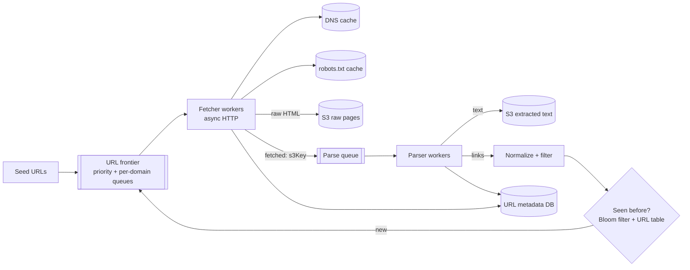
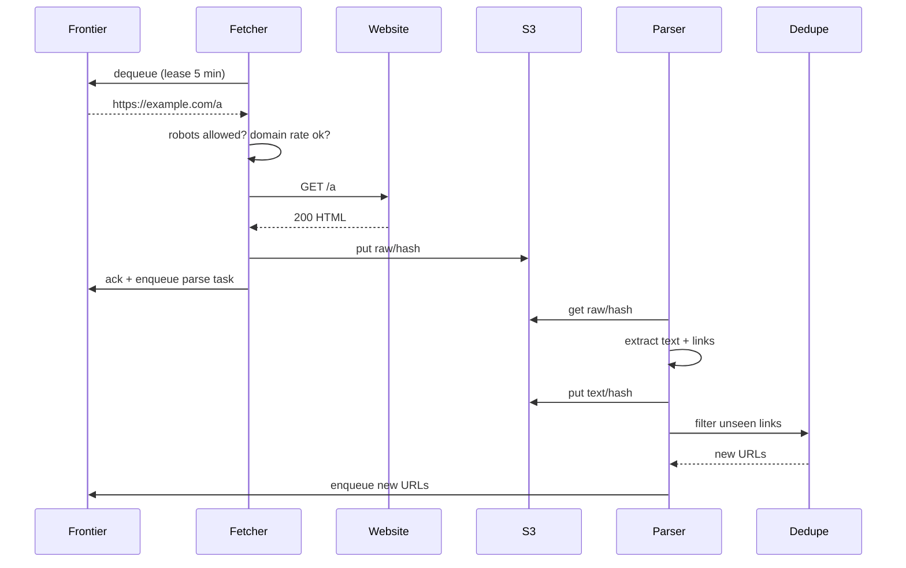

# Design a Web Crawler

## Requirements

**Functional**
1. Start from seed URLs, fetch pages, extract text and outgoing links.
2. Keep crawling newly discovered URLs.
3. Store page content for downstream use (a search index or LLM training data).

**Non-functional**
- **Politeness:** obey robots.txt and limit the request rate per domain.
- **Throughput:** crawl ~10B pages in ~5 days.
- **Fault tolerant:** crashes don't lose progress or cause large re-crawls.
- **Efficient:** avoid fetching the same URL twice and storing duplicate content.
- **Robust:** survive malformed HTML, slow servers and crawler traps.

**Out of scope:** JavaScript rendering for every page (mention it as an extension), indexing and ranking.

### Back-of-envelope estimates

| Quantity | Estimate | Implication |
|---|---|---|
| Fetch rate | 10B / (5 × 86,400 s) ≈ 23k pages/s | Hundreds of fetchers with async I/O |
| Bandwidth | 23k × ~100 KB ≈ 2.3 GB/s ≈ 18 Gbps | Spread across many machines and IPs |
| Raw storage | 10B × 100 KB ≈ 1 PB (compressed ~250 TB) | Object storage |
| URL frontier | Tens of billions of URLs discovered | A distributed durable queue, not memory |
| DNS | 23k lookups/s if uncached | A DNS cache is mandatory |

## Core entities

| Entity | Key fields | Notes |
|---|---|---|
| Frontier entry | `url`, `domain`, `priority`, `depth`, `attempts` | In the queue |
| URL record | `url_hash` (PK), `status`, `last_crawled`, `content_hash`, `s3_key` | DynamoDB/Cassandra; doubles as the seen-set |
| Domain record | `domain`, robots rules, crawl delay, `next_allowed_at` | Cached in fetchers |
| Page | raw HTML (S3), extracted text (S3) | Keyed by `url_hash` |

## API

There is no user-facing API; these are the internal contracts:

```
frontier.enqueue(url, priority)      frontier.dequeue(workerId) → url (leased)
fetcher.fetch(url)   → { status, headers, body } → S3 raw/{url_hash}
parser.parse(s3Key)  → { text → S3 text/{url_hash}, links[] }
dedupe.seen(url)     → bool
```

## High-level design





**Why separate fetching and parsing?** Fetching is network-bound (mostly waiting); parsing is CPU-bound. Separate fleets scale independently, and keeping raw HTML in S3 lets you re-parse with a better extractor without re-crawling.

## Deep dives

### Politeness

- Fetch robots.txt per domain (cached for ~24 h) and respect `Disallow` and `Crawl-delay`. Identify the crawler with a clear User-Agent and a contact URL.
- **Per-domain rate limiting:**
  - **Frontier design:** route URLs into queues by domain hash so each fetcher owns a set of domains, with a per-domain `next_allowed_at`. The fetcher only dequeues from domains whose time has come. All of a domain's requests go through one owner, so the limit is enforced locally without coordination.
  - **Alternative:** a shared Redis rate limiter keyed by domain, checked before each fetch, with URLs re-queued with a delay if it's too soon.
- Back off exponentially on 429/503 and slow responses; lower the rate for fragile sites.

### Throughput

- Async I/O (epoll, or an event loop in Go/Rust): one machine handles ~500–1,000 concurrent connections, so ~100–300 fetchers reach 23k pages/s.
- A local DNS cache (or a dedicated resolver fleet) removes a classic hidden bottleneck.
- Set timeouts on connect and read, and cap response size (e.g. 10 MB), so slow or huge pages don't tie up workers.

### Deduplication

- **URL-level:** normalize first (lowercase the host, remove default ports and fragments, sort query parameters, strip tracking parameters like `utm_*`), then check:
  - a **Bloom filter** (10B URLs at 1% false positives ≈ 12 GB, which fits in memory across a few nodes); a false positive just skips a URL, which is acceptable;
  - backed by the URL table for exactness where it matters.
- **Content-level:** hash the body (SHA-256) and skip parsing and storing exact duplicates (mirrors, `?session=` variants). Use **SimHash/MinHash** to detect near-duplicates such as boilerplate-heavy pages.

#### How a Bloom filter works

A Bloom filter answers "have I seen this URL?" using a fraction of the memory of a hash set, at the cost of occasional false "yes" answers.

- It's a **bit array of m bits**, all 0 at first, plus **k independent hash functions**.
- **Add(url):** compute the k hashes and set those k bit positions to 1.
- **MightContain(url):** compute the same k positions. If **any bit is 0**, the URL was **definitely never added**. If all are 1, it was **probably** added: other URLs may have set those bits (a false positive).
- There are **no false negatives**, and you can't delete (clearing a bit could erase other entries; a counting Bloom filter supports deletes at 4× the memory).

**Worked sizing for 10B URLs:**

| Target false-positive rate p | Bits per URL (m/n = −ln p / (ln 2)²) | Total memory | Best number of hashes k = (m/n) × ln 2 |
|---|---|---|---|
| 1% | 9.6 | ~12 GB | 7 |
| 0.1% | 14.4 | ~18 GB | 10 |

A hash set of 10B URLs (avg ~80 bytes plus overhead) would need roughly a terabyte, so the Bloom filter is ~50–100× smaller. For a crawler, a false positive just means **skipping a URL we never crawled**, which is acceptable at 1%; a false negative (re-crawling) never happens.

#### How SimHash finds near-duplicate pages

Exact hashes treat two pages that differ only in a timestamp or ad as completely different. **SimHash** produces a 64-bit fingerprint where *similar documents get fingerprints that differ in only a few bits*:

1. Split the page text into features (words or shingles) and hash each to 64 bits.
2. For each bit position, add the feature's weight if that bit is 1, subtract it if 0.
3. The final fingerprint has bit i = 1 where the sum is positive.

Pages whose fingerprints differ in **≤ 3 bits** (Hamming distance) are treated as near-duplicates. Google described using exactly this for web crawling. To find matches quickly among billions of fingerprints, index them by blocks of bits, so candidates share at least one exact block.

### Fault tolerance

- The frontier is durable (Kafka, or SQS with visibility timeouts). Workers **lease** a URL and ack only after its result is in S3, so a crash means the lease expires and another worker retries.
- Count attempts per URL; after N failures send it to a **dead-letter queue** for inspection rather than retrying forever.
- Writes are idempotent (keyed by `url_hash`), so retries never corrupt state.

### Priority, freshness and traps

- **Priority:** score URLs by domain importance (PageRank-like), depth and link count; the frontier has multiple priority levels, and fetchers favor higher ones.
- **Freshness:** re-crawl pages based on how often they changed historically (news homepages hourly, static docs monthly); use `If-Modified-Since` and ETags to save bandwidth.
- **Traps:** cap URL length, path depth and pages per domain; detect repeating path patterns (calendar loops `/2026/11/2026/11/...`) and auto-generated infinite pages.

## Production readiness

### Database choice and consistency

- **URL table: DynamoDB/Cassandra.** Tens of billions of rows, random-access writes keyed by `url_hash`, no joins, and every access is a point lookup or upsert. A relational DB would need heavy manual sharding to take ~23k status updates/s plus link-discovery checks (several times that, since each page yields many links), and gives you nothing in return. A wide-column/KV store partitions on `url_hash` naturally.
- **S3 for pages:** ~250 TB compressed of immutable blobs is exactly what object storage is for. Never put page bodies in the URL table.
- **Frontier: a durable queue (Kafka or SQS),** not a database table. Polling a table for "next URL for a domain whose time has come" at 23k/s is a classic way to build a hot index.
- **No ACID needed.** Everything is idempotent by `url_hash`: refetching a page overwrites the same S3 key; re-inserting a seen URL is a no-op. The cost of inconsistency is a duplicate fetch or a skipped URL, both cheap. That's why BASE is the right choice throughout.
- **CAP: AP everywhere.** If a URL-table partition is unreachable, it's better to keep crawling and occasionally re-fetch a page than to stall 300 fetchers. The one thing to keep strongly consistent per domain is the rate limit, and the frontier design gets that by giving each domain a single owner, not by distributed consensus.

### Service boundaries and communication

- **Frontier, fetchers, parsers, dedupe** are split because they're bound by different resources: queue I/O, network, CPU, and memory (Bloom filter). The fetch/parse split is explained above.
- **Robots and DNS caches** are libraries/sidecars inside fetchers, not remote services, because they're consulted on every fetch and a remote hop would add latency and a failure point.
- **Everything is asynchronous.** There's no user waiting, so every hand-off is a queue: frontier → fetcher → parse queue → parser → dedupe → frontier. Queues absorb rate mismatches (e.g. parsers falling behind for an hour) and give you leases and retries for free. The only synchronous calls are the external HTTP fetch, DNS, and the dedupe lookup from parsers, which is synchronous because the parser needs the answer before enqueueing.

### Failure modes and reliability

| Failure | Effect | Mitigation |
|---|---|---|
| Target site slow or hanging | Fetcher connections tied up | Connect timeout ~5 s, read timeout ~30 s, 10 MB size cap; per-domain concurrency limit as a bulkhead so one slow site can't consume a fetcher's connection pool |
| Site returning 5xx/429 | Wasted fetches, angry site owner | Per-domain exponential backoff with jitter and a circuit breaker (see follow-up); honor `Retry-After` |
| Fetcher crashes mid-batch | Leased URLs not acked | Lease expiry (5 min) returns them to the frontier; idempotent S3 writes |
| Poison page crashes the parser (malformed HTML, zip bomb) | Parse task retried forever | Attempt count; after N failures route to a DLQ; parse in a sandboxed process with memory/CPU limits |
| DNS resolver overloaded | Fetch rate collapses globally | Local cache with long TTLs, dedicated resolver fleet, negative caching for NXDOMAIN |
| Parsers fall behind | Parse queue grows, S3 raw grows unparsed | Autoscale parsers on queue lag; if still behind, pause low-priority domains in the frontier (load shedding at the source) |

### High availability and disaster recovery

- **This is a batch system, so "availability" means throughput and progress, not uptime.** Losing a zone should slow the crawl, not lose it.
- **SPOFs:** the frontier (replicated Kafka/SQS across zones), the URL table (replication factor 3 across zones), and the Bloom filter (sharded in memory; rebuildable from the URL table, and snapshot it to S3 every hour so a restart doesn't need a full rebuild).
- **Single region with multi-zone** is the default. Multi-region crawling is for latency to far-away sites (see follow-up), not for DR.
- **Backups:** S3 is already durable; enable versioning or cross-region replication only for the extracted text and metadata that downstream training depends on. Raw HTML can be re-crawled.
- **RPO/RTO:** frontier and URL table RPO of minutes is fine: re-crawling a few minutes of pages (~23k/s × 300 s ≈ 7M pages) costs well under 1% of a 10B crawl. RTO a few hours; a 5-day crawl that pauses for 2 hours finishes ~2% late.

### Security

- **We are the client, so security is about what we fetch.** Treat every page as hostile: parse in sandboxes, cap decompression ratios, never execute fetched JS outside the isolated rendering fleet.
- **SSRF:** a discovered link like `http://169.254.169.254/` or an internal hostname must never be fetched. Block private IP ranges after DNS resolution (not just by hostname, to stop DNS-rebinding), and run fetchers in a network segment with no route to internal services.
- **Authz:** fetchers can write to `raw/` but not delete; only the curation pipeline reads `text/`. Encrypt buckets at rest; TLS for internal traffic.
- **PII and legal:** crawled pages contain personal data. PII scrubbing in the text pipeline, a takedown process that deletes by `url_hash` across raw, text and derived datasets, and an audit log of takedowns and dataset builds.
- **Abuse by us:** the politeness rules are also our reputation. Publish IP ranges and a contact URL, and alert if any domain exceeds its rate limit.

### Observability

- **SLIs/SLOs:** sustained fetch rate ≥ 23k pages/s averaged per hour (otherwise the 5-day target slips); fewer than 0.1% of fetches violate a domain's crawl delay; 99% of fetched pages parsed and stored within 1 hour; frontier progress on track to finish 10B within 5 days.
- **Dashboards:** pages/s, bytes/s, HTTP status mix, per-domain error rates, frontier depth per priority level, parse queue lag, DLQ size, Bloom filter fill ratio (false-positive rate rises as it fills), duplicate-content ratio.
- **Tracing:** full traces aren't useful at 23k/s; instead keep a per-URL event log (`dequeued`, `fetched`, `parsed`, attempts) in the URL record, and sample traces for debugging.
- **Paging:** projected completion time slipping past the deadline, politeness violations, and abuse complaints. A single fetcher dying is not a page.

### Performance and cost

- **Bottleneck:** per the follow-up, the frontier/URL-table metadata and DNS, not bandwidth. Batch URL-table writes and dedupe lookups (parsers check a page's 50–100 links in one batched call), keep the domain-owned frontier so lookups stay local, and reuse HTTP connections to the same host.
- **Bandwidth:** 18 Gbps for 5 days ≈ 1 PB transferred. Ingress is often free or cheap in clouds, but NAT gateways and inter-zone hops can charge per GB, so route fetchers straight to the internet and keep S3 writes in-zone where possible. Conditional GETs on re-crawls avoid re-downloading unchanged pages.
- **Storage:** ~250 TB compressed per crawl. Content-hash dedupe drops exact copies before storage; move raw HTML older than one crawl cycle to an archive tier. Trade-off: re-parsing old crawls gets slower and costs retrieval fees.
- **Compute:** JS rendering at 10–100× cost per page is the biggest lever; render only pages that need it.

## Follow-up questions

### How do you crawl JavaScript-heavy sites?
Detect pages whose meaningful content needs JS (an empty body with large script bundles). Send only those to a separate headless-browser rendering fleet (Chromium), which is ~10–100× more expensive per page, with its own priority and rate limits.

### How do you decide when to re-crawl a page?
Estimate each page's change rate from past crawls (did the content hash change?) and schedule the next crawl proportional to it, weighted by importance. Conditional GETs (`If-None-Match`) make unchanged re-crawls cheap.

### A website starts returning 500s for all pages. What happens?
Retries back off exponentially per domain, and a per-domain circuit breaker pauses that domain for a while once errors exceed a threshold, so URLs aren't burned through attempt limits. It resumes with a slow probe.

### How would you distribute the crawl across regions?
Assign domains to regions by geography (crawl European sites from Europe for latency), using a consistent hash on domain to pick the owner. Each region runs its own frontier partition and fetchers; dedupe stays global through the shared URL table, or a periodic Bloom filter sync.

### How do you store and use the output for an LLM training dataset?
Keep raw WARC files in S3 for provenance; extracted text goes through quality filters (language ID, boilerplate removal, toxicity, PII scrubbing) and dedupe (MinHash across the corpus), then lands as sharded Parquet or JSONL with metadata (URL, crawl date, license signals).

### How does the frontier avoid one giant domain starving everything else?
Per-domain queues plus round-robin across domains within each priority level, with per-domain rate limits capping any single site's share. A domain with millions of URLs simply drains slowly.

### What's the hardest scaling bottleneck in practice?
Usually the frontier and dedupe metadata (tens of billions of URLs with random-access writes) and DNS, more than raw bandwidth. Partitioning by domain hash keeps both local to the worker that owns the domain.

### How do you respect sites that don't want to be crawled beyond robots.txt?
Honor `noindex`/`nofollow` meta tags and the `X-Robots-Tag` header, AI-specific opt-out signals where relevant, and takedown requests; keep a blocklist; publish crawler IP ranges and a contact page so site owners can reach you.
