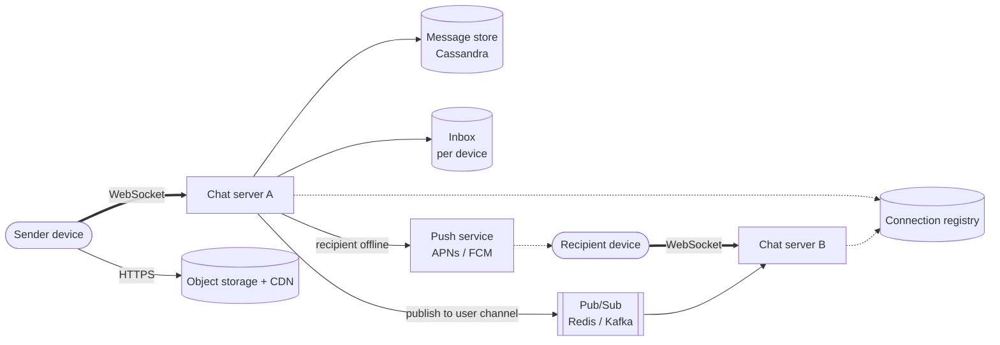
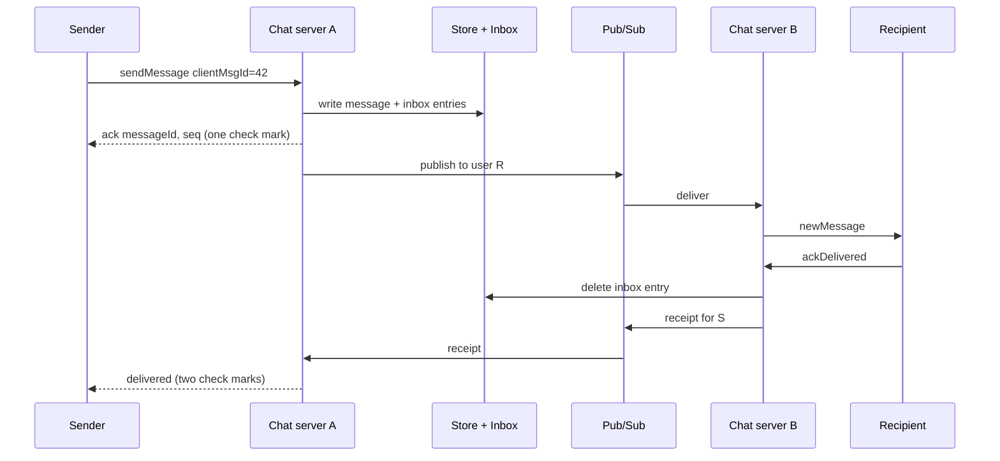

# Design a Chat App (WhatsApp / Messenger)

## Requirements

**Functional**
1. Send and receive 1:1 messages in real time.
2. Group chats (up to ~100 members, but design so this can grow).
3. Messages to offline users are delivered when they come back online.
4. Sent / delivered / read receipts.
5. Media attachments (images, video, documents).

**Non-functional**
- **Low latency:** under ~500 ms delivery when both users are online.
- **Guaranteed delivery:** a message the server has acknowledged is never lost.
- **Ordering:** messages appear in the same order for everyone in a chat.
- **Scale:** ~2B users, ~100B messages/day, ~200M concurrent connections.
- **Minimal storage:** messages kept on the server only until delivered (WhatsApp's model), or ~30 days (alternative).

**Out of scope:** end-to-end encryption internals (mention it), voice/video calls, stories.

### Back-of-envelope estimates

| Quantity | Estimate | Implication |
|---|---|---|
| Messages | 100B/day ≈ 1.2M/s (peak ~3M/s) | Needs a write-optimized, partitioned store |
| Connections | 200M concurrent; ~1M per tuned server | ~200–400 chat servers |
| Message size | ~100 B text + metadata | ~10 TB/day if retained, so delete after delivery |
| Media | Separate blob path | Never send media bytes through chat servers |

## Core entities

| Entity | Key fields | Store |
|---|---|---|
| User / Device | `user_id`, `device_id`, push token | Users DB |
| Chat | `chat_id`, type (direct / group), `participants` | Chat DB |
| Message | `chat_id`, `seq` (per-chat sequence), `message_id`, `sender_id`, `body` or `media_id`, `ts` | Cassandra: partition `chat_id`, cluster `seq` |
| Inbox | `device_id` → pending `message_id`s | Cassandra / Redis: partition `device_id` |
| Connection | `user_id`/`device_id` → chat server | Redis registry with a TTL |

## API

A persistent **WebSocket** per device; commands are frames:

```
→ sendMessage   { chatId, clientMsgId, body | mediaId }
← ack           { clientMsgId, messageId, seq, ts }          (persisted, so safe to show one check mark)
← newMessage    { chatId, messageId, seq, senderId, body, ts }
→ ackDelivered  { messageIds }                                 (sender sees two check marks)
→ markRead      { chatId, uptoSeq }                            (sender sees blue check marks)
→ createChat    { participants } → { chatId }
```

Media goes over HTTPS: `POST /media` → presigned upload URL → the client uploads to object storage → the message carries `mediaId`.

## High-level design





**Offline recipient:** the inbox entry remains, and a push notification is sent. On reconnect, the device syncs: "give me everything in my inbox", then acks it.

## Deep dives

### Why WebSockets? Comparing real-time options

| Option | How it works | Fit for chat |
|---|---|---|
| Short polling | Client asks "anything new?" every few seconds | Wasteful (most responses are empty) and adds up to the poll interval in latency |
| Long polling | Server holds the request open until there's data or a timeout, then the client reconnects | Works through any proxy; reconnect overhead after every message; awkward for sending |
| Server-Sent Events | One long-lived HTTP response streaming server → client events | Great for one-way feeds (live comments, notifications); the client still needs separate requests to send |
| **WebSocket** | HTTP connection upgraded to a persistent, full-duplex TCP channel | Both directions on one connection with tiny per-message overhead: the right fit for chat |

A WebSocket starts as an HTTP request with `Upgrade: websocket`; the server answers `101 Switching Protocols`, and from then on both sides send framed messages over the same TCP connection. The costs: servers become **stateful** (each holds open connections), load balancers must support long-lived connections (L4, or L7 with WebSocket support), and clients need reconnect logic.

**Keeping connections healthy:** clients send a heartbeat (ping) every ~30 s. That keeps NAT and proxy mappings alive, lets the server detect dead clients (no ping in ~60 s means close the socket and mark the device offline), and doubles as the presence signal.

### Routing messages between chat servers

- Each device's socket lives on exactly one chat server, so the sender's server must find it.
- **Option A: connection registry + direct RPC.** Redis maps device → server (with a TTL refreshed by heartbeats); server A calls server B. Simple, but you must handle stale entries.
- **Option B: pub/sub.** Each server subscribes to channels for its connected users; senders publish to the recipient's channel. With Redis pub/sub (at-most-once), the **inbox stays the source of truth**, so a missed publish is caught by the next sync.
- Use L4 load balancing for sockets and drain servers gracefully during deploys (clients reconnect elsewhere and resync).

### Delivery guarantees, ordering and idempotency

- **Persist before acking:** the server acks the sender only after the message and inbox entries are durable. The client retries until it gets an ack.
- **Idempotency:** dedupe on (`sender_device`, `clientMsgId`) so retries don't create duplicates.
- **Ordering:** a **per-chat sequence number** assigned at write time. Clients display by `seq` and request missing ranges when they see a gap.
  - **Why not timestamps?** Two servers' clocks differ by milliseconds or more, so two messages sent almost together could be ordered differently on different devices.
  - **How to assign `seq`:** an atomic counter per chat (`INCR chat:{id}:seq` in Redis, or a conditional update on a `chats.last_seq` row), or route every write for a chat through **one owner**: a Kafka partition keyed by `chat_id`, so one consumer assigns sequence numbers in arrival order.
  - **Gap detection:** a client holding seq 1–41 that receives 43 knows 42 is missing and asks for it (`sync chatId from 41`) before displaying 43.
- The result is at-least-once delivery from server to device, made effectively exactly-once by client-side dedupe on `message_id`.

### Group chats

- **Small groups (≤ ~100–1,000):** fan out on write: one message row, plus an inbox entry per member device, plus a publish per online member. The amplification is bounded.
- **Huge channels:** store each message once and keep **per-member read cursors**; members pull ranges by `seq`. Push a lightweight "new activity" signal instead of the full message.

### Multiple devices per user

- Store an inbox per device; every device acks independently. A message is deleted from the server once all of the recipient's devices (and the sender's other devices, for sync) have acked, or after a retention TTL.

### Presence and typing indicators

- Heartbeats over the socket refresh `presence:{user}` in Redis with a ~30 s TTL; "last seen" is written on disconnect.
- Don't broadcast presence to all contacts. Push presence and typing events only to users who currently have that chat open (subscribe when a chat opens, unsubscribe when it closes). Typing indicators are fire-and-forget, never persisted.

### Media

- Upload directly to object storage with a presigned URL (client-side encrypted in an E2EE design); the message references `mediaId`. Recipients download through the CDN. Generate thumbnails asynchronously.

## Production readiness

### Database choice and consistency

- **Messages and inboxes: Cassandra/ScyllaDB** (see the follow-up for why). The extra point here is the delete pattern: in the delete-after-delivery model nearly every inbox row is written and then deleted within seconds, which in an LSM store means tombstones. Use TTLs on inbox rows plus a time-window compaction strategy, or keep hot inbox entries in Redis with a Cassandra backstop, otherwise reads slow down as tombstones pile up.
- **Users, devices, chat membership: a relational DB** (or a strongly consistent KV store). It's small next to messages, needs uniqueness (one account per phone number) and atomic membership changes (add/remove a group member and bump the group's version together). Rejected for messages because 1.2M writes/s with no joins is not what a relational DB is good at.
- **Connection registry and presence: Redis with TTLs.** Pure soft state, rebuilt by heartbeats.
- **ACID vs BASE:** a single message write must be durable and acknowledged at `QUORUM`/`LOCAL_QUORUM` before the sender sees one check mark; that's the "acked is never lost" guarantee. The per-chat `seq` must be assigned by a single owner (atomic counter or one partition per chat). Everything else is BASE: receipts, presence, typing, "last seen" can be late or lost.
- **CAP:** message persistence is **CP per chat**: if a quorum isn't reachable, don't ack; the client retries. Delivery, presence and receipts are **AP**. The business reason: a phantom check mark on a lost message destroys trust; a late blue tick doesn't.

### Service boundaries and communication

- **Chat servers** (stateful, hold sockets) are separate from **storage** and **push** so you can deploy and drain chat servers without touching data. **Group service** owns membership; **media service** only issues presigned URLs; **key server** for E2EE pre-keys.
- **Don't split per feature on the socket path:** receipts, typing and messages share one connection and one server process; extra hops would eat the 500 ms budget.
- **Synchronous:** sender → chat server → durable write → ack (the client must know it's safe). **Asynchronous:** fan-out to recipients via pub/sub, push notifications, receipts, thumbnail generation, and large-group fan-out, which runs from a queue so a 1,000-member group doesn't hold up the sender's ack.

### Failure modes and reliability

| Failure | Effect | Mitigation |
|---|---|---|
| Chat server crash (1M sockets) | Mass reconnect storm | Clients reconnect with exponential backoff + jitter (see follow-up); LB admission control limits new handshakes per second per server |
| Cassandra replica slow | Sender ack latency rises | Write timeout ~200 ms with speculative retry; idempotent on (`sender_device`, `clientMsgId`) so client retries are safe |
| Pub/sub drops a message (Redis at-most-once) | Recipient doesn't see it live | Inbox is the source of truth; client sync on reconnect and on `seq` gap detection catches it |
| APNs/FCM degraded | Offline users not notified | Circuit breaker per provider, retry with backoff, coalesce pushes per device; messages wait safely in inbox |
| Large-group fan-out spike | Fan-out workers lag, 1:1 latency suffers | Bulkhead: separate worker pools and queues for group fan-out vs 1:1 delivery; shed typing/presence events first under load |
| Region-wide New Year's spike (3M/s) | Storage write saturation | Graceful degradation: delay read receipts and presence, keep message persistence; autoscale chat servers ahead of known peaks |

### High availability and disaster recovery

- **SPOFs:** the per-chat sequence owner (if a single Redis counter, losing it stalls that chat's sends; use a replicated counter or derive `seq` from a conditional write in the store), and the connection registry (replicated Redis; worst case, fall back to pub/sub broadcast or push).
- **Replication:** Cassandra RF=3 across zones in each region with `LOCAL_QUORUM`; asynchronous replication to a second region.
- **Multi-region:** users are homed in a region near them. Cross-region chats write to the chat's home region; that adds latency for some pairs but keeps ordering simple.
- **RPO/RTO:** zone failure: RPO 0 for acked messages (quorum spans zones), RTO seconds as clients reconnect. Region failure: RPO of a few seconds for undelivered messages (async replication), RTO ~10–15 minutes. Justification: under the delete-after-delivery model, the server holds only undelivered messages, so the damage window is small, and senders still have their copy and can resend.
- **Backups:** in the WhatsApp model, the server deliberately doesn't keep long-term history, so backups cover users, groups and keys; message history backup is the client's job.

### Security

- **Authn:** phone number verification issues a device credential; each socket authenticates with it. Every device has its own identity key for E2EE.
- **Authz:** the server checks the sender is a current member of `chat_id` before accepting a message and before fan-out; membership changes are audit-logged.
- **Encryption:** E2EE for content (follow-up), TLS on sockets, encryption at rest for inboxes and media even though they're ciphertext, since metadata (who talks to whom, when) is itself sensitive.
- **Key handling:** the server stores only public identity and pre-keys; clients alert when a contact's identity key changes. Server-side secrets (push credentials, DB creds) rotate through a secrets manager.
- **PII:** phone numbers and contact graphs. Minimize metadata retention; delete inbox rows on delivery.
- **Abuse:** rate-limit sends per account, especially new ones; cap forwards; throttle group creation and adds of non-contacts (see follow-up).

### Observability

- **SLIs/SLOs:** 99.9% of messages acked to the sender within 300 ms; 99% delivered to an online recipient within 500 ms, measured by recipient-side ack timestamps; zero acked messages lost (a reconciliation job samples inboxes against sender acks); 99.95% socket connect success.
- **Dashboards:** messages/s, active sockets per server, reconnect rate, inbox backlog age (oldest undelivered message for online devices is a strong symptom), pub/sub lag, push success rate per provider, Cassandra write latency per zone.
- **Tracing:** sample message lifecycles by `message_id` (ack → publish → deliver → receipt), carrying no content.
- **Paging:** burn rate on ack latency and delivery latency, and reconnect-rate spikes. A single node failure is not a page.

### Performance and cost

- **Bottleneck:** storage write throughput: each 1:1 message is a message write, an inbox write and an inbox delete, so ~3× the 1.2M msg/s, ~3.6M ops/s average and ~9M at the 3M/s peak, before group fan-out. Batch inbox deletes from `ackDelivered`. In the delete-after-delivery model, store the body directly in the device inbox row for 1:1 chats, which drops one write per message; the trade-off is that groups would copy the body once per member device, so keep the shared message row there.
- **Connections:** ~1M sockets per tuned server, ~200–400 servers; memory per connection is the lever (small buffers, TLS session reuse). Fewer, bigger servers are cheaper but each crash disconnects more users.
- **Storage:** delete-after-delivery keeps the store tiny. The 30-day alternative is 10 TB/day × 30 ≈ 300 TB, ~900 TB at RF=3, which is the cost of offering server-side history.
- **Media** dominates bytes: dedupe forwarded media by content hash (only possible without per-recipient encryption, so it's a privacy trade-off), compress on the client, and expire media after delivery.

## Follow-up questions

### How does end-to-end encryption change the design?
The server routes opaque ciphertext and can't read or search messages. Clients exchange keys (the Signal protocol: identity keys, signed pre-keys, one-time pre-keys fetched from a key server). Groups use sender keys. The server still handles routing, inboxes and receipts, but features like server-side search or moderation of content become impossible.

### A chat server crashes with 1M connected users. What happens?
Clients detect the dropped socket, reconnect with backoff (jittered to avoid a thundering herd) to other servers, update the registry, and sync their inbox from their last seen sequence number. No acked message is lost because inboxes are durable. In-flight unacked sends are retried by the sender.

### How do you guarantee ordering when two people send at the same time in a group?
Assign the sequence number at a single point per chat, e.g. a conditional counter increment in the store or routing all writes for a chat through one owner partition (a Kafka partition keyed by `chat_id`). Everyone then displays by `seq`, so they all see the same order.

### How do you sync history to a newly linked device?
Either the primary device sends an encrypted history bundle (WhatsApp's approach under E2EE), or, if the server retains messages, the new device pages through each chat by `seq` from the message store. Afterwards it joins the normal per-device inbox flow.

### How would you implement read receipts in large groups efficiently?
Don't send a receipt per message per member. Clients send "read up to seq N" per chat; the server stores a per-member cursor and the sender's UI aggregates on demand ("read by 12"). Batch updates and debounce.

### What database would you use for messages and why?
Cassandra or ScyllaDB (HBase is what Facebook Messenger historically used): a very high write rate, partitioned by `chat_id` with messages clustered by `seq` for efficient range reads, TTL support for retention, and multi-datacenter replication. Strong cross-row transactions aren't needed.

### How do push notifications work when the app is closed?
If the recipient has no live socket (registry miss), the chat server sends a push through APNs or FCM with minimal content (or an encrypted payload that the app decrypts in a notification extension). Tapping it opens the app, which connects and syncs the inbox.

### How do you handle spam and abuse with E2EE?
Use metadata signals rather than content: sending rate, number of new contacts, forward counts, and user reports (reported messages are sent by the reporter for review). Rate-limit new accounts and cap message forwarding.
