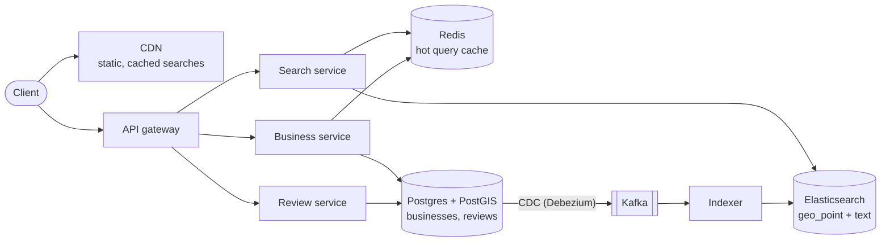
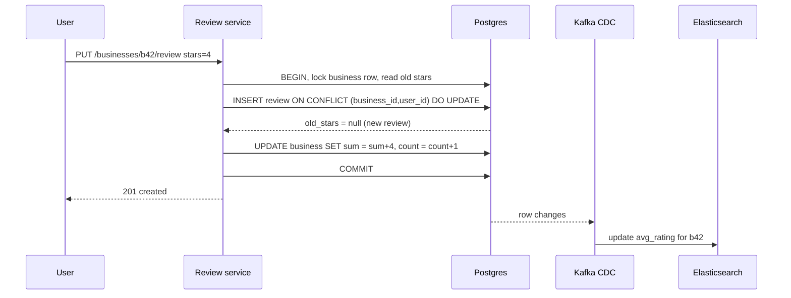

# Design Yelp / Proximity Service

## Requirements

**Functional**
1. Search businesses near a location (or within a map viewport), filtered by name/keyword and category, sorted by distance, rating or relevance.
2. View a business's details, its average rating, and a paginated list of reviews.
3. Leave a review (1–5 stars plus text); each user may have at most one review per business, which they can edit.

**Non-functional**
- **Fast search:** p99 under 500 ms end to end.
- **Read-heavy:** ~100 searches and views per review written.
- **Average rating consistency:** a business's displayed average reflects a new review within seconds and never drifts from the true value.
- **Highly available** for search and viewing; eventual consistency of a few seconds is fine for search results.
- **Scale:** ~10M businesses, ~100M DAU, ~1B reviews total.

**Out of scope**
- Ads, reservations, photo storage details, spam/fake review detection beyond a mention.

### Back-of-envelope estimates

| Quantity | Estimate | Implication |
|---|---|---|
| Searches | 100M DAU × 5 = 500M/day ≈ 5.8k/s average, ~3× at peak ≈ 17k/s | Search tier must scale horizontally and cache hot areas |
| Review writes | 1M/day ≈ 12/s | Writes are tiny; a single relational primary handles them |
| Business data | 10M × ~1 KB = 10 GB | Fits on one DB node; geo index fits in memory |
| Geo index | 10M × (ID 8 B + lat 8 B + lng 8 B) ≈ 240 MB | A quadtree or geohash index can live in RAM on every search node |
| Reviews | 1B × ~1 KB ≈ 1 TB | Partition reviews by `business_id` |

## Core entities

| Entity | Key fields | Store/Notes |
|---|---|---|
| Business | `business_id` (PK), name, category, address, `location` (lat, lng), `geohash`, `rating_sum`, `rating_count`, hours | Postgres + PostGIS; denormalized rating fields; replicated to Elasticsearch |
| Review | `review_id` (PK), `business_id`, `user_id`, `stars`, text, `created_at`, `updated_at` | Postgres partitioned by `business_id`; `UNIQUE (business_id, user_id)` |
| User | `user_id` (PK), name, review count | Postgres |
| Search document | `business_id`, name, categories, `geo_point`, `avg_rating`, `rating_count` | Elasticsearch index, fed by CDC |

## API

```
GET  /v1/businesses/search?lat=&lng=&radius_m=2000&q=pizza&category=&sort=distance|rating&cursor=
     → 200 { results: [{ businessId, name, distanceM, avgRating, ratingCount }], nextCursor }
GET  /v1/businesses/{id}
     → 200 { business, avgRating, ratingCount }
GET  /v1/businesses/{id}/reviews?sort=newest&cursor=
     → 200 { reviews: [...], nextCursor }
PUT  /v1/businesses/{id}/review          { stars: 4, text: "..." }
     → 201 created | 200 updated | 400 stars out of range | 401
DELETE /v1/businesses/{id}/review        → 204
```

Notes:
- The reviewer is taken from the auth token. Using `PUT` on `/businesses/{id}/review` (singular) models "one review per user per business": repeating the call updates instead of duplicating.
- Cursor pagination for reviews (`(created_at, review_id)` of the last item) stays stable as new reviews arrive, unlike offsets.
- Radius is capped (e.g. 50 km) so a single query can't scan a continent.

## High-level design



1. **Search:** the search service builds one Elasticsearch query combining a `geo_distance` filter, a text match on name/categories, and a category filter, then sorts by distance or a blended score. Popular (rounded location, query) pairs are cached in Redis for ~60 s.
2. **View:** the business service reads the business row (with its stored `rating_sum`/`rating_count`) from a cache or a read replica, and the first page of reviews by `business_id`.
3. **Write a review:** the review service upserts the review and updates the business's rating aggregate in one Postgres transaction. CDC carries the change to Elasticsearch within seconds.



## Deep dives

### Geospatial search, explained

**The problem:** "pizza within 2 km of (37.7955, −122.3937)". A B-tree on `lat` returns a band around the whole planet; you still scan every longitude. You need an index where nearby points are close together.

#### How geohash works

A geohash interleaves longitude and latitude bits by repeatedly halving the range, then writes each 5 bits as a base32 character (`0123456789bcdefghjkmnpqrstuvwxyz`). Encoding the Ferry Building, San Francisco (37.7955, −122.3937):

| Bit | Axis | Range | Midpoint | Value ≥ mid? | Bit |
|---|---|---|---|---|---|
| 1 | lng | [−180, 180] | 0 | −122.39 < 0 | 0 |
| 2 | lat | [−90, 90] | 0 | 37.80 ≥ 0 | 1 |
| 3 | lng | [−180, 0] | −90 | −122.39 < −90 | 0 |
| 4 | lat | [0, 90] | 45 | 37.80 < 45 | 0 |
| 5 | lng | [−180, −90] | −135 | −122.39 ≥ −135 | 1 |

Bits `01001` = 9, which is base32 character `9`. Continuing gives `9q8znb7`. Every point whose geohash starts with `9q8zn` is in the same ~4.9 km × 4.9 km cell.

| Length | Cell size (approx.) | Use |
|---|---|---|
| 4 | 39 km × 20 km | City-wide search |
| 5 | 4.9 km × 4.9 km | ~2–5 km radius |
| 6 | 1.2 km × 0.6 km | ~500 m radius |

**Query:** pick the length whose cell is at least the radius, compute the target cell and its 8 neighbors (points near a border share no prefix with the cell next door), fetch businesses in those 9 cells with prefix range scans, then compute exact distances and drop those beyond the radius.

```sql
SELECT business_id, lat, lng FROM business
WHERE geohash5 IN ('9q8zn', '9q8zj', '9q8zp', ...);   -- 9 cells, then filter by distance in app
```

#### How a quadtree works

Start with one node covering the world. When a node holds more than N businesses (say 100), split it into four children (NW, NE, SW, SE) and push its points down. Dense Manhattan ends up 15+ levels deep with tiny cells; rural Nevada stays one huge cell. To search, descend to the leaf containing the point, then collect neighboring leaves until you have enough results or exceed the radius.

**Worked example:** 10M businesses / 100 per leaf ≈ 100k leaves, ~133k nodes total (a tree with 4 children per node has about 4/3 as many nodes as leaves). At ~240 MB for points plus small node overhead, the whole tree fits in memory on each search server, rebuilt at startup and updated incrementally since businesses rarely move. Quadtrees adapt to density better than fixed geohash cells, but are a custom in-memory structure you must build and keep in sync.

#### How PostGIS and Elasticsearch do it

PostGIS stores a `geography(Point, 4326)` column and builds a **GiST index**, an R-tree-like structure of nested bounding boxes:

```sql
CREATE INDEX idx_business_loc ON business USING GIST (location);
SELECT business_id, ST_Distance(location, ST_MakePoint(-122.3937, 37.7955)::geography) AS d
FROM business
WHERE ST_DWithin(location, ST_MakePoint(-122.3937, 37.7955)::geography, 2000)
  AND category = 'pizza'
ORDER BY d LIMIT 20;
```

Elasticsearch indexes `geo_point` fields in a BKD tree and supports `geo_distance` filters combined with full-text scoring in one query, which is what Yelp-style "pizza near me" needs.

#### Choosing

- **Weak:** lat/lng `BETWEEN` on a plain table: a 2-D range scan with a 1-D index.
- **Better:** geohash column plus 9-cell prefix scan, or PostGIS. PostGIS alone is enough at 10M rows and 17k QPS spread over read replicas, but text relevance is weak.
- **Best:** Elasticsearch with `geo_point` for combined text + geo + filters + ranking, fed from Postgres via CDC; Postgres stays the source of truth. Mention quadtrees as the in-memory option when you need custom density-aware lookup.

### Maintaining the average rating

- **Weak:** `SELECT AVG(stars) FROM review WHERE business_id = ?` on every page view. A business with 20k reviews scans 20k rows per view.
- **Better:** a nightly batch recompute. Cheap, but a new review doesn't show for up to a day, violating the consistency requirement.
- **Best:** store `rating_sum` and `rating_count` on the business and update them **in the same transaction** as the review write. The average is `rating_sum / rating_count` at read time.

#### How incremental updates work

| Event | `rating_sum` | `rating_count` | Average |
|---|---|---|---|
| Start | 42 | 10 | 4.20 |
| New 5-star review | 47 | 11 | 4.27 |
| That user edits it to 2 stars (delta −3) | 44 | 11 | 4.00 |
| Another user deletes a 4-star review | 40 | 10 | 4.00 |

```sql
BEGIN;
SELECT 1 FROM business WHERE business_id = :b FOR UPDATE;   -- serialize writes for this business
SELECT stars AS old_stars FROM review WHERE business_id = :b AND user_id = :u;  -- null if new
INSERT INTO review (business_id, user_id, stars, text) VALUES (:b, :u, :s, :t)
ON CONFLICT (business_id, user_id)
  DO UPDATE SET stars = EXCLUDED.stars, text = EXCLUDED.text, updated_at = now();
UPDATE business
SET rating_sum = rating_sum + :s - coalesce(:old_stars, 0),
    rating_count = rating_count + (CASE WHEN :old_stars IS NULL THEN 1 ELSE 0 END)
WHERE business_id = :b;
COMMIT;
```

Locking the business row first matters: without it, a double-tapped first review could have both requests read `old_stars = null` and increment the count twice. Use relative updates (`sum = sum + x`), never a value computed in the app from a stale read. Store the sum, not the average, so there's no floating-point drift. At 12 writes/s the row lock on a business is never a hotspot. A periodic job recomputes aggregates from the review table and alerts on any mismatch as a safety net.

For **ranking**, a raw average favors a business with one 5-star review. Sort by a Bayesian average: `(C × m + rating_sum) / (C + rating_count)`, where m is the global mean (say 3.7) and C a confidence constant (say 10). One 5-star review gives (37 + 5) / 11 ≈ 3.82, not 5.0.

### One review per user per business

- **Weak:** check "does a review exist?" in application code, then insert. Two concurrent submissions (a double-tap) both pass the check.
- **Best:** a database `UNIQUE (business_id, user_id)` constraint, so the database rejects or merges the duplicate atomically. Combined with `INSERT ... ON CONFLICT DO UPDATE`, the second request becomes an edit. Partitioning reviews by `business_id` keeps the constraint local to one partition (Postgres requires the partition key to be part of any unique constraint on a partitioned table, which it is here).

### Keeping search fast and fresh

- **Read path:** Elasticsearch shards hold the 10M docs (~10 GB) with replicas for throughput; cache popular searches keyed by (geohash6 of the location, query, filters) for 60 s, since many users near the same spot search "coffee".
- **Freshness:** CDC (Debezium reads the Postgres WAL into Kafka) updates the search index within seconds. This avoids dual writes from the app, which can leave the two stores inconsistent when one write fails.
- **Rating in search results** is denormalized into the search doc; a few seconds of lag is acceptable there because the details page reads the authoritative row.

## Production readiness

### Database choice and consistency

- **Postgres is the source of truth** for businesses, reviews and users. The two hard requirements, one review per user per business and an average that never drifts, are both solved by relational features: a `UNIQUE` constraint and a multi-row transaction (review upsert + aggregate update). A document or wide-column store was rejected because you'd re-implement that transaction with conditional writes across two keys. At 12 writes/s and ~1 TB of reviews, Postgres isn't stretched.
- **Elasticsearch is a derived read model**, never written by the app directly. If it's lost, you rebuild it from Postgres. That's why it can be eventually consistent.
- **Redis is a disposable cache** for hot searches and first review pages.
- **ACID:** review writes and rating aggregates (business reputation and money depend on them; a drifting average invites complaints from owners). **BASE:** search results, cached pages, the denormalized `avg_rating` in Elasticsearch, all a few seconds behind.
- **CAP:** the write path is **CP**: if the Postgres primary is unreachable, return 503 on `PUT /review`; the client keeps the draft and retries. Search and viewing are **AP**: serve from replicas, Elasticsearch or cache even if they're stale. The asymmetry matches the ~100:1 read/write ratio: almost all users only read.

### Service boundaries and communication

- **Search service** (Elasticsearch + cache), **Business service** (details), and **Review service** (writes and review pages) are split because they have different scaling and failure profiles: search is CPU-heavy and read-only, reviews need transactions and stricter auth. Don't split "rating service" out of reviews: the aggregate must live in the same transaction as the review.
- **Synchronous:** search, details view, and the review write (the user wants to see "posted"). **Asynchronous:** CDC → Kafka → indexer, fake-review scoring, cache invalidation for the first review page, and notifications to business owners. The CDC pipeline is the main async seam; it's why the app never dual-writes.

### Failure modes and reliability

| Failure | Effect | Mitigation |
|---|---|---|
| Elasticsearch cluster degraded or slow | Search p99 blows past 500 ms | Timeout ~300 ms and circuit breaker in the search service; fall back to cached results for the same geohash6 cell, then to a simpler PostGIS query on read replicas with no text relevance (graceful degradation) |
| CDC/indexer lag or crash | New reviews/businesses missing from search | Kafka retains changes so the indexer resumes from its offset; idempotent upserts by `business_id`; poison events to a DLQ; alert on lag |
| Postgres primary failover | Review writes fail for ~30 s | Client retries with backoff + jitter; `PUT` is idempotent by design (upsert on `(business_id, user_id)`) |
| Read replica lag | User posts a review then doesn't see it | Read-your-writes: route that user's next reads of that business to the primary for a short window |
| Hot-area traffic spike (event downtown) | Search QPS concentrated on a few cells | Redis cache keyed by geohash6 absorbs repeats; rate limits per client; shed sort-by-relevance to cheaper distance sort under load |
| Aggregate mismatch bug | Average drifts from truth | The periodic recompute job (deep dive) detects and repairs it, and alerts |

### High availability and disaster recovery

- **SPOFs:** the Postgres primary (synchronous standby in another zone with automatic failover) and the CDC connector (run it supervised with stored offsets so a restart resumes, not re-snapshots).
- **Deployment:** multi-zone in each region. Businesses are local, so serve reads from several regions with Elasticsearch and Postgres read replicas, and keep writes in one primary region. Writes are rare and can take the extra cross-region latency.
- **Backups:** daily Postgres snapshots plus WAL archiving for point-in-time restore (protects against a bad migration or a mass-deletion bug), copied cross-region. Elasticsearch doesn't need backups for correctness; snapshot it anyway to make a rebuild minutes instead of hours.
- **RPO/RTO:** reviews RPO 0 within a region (sync standby), because a lost review is user-visible content gone; seconds cross-region. RTO: search under 5 minutes (it's what most users do), review writes under 30 minutes for a regional disaster.

### Security

- **Authn/authz:** OAuth tokens; the reviewer comes from the token (as noted). Users can only edit or delete their own review; business owners can reply but never edit reviews or ratings; moderators have a separate role, and every moderator hide/unhide is audit-logged with a reason, because those actions change a business's rating.
- **Encryption:** TLS externally and between services; encryption at rest for Postgres, Kafka and backups.
- **PII:** reviews are public, but user emails, IPs and device data used for fraud scoring are not. Keep fraud signals in a separate restricted store with short retention, and support account deletion, which is also an aggregate change.
- **Abuse:** review bombing and fake reviews (see follow-up): rate-limit review writes per user and per business per hour. Scraping is the other big one: rate-limit search per API key and IP, and require keys for the public API.
- **Secrets:** DB and Elasticsearch credentials in a secrets manager with automatic rotation.

### Observability

- **SLIs/SLOs:** 99.9% of searches succeed and 99% complete within 500 ms over 30 days; 99.9% of review writes succeed; 99% of review changes visible in search within 10 s (CDC end-to-end lag); zero unrepaired aggregate mismatches.
- **Dashboards:** search QPS and latency by sort mode, cache hit rate, Elasticsearch query time and rejected requests, CDC lag (WAL position vs indexer offset), replica lag, review write rate and rejection reasons.
- **Tracing:** search requests through gateway → search service → cache → Elasticsearch, tagged with radius and filters to spot expensive queries; review writes through the transaction and CDC with a correlation ID.
- **Paging:** burn rate on search availability/latency and review write errors; CDC lag over a few minutes. Elasticsearch node loss with healthy SLOs is a ticket.

### Performance and cost

- **Bottleneck:** search at ~17k/s peak. The geohash6-keyed cache helps most for popular queries in dense areas. Inside Elasticsearch, filter on geo and category before scoring text, cap the radius (50 km), and keep the index small (10M docs, ~10 GB) so it fits in page cache on every node.
- **Cost drivers:** Elasticsearch replicas are the biggest line item: each replica is another copy of the index plus heap. Size by peak QPS, not storage; adding cache hits is cheaper than adding replicas. Trade-off: cached results are up to 60 s stale.
- **Reviews storage** grows ~1M/day × 1 KB ≈ 1 GB/day (~365 GB/year) on top of the 1 TB; move old review text to cheaper storage tiers or partitions after a few years, with the trade-off that deep pagination gets slower.
- **Multi-region** read replicas and Elasticsearch clusters multiply cost; add regions where latency data shows users are far from the nearest one.
- **Operational complexity:** CDC + Kafka + Elasticsearch is three systems to run. At smaller scale, PostGIS on read replicas alone is a defensible, cheaper choice.

## Follow-up questions

### How do you search a map viewport instead of a radius?
Use a bounding-box filter (`geo_bounding_box` in Elasticsearch, `ST_MakeEnvelope` with `&&` in PostGIS) instead of a distance filter. When zoomed far out, return clusters (counts per geohash cell via an aggregation) instead of thousands of pins.

### What if a radius search returns too few results?
Expand the radius in steps (1 km, 2 km, 5 km) until you reach a minimum count or the cap. With a quadtree you keep visiting neighboring leaves. Tell the user results are farther away than requested.

### Why not store the average as a float and update it?
Updating an average needs the count anyway (new_avg = (avg × n + s) / (n + 1)), and repeated float math accumulates rounding error. Storing integer sum and count is exact, handles edits and deletes trivially, and the average is one division at read time.

### How would you handle a business with a very hot review stream?
At Yelp scale no single business gets more than a few reviews per second, so a row-level update is fine. If it did, append rating deltas to Kafka and have a consumer apply them in batches per business, accepting a short delay. Sharded counters (N sub-rows summed on read) are another option.

### How do you rank results beyond distance?
Blend distance decay, Bayesian rating, review count, text relevance, open-now status and personalization into a score, using Elasticsearch `function_score` for a first pass. A learning-to-rank model can then rerank the top ~100.

### How do you detect fake reviews?
Score reviews asynchronously on account age, device and IP clustering, burst patterns for one business, and text similarity. Suspicious reviews are hidden and excluded from the aggregate, which means adjusting `rating_sum`/`rating_count` like a delete.

### How would you shard if businesses grew to 500M?
Shard Postgres by `business_id` (reviews co-located with their business) and add Elasticsearch shards. For geo-local queries, routing by region keeps a search on one or a few shards. The per-business aggregate stays a single-shard transaction because reviews and business share a shard.

### How do you show recent reviews quickly for popular businesses?
Index reviews by `(business_id, created_at DESC)` and paginate with a cursor. Cache the first page per business in Redis and invalidate it on review writes. Deeper pages are rare and can hit read replicas.
