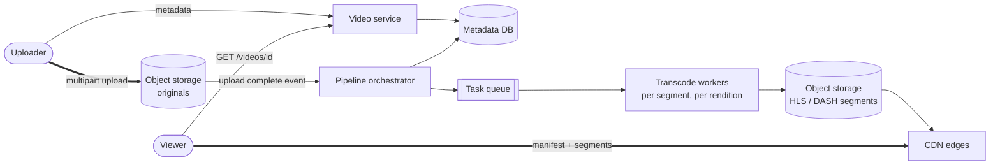
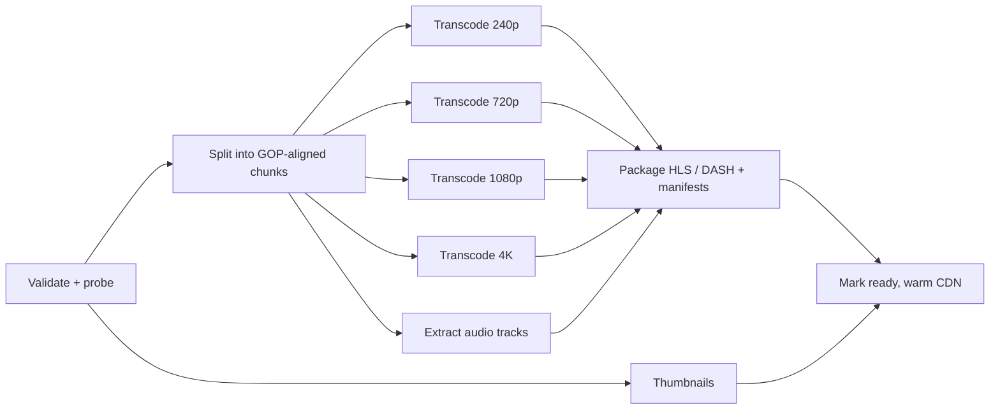

# Design YouTube / Netflix

## Requirements

**Functional**
1. Users upload videos.
2. Users watch videos, with playback that adapts to their network.
3. (Extension) Search videos by title; view counts.

**Non-functional**
- **Smooth playback:** fast start (under ~2 s) and minimal rebuffering on any network.
- **Huge uploads:** up to tens of GB, resumable.
- **Availability over consistency:** a new upload taking minutes to become watchable is fine.
- **Global scale:** ~1B DAU watching, ~500 hours uploaded per minute.

### Back-of-envelope estimates

| Quantity | Estimate | Implication |
|---|---|---|
| Uploads | ~500 hours/min ≈ 720k hours/day | A massive, parallel transcoding fleet |
| Storage per hour | ~1–3 GB original + ~5–10 GB for all renditions | Multiple PB per day before dedupe |
| Egress | 1B DAU × ~1 hour × ~2 Mbps avg ≈ 100s of Tbps at peak | Only a CDN can serve this; origin must be shielded |
| Metadata reads | Billions/day | Cache aggressively; this part is easy |

## Core entities

| Entity | Key fields | Store |
|---|---|---|
| Video | `video_id`, `uploader_id`, `title`, `description`, `status` (uploading → processing → ready), `duration`, `manifest_url` | Metadata DB (sharded MySQL / Cassandra) + cache |
| Rendition | `video_id`, `resolution`, `bitrate`, `codec`, segment prefix | Metadata; files in object storage |
| Segment | ~2–6 s chunk of one rendition | Object storage, served by the CDN |
| Upload | `upload_id`, part ETags, progress | Tracks resumable multipart state |

## API

```
POST /videos                    { title, description, sizeBytes }
     → { videoId, uploadId, partUrls: [presigned PUT URLs] }
PUT  {partUrl}                                                  (client → object storage)
POST /videos/{id}/complete      { parts: [{partNumber, etag}] } → 202 (processing)
GET  /videos/{id}               → { metadata, status, manifestUrl }   (e.g. https://cdn/.../master.m3u8)
GET  /search?q=&cursor=
```

## High-level design



**The processing pipeline is a DAG:**



**Playback:** the player fetches metadata, then the master manifest from the CDN, picks a rendition based on measured bandwidth and screen size, and fetches segments sequentially, switching renditions between segments as conditions change.

## Deep dives

### Uploading huge files reliably

- **Weak:** a single POST through the API servers: timeouts, no resume, and API servers carrying video bandwidth.
- **Best:** an **S3 multipart upload with presigned part URLs**. The client uploads ~10–100 MB parts in parallel and retries failed parts; it can resume by asking which parts are done. API servers handle only metadata.
- Verify part checksums; on `complete`, the object store assembles the parts and emits an event that starts the pipeline.

### Fast transcoding

- Transcoding a 2-hour 4K film serially takes hours. **Split it into chunks** at keyframe (GOP) boundaries and transcode the chunks **in parallel** across many workers, then concatenate. That's minutes instead of hours.
- Orchestrate with a workflow engine (Temporal, Step Functions) or a DAG scheduler: retries per task, idempotent outputs (deterministic object keys), and progress tracking.
- **Prioritize:** produce a low and a mid rendition first, so the video becomes watchable quickly; 4K and extra codecs (AV1, VP9) follow later.
- Use spot instances for workers; tasks are short and retryable.

### Adaptive bitrate streaming, explained

**The problem:** a single 1080p file stalls on a slow phone connection, and a single 360p file looks bad on a fiber-connected TV. Bandwidth also changes mid-video. ABR lets the player switch quality every few seconds.

**How it's built:** each rendition (e.g. 240p @ 400 kbps … 4K @ 16 Mbps) is cut into short **segments** of 2–6 s, all aligned at the same timestamps, so the player can switch between renditions at any segment boundary. A **manifest** lists everything.

An HLS **master playlist** lists the renditions:

```
#EXTM3U
#EXT-X-STREAM-INF:BANDWIDTH=800000,RESOLUTION=640x360,CODECS="avc1.4d401e,mp4a.40.2"
360p/index.m3u8
#EXT-X-STREAM-INF:BANDWIDTH=2800000,RESOLUTION=1280x720,CODECS="avc1.4d401f,mp4a.40.2"
720p/index.m3u8
#EXT-X-STREAM-INF:BANDWIDTH=5000000,RESOLUTION=1920x1080,CODECS="avc1.640028,mp4a.40.2"
1080p/index.m3u8
```

Each **media playlist** (e.g. `720p/index.m3u8`) lists that rendition's segments:

```
#EXTM3U
#EXT-X-TARGETDURATION:4
#EXTINF:4.0,
seg_00000.m4s
#EXTINF:4.0,
seg_00001.m4s
...
#EXT-X-ENDLIST
```

DASH (`.mpd`, XML) carries the same information; CMAF lets one set of segment files serve both HLS and DASH.

**How the player chooses (the ABR algorithm):**
- **Throughput-based:** measure how fast recent segments downloaded and pick the highest bitrate below ~80% of that. Reacts quickly but jumps around with noisy networks.
- **Buffer-based (e.g. BOLA):** pick quality from how many seconds of video are buffered: a low buffer means drop quality to avoid a stall; a full buffer means step up. More stable.
- Real players blend both, start at a conservative bitrate for a fast first frame, and avoid switching too often because visible quality flapping annoys viewers.
- Segment length trade-off: shorter segments react faster and start faster, but mean more requests and slightly worse compression.

### Why videos are split at keyframes (GOPs)

Video codecs don't store every frame in full. A **keyframe (I-frame)** is a complete picture; the frames after it (P/B-frames) store only differences from nearby frames. A **GOP** (group of pictures) is a keyframe plus its dependent frames, typically 2–4 seconds.

- A segment must **start with a keyframe**, otherwise the player has nothing to decode it from. So encoders force keyframes at fixed intervals (e.g. every 2 s) in *every* rendition, which keeps segments aligned across qualities for switching.
- The parallel transcoder splits the source at GOP boundaries for the same reason: each chunk decodes independently, so workers don't need each other's frames.

### Global delivery

- Segments are immutable, so they cache perfectly: a long TTL and no invalidation.
- **Popular content** is pushed ahead of time to edge caches, including ISP-embedded appliances (Netflix Open Connect). The **long tail** is pulled on demand through a regional "origin shield" layer, so the origin isn't hammered.
- Route viewers to the best edge with DNS/anycast plus client-side measurement.

### Metadata, view counts and search

- Video pages are read-heavy: cache metadata in Redis and at the edge.
- **View counts:** player heartbeats → Kafka → stream aggregation → periodic batched updates. Never increment a DB row per view; dedupe and filter bots in the stream.
- **Search:** index title, description, tags and captions in Elasticsearch, kept in sync with metadata via change data capture.

## Production readiness

### Database choice and consistency

- **Object storage for originals and segments.** Petabytes of immutable blobs, written once and read through the CDN. Nothing else is cost-effective at this size.
- **Metadata DB: sharded MySQL (or Vitess-style) by `video_id`, or Cassandra.** Video rows have a real state machine (`uploading → processing → ready`) and ownership checks, and the creator's dashboard needs "my videos" queries. Relational is the simpler choice for correctness on the creator side; the row count (hundreds of thousands of new videos per day) is high but partitions cleanly by `video_id`. Cassandra is a fine alternative if you accept doing the status transitions with lightweight transactions and maintaining a separate `uploader_id → videos` table.
- **Upload state** (part ETags, progress) lives with the object store's multipart session plus a small row per upload; it's short-lived.
- **View counts and watch history:** Kafka → stream aggregation → batched counters, explicitly BASE (deep dive).
- **ACID where it matters:** status transitions (a video must not show as `ready` before its manifest exists), takedowns and privacy changes (a video switched to private must stop being listed), and monetization-relevant data. **BASE:** view counts, search index, recommendations, CDN copies.
- **CAP:** playback is **AP**: if metadata is unreachable, serve the cached manifest URL; a slightly stale title is fine. Privacy and takedown changes lean **CP**: they must win over cached copies quickly, which is why manifests get short TTLs and are signed while segments are long-lived.

### Service boundaries and communication

- **Video service** (metadata, upload initiation), **pipeline orchestrator** + **transcode workers**, **playback/manifest service**, **search**, **view counting**. Transcoding is split out because it's 99% of compute, bursty, and runs on cheap preemptible capacity; it must never share resources with the metadata API.
- **Synchronous:** `POST /videos` (issue presigned URLs), `GET /videos/{id}`, segment fetches from the CDN. **Asynchronous:** everything after upload. `complete` returns `202`, the object-store event starts the DAG, tasks flow through a queue, and the creator is notified when the video is ready. Making a user wait on a multi-minute transcode would be wrong. View events, search indexing (CDC) and thumbnails are async too.

### Failure modes and reliability

| Failure | Effect | Mitigation |
|---|---|---|
| Spot/preemptible transcode workers reclaimed | Tasks die mid-chunk | Short per-chunk tasks, lease expiry, idempotent outputs under deterministic keys; retry with backoff; DLQ after N failures (see follow-up) |
| Corrupt or malicious upload | Workers crash repeatedly | Validate + probe first; run decoders in sandboxes with CPU/memory caps; failing videos go to a DLQ and the creator gets an error |
| Upload surge (major event) | Transcode backlog, slow time-to-watchable | Priority queues: low/mid renditions first; defer 4K and AV1 encodes; autoscale on queue age |
| CDN edge or provider outage | Rebuffering in a region | Multi-CDN or multiple edge tiers; client retries the next segment against an alternate host; ABR drops bitrate (graceful degradation is built into the player) |
| Long-tail misses flood origin | Origin storage throttled | Origin shield collapses concurrent misses for the same segment into one fetch; rate-limit per edge |
| Metadata DB shard down | Video pages fail for that shard | Read replicas plus Redis cache serve `GET /videos/{id}`; upload initiation for those IDs retries with backoff |

### High availability and disaster recovery

- **SPOFs:** the orchestrator (run it on a replicated workflow engine so state survives node loss), metadata primaries (per-shard standby across zones), and the upload endpoint (stateless, multi-region).
- **Regions:** playback is inherently multi-region via the CDN. Metadata is replicated to several regions for reads; writes go to the home region per shard. Transcoding can run in any region with capacity, so a regional loss only slows processing.
- **Originals are the irreplaceable asset**: renditions can be regenerated, but originals can't. Store originals with cross-region replication (or erasure coding across regions), and keep renditions single-region-redundant for long-tail videos.
- **RPO/RTO:** originals RPO 0 once `complete` has returned (the upload isn't acknowledged until durably stored). Metadata RPO under a minute. Playback RTO under 1 minute for a region (CDN rerouting); uploads and processing RTO under an hour, since creators tolerate delay far better than viewers do.

### Security

- **Authn/authz:** OAuth for creators; only the owner (or delegated channel managers) can edit, delete or change privacy. Presigned upload URLs are scoped to one `upload_id` and expire in hours.
- **Private and unlisted videos:** unguessable IDs aren't enough; use signed, expiring manifest URLs (and signed segment URLs or cookies for private and premium content), checked at the CDN edge.
- **Encryption:** TLS for all delivery and APIs; at-rest encryption for originals. DRM for premium content (follow-up). Signing keys for CDN URLs live in a secrets manager and are rotated with overlap, accepting both old and new keys for one TTL window so existing playback sessions don't break.
- **Audit:** log takedowns, privacy changes, and admin access to private videos.
- **Abuse:** per-account upload quotas and rate limits, content scanning (copyright fingerprinting, policy classifiers) as a pipeline stage before `ready`, and bot filtering for view counts so they can't be inflated.

### Observability

- **SLIs/SLOs:** video start time under 2 s for 95% of plays; rebuffering ratio (stall time / watch time) under 0.5%; 99.9% of segment requests succeed; 95% of uploads watchable at a low rendition within 10 minutes of `complete`.
- **Dashboards:** client-side QoE (startup time, rebuffers, average bitrate, errors) by region, ISP and device; CDN hit rate and origin egress; transcode queue age by priority; failure rate per pipeline stage; DLQ size.
- **Tracing:** one trace per upload through the DAG, so a slow video points at the stage; client beacons per playback session for QoE.
- **Paging:** burn rate on start time and rebuffering per region (symptoms viewers feel), segment error rate, and time-to-watchable. One worker pool losing spot capacity is not a page unless queue age breaches the SLO.

### Performance and cost

- **Bottleneck:** delivery. 1B DAU × 1 hour × 2 Mbps ≈ 900 PB/day, ~80 Tbps averaged and well past that at peak. CDN hit rate is the lever: every point of hit rate saves a large slice of origin egress. Push popular content to ISP-embedded caches; use origin shields for the long tail.
- **Storage:** 720k hours/day × (~6–13 GB) ≈ 4–9 PB/day, so on the order of 1.5–3.5 EB per year. Levers: cold-tier originals after processing; delete renditions of videos with no views for months and regenerate on demand (trade-off: a slow first play); skip 4K renditions for low-view videos.
- **Encoding:** better codecs (AV1/VP9) cut egress bitrate noticeably for the same quality but cost several times more compute to encode. Spend it only on videos popular enough that the egress savings repay it.
- **Compute:** spot capacity for transcoding saves a lot, at the cost of retries and longer tails for some jobs.

## Follow-up questions

### How do you make a video watchable as fast as possible after upload?
Stream-transcode while uploading (start processing parts as they arrive), transcode the lowest renditions first, and mark the video ready once a minimal ladder exists; higher renditions are appended to the manifest later.

### How would you support live streaming?
Ingest via RTMP/SRT to an ingest server, transcode in real time into a small bitrate ladder, package into short segments (1–2 s, or low-latency HLS/CMAF chunks), and publish a rolling manifest to the CDN. The trade-off is latency vs. stability: smaller segments mean lower latency but more requests and rebuffering risk.

### How do you prevent people from downloading or pirating premium content?
DRM (Widevine, FairPlay, PlayReady): segments are encrypted, and licenses are issued per session by a license server after an entitlement check. Add signed, expiring CDN URLs and forensic watermarking for premium content.

### A video goes viral overnight. What changes?
Its segments get pulled into more and more edge caches automatically. Proactively, detect the view spike and push its segments to more edges; make sure the origin shield absorbs cache misses. Metadata stays cache-served.

### Where do you store originals, and do you keep them forever?
Keep originals in object storage (moving to a cold tier after processing) so you can re-transcode later with better codecs. Generated renditions for rarely watched videos can be deleted and regenerated on demand to save storage.

### How do you recommend videos?
Candidate generation (collaborative filtering, embeddings of watch history) → ranking model (predicted watch time, engagement) → re-ranking for diversity and freshness. Train offline on watch logs, serve with a feature store, and A/B test changes.

### What happens if a transcode worker crashes mid-task?
The task's lease or visibility timeout expires, and another worker retries it. Outputs are written under deterministic keys, so a retry overwrites partial results. After N failures the task goes to a dead-letter queue and the video is flagged for inspection.

### How do you handle different devices (TV, phone, low-end Android)?
The manifest offers multiple codecs and resolutions; the client picks what it supports (e.g. AV1 on new devices, H.264 everywhere). Device profiles can cap the bitrate, e.g. no 4K on small screens.
